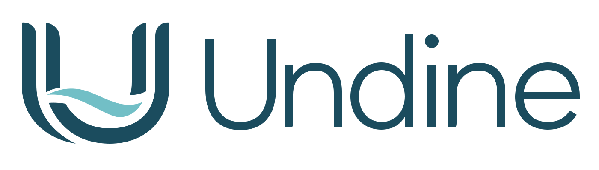
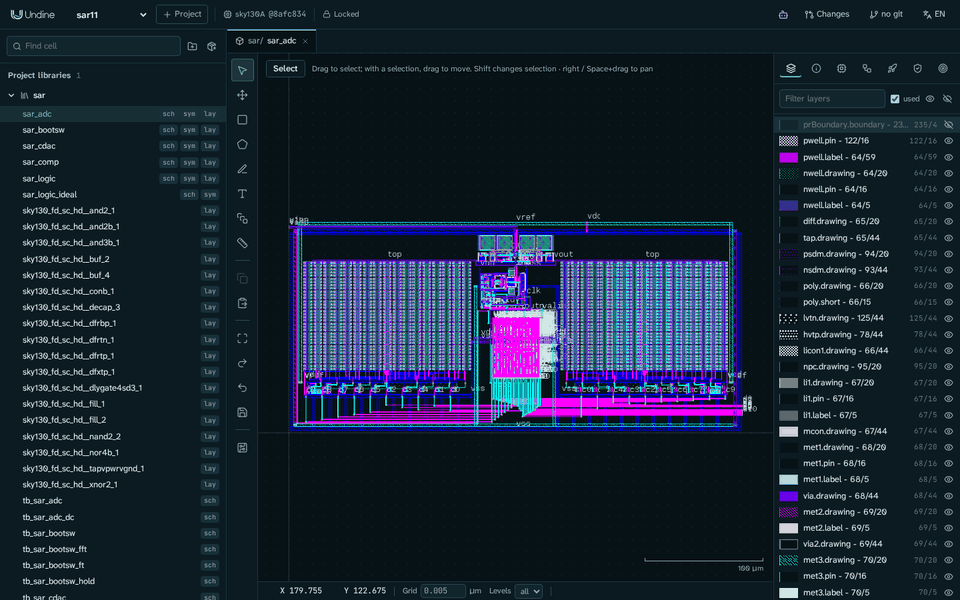
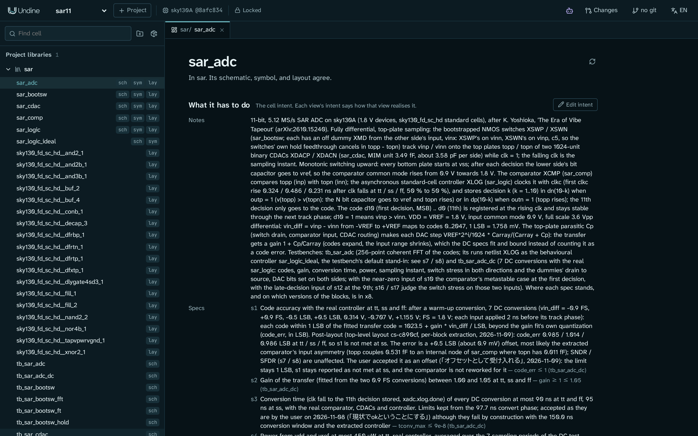
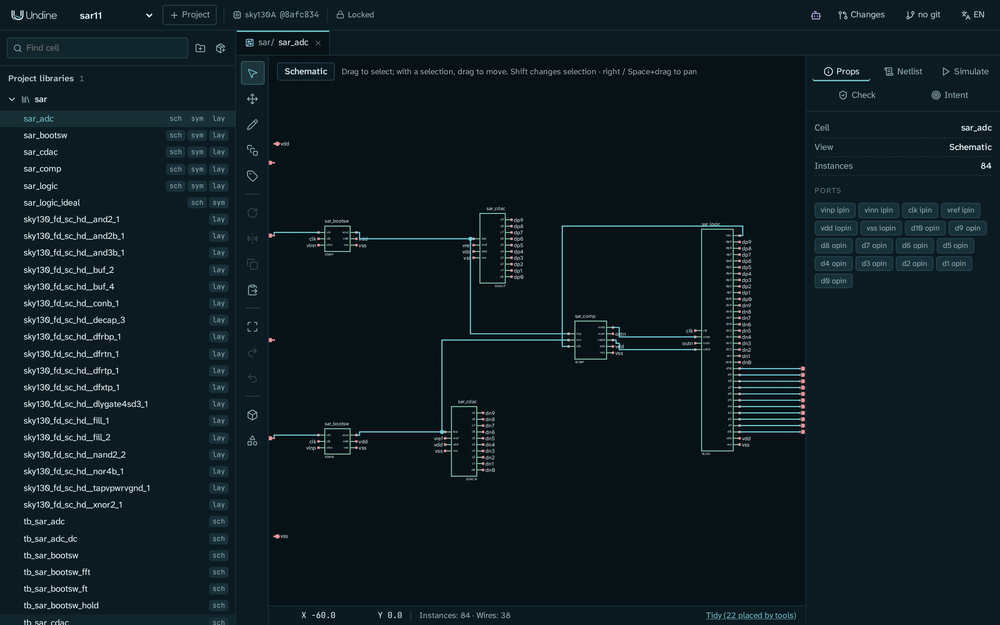
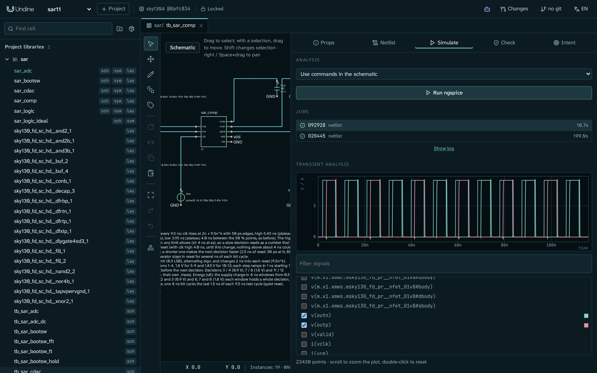
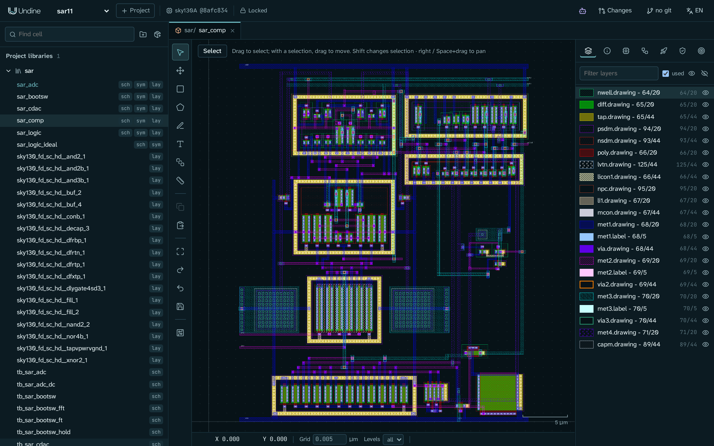
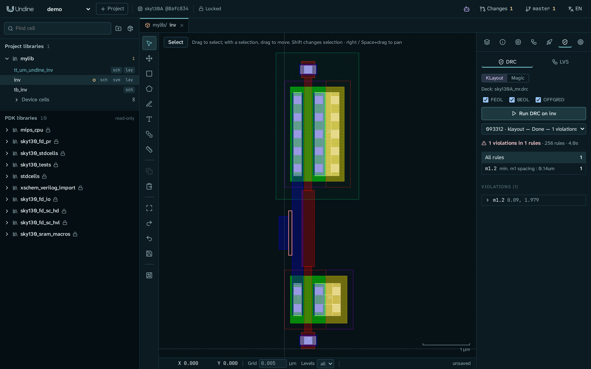
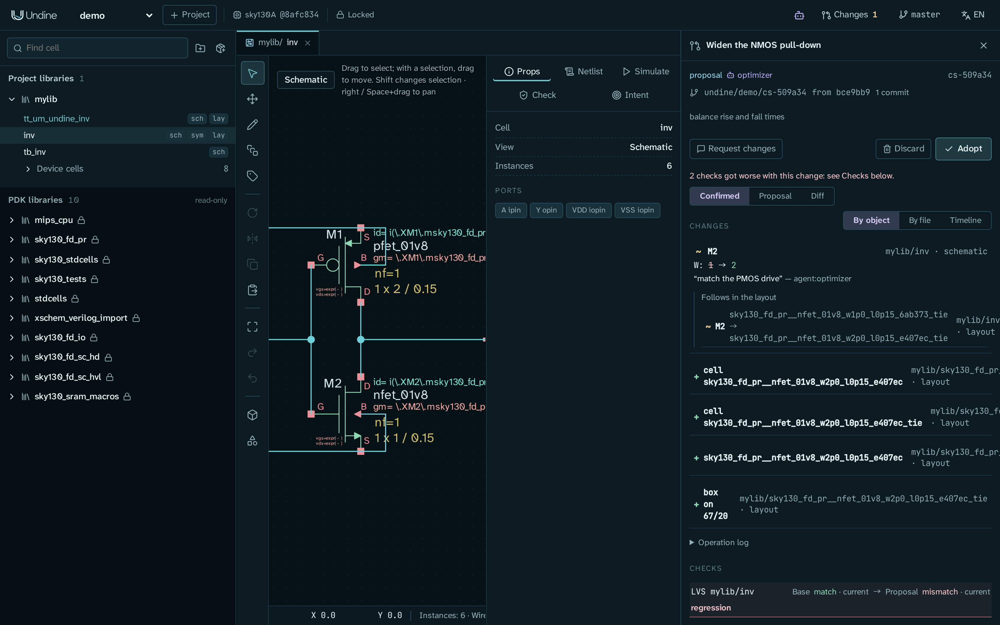

<p align="center">
  <picture>
    <source media="(prefers-color-scheme: dark)" srcset="web/public/brand/undine-logo-dark.svg">
    
  </picture>
</p>

<p align="center">
  <strong>An AI-native, web-based EDA environment for custom IC design.</strong><br>
  From schematic to tapeout in the browser, with one API that people, scripts and AI agents share.
</p>

<p align="center">
  <a href="LICENSE"></a>
  <a href="docs/getting-started/install.md#other-pdks"></a>
  <a href="docs/getting-started/connect-ai.md"></a>
  <a href="docs/roadmap.md"></a>
</p>

<p align="center">
  <a href="docs/index.md">Documentation</a> ·
  <a href="docs/index.ja.md">日本語</a> ·
  <a href="#getting-started">Getting started</a> ·
  <a href="docs/tutorials/inverter.md">Tutorial</a> ·
  <a href="docs/getting-started/connect-ai.md">Connect an AI agent</a> ·
  <a href="docs/roadmap.md">Roadmap</a> ·
  <a href="CONTRIBUTING.md">Contributing</a>
</p>

<p align="center">
  
</p>

<p align="center">
  <sub>An 11-bit SAR ADC designed in Undine with an AI agent: 0.067 mm² on SKY130, DRC and LVS clean. On each block's
  extracted layout at the tt corner it simulates at SNDR 67.09 dB, SFDR 81.62 dB and 245 µW
  (<a href="docs/tutorials/sar-adc.md">case study</a>, with its limits).</sub>
</p>

Undine (pronounced *uhn-deen*) is built for analog and mixed-signal design. The design database, the PDK, DRC / LVS and simulation run on a
server; the browser only draws. Everything the editor does is an HTTP call, so an AI agent can do it too, and its edits
arrive as a proposal that you review, check and adopt or discard.

> [!IMPORTANT]
> Undine is alpha software, and its server has no sign-in yet. Run it on your own machine or on a network you trust.

## Features

- **Design in the browser.** Xschem-compatible schematics; layout drawn from the PDK's layers and PCells, or generated
  from the schematic; Verilog and SystemVerilog per cell.
- **Verify on the server.** ngspice with specs measured at corners and temperatures; KLayout and Magic / Netgen DRC
  and LVS; parasitic extraction and simulation of the extracted layout.
- **Agents propose, people decide.** An MCP server for Claude Code and Claude Desktop, the `undine` command and a
  Python client. Each proposal is a changeset on its own git branch, with checks before and after.
- **Design intent.** Each cell carries its goals, constraints and specs, and checks and agents work from them.
- **Reproducible projects.** The PDK is pinned by commit and tree hash, libraries are packages pinned by content, and
  every edit is in an operation log and in git.
- **Three open PDKs and three shuttles.** SKY130, GF180MCU and IHP SG13G2 through
  [ciel](https://github.com/fossi-foundation/ciel); checks and submission bundles for Tiny Tapeout, wafer.space and
  ChipFoundry.

<table>
  <tr>
    <td width="50%"><br><sub><b>Cells and intent</b>: a cell's goals, constraints and specs</sub></td>
    <td width="50%"><br><sub><b>Schematic</b>: Xschem-compatible editing</sub></td>
  </tr>
  <tr>
    <td><br><sub><b>Simulation</b>: ngspice on the server, waveforms in the browser</sub></td>
    <td><br><sub><b>Layout</b>: server-rendered tiles in the PDK's layers</sub></td>
  </tr>
  <tr>
    <td><br><sub><b>DRC / LVS</b>: KLayout or Magic decks, markers in the layout</sub></td>
    <td><br><sub><b>Changesets</b>: an agent's proposal waiting for a person</sub></td>
  </tr>
</table>

## Getting started

### Prerequisites

- Linux x86-64, or Windows with WSL2
- [pixi](https://pixi.sh/); `./setup.sh` uses it to install Python, Node, ngspice, Xschem, Magic, Netgen and Verilator
- The [KLayout application](https://www.klayout.de/build.html) 0.30 or later
  ([per distribution](docs/getting-started/install.md#per-distribution))

### Install and run

```sh
git clone https://github.com/kadomoto-lab/undine-eda.git
cd undine-eda
./setup.sh                                          # environments, UI build, the sky130 PDK through ciel, a check
pixi run python -m undine new demo --pdk sky130A    # a project in ~/undine-projects
pixi run serve                                      # then open http://127.0.0.1:8700
```

> [!TIP]
> `./setup.sh check` (or `pixi run doctor`) says what is missing and the command that fixes it.

Then follow [Your first cell: an inverter](docs/tutorials/inverter.md): draw a schematic, simulate it and lay it out.

### Connect an AI agent

With Claude Code, register Undine once from the repository's directory:

```sh
claude mcp add --scope user undine -- "$PWD/.pixi/envs/default/bin/python" -m undine mcp-stdio
```

Then ask Claude for a change to a design, for example to size a cell for a delay spec, and review its proposal in
Undine. [Connect an AI agent](docs/getting-started/connect-ai.md) covers Claude Desktop, other MCP clients and the
in-app agent; [Design with an AI agent](docs/tutorials/agent.md) walks through a whole session.

## Documentation

The documentation is in [`docs/`](docs/index.md), in English and Japanese, and builds into a site with
`pixi run -e docs docs-serve`.

- **Start:** [Install](docs/getting-started/install.md) · [First project](docs/getting-started/first-project.md) ·
  [Overview](docs/overview.md)
- **Tutorials:** [An inverter](docs/tutorials/inverter.md) · [With an AI agent](docs/tutorials/agent.md) ·
  [Tiny Tapeout](docs/tutorials/tiny-tapeout.md) · [Case study: an 11-bit SAR ADC](docs/tutorials/sar-adc.md)
- **Guides:** [Cells and intent](docs/guide/cells.md) · [Schematic](docs/guide/schematic.md) ·
  [Layout](docs/guide/layout.md) · [Simulation and RTL](docs/guide/rtl.md) · [Verification](docs/guide/verification.md) ·
  [Changesets](docs/guide/changesets.md) · [PDKs](docs/guide/pdks.md) · [Libraries](docs/guide/libraries.md) ·
  [Tapeout](docs/guide/tapeout.md)
- **Reference:** [Command line](docs/reference/cli.md) · [Data on disk](docs/reference/data.md) ·
  [HTTP API](docs/reference/api.md)
- **Help:** [Troubleshooting and FAQ](docs/troubleshooting.md) · [Issues](https://github.com/kadomoto-lab/undine-eda/issues)

日本語のドキュメントは [ホーム](docs/index.ja.md) から。すべてのページに日本語版があります。

## Built on

[KLayout](https://www.klayout.de/), [Xschem](https://xschem.sourceforge.io/), [ngspice](https://ngspice.sourceforge.io/),
[Magic](http://opencircuitdesign.com/magic/), [Netgen](http://opencircuitdesign.com/netgen/),
[Verilator](https://www.veripool.org/verilator/), [LibreLane](https://github.com/librelane/librelane),
[OpenVAF](https://openvaf.semimod.de/), [open_pdks](https://github.com/RTimothyEdwards/open_pdks),
[ciel](https://github.com/fossi-foundation/ciel) and the open PDKs from SkyWater, GlobalFoundries and IHP. Their
licenses are listed in [Licenses](docs/licenses.md).
