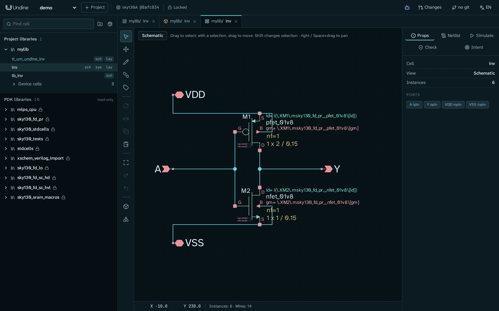
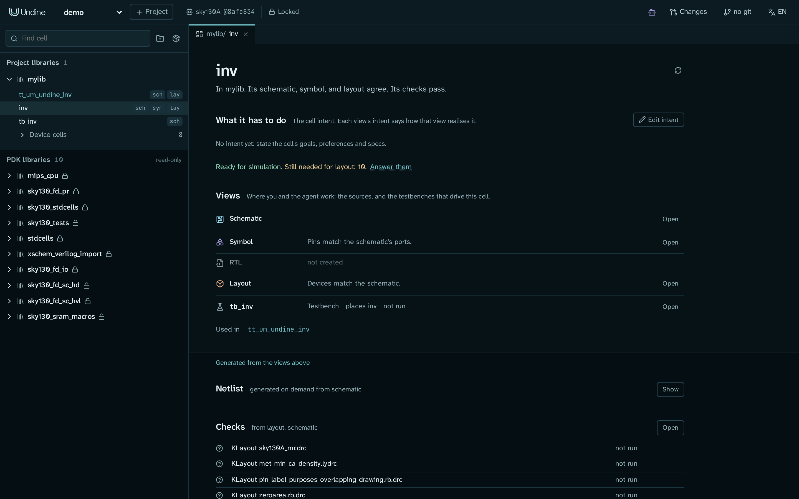
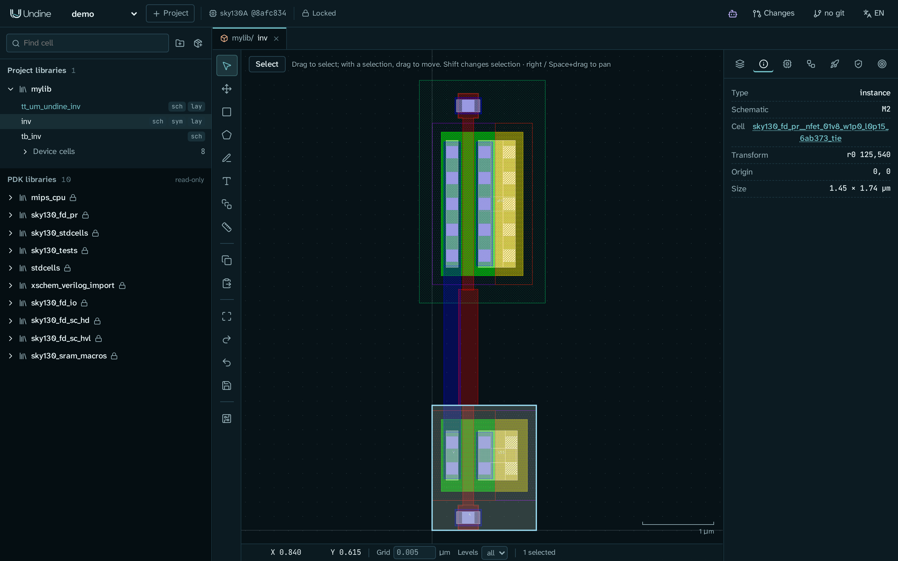
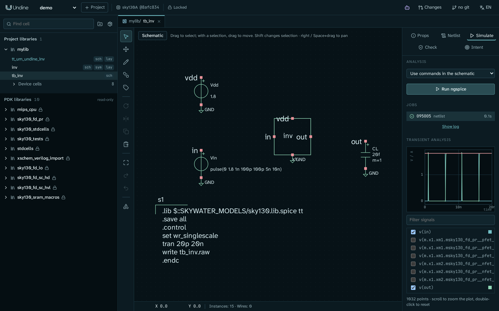

# 最初のプロジェクト

このページは Undine をひと回りする案内です。プロジェクトを作り、サーバーを起動し、例のスクリプトでデモの設計を作って、
ブラウザで見ていきます。ライブラリブラウザ、セルのページ、回路図、レイアウト、シミュレーションです。終わったときには、
何がどこにあるか(画面上でも、ディスク上でも)がわかっています。

ここでは何も描きません。スクリプトが CMOS インバータ、そのテストベンチ、配線済みのレイアウト、それを入れた Tiny Tapeout の
タイルを作ります。セルを自分で描くのは [最初のセル: インバータ](../tutorials/inverter.md) です。

所要時間は約 15 分で、ほとんどは読む時間です。

<a id="before-you-start"></a>
## 始める前に

次のものが必要です:

- sky130A の PDK を含めてインストールした Undine。[インストール](install.ja.md) を参照してください。`./setup.sh check`
  (または `pixi run doctor`)で、足りないものがわかります。
- Undine のチェックアウト先で開いたターミナル。このページの例では `~/undine-eda` としています。
- 同じマシンの Web ブラウザ。

<a id="1-create-a-project"></a>
## 1. プロジェクトを作る

プロジェクトは、ライブラリとセルを入れるディレクトリで、PDK のある 1 つのバージョンに固定されます。sky130A で `demo` という
名前のプロジェクトを作ります:

```sh
cd ~/undine-eda
pixi run python -m undine new demo --pdk sky130A
```

次のように表示されます:

```text
created /home/you/undine-projects/demo (pdk sky130A@8afc8346a57f)
```

`--pdk sky130A` は、インストールされている sky130A のうち Undine がテストしているバージョンを選び、プロジェクトはそのバージョン
(`sky130A@8afc8346a57f`)を `project.json` に記録します。`set-pdk` で進めるまで([コマンドラインと設定](../reference/cli.ja.md#command-line))、
プロジェクトはこのバージョンを使い続けます。そのため、何か月たっても設計は同じようにシミュレーションでき、同じように検証できます。

!!! note "プロジェクトの置き場所"
    プロジェクトは、既定では `~/undine-projects` に置かれます。別の場所に置くには、Undine に使うすべてのターミナルで `UNDINE_ROOT`
    を設定します(たとえば `export UNDINE_ROOT=~/chips`)。サーバーと例のスクリプトが同じディレクトリを見ている必要があります。
    [設定](../reference/cli.ja.md#configuration-environment) を参照してください。

<a id="2-start-the-server"></a>
## 2. サーバーを起動する

Undine はサーバーです。設計データベース、PDK、PCell、DRC / LVS、シミュレーションはすべてサーバーで動き、ブラウザは描画するだけです。
サーバーを起動します:

```sh
pixi run serve
```

1 行を表示したあと、動き続けます:

```text
undine: 2 PDKs, projects in /home/you/undine-projects
```

PDK の数は、何をインストールしたかによります(`setup.sh` は sky130A と sky130B をインストールします)。このターミナルは開いたままに
してください。サーバーは、そこで Ctrl+C を押すまで動きます。次の手順のコマンドには、**2 つ目のターミナル** を開きます。

!!! tip "ポートが使われている場合"
    `pixi run serve` は `127.0.0.1:8700` で待ち受けます。ほかのプログラム(または別の Undine)がすでにそのポートを使っている場合は、
    別のポートで起動します: `pixi run python -m undine serve --port 8701`。以下のアドレスでも、そのポートを使ってください。

<a id="3-open-undine-in-your-browser"></a>
## 3. ブラウザで Undine を開く

同じマシンのブラウザで **<http://127.0.0.1:8700>** を開きます。

!!! tip "Windows で Undine を WSL の中で動かしている場合"
    このアドレスを Windows のブラウザで開きます。WSL2 は、Windows の `127.0.0.1` を WSL の中のサーバーへ転送します。

Undine のウィンドウが表示されます。左上のプロジェクトの一覧で `demo` が選ばれていなければ、選びます(ウィンドウは一覧の最初の
プロジェクトを開きます)。左側の **ライブラリブラウザ** には、**PDK ライブラリ**(*読み取り専用* の印付き)だけが並んでいます。
PDK のデバイスのシンボル(`sky130_fd_pr`)、標準セル、そのほかの Xschem のライブラリです。プロジェクト自身のライブラリはまだありません。

!!! tip "ブラウザでプロジェクトを作る"
    プロジェクトの一覧の横にある **+ プロジェクト**(**+ Project**)ボタンでも、手順 1 と同じようにプロジェクトを作れます。
    **新しいプロジェクト** が開くので、**名前** を入力し、**PDK（このバージョンに固定）** を選んで **作成** をクリックします。
    PDK のバージョンが複数インストールされている場合は、一覧のバージョンが意図したものか確認してください。

<a id="4-build-the-demo-designs"></a>
## 4. デモの設計を作る

2 つ目のターミナルで、`~/undine-eda` にいるまま、3 つの例のスクリプトをこの順に実行します:

```sh
pixi run python examples/make_inverter.py demo mylib     # inverter schematic, symbol and testbench
pixi run python examples/route_inverter.py demo mylib    # the inverter's layout, routed, then LVS
pixi run python examples/make_tt_inverter.py demo mylib  # a Tiny Tapeout tile around the inverter
```

最初の 2 つの引数は、プロジェクトとライブラリです。ライブラリ `mylib` は、なければ作られます。

| スクリプト | 作るもの | 表示される内容 |
|---|---|---|
| `make_inverter.py` | セル `inv`(回路図とシンボル。PMOS と NMOS が 1 つずつ、ポートは `A`、`Y`、`VDD`、`VSS`)と、テストベンチ `tb_inv` | `wrote .../libs/mylib/inv.sch`、`inv.sym`、`tb_inv.sch` の 3 行 |
| `route_inverter.py` | `inv` のレイアウト。トランジスタを回路図から PDK の PCell として生成し、Design API を通して手で配線します。続いて LVS を実行します | 約 30 秒後に `done {"match": true, ...}` と、比較したデバイス、ピン、ネットがそれぞれ `Match` |
| `make_tt_inverter.py` | `tt_um_undine_inv`。1x2 の Tiny Tapeout のアナログタイルで、インバータを `ua[0]` から `ua[1]` へつないだもの | 何も表示されません。約 40 秒で戻ります |

`make_inverter.py` はファイルを直接書きます。残りの 2 つは動いているサーバーも使うので、手順 2 のサーバーが、同じマシンで、
同じ `UNDINE_ROOT` で動いている必要があります。これらのスクリプトは、プロジェクトのファイルの一部を自分で読み書きするからです。
スクリプトは何度実行しても安全です。どれも、自分のセルを一から作り直します。

!!! note "サーバーが別のポートで動いている場合"
    `route_inverter.py` と `make_tt_inverter.py` は、3 番目の引数にサーバーのアドレスを取ります。たとえば
    `pixi run python examples/route_inverter.py demo mylib http://127.0.0.1:8701` です。

!!! tip "`pixi run` を省く"
    `pixi shell` で、Undine の環境を有効にしたシェルを開けます。そこでは `pixi run` を省略できます
    (`python -m undine serve`、`python examples/make_inverter.py demo mylib`)。

ここでブラウザの **ページを再読み込み** します(F5)。ライブラリブラウザに新しいグループ **プロジェクトのライブラリ** ができ、
`mylib` が入っています。開いていなければ `mylib` をクリックして展開します。次のものが表示されます:

- `tt_um_undine_inv`(`sch`、`lay`): Tiny Tapeout のタイル。最上位セルとして強調表示されます(ほかのどのレイアウトのセルも
  これを置いていません)。
- `inv`(`sch`、`sym`、`lay`): インバータ。
- `tb_inv`(`sch`): そのテストベンチ。
- **デバイスのセル**(8): レイアウトのために生成した PCell のセル(トランジスタとビア)。1 行にまとめて畳まれています。

<a id="5-take-a-tour-of-the-window"></a>
## 5. ウィンドウをひと回りする

エディタの領域はまだ空です。まだどのセルも開いていません。手順 6 から 8 でインバータを開くと、ウィンドウは次のようになります:



**上部バー**(左から右へ):

| 項目 | 働き |
|---|---|
| プロジェクトの一覧(`demo`) | プロジェクトを切り替えます |
| **+ プロジェクト**(**+ Project**) | プロジェクトを作ります |
| PDK のバッジ(`sky130A @8afc834`) | プロジェクトが固定されている PDK のバージョン。クリックすると、`undine.lock` と比べた状態、PDK がないときの **取得...**、**PDK を再検出** が出ます([PDK](../guide/pdks.ja.md#how-a-project-pins-its-pdk)) |
| **バージョン固定済み**(**Locked**) | PDK と依存関係が `undine.lock` と一致しています。一致しなければ、不一致の件数を表示します。ツールのバージョンの違いは、そのダイアログに出る警告で、不一致には数えません([ライブラリと依存関係](../guide/libraries.ja.md#undinelock)) |
| エージェントのボタン(ロボットのアイコン) | アプリ内の **エージェント**(**Agent**)パネルを表示したり隠したりします。ここで設計について AI に質問したり、作業を頼んだりします([設計エージェントと MCP](../guide/assistant.ja.md#agent-in-app)) |
| **変更**(**Changes**) | changeset の一覧を開きます。changeset は(エージェントの、または自分の)提案で、確認してから採用 (Adopt) または破棄します([変更セット (changeset)](../guide/changesets.ja.md)) |
| git のボタン(**git なし**、またはブランチ名) | **履歴** パネルを開きます。コミットと未コミットの変更を、セルごとに表示します([git の履歴](../guide/history.ja.md)) |
| 言語の一覧(**EN** / **JA**) | 表示を英語と日本語で切り替えます([表示言語](../guide/language.ja.md)) |

**ライブラリブラウザ**(左)。**セルを検索** で、すべてのライブラリのセルを名前で絞り込みます。その横のボタンと、自分の各ライブラリの
ボタンで、ライブラリやセルを作ります([自分の設計を始める](#start-a-design-of-your-own))。セルの行では:

- **名前** をクリックすると、そのセルの **セルのページ** が開きます。
- `sch`、`sym`、`rtl`、`lay` をクリックすると、そのビューが直接開きます。

**エディタのタブ**(中央)。開いたビューごとにタブができ、ライブラリとセルの名前と、ビューのアイコンが付きます。開いているタブは、
プロジェクトごとにブラウザが覚えています。`http://127.0.0.1:8700/#/p/demo/o/mylib/inv/schematic` の形のリンクで、1 つのビューを
直接開けます(最後の部分は `cell`、`schematic`、`symbol`、`rtl`、`layout` のどれか)。ブックマークに便利です。

**サイドパネル**(右)。エディタごとに、それぞれのサイドパネルがあります。回路図エディタのサイドパネルには **属性**(**Props**)、
**ネットリスト**(**Netlist**)、**シミュレーション**(**Simulate**)、**整合性**(**Check**)、**意図**(**Intent**)のタブがあります。
レイアウトエディタのサイドパネルはアイコンのタブで、ポインタを合わせると名前が表示されます: **レイヤー**、**属性**、**PDK PCell**、
**回路図からレイアウトを生成**、**テープアウト: シャトル検査と出力一式**(ロケット)、**DRC / LVS**(盾)、**意図**。

<a id="6-open-the-inverters-cell-page"></a>
## 6. インバータのセルのページを開く

ライブラリブラウザで名前 `inv` をクリックします。**セルのページ** が開きます:



上から順に:

- セルの名前と、今どうなっているかを述べる文: *mylib のセル。回路図、シンボル、レイアウトは一致しています。検証はすべて合格しています。*
- **このセルがすべきこと**: セルの設計の意図(目標、仕様、制約)。デモにはまだありません: *意図はまだありません*。
  **意図を編集** でエディタが開きます。その下の行は、各段階の前に意図にまだ足りないものを示します(*シミュレーションの準備ができています。
  レイアウトに必要な情報があと 10 件あります。*)。**回答する** でその質問が開きます。今はそのままで構いません。
- **ビュー**: 回路図、シンボル(*ピンは回路図のポートと一致しています。*)、RTL(*未作成*)、レイアウト(*デバイスは回路図と一致しています。*)、
  テストベンチ `tb_inv`(手順 9 でシミュレーションするまでは *未実行*)。それぞれ **開く** で開きます。*使用先* は `inv` を置いているセルを示します:
  `tt_um_undine_inv`。
- アクアの線(**水面線**)の下に、ビューから生成されるものが並びます。**ネットリスト**(**表示**)と **検証** です。**KLayout LVS** は
  *一致* で *最新* です。これは `route_inverter.py` が実行した LVS で、今のレイアウトに対するものです。DRC のデッキは *未実行* です。

セルのページと設計の意図については、[セル、意図、ビュー](../guide/cells.ja.md) で詳しく説明しています。

<a id="7-open-the-schematic"></a>
## 7. 回路図を開く

`inv` の行の `sch` をクリックします(またはセルのページの **回路図** の横の **開く**)。インバータが表示されます。上に PMOS `M1`、
下に NMOS `M2`、ポート `A`、`Y`、`VDD`、`VSS` です。

- `M2` をクリックします。**属性** に、そのシンボル(`sky130_fd_pr/nfet_01v8.sym`)と属性 `W`、`L`、`nf` ... が表示されます。
- **ネットリスト** のタブをクリックします。セルの SPICE ネットリストが、`XM1` と `XM2` とその寸法(`W=2` と `W=1`、`L=0.15`)とともに
  表示されます。
- **F** を押すと、図面がウィンドウに収まります。スクロールで拡大・縮小し、右ボタンのドラッグ(または Space+ドラッグ)で移動します。

!!! warning "回路図の編集はすぐに保存されます"
    回路図エディタは、編集のたびにすぐ `.sch` ファイルに書き込みます(Undo で戻せます)。デモでは自由に試してください。
    `make_inverter.py` でまた作り直せます。

キーとツールは [回路図エディタ](../guide/schematic.ja.md) のガイドにあります。

<a id="8-open-the-layout"></a>
## 8. レイアウトを開く

`inv` の行の `lay` をクリックします。レイアウトには、PMOS が NMOS の上にあり、ポリのゲートでつながり、li1 と met1 で配線されているのが
表示されます。レイヤーは PDK のもので、**レイヤー** のタブに一覧があります。

- 下のトランジスタをクリックし、続いて **属性** のタブ(*i* のアイコン)をクリックします。生成された PCell のセルの *インスタンス* であることと、
  **回路図** `M2` が表示されます。レイアウトは、自分がどの回路図のデバイスから生成されたかを知っています。
- **F** で全体を表示します。スクロールで拡大・縮小し、中ボタンまたは右ボタンのドラッグで移動します。
- インスタンスをダブルクリックすると、そのセルが別のタブで開きます。



!!! warning "レイアウトの編集は保存を待ちます"
    回路図エディタと違い、レイアウトエディタは編集のたびにセルの `.oas` ファイルへ書き込みはしません。選択があるときは左ドラッグで
    それを動かすので、うっかりしたドラッグも編集になります。Ctrl+S(または図面の左のツールバーの保存ボタン)を押すと、セルのファイルに
    書き込みます。それまで編集はサーバーの操作ログに保たれ、再起動しても残ります。Undo(U または Ctrl+Z)で編集を戻せます。

**DRC / LVS** のタブ(盾のアイコン)で、このセルの DRC と LVS を実行します。次にタイルを開きます。`tt_um_undine_inv` の行の `lay` を
クリックし、縮小して 1x2 のタイル全体を見ます。met4 のピンと電源ストライプがあり、インバータは右下の近くにあります。描画、回路図駆動
レイアウト、DRC、LVS については、[レイアウトエディタ](../guide/layout.ja.md) と [検証](../guide/verification.ja.md) のガイドで説明しています。

<a id="9-run-a-simulation"></a>
## 9. シミュレーションを実行する

テストベンチ `tb_inv` は、1.8 V の電源、入力のパルス、20 fF の負荷でインバータを駆動します。そのコードブロックは、sky130 のモデルの
typical コーナーで 20 ns の過渡解析を実行します。

1. `tb_inv` の行の `sch` をクリックします。
2. サイドパネルで **シミュレーション**(**Simulate**)をクリックします。
3. **解析** は **回路図内のコマンドを使用** のままにして、**ngspice を実行** をクリックします。

実行は **ジョブ** の下に表示され、終わると(1、2 秒で)チェックの印が付きます。その下のプロットは *Transient Analysis* という見出しで、
最初のいくつかのノード電圧 `v(in)`、`v(out)`、`v(vdd)` を示します。入力が切り替わるたびに出力が切り替わります。プロットの上で
スクロールすると変化点を拡大でき、ダブルクリックで元に戻ります。プロットの下の一覧で、信号のチェックを付けたり外したりします
(**信号を絞り込む** で一覧を絞れます)。



ngspice はブラウザではなくサーバーで動きます。`inv` のセルのページのタブに戻ると、`tb_inv` の行に *最後のシミュレーション: done* と
*最新* が表示されています。ほかの解析(AC、DC スイープ、動作点)は [回路図エディタ](../guide/schematic.ja.md) のガイドで、コーナーで
測る仕様、レイアウト後シミュレーション、スイープは [検証](../guide/verification.ja.md) で説明しています。

<a id="10-find-your-files-on-disk"></a>
## 10. ディスク上のファイルを見つける

Undine がプロジェクトについて知っていることは、すべてそのディレクトリに普通のファイルとして入っています:

```text
~/undine-projects/demo/
    project.json          the project: its name, the pinned PDK, its libraries
    undine.lock           the PDK and tool versions the project is locked to
    libs/mylib/
        inv.sch, inv.sym  the schematic and the symbol, in Xschem format
        inv.netlist.yaml  the schematic's netlist view (its connectivity)
        inv.oas           the inverter's layout (OASIS), one file per cell
        tb_inv.sch, tt_um_undine_inv.sch, tt_um_undine_inv.oas, ...
    history/mylib.jsonl   the operation log: who changed what, and why
    runs/<job>/           each simulation, DRC and LVS run: inputs, netlists, logs, results
    changesets/           the changesets and what they leave behind
```

Xschem は `libs/mylib` をそのまま開けます。KLayout も `.oas` ファイルを読めますが、各ファイルは 1 つのセルだけを持ち、置いているセルは
中身なしで名前だけを記録しています。階層全体を見るには、ライブラリのすべてのファイルを 1 つのレイアウトに読み込みます
([レイアウトのセルのファイル](../reference/data.ja.md#layout-cell-files))。changeset、テープアウトのバンドル、エージェントのファイルを含む
全体の配置は [データの配置](../reference/data.ja.md#data-layout-server-side) にあります。

<a id="11-put-the-project-in-git"></a>
## 11. プロジェクトを git で管理する

changeset([エージェントのチュートリアル](../tutorials/agent.md) で確認する提案)は git のブランチなので、ここでプロジェクトを git で
管理しておきます。

1. 手順 8 でレイアウトを変更した場合は、先に保存します(そのタブで Ctrl+S)。保存していないレイアウトの編集があるあいだは、
   **git をセットアップ** は最初のコミットを作りません。
2. **git なし** と表示されている git のボタンをクリックします。**履歴** パネルが開きます。
3. **git をセットアップ** をクリックし、ダイアログで確認します。

Undine は `git init` を実行し、`.gitignore` と `.gitattributes` を加え、差分とマージのドライバを登録して、プロジェクトのファイルを
最初のコミットにします。以後、ボタンにはブランチ名が表示されます。[git の履歴](../guide/history.ja.md) を参照してください。

<a id="12-stop-the-server"></a>
## 12. サーバーを止める

サーバーが動いているターミナルで Ctrl+C を押します。回路図の編集はすでにファイルに入っています。変更したレイアウトは止める前に
保存してください(Ctrl+S)。ただし、保存していないレイアウトの編集も操作ログに保たれ、再起動後に戻ってきます。サーバーは、必要に
なったらいつでも `pixi run serve` で起動し直せます。実行中のシミュレーションはそのまま続き、次に起動したサーバーが引き継ぎます
([サーバーの再起動](../reference/cli.ja.md#restarting-the-server))。

<a id="start-a-design-of-your-own"></a>
## 自分の設計を始める

自分のセルで作業する準備ができたら:

- **新しいライブラリ:** ライブラリブラウザの上部にあるフォルダーのボタン(**新しいライブラリ**)。
- **ライブラリの依存関係:** その横のパッケージのボタン(**依存ライブラリを追加**)。git のリポジトリにあるライブラリを、
  コミットに固定して使います([ライブラリと依存関係](../guide/libraries.ja.md))。
- **新しいセル:** ライブラリの **+** ボタン(**新しいセル**)。名前と、作るビュー(回路図、シンボル、RTL、レイアウト)を指定します。
- **既存のセル:** ライブラリのインポートのボタン(**既存セルをインポート**)。Xschem の `.sch` か `.sym`、または `.gds`、`.oas`、
  `.oasis` のレイアウトを、サーバー上のパスから取り込みます。パスは、既定ではホームディレクトリの中になければなりません
  (`serve --import-root DIR` でほかのディレクトリも許可できます。[コマンドラインと設定](../reference/cli.ja.md#command-line) を参照)。
  レイアウトはコマンドラインからも取り込めます:

    ```sh
    pixi run python -m undine import demo mylib chip.gds
    ```

<a id="what-you-learned"></a>
## 学んだこと

- プロジェクトは `~/undine-projects`(`UNDINE_ROOT`)の下のディレクトリで、PDK のある 1 つのバージョンに固定されます。
- 仕事をするのはサーバー(データベース、PDK、PCell、検証、シミュレーション)で、<http://127.0.0.1:8700> のブラウザは描画します。
- ライブラリブラウザから、セルの **セルのページ**(名前をクリック)や、そのビューの 1 つ(`sch`、`sym`、`rtl`、`lay`)を開きます。
- セルのページは、セルのビューが一致しているか、検証とシミュレーションがどうなっているかを示します。
- シミュレーションは、テストベンチの回路図で **シミュレーション** → **ngspice を実行** で実行します。
- 設計は普通のファイルです。Xschem の回路図とシンボル、OASIS のレイアウトのセル、YAML のネットリスト、操作ログです。

<a id="next-steps"></a>
## 次のステップ

チュートリアル:

- [最初のセル: インバータ](../tutorials/inverter.md): 回路図を描き、シミュレーションし、レイアウトを自分で作ります。
- [AI エージェントと設計する](../tutorials/agent.md): セルの意図を書き、エージェントにセルの寸法を決めてもらい、その提案を確認して
  採用します。
- [Tiny Tapeout でアナログタイルをテープアウトする](../tutorials/tiny-tapeout.ja.md): `tt_um_undine_inv` に、シャトルのチェック、
  サインオフ一式、エクスポートのバンドルを通します。
- [事例: 11 ビット SAR ADC](../tutorials/sar-adc.ja.md): Undine で作った、ミックスドシグナルの設計の全体です。

Claude Desktop、Claude Code、またはほかの AI アプリをつなぐには、[AI エージェントをつなぐ](connect-ai.ja.md) に従ってください。

ユーザーガイドでは、各エディタと作業の流れを詳しく説明しています。このページで案内したのは、[セル、意図、ビュー](../guide/cells.ja.md)、
[回路図エディタ](../guide/schematic.ja.md)、[レイアウトエディタ](../guide/layout.ja.md)、[検証](../guide/verification.ja.md)、
[変更セット (changeset)](../guide/changesets.ja.md)、[git の履歴](../guide/history.ja.md) です。リファレンスは
[コマンドラインと設定](../reference/cli.ja.md) から始まり、すべてのコマンドと設定を載せています。
