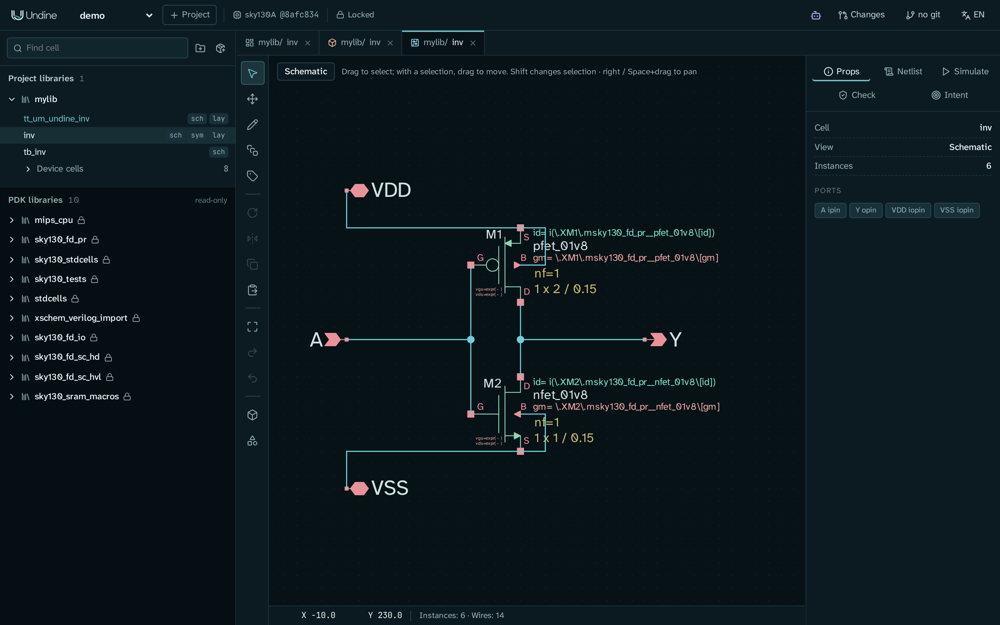
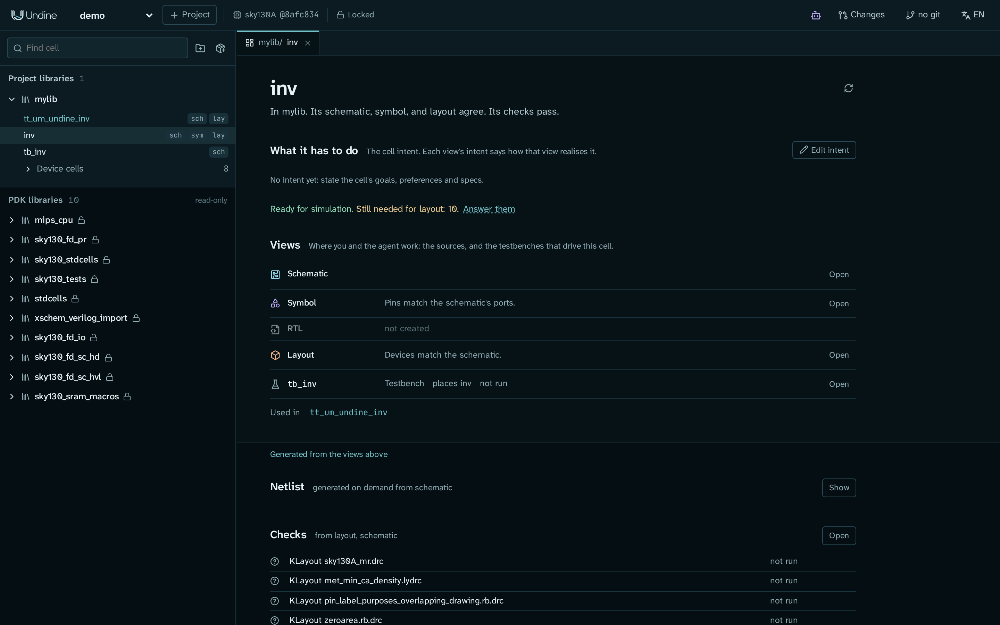
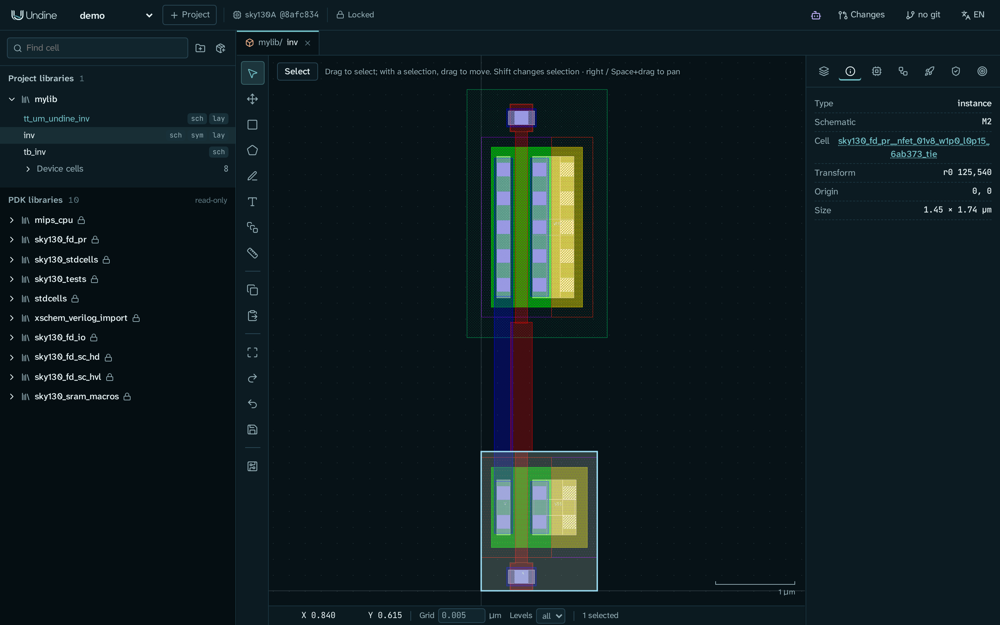
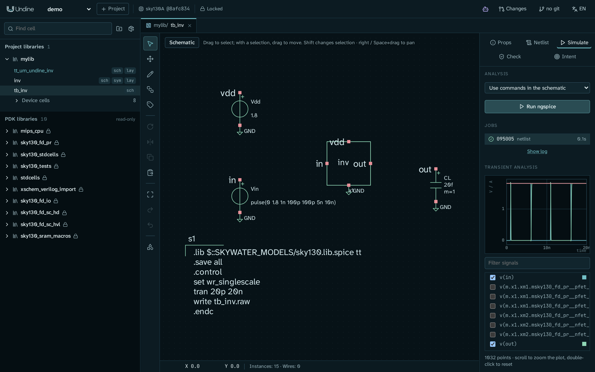

# First project

This page is a quick tour of Undine. You create a project, start the server, build the demo designs with the example
scripts, and look at them in the browser: the library browser, a cell page, a schematic, a layout and a simulation.
At the end you know where everything is, on screen and on disk.

You do not draw anything here: the scripts build a CMOS inverter, its testbench, its routed layout and a Tiny Tapeout
tile around it. [Your first cell: an inverter](../tutorials/inverter.md) is where you draw a cell yourself.

The tour takes about 15 minutes, most of it reading.

## Before you start

You need:

- Undine installed, with the sky130A PDK. See [Install](install.md). `./setup.sh check` (or `pixi run doctor`) tells you
  what is missing.
- A terminal in your checkout of Undine. The examples on this page use `~/undine-eda`.
- A web browser on the same machine.

## 1. Create a project

A project is a directory that holds your libraries and cells, pinned to one exact version of a PDK. Create one named
`demo` on sky130A:

```sh
cd ~/undine-eda
pixi run python -m undine new demo --pdk sky130A
```

You should see:

```text
created /home/you/undine-projects/demo (pdk sky130A@8afc8346a57f)
```

`--pdk sky130A` picks the installed version of sky130A that Undine is tested with, and the project records that exact
version (`sky130A@8afc8346a57f`) in its `project.json`. The project keeps it until you move it on with `set-pdk`
([Command line and configuration](../reference/cli.md#command-line)), so the design simulates and verifies the same way months later.

!!! note "Where projects are kept"
    Projects live in `~/undine-projects` by default. To keep them elsewhere, set `UNDINE_ROOT`
    (for example `export UNDINE_ROOT=~/chips`) in every terminal you use for Undine: the server and the example scripts
    must see the same directory. See [Configuration](../reference/cli.md#configuration-environment).

## 2. Start the server

Undine is a server: the design database, the PDK, the PCells, DRC / LVS and simulation all run in it, and the browser
only draws. Start it:

```sh
pixi run serve
```

It prints one line and then keeps running:

```text
undine: 2 PDKs, projects in /home/you/undine-projects
```

The number of PDKs depends on what you installed (`setup.sh` installs sky130A and sky130B). Leave this terminal open;
the server runs until you press Ctrl+C there. Open a **second terminal** for the commands of the next steps.

!!! tip "The port is taken?"
    `pixi run serve` listens on `127.0.0.1:8700`. If another program (or another Undine) already uses that port, start
    this one on another: `pixi run python -m undine serve --port 8701`, and use that port in the addresses below.

## 3. Open Undine in your browser

Open **<http://127.0.0.1:8700>** in a browser on the same machine.

!!! tip "Windows with Undine in WSL"
    Open the address in your Windows browser. WSL2 forwards `127.0.0.1` from Windows to the server inside WSL.

You should see the Undine window. Select `demo` in the project menu at the top left if it is not selected already
(the window opens the first project of the list). The left side, the
**library browser**, lists only **PDK libraries** (marked *read-only*): the PDK's device symbols (`sky130_fd_pr`), its
standard cells and its other Xschem libraries. Your project has no library of its own yet.

!!! tip "Creating a project in the browser"
    The **+ Project** button next to the project menu creates a project like step 1: it opens **New project**, where
    you give a **Name** and choose the **PDK, pinned to this exact version**, then click **Create**. When several
    versions of a PDK are installed, check that the version in the list is the one you want.

## 4. Build the demo designs

In the second terminal, still in `~/undine-eda`, run the three example scripts in this order:

```sh
pixi run python examples/make_inverter.py demo mylib     # inverter schematic, symbol and testbench
pixi run python examples/route_inverter.py demo mylib    # the inverter's layout, routed, then LVS
pixi run python examples/make_tt_inverter.py demo mylib  # a Tiny Tapeout tile around the inverter
```

The first two arguments are the project and the library. The library `mylib` is created when it does not exist.

| Script | What it builds | What you should see |
|---|---|---|
| `make_inverter.py` | the cell `inv` (schematic and symbol: a PMOS and an NMOS, ports `A`, `Y`, `VDD`, `VSS`) and the testbench `tb_inv` | three lines `wrote .../libs/mylib/inv.sch`, `inv.sym`, `tb_inv.sch` |
| `route_inverter.py` | the layout of `inv`: its transistors generated from the schematic as PDK PCells, then routed by hand through the Design API; then it runs LVS | after about 30 seconds, `done {"match": true, ...}` and the devices, pins and nets of the comparison, each `Match` |
| `make_tt_inverter.py` | `tt_um_undine_inv`, a 1x2 Tiny Tapeout analog tile with the inverter wired from `ua[0]` to `ua[1]` | nothing; it returns after about 40 seconds |

`make_inverter.py` writes the files directly. The other two also work through the running server, so the server from
step 2 must be running, on the same machine and with the same `UNDINE_ROOT`: they read and write some of the
project's files themselves. The scripts are safe to run again: each one rebuilds its cells from scratch.

!!! note "Server on another port"
    `route_inverter.py` and `make_tt_inverter.py` take the server's address as a third argument, for example
    `pixi run python examples/route_inverter.py demo mylib http://127.0.0.1:8701`.

!!! tip "Leave out `pixi run`"
    `pixi shell` opens a shell with Undine's environment active; in it you can leave out the `pixi run` prefix
    (`python -m undine serve`, `python examples/make_inverter.py demo mylib`).

Now **reload the page** in your browser (F5). The library browser has a new group, **Project libraries**, with
`mylib`. Click `mylib` to expand it if it is not open. You should see:

- `tt_um_undine_inv` (`sch`, `lay`): the Tiny Tapeout tile, highlighted as a top cell (no other layout cell places it);
- `inv` (`sch`, `sym`, `lay`): the inverter;
- `tb_inv` (`sch`): its testbench;
- **Device cells** (8): the PCell cells generated for the layout (transistors and vias), folded into one row.

## 5. Take a tour of the window

Your editor area is still empty: no cell is open yet. Once you have opened the inverter in steps 6 to 8, the window
looks like this:



**Top bar**, from left to right:

| Item | What it does |
|---|---|
| Project menu (`demo`) | switches between your projects |
| **+ Project** | creates a project |
| PDK badge (`sky130A @8afc834`) | the PDK version the project is pinned to; click it for how it stands against `undine.lock`, **Fetch...** when it is missing, and **Rescan PDKs** ([PDKs](../guide/pdks.md#how-a-project-pins-its-pdk)) |
| **Locked** | the PDK and the dependencies match `undine.lock`; otherwise it shows the number of lock issues. A tool of another version is a warning listed in its dialog, not a lock issue ([Libraries and dependencies](../guide/libraries.md#undinelock)) |
| Agent button (robot icon) | shows or hides the in-app **Agent** panel, where you ask an AI about the design or give it work ([Agent and MCP](../guide/assistant.md#agent-in-app)) |
| **Changes** | opens the list of changesets: proposals (from an agent, or your own) that you review, then adopt or discard ([Changesets](../guide/changesets.md)) |
| git button (**no git**, or the branch name) | opens the **History** panel: commits and uncommitted changes, cell by cell ([Git history](../guide/history.md)) |
| Language menu (**EN** / **JA**) | switches the interface between English and Japanese ([Interface language](../guide/language.md)) |

**Library browser** (left). **Find cell** filters the cells of all libraries by name. The buttons next to it, and
those of each library of your own, create libraries and cells ([Start a design of your own](#start-a-design-of-your-own)).
In a cell's row:

- click the **name** to open the cell's **cell page**;
- click `sch`, `sym`, `rtl` or `lay` to open that view directly.

**Editor tabs** (middle). Each view you open gets a tab, labelled with the library and the cell and an icon for the
view. The browser remembers the open tabs of each project. A link of the form
`http://127.0.0.1:8700/#/p/demo/o/mylib/inv/schematic` opens one view directly (the last part can be `cell`,
`schematic`, `symbol`, `rtl` or `layout`), which is handy for a bookmark.

**Side panel** (right). Each editor has its own side panel. The schematic editor's has the tabs **Props**,
**Netlist**, **Simulate**, **Check** and **Intent**; the layout editor's has icon tabs, whose names show when you
point at them: **Layers**, **Properties**, **PDK PCells**, **Schematic-driven layout**, **Tapeout** (rocket),
**DRC / LVS** (shield) and **Intent**.

## 6. Open the inverter's cell page

Click the name `inv` in the library browser. The **cell page** opens:



From the top:

- the cell's name and a sentence on where it stands: *In mylib. Its schematic, symbol, and layout agree. Its checks
  pass.*
- **What it has to do**: the cell's design intent (goals, specs, constraints). The demo has none yet: *No intent yet*.
  **Edit intent** opens the editor. Below it, a line says what the intent still lacks before each step (*Ready for
  simulation. Still needed for layout: 10.*); **Answer them** opens those questions. You can leave them for now.
- **Views**: the schematic, the symbol (*Pins match the schematic's ports*), RTL (*not created*), the layout (*Devices
  match the schematic*) and the testbench `tb_inv` (*not run*, until you simulate it in step 9). **Open** opens each one. *Used in* names the cells that
  place `inv`: `tt_um_undine_inv`.
- Below the aqua line, the **waterline**, is what is generated from the views: the **Netlist** (**Show**) and the
  **Checks**. **KLayout LVS** says *Matched* and *current*: that is the LVS run `route_inverter.py` made, on the layout
  as it is now. The DRC decks say *not run*.

[Cells, intent and views](../guide/cells.md) explains the cell page and design intent in full.

## 7. Open the schematic

Click `sch` in the row of `inv` (or **Open** next to **Schematic** on the cell page). You see the inverter: the PMOS
`M1` above, the NMOS `M2` below, the ports `A`, `Y`, `VDD` and `VSS`.

- Click `M2`. **Props** shows its symbol (`sky130_fd_pr/nfet_01v8.sym`) and its attributes: `W`, `L`, `nf` ...
- Click the **Netlist** tab. It shows the SPICE netlist of the cell, with `XM1` and `XM2` and their sizes
  (`W=2` and `W=1`, `L=0.15`).
- Press **F** to fit the drawing to the window. Scroll to zoom; drag with the right mouse button (or Space+drag) to pan.

!!! warning "Schematic edits are saved at once"
    The schematic editor writes each edit to the `.sch` file immediately (Undo takes it back). Feel free to try things
    on the demo; `make_inverter.py` builds it again.

The keys and tools are in the [Schematic editor](../guide/schematic.md) guide.

## 8. Open the layout

Click `lay` in the row of `inv`. The layout shows the PMOS above the NMOS, joined by a poly gate and routed on li1 and
met1. The layers come from the PDK; the **Layers** tab lists them.

- Click the lower transistor, then the **Properties** tab (the *i* icon). It shows an *instance* of a generated PCell
  cell, and **Schematic** `M2`: the layout knows which schematic device it was generated from.
- Press **F** to fit. Scroll to zoom; drag with the middle or right mouse button to pan.
- Double-click an instance to open its cell in a tab of its own.



!!! warning "Layout edits wait for a save"
    Unlike the schematic editor, the layout editor does not write each edit to the cell's `.oas` file. With a
    selection, a left drag moves it, so a stray drag is an edit too. Press Ctrl+S (or the save button in the
    toolbar on the left of the drawing) to write the cell files; until then the edits are kept in the operation log on
    the server, and they survive a restart. Undo (U or Ctrl+Z) takes an edit back.

The **DRC / LVS** tab (shield icon) runs DRC and LVS on this cell. Now open the tile: click `lay` in the row of
`tt_um_undine_inv` and zoom out to see the whole 1x2 tile with its met4 pins and power stripes; the inverter sits near
the bottom right. The [Layout editor](../guide/layout.md) and [Verification](../guide/verification.md) guides cover drawing,
schematic-driven layout, DRC and LVS.

## 9. Run a simulation

The testbench `tb_inv` drives the inverter with a 1.8 V supply, a pulse on the input and a 20 fF load, and its code
block runs a 20 ns transient analysis with the sky130 models at the typical corner.

1. Click `sch` in the row of `tb_inv`.
2. In the side panel, click **Simulate**.
3. Leave **Analysis** at **Use commands in the schematic** and click **Run ngspice**.

The run appears under **Jobs** with a tick when it is done (a second or two). Below it, the plot, headed *Transient
Analysis*, shows the first node voltages, `v(in)`, `v(out)` and `v(vdd)`: the output switches each time the input
does. Scroll on the plot to zoom in on an edge, double-click to reset. Tick and untick signals in the list under the
plot (**Filter signals** narrows it).



ngspice runs on the server, not in the browser. Go back to the tab of the cell page of `inv`: the row of `tb_inv` now
says *last simulation: done* and *current*. The [Schematic editor](../guide/schematic.md) guide covers the other
analyses (AC, DC sweep, operating point); [Verification](../guide/verification.md) covers specs measured at corners,
post-layout simulation and sweeps.

## 10. Find your files on disk

Everything Undine knows about the project is in its directory, as ordinary files:

```text
~/undine-projects/demo/
    project.json          the project: its name, the pinned PDK, its libraries
    undine.lock           the PDK and tool versions the project is locked to
    libs/mylib/
        inv.sch, inv.sym  the schematic and the symbol, in Xschem format
        inv.netlist.yaml  the schematic's netlist view (its connectivity)
        inv.oas           the inverter's layout (OASIS), one file per cell
        tb_inv.sch, tt_um_undine_inv.sch, tt_um_undine_inv.oas, ...
    history/mylib.jsonl   the operation log: who changed what, and why
    runs/<job>/           each simulation, DRC and LVS run: inputs, netlists, logs, results
    changesets/           the changesets and what they leave behind
```

Xschem can open `libs/mylib` as it is. KLayout can read the `.oas` files too, but each file holds one cell and names
the cells it places without their contents: load all of a library's files into one layout to see the whole hierarchy
([Layout cell files](../reference/data.md#layout-cell-files)). The full layout, with the files of changesets, tapeout
bundles and the agent, is in [Data layout](../reference/data.md#data-layout-server-side).

## 11. Put the project in git

Changesets, the proposals you review in the [agent tutorial](../tutorials/agent.md), are git branches, so put the
project in git now.

1. If you changed a layout in step 8, save it first (Ctrl+S in its tab). **Set up git** makes no first commit while a
   layout has unsaved edits.
2. Click the git button, which says **no git**. The **History** panel opens.
3. Click **Set up git**, and confirm in the dialog.

Undine runs `git init`, adds a `.gitignore` and `.gitattributes`, registers its diff and merge drivers and commits the
project's files as the first commit. The button then shows the branch name. See [Git history](../guide/history.md).

## 12. Stop the server

Press Ctrl+C in the terminal where the server runs. Schematic edits are already in their files; save any layout you
changed (Ctrl+S) before you stop, although unsaved layout edits are kept in the operation log and come back after a
restart. Start the server again with `pixi run serve` whenever you need it. A simulation that is still running carries
on and the next server takes it up ([Restarting the server](../reference/cli.md#restarting-the-server)).

## Start a design of your own

When you are ready to work on your own cells:

- **A new library:** the folder button at the top of the library browser (**New library**).
- **A library dependency:** the package button next to it (**Add library dependency**): a library from a git
  repository, pinned to a commit ([Libraries and dependencies](../guide/libraries.md)).
- **A new cell:** the **+** button of a library (**New cell**): a name and the views to create (schematic, symbol,
  RTL, layout).
- **An existing cell:** the import button of a library (**Import existing cell**): an Xschem `.sch` or `.sym`, or a
  `.gds`, `.oas` or `.oasis` layout, from a path on the server. The path must be inside your home directory by default
  (`serve --import-root DIR` allows other directories; see
  [Command line and configuration](../reference/cli.md#command-line)). A layout can also be imported from the command
  line:

    ```sh
    pixi run python -m undine import demo mylib chip.gds
    ```

## What you learned

- A project is a directory under `~/undine-projects` (`UNDINE_ROOT`), pinned to an exact PDK version.
- The server does the work (database, PDK, PCells, checks, simulation); the browser at <http://127.0.0.1:8700> draws.
- The library browser opens a cell's **cell page** (click the name) or one of its views (`sch`, `sym`, `rtl`, `lay`).
- The cell page shows whether a cell's views agree and how its checks and simulations stand.
- Simulations run with **Simulate** → **Run ngspice** in a testbench's schematic.
- Your design is plain files: Xschem schematics and symbols, OASIS layout cells, YAML netlists and an operation log.

## Next steps

Tutorials:

- [Your first cell: an inverter](../tutorials/inverter.md): draw the schematic, simulate it and build the layout
  yourself.
- [Design with an AI agent](../tutorials/agent.md): write down a cell's intent, let an agent size the cell, then review
  and adopt its proposal.
- [Tape out an analog tile on Tiny Tapeout](../tutorials/tiny-tapeout.md): take `tt_um_undine_inv` through the
  shuttle's checks, the sign-off suite and the export bundle.
- [Case study: an 11-bit SAR ADC](../tutorials/sar-adc.md): a full mixed-signal design built in Undine.

To connect Claude Desktop, Claude Code or another AI app, follow [Connect an AI agent](connect-ai.md).

The User guide covers each editor and workflow in depth; the pages this tour pointed to are
[Cells, intent and views](../guide/cells.md), the [Schematic editor](../guide/schematic.md), the
[Layout editor](../guide/layout.md), [Verification](../guide/verification.md), [Changesets](../guide/changesets.md) and
[Git history](../guide/history.md). The Reference, starting with
[Command line and configuration](../reference/cli.md), lists every command and setting.
