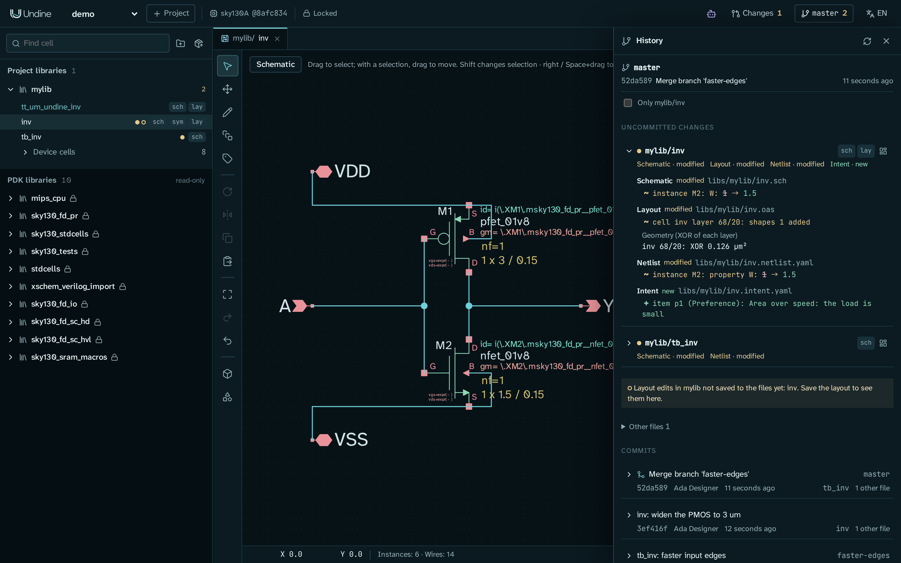
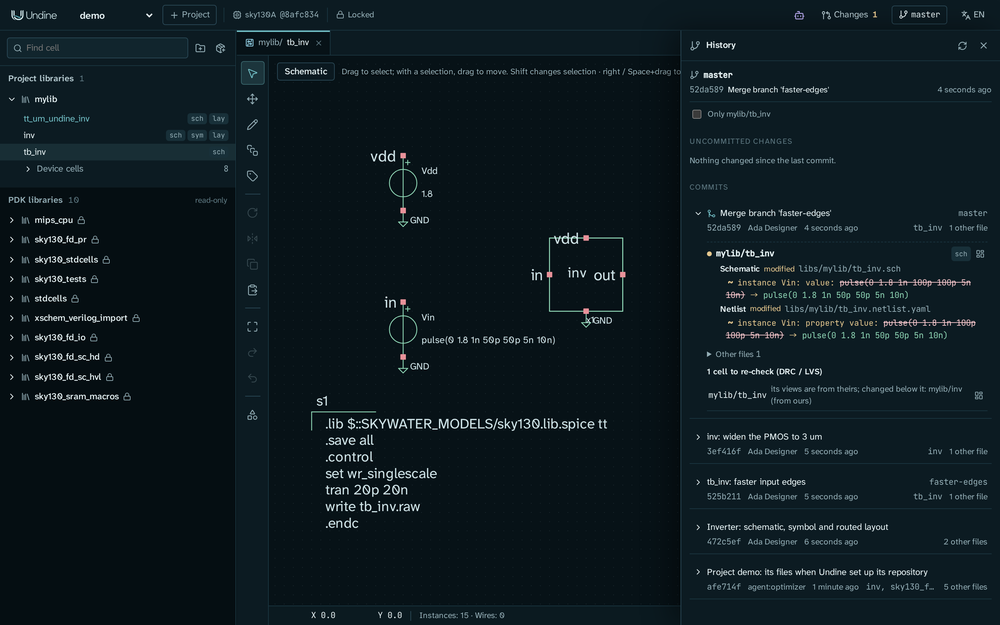

# git の履歴

git で管理しているプロジェクトには履歴があります。コミットごとの変更と、まだコミットしていない変更を、テキストの行ではなく、セルごと、
オブジェクトごと(インスタンスの幅、レイヤーの図形、設計意図の項目)に表示します。上部バーの右側にある、ブランチ名を表示したボタン
(git で管理していなければ **git なし**)で開きます。
このパネルは git を読むだけです。コミット、ブランチ、マージは、シェルや普段使っている git クライアントで git 自体を使って行います
(ただし、頼まれたときにパネルが作るプロジェクトの最初のコミットは除きます。下記)。



## git のセットアップ

git のリポジトリに入っていないプロジェクトでは、ボタンに **git なし** と表示され、パネルに **git をセットアップ** ボタンが出ます。
これは [`undine git-setup`](../reference/cli.md) と同じ処理です。プロジェクトのディレクトリがどのリポジトリにも入っていなければ `git init` を実行し、
`.gitattributes` と `.gitignore` を書き込み(ジョブの結果、テープアウトのバンドル、設計エージェントのログ、インストールした依存関係は
管理対象から外します。これらは、git が無視していなくてもパネルには表示しません)、
このクローンの git 設定に差分とマージのドライバを登録し、pre-commit フックを入れます。`git init` を実行したときは、続けてプロジェクトのファイルを
そのまま最初のコミットにします(`Project <project>: its files when Undine set up its repository`。Undine 自身の出力と changeset の記録は含みません)。
採用した提案は、その上にコミットされます。それ以外の場合はコミットしません。以降はいつも通り git でコミットしてください。

```bash
cd ~/undine-projects/demo          # $UNDINE_ROOT/<プロジェクト>
git add -A
git commit -m "Inverter: schematic, symbol and routed layout"
```

ドライバとフックは git のローカル設定なので、クローンごとにセットアップしてください(パネルから、または `undine git-setup PROJECT` で)。
マージドライバ、レイアウトの差分ドライバ、フックのどれかがクローンに足りないときは、パネルがそれを示し、もう一度セットアップするボタンを出します。
Undine の `.gitignore` にあとから加わった行(変更セットのリクエストログの `/changesets/requests/` など)は、それより前にセットアップしたプロジェクトには
ありません。git はそのファイルを未追跡として表示します。パネルは足りない行を示し、**セットアップ** がそれを末尾に加えます(自分で書いた行は
そのまま残ります)。それ以外に `.gitignore` を書き換えるものはありません。
リポジトリに独自の pre-commit フックがある場合や、`core.hooksPath` のフックを使う場合は、Undine はそこに書き込みません。
そのときはセットアップが、フックを入れなかった理由と、そのフックに自分で加える行(`<python> -P -m undine precommit`。`<python>` は Undine が動いている Python)を示します。
プロジェクトは、より大きなリポジトリのサブディレクトリでもかまいません。changeset の作業コピーはそのブランチの worktree です。そこではパネルが
ブランチと起点のコミットを示し、レビューとプロジェクトの履歴へ案内します。コミット付きで採用した changeset は、マージコミット
`Apply <id>: <changeset title>` として表示され、その下にブランチのコミットが、先端の横に残した参照(`refs/undine/changesets/<project>/<id>`)が並びます
([変更セット (changeset)](changesets.md#adopting-the-merge))。

まだコミットのないリポジトリ(自分で `git init` した、または以前の Undine がコミットせずにセットアップした)では **まだコミットがありません** と
表示され、コミットの一覧の下に **最初のコミットを作成** が出ます。プロジェクトのファイルをそのまま、Undine 自身の出力(`runs/`、`tapeout/`、
`llm/`、`.undine/`)と changeset の記録(`changesets/`)を除いて、`user` としてコミットします。ブランチにコミットがないあいだは、採用した提案は
作業ツリーに未コミットのまま残り、そのレビューがそのことを伝えます。最初のコミットにはそのマージも含まれ、それ以降に採用した
提案はコミットされます。プロジェクトのうち追跡しているもの(`.gitignore` が無視するファイルでも `git add -f` で追加したもの)は現在の
内容でコミットし、ステージしていた Undine 自身の出力は追跡しない状態に戻します。プロジェクトがリポジトリのサブディレクトリなら、
プロジェクトのディレクトリだけをコミットします。このボタンは、Undine 用に設定したリポジトリで、セルの絞り込み(**<セル> のみ**)を外しているときだけ
表示されます(設定されていなければ、先に上の **セットアップ** で設定してください)。セルファイルに保存されていないレイアウトの編集があるあいだは、
ボタンはレイアウトを示して待ちます。先に保存してください(pre-commit フックも保存されていないレイアウトの編集のコミットを拒否します。
そのときは **git をセットアップ** も最初のコミットを作らず、そう伝えます)。そのとき別の git がリポジトリのインデックスを使っていた場合は、
コミットは作られ、プロジェクトで `git reset` を実行するようパネルが伝えます。`undine git-setup` 自体はコミットしません。リポジトリに
まだコミットがないときは、そう表示します。

## マーク

- **上部バー。** ボタンにブランチ名(または *detached HEAD*)と、前回のコミット以降に変わったセルの数を表示します。
- **ライブラリ一覧。** セル名の後ろの点の色は、セルのビューの変化のうち最も重要なものを表します。重要な順に、マージで競合しているビューがあれば赤
  (周りに淡い縁取り)、前回のコミット以降に変わったビューがあれば琥珀色、新しいビューがあれば緑、削除したビューがあれば薄い赤です。
  たとえば、回路図を変えてシンボルを削除したセルは琥珀色、コミット済みのセルに設計意図のファイルを加えただけのセルは緑です。
  輪は、まだセルのファイルに保存していないレイアウトの編集を表します。ツールチップには変化の種類ごとにそのビューが出ます。
  ライブラリの行には変わったセルの数が出て、折りたたんだデバイスセルの行には、それらをまとめた点が 1 つ出ます。
- **レイアウトの編集。** ライブラリの行(と、変わったセルがないときは上部バーのボタン)の輪は、打ち消し合っている未保存のレイアウトの編集です。
  ファイルと違うセルはありませんが、操作ログには編集が残っているので、pre-commit フックはこれも断ります。ライブラリの行と上部バーのボタンの
  警告マークは、レイアウトに未保存の編集があるあいだに、セルのファイルがディスク上で変わったことを表します([後述](#files-changed-under-undine))。

## 未コミットの変更

最初の欄に、変わったセルとそのビュー(*回路図 · 変更*、*設計意図 · 新規* など)、ビューとセルページを開くボタンが並びます。
展開すると、前回のコミットからの各ビューの **意味的な差分** が表示されます。

| ビュー | 差分に出るもの |
|---|---|
| 回路図、シンボル | インスタンス、配線、テキスト、属性を、その ID ごとに: `~ インスタンス M2: W: 2 → 1.5`、`+ 配線 80,-60,80,-20` |
| レイアウト | セルとレイヤーごとに追加・削除した図形、インスタンスとその配置、変わったレイヤーごとの XOR の面積(`inv 68/20: XOR 0.126 µm²`)。図形の描き方だけが変わった場合(多角形を、同じ範囲を覆う矩形に置き換えた場合など)は *形状は同じ* |
| ネットリスト | ポート、インスタンスとそのピンとプロパティ、コードブロック |
| 設計意図 | メモ、ポート、電源、項目: `+ 項目 p1（選好）: Area over speed` |
| RTL などのテキスト | ファイルが変わったこと。行の差分は `git diff` で確認します |

`+` は追加、`−` は削除、`~` は変更です。この差分は git のマージが使うものと同じ(同じ ID)なので、ここで 1 つの変更として出るものが、
マージで 1 つにまとめられたり、1 つの競合として報告されたりします。

- **まだ保存していないレイアウトの編集** は別に表示します。差分はセルのファイルを比べるので、レイアウトを保存(Ctrl+S)すると差分に出ます。
  打ち消し合っている編集も、セルなしで表示します。保存していないレイアウトの編集が操作ログに残っているコミットは、pre-commit フックが断ります
  ([理由](../reference/data.md#save-layouts-before-committing))。表示されるのは、Undine を起動してから開いたレイアウトだけです。
  再起動した後は、レイアウトを開いてください。
- **その他のファイル**(折りたたみ): `project.json`、`undine.lock`、操作ログ `history/<lib>.jsonl` など、セルのビューではないもの。
- **〈lib/cell〉のみ** にチェックすると、変更とコミットをアクティブなタブのセルに絞ります。

パネルは、ページが見えている間は 10 秒ごと、レイアウトや RTL のファイルに未保存の編集ができたときと保存したとき、再読み込みボタンを押したときに状態を読み直します。

## コミット

その下に、プロジェクトを変えたコミットを新しい順に並べます。件名、ブランチとタグの名前、短いハッシュ、作者、日時、変えたセル、その他のファイルの数です。
コミットを展開すると、メッセージと、最初の親からの意味的な差分が表示されます。マージコミットなら、マージで取り込んだ変更です。
**さらに読み込む** で古いコミットを読みます。`git log` と同じく、プロジェクトのファイルを片方からそのまま受け取ったマージは表示しません。

<a id="merges-and-the-cells-to-re-check"></a>
## マージと再検証が必要なセル

ブランチは git でマージします(`git merge feature`)。マージドライバがセットアップされていれば、git はセルの各ファイルをオブジェクト単位でマージします。
別々のセルへの変更や、同じセルの別々のオブジェクトへの変更はまとめられ、両方のブランチが違う値にした箇所は競合になります。



- **マージの途中**(チェリーピックやリベースの途中も)には、競合しているファイルと、その未解決の競合を示す欄が出ます。ours、theirs、base の値を並べ、
  いまファイルに入っている値に下線を引きます。表示されたコマンド `undine resolve PATH --theirs ID` で theirs を採用しない限り、ファイルは ours のままです。
  その後ファイルを `git add` します。競合がなくなったら、git の手順どおりに締めくくります(欄にも表示します): マージならコミット、
  チェリーピックなら `git cherry-pick --continue`、リベースなら `git rebase --continue` です(リベースはコミットしても終わりません)。
  続いて、その時点での再検証が必要なセルと警告が出ます。
- **マージコミット** には **再検証が必要なセル** があります。マージした結果が、どちらのブランチにもなかった組み合わせになったセルです。
  たとえば、テストベンチは一方のブランチのもので、それが使うセルはもう一方のブランチで変わっている場合です。この組み合わせはまだどの DRC、LVS、
  シミュレーションも見ていないので、これらのセルで実行してください。続いてマージの警告が出ます。マージの記録はマージしたクローンにだけ残るため、
  別のクローンでマージしたファイルや、git の octopus 戦略(複数のブランチを一度にマージする)でマージしたファイルは、ここに記録がないものとして表示します。

<a id="files-changed-under-undine"></a>
### Undine が開いている間に変わったファイル

マージ、チェックアウト、pull、リベースでは、Undine が開いているファイルを git が書き換えます。回路図、シンボル、ネットリスト、設計意図は、
編集のたびにファイルから読むので、編集は git が書いた内容に対して行われます。開いているレイアウトは、1 秒に 1 回まで、また保存の前には必ず、
セルのファイルを読んだときのものと比べます:

- **未保存の編集がなければ**、Undine はレイアウトをファイルから読み直します。
- **未保存の編集があれば**、Undine は古いセルを新しいファイルの上に書きません。レイアウトの保存は断ります。パネルはそのライブラリと、
  ディスク上で変わったセルを示し、ライブラリの行と上部バーのボタンに警告マークが付きます。**編集を破棄して読み直す** を押すと(確認の後)、
  未保存の編集を捨ててファイルを読み直します。捨てた編集は操作ログに履歴として残り、Undo で読み直しより前に戻ることはありません。

ですから、git を実行する前にレイアウトを保存してください(どのみち pre-commit フックが求めることです)。その間に開いていたタブには、
古い図が残っていることがあるので、開き直してください。エディタで開いているテキスト(RTL のファイル、YAML で編集する設計意図)は、
エディタが持っている内容のまま保存されます。git がそのファイルを変えた後は、保存する前に開き直してください。

## コマンドライン

| | |
|---|---|
| `undine git-setup PROJECT` | **git をセットアップ** と同じ処理 |
| `undine diff --rev A [B]` | 2 つのリビジョンの間のプロジェクトの意味的な差分(B を省くと作業ツリー) |
| `undine merge-check [DIR] [--commit C]` | 進行中のマージ、またはマージコミット C の、未解決の競合、警告、再検証が必要なセル |
| `undine resolve PATH --theirs ID ...` | 競合しているファイルをマージし直し、指定した競合で theirs を採用する |

[コマンドライン](../reference/cli.md)、[git でのバージョン管理](../reference/data.md#version-control-with-git)、
[意味的な差分とマージ](../design/merge.md)の設計、パネルが使う [HTTP API](../reference/api.md#git-history) も参照してください。
1 つの Undine の中で提案(特に設計エージェントの提案)をレビューするには、引き続き [変更セット (changeset)](changesets.md) を使います。
