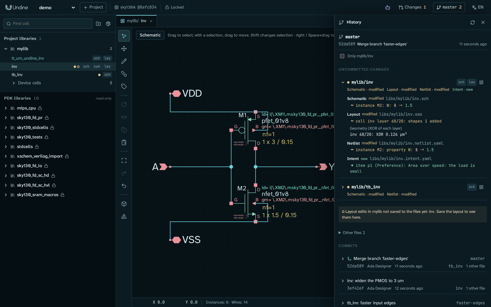
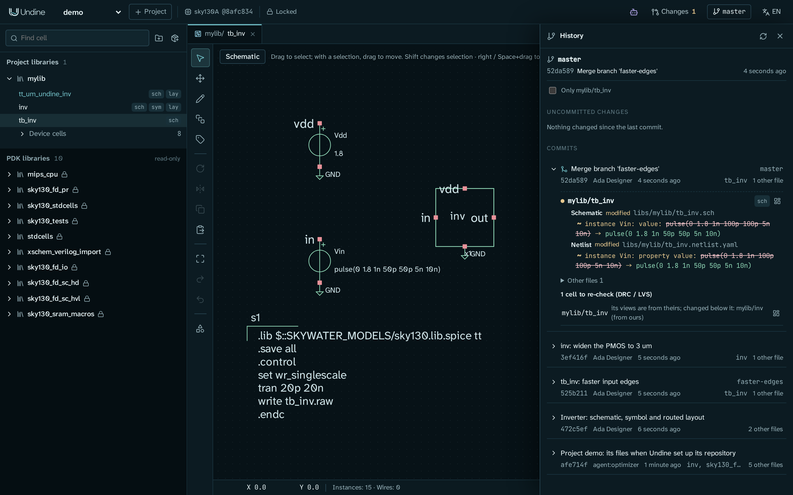

# Git history

A project kept in git has a history: every commit, and what is not committed yet, shown cell by cell and object by
object (an instance's width, a layer's shapes, an intent item) instead of as lines of text. The button at the right
of the top bar that shows the branch's name (**no git** when the project is not in git) opens it. The panel reads git;
commits, branches and merges are made with git itself, in a shell or in your git client (but the project's first
commit, which the panel makes when you ask, below).



## Setting up git

A project that is not in a git repository shows **no git** on the button, and the panel offers **Set up git**. It
does what [`undine git-setup`](../reference/cli.md) does: `git init` in the project directory when it is in no
repository, `.gitattributes` and `.gitignore` (job results, tapeout bundles, the assistant's log and the installed
dependencies stay out; the panel never lists them, ignored or not), the diff and merge drivers in this clone's git
configuration, and a pre-commit hook. When it ran `git init`, it then commits the project's files as they are as the
first commit (`Project <project>: its files when Undine set up its repository`; Undine's own output and the changeset
records stay out), so that the proposals you adopt are committed on top of it; otherwise nothing is committed. From
then on, commit with git as usual.

```bash
cd ~/undine-projects/demo          # $UNDINE_ROOT/<project>
git add -A
git commit -m "Inverter: schematic, symbol and routed layout"
```

The drivers and the hook are local git configuration, so set git up in every clone (from the panel, or with
`undine git-setup PROJECT`). When the merge driver, the layout diff driver or the hook is missing in a clone, the panel
says which and offers to set it up again. A project set up before a line was added to Undine's `.gitignore` (such as
`/changesets/requests/`, the changesets' request log) lacks it, and git lists those files as untracked: the panel
names the missing lines, and **Set up** appends them, leaving your own lines as they are. Nothing else edits your
`.gitignore`. Undine never writes into a pre-commit hook of the repository's own, nor into
one under `core.hooksPath`: there, setting up says why it did not install the hook and shows the line to add to that
hook yourself (`<python> -P -m undine precommit`, with the Python Undine runs on). A project can also be a subdirectory
of a larger repository. A changeset's working copy is a worktree of its branch: in it the panel names the branch
and the commit it started from, and leads to the review and to the project's history. A changeset adopted with a
commit shows as a merge commit `Apply <id>: <changeset title>`, with the branch's commits below it and its kept ref
(`refs/undine/changesets/<project>/<id>`) next to its tip ([Changesets](changesets.md#adopting-the-merge)).

A repository with no commit yet (you ran `git init` yourself, or an older Undine set the project up without committing)
shows **No commit yet** and, below the commits, **Make the first commit**: it commits the project's files as they are,
leaving out Undine's own output (`runs/`, `tapeout/`, `llm/`, `.undine/`) and the changeset records (`changesets/`), by
`user`. What you track of the project is committed as it is now (a file `.gitignore` ignores that you added with `git
add -f` too), and Undine's own output you had staged is untracked again. Until the branch has a commit, an adopted
proposal is left uncommitted in the working tree, and its review says so: the first commit takes what it merged too,
and the proposals adopted after it are committed. In a repository whose project is a subdirectory, only the project's
directory is committed. The button is there only in a repository set up for Undine (otherwise set it up first, with
**Set up** above) and with the cell filter (**Only <cell>**) off. While a layout has edits not saved to its cell files, the button
waits and names the layouts: save them first (the pre-commit hook refuses unsaved layout edits in a commit; **Set up
git** makes no first commit then either, and says so). If another git is using the repository's index at that moment,
the commit is made and the panel says to run `git reset` in the project. `undine git-setup` itself never commits; it
says when the repository has no commit yet.

## Markers

- **Top bar.** The button shows the branch (or *detached HEAD*) and the number of cells changed since the last commit.
- **Library browser.** A dot after a cell's name shows the most significant change among the cell's views, in this
  order: red with a halo when one is conflicted in a merge, amber when one changed since the last commit, green when one
  is new, pale red when one was deleted. A cell whose schematic changed and whose symbol was deleted is amber, for
  example, and a committed cell that only gained an intent file is green. A ring means layout edits that are not saved
  to the cell file yet. The tooltip lists each kind of change with its views. A library row shows how many of its cells
  changed, and the folded row of a library's device cells one dot for them all.
- **Layout edits.** A ring on a library row (and on the top-bar button, when no cell changed) means unsaved layout edits
  that cancel out: no cell differs from its file, but the operation log still holds them and the pre-commit hook
  refuses them all the same. A warning sign on a library row and on the top-bar button means that cell files changed
  on disk while the layout had unsaved edits ([below](#files-changed-under-undine)).

## Uncommitted changes

The first section lists each changed cell with its views (*Schematic · modified*, *Intent · new*, ...), buttons that
open the views and the cell page, and, when you expand it, the **semantic diff** of each view against the last commit:

| View | What the diff shows |
|---|---|
| Schematic, symbol | instances, wires, texts and attributes by their identity: `~ instance M2: W: 2 → 1.5`, `+ wire 80,-60,80,-20` |
| Layout | per cell and layer the shapes added and removed, instances and their placement, and the XOR area of each changed layer (`inv 68/20: XOR 0.126 µm²`); *geometry unchanged* when the shapes were only drawn differently (a polygon replaced by boxes covering it) |
| Netlist | ports, instances with their pins and properties, code blocks |
| Intent | notes, ports, supplies and items: `+ item p1 (Preference): Area over speed` |
| RTL and other text | that the file changed; `git diff` shows the lines |

`+` is added, `−` removed and `~` changed. The diff is the one git merges with (the same identities), so what it shows
as one change is what a merge combines or reports as one conflict.

- **Layout edits not saved yet** are listed apart: the diff shows the cell files, so save the layout (Ctrl+S) to see
  them there. Edits that cancel out are listed too, without cells. The pre-commit hook refuses a commit whose operation
  log holds unsaved layout edits ([why](../reference/data.md#save-layouts-before-committing)). Only layouts opened since
  Undine started are listed; after a restart, open the layout.
- **Other files** (folded): `project.json`, `undine.lock`, the operation logs `history/<lib>.jsonl` and anything that
  is not a cell's view.
- **Only *lib/cell*** narrows the changes and the commits to the cell of the active tab.

The panel reads the state again every 10 seconds while the page is visible, when a layout or RTL file gets unsaved
edits or is saved, and with its refresh button.

## Commits

Below, the commits that changed the project, newest first: the subject, branch and tag names, the short hash, the
author, when, the cells it changed and how many other files. Expanding a commit shows its message and the semantic diff
against its first parent, so for a merge commit what the merge brought in. **Load more** reads older commits. As in
`git log`, a merge that took the project's files whole from one side is not listed.

## Merges and the cells to re-check

Branches are merged with git (`git merge feature`). With the merge driver set up, git merges each file of a cell object
by object: changes to different cells, or to different objects of one cell, combine; a value both branches changed
differently is a conflict.



- **During a merge** (or a cherry-pick or rebase) the panel shows a banner with each conflicted file and its open
  conflicts: ours, theirs and the base value, the one the file holds now underlined. The file keeps ours until you take
  theirs with the command shown, `undine resolve PATH --theirs ID`; then `git add` the file. When no conflict is left,
  conclude as git does, which the banner says: commit a merge, `git cherry-pick --continue` a cherry-pick,
  `git rebase --continue` a rebase (a commit does not end it). The cells to re-check so far and the warnings follow.
- **A merge commit** has **Cells to re-check**: the cells whose merged design neither branch had, such as a testbench
  taken from one branch while the cell it uses changed on the other. No DRC, LVS or simulation has seen that
  combination yet, so run them on these cells. The merge's warnings follow. The merge reports stay in the clone that
  merged: a file merged in another clone, or by git's octopus strategy (several branches at once), is listed as having
  no report here.

### Files changed under Undine

git changes files while Undine has them open: a merge, a checkout, a pull, a rebase. Schematics, symbols, netlists and
intent are read from their files at every edit, so an edit applies to what git wrote. An open layout compares its cell
files with the ones it read, at most once a second and always before a save:

- **Without unsaved edits** Undine reads the layout again from the files.
- **With unsaved edits** Undine does not write the old cells over the new files: saving the layout is refused. The
  panel names the library and the cells that changed on disk, and a warning sign marks the library and the top-bar
  button. **Discard the edits and reload** (after a confirmation) drops the unsaved edits and reads the files; the
  operation log keeps the dropped edits as history, and undo does not go back past the reload.

So save your layouts before you run git, as the pre-commit hook asks anyway. A tab that was open meanwhile may still
show the old drawing: open it again. A text open in an editor (an RTL file, the intent as YAML) is saved as the editor
holds it, so open it again after git changed its file, before you save it.

## On the command line

| | |
|---|---|
| `undine git-setup PROJECT` | what **Set up git** does |
| `undine diff --rev A [B]` | the semantic diff of the project between two revisions (default B: the working tree) |
| `undine merge-check [DIR] [--commit C]` | open conflicts, warnings and the cells to re-check, of the merge in progress or of merge commit C |
| `undine resolve PATH --theirs ID ...` | merge a conflicted file again, taking theirs for those conflicts |

See [Command line](../reference/cli.md), [Version control with git](../reference/data.md#version-control-with-git),
the design of the [semantic diff and merge](../design/merge.md), and the panel's calls in the
[HTTP API](../reference/api.md#git-history). [Changesets](changesets.md) remain the way to review a proposal, an
agent's in particular, inside one Undine.
