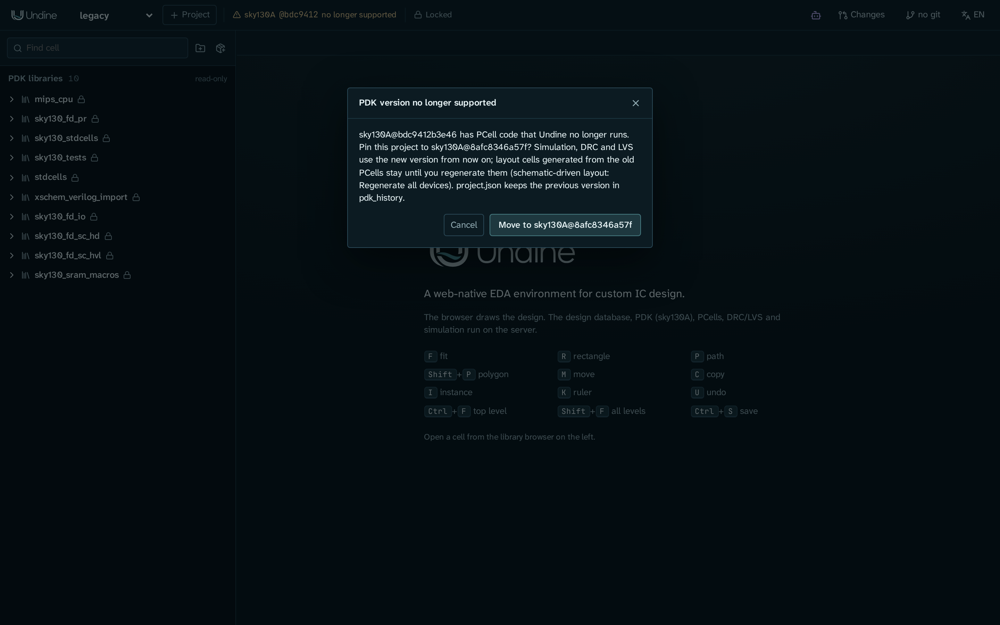

# PDK

PDK(プロセスデザインキット)は、Undine が製造プロセスについて知っていることのすべてです。レイヤーとデザインルール、DRC と
LVS のデッキ、SPICE モデル、デバイスのシンボル、PCell のジェネレータが含まれます。PDK はサーバーにだけ置き、ブラウザには
レイヤーの名前と色、生成した形状だけを渡します。モデルやルールデッキは渡しません。

Undine は PDK を同梱していません。PDK はオープンソースの PDK バージョン管理ツール
[ciel](https://github.com/fossi-foundation/ciel) で入れ、各プロジェクトは 1 つの PDK の 1 つのバージョンに固定します。
このページでは、Undine が対応する PDK、そのインストール方法、プロジェクトが PDK を記録する方法、プロジェクトを別のバージョンへ
移す方法を説明します。

<a id="supported-pdks"></a>
## 対応している PDK

| PDK | バリアント | Undine で動作確認したバージョン | 使えるもの |
|---|---|---|---|
| SkyWater SKY130 | `sky130A`、`sky130B` | open_pdks `8afc8346a57fe1ab7934ba5a6056ea8b43078e71`(2025 年)。`./setup.sh` が入れます | KLayout の DRC と LVS、Magic DRC、Magic + Netgen LVS、コーナー `tt`、`ss`、`ff`、`sf`、`fs` での ngspice、PDK の PCell、Tiny Tapeout と Caravel の[テープアウト](tapeout.ja.md)のターゲット |
| GlobalFoundries GF180MCU | `gf180mcuA`(メタル 3 層)、`gf180mcuB`(4 層)、`gf180mcuC`、`gf180mcuD`(5 層) | open_pdks `792ef67037d74c8c51811eab3ce23cf793491296`(wafer.space が固定しているバージョン) | KLayout の DRC と LVS、Magic DRC、Magic + Netgen LVS、`typical`、`ss`、`ff`、`sf`、`fs` での ngspice、29 種類の PCell(nfet、pfet、抵抗、MIM / MOS 容量、ダイオード、BJT、ビア)、wafer.space の[テープアウト](tapeout.ja.md)のターゲット |
| IHP SG13G2 | `ihp-sg13g2` | IHP-Open-PDK `89d42ee6d2fd9b50b86a1aada6fee6673c3e6008` | KLayout の DRC と LVS、Magic DRC、Magic + Netgen LVS、[Verilog-A のモデルをコンパイル](#ihp-sg13g2-verilog-a-models)した後の `mos_tt`、`mos_ss`、`mos_ff`、`mos_sf`、`mos_fs` での ngspice、38 種類の PCell(nmos、pmos、抵抗、MIM 容量など) |
| IHP SG13CMOS5L | `ihp-sg13cmos5l` | 未確認(ciel が `ihp-sg13` ファミリーと一緒に入れます) | 未検証。KLayout DRC と Magic DRC。Magic + Netgen LVS と ngspice(`mos_*` コーナー、モデルをコンパイルした後)は SG13G2 と同じように設定してありますが、実行したことはありません。KLayout LVS はなく(Undine がまだ設定していません)、PCell もなく、PDK には標準セルのライブラリがありません |

[レイアウトエディタ](layout.ja.md)の PCell パネルでは各 PDK 自身の PCell を置けます。
レイアウトエディタの[回路図駆動レイアウト](layout.ja.md#schematic-driven-layout)は、SKY130、GF180MCU、SG13G2 で、回路図から MOSFET、抵抗、
MIM 容量を生成します。幅のパラメータに注意してください。GF180MCU の `w_gate` は 1 フィンガーあたり、SG13G2 の `w` は `ng` 本の
ゲートの合計です。

これらの PDK のほかのバージョンも、たいていは動きますが、動作確認はしていません。例外は 2025 年より前の open_pdks の
SKY130 で、その PCell コードを Undine はもう実行しません([サポートが終了したバージョン](#versions-no-longer-supported)を参照)。

ほかのファミリーの PDK も見つかって一覧に出ますが、Undine にはその[プロファイル](#pdk-profiles)がありません。レイヤーも
デッキもモデルも分からないので、それらを使う機能は使えません。

<a id="installing-a-pdk"></a>
## PDK のインストール

<a id="sky130"></a>
### SKY130

`./setup.sh` は手順 `pdk` で、動作確認したバージョンの SKY130 を入れます。この手順だけを実行するには:

```sh
./setup.sh pdk
```

`ciel enable --pdk-family sky130 8afc8346a57fe1ab7934ba5a6056ea8b43078e71` を実行し、PDK を `$PDK_ROOT`(既定は `~/.ciel`)に
ダウンロードして有効にします。そのバージョンがすでに入っていれば飛ばし、最後に `./setup.sh` のチェックを実行します。

別のバージョンを入れるには、open_pdks のコミットを `PDK_VERSION` で指定します:

```sh
pixi run ciel ls-remote --pdk-family sky130      # the versions ciel can install
PDK_VERSION=<open_pdks commit> ./setup.sh pdk
```

!!! note "`pixi run pdk`"

    `pixi run pdk` は、動作確認した SKY130 のバージョンを `ciel enable` するだけです。`PDK_VERSION` も `PDK_FAMILY` も読まず、
    入っているバージョンも飛ばさず、最後のチェックもしません。それ以外のことをするときは `./setup.sh pdk` を使います。

<a id="gf180mcu-and-ihp-sg13g2"></a>
### GF180MCU と IHP SG13G2

動作確認したバージョンを ciel で入れます:

=== "ciel"

    ```sh
    pixi run ciel enable --pdk-family gf180mcu 792ef67037d74c8c51811eab3ce23cf793491296
    pixi run ciel enable --pdk-family ihp-sg13 89d42ee6d2fd9b50b86a1aada6fee6673c3e6008
    ```

=== "setup.sh"

    ```sh
    PDK_FAMILY=gf180mcu PDK_VERSION=792ef67037d74c8c51811eab3ce23cf793491296 ./setup.sh pdk
    PDK_FAMILY=ihp-sg13 PDK_VERSION=89d42ee6d2fd9b50b86a1aada6fee6673c3e6008 ./setup.sh pdk
    ```

`ihp-sg13` ファミリーを入れると、SG13G2 と SG13CMOS5L の両方が入ります。続けて:

- IHP では、トランジスタのモデルを一度コンパイルします: `./setup.sh osdi`([下記](#ihp-sg13g2-verilog-a-models))。
- GF180MCU の PCell は専用の環境 `pcell-gf180`(gdsfactory 7.9)で動きます。この環境は `./setup.sh` の手順 `install` が
  作ります(`pixi install -e pcell-gf180`)。

!!! note "PDK を入れたら探し直します"

    サーバーは起動したときに PDK を探します。動いている間に入れた PDK は、再起動しなくても探し直せば現れます: PDK のバッジの
    メニューの **PDK を再検出**、または `POST /api/pdks/rescan`。ブラウザから取得した PDK
    ([プロジェクトの PDK を取得する](#fetching-a-projects-pdk))はすぐに見つかります。再起動(`./scripts/restart.sh`)でも
    見つかり、作業は失われません([サーバーの再起動](../reference/cli.ja.md#restarting-the-server))。

pixi を使わない場合は、サーバーと一緒に ciel を入れて(`pip install -e "server[pdk,dev]"`)、同じ `ciel enable` を実行します。
[pixi を使わない場合](../getting-started/install.ja.md#without-pixi)を参照してください。

<a id="where-undine-looks-for-pdks"></a>
## Undine が PDK を探す場所

Undine は起動時に、次の PDK ルートをこの順に探します:

1. `$PDK_ROOT`(設定されているとき。ciel もここに入れます)
2. `~/.ciel`
3. `~/.volare`(ciel の前身の volare で入れた PDK)

`--pdk-root DIR` はこの一覧を置き換えます。グローバルなオプションなので、コマンドの前に書きます。何度でも指定できます:

```sh
pixi run python -m undine --pdk-root /opt/pdks --pdk-root ~/.ciel serve
```

!!! note "`--pdk-root` とセットアップの手順"

    `--pdk-root` を受け付けるのは `python -m undine` のコマンドだけです。手順 `osdi` と、手順 `pdk` の「すでに入っているか」の
    チェックは、いつも既定のルートを探します。ほかのルートにある PDK に対して実行するときは、`PDK_ROOT` にそのルートを
    設定します。例: `PDK_ROOT=/opt/pdks ./setup.sh osdi`。

各ルートで、Undine は次のものを見つけます:

- ciel のストア `<root>/ciel/<family>/versions/<commit>/<variant>/` と、volare のストア
  `<root>/volare/<family>/versions/<commit>/<variant>/` にあるすべてのバージョン。有効にしたものだけではありません。
- 素の PDK ディレクトリ `<root>/<variant>/libs.tech/`。それが `versions/<commit>/` のディレクトリへのリンク(ciel や volare が
  有効にしたバージョン)なら、そのコミットがバージョンです。そうでなければバージョンはありません。

PDK は **id** で区別します。バリアント、`@`、コミットの先頭 12 文字をつなげたもので、例えば `sky130A@8afc8346a57f` です。
バージョンのない PDK は、名前だけが id です。2 つのルートに同じ id があれば、先に見つけたほうを使います。見つけたものを
一覧するには:

```sh
pixi run python -m undine pdk list       # or: pdks
```

上の 3 つのファミリーを入れていれば、出力は次のように始まります(一部省略):

```
gf180mcuA@792ef67037d7           lyp=yes xschem=yes  792ef67037d74c8c51811eab3ce23cf793491296  ciel    /home/you/.ciel/ciel/gf180mcu/versions/792ef67.../gf180mcuA  libraries=gf180mcu_fd_pr,...
...
ihp-sg13g2@89d42ee6d2fd          lyp=yes xschem=yes  89d42ee6d2fd9b50b86a1aada6fee6673c3e6008  ciel    /home/you/.ciel/ciel/ihp-sg13/versions/89d42ee.../ihp-sg13g2  libraries=sg13g2_pr,sg13g2_stdcell,...
sky130A@8afc8346a57f             lyp=yes xschem=yes  8afc8346a57fe1ab7934ba5a6056ea8b43078e71  ciel    /home/you/.ciel/ciel/sky130/versions/8afc834.../sky130A  libraries=sky130_fd_pr,sky130_fd_sc_hd,...
```

`lyp` は PDK に KLayout のレイヤープロパティ(レイヤーの色)があるか、`xschem` は Xschem のデバイスシンボルがあるかを示します。
続いて、コミット全体、入れたもの(`ciel`、`volare`、素のディレクトリなら `-`)、ディレクトリ、入っているライブラリ(`libs.ref/`)
が出ます。

<a id="how-a-project-pins-its-pdk"></a>
## プロジェクトが PDK を固定するしくみ

新しいプロジェクトは、PDK の 1 つのバージョンに固定されます:

=== "ブラウザ"

    上部バーの **+ プロジェクト** で **新しいプロジェクト** が開き、名前と **PDK（このバージョンに固定）** を尋ねます。
    サーバーが見つけた id のどれか、または *なし* を選びます。

=== "コマンドライン"

    ```sh
    pixi run python -m undine new demo --pdk sky130A
    ```

<a id="bare-pdk-name"></a>
id 全体でも、名前だけでも指定できます。`sky130A` のような名前だけを指定すると、バージョンを次の順で選びます: Undine が
PCell を実行できるバージョンを、できないものより先に。動作確認したバージョンを、ほかのものより先に。それでも決まらなければ、
最初に見つけたもの。プロジェクトには選んだ id そのものを記録します。

`project.json` は PDK を id で指定します:

```json
{
  "name": "demo",
  "pdk": "sky130A@8afc8346a57f",
  "libraries": {"mylib": "libs/mylib"}
}
```

プロジェクトの [`undine.lock`](libraries.ja.md#undinelock) にも、ツールのバージョンと並んで同じ id を記録します。こうすると、別の
マシンのチェックアウトで PDK のバージョンが違うことが分かります。format 2 の lock は、さらに PDK のファイルも固定します
([PDK をファイルで固定する](#pinning-the-pdk-by-its-files))。`project.json` に名前だけ(`"pdk": "sky130A"`)を書いて手で
作ったプロジェクトも開けますが、開くたびに[名前からバージョンを選びます](#bare-pdk-name)。どのマシンでも同じバージョンを
使うように、id で固定してください。

ウィンドウ上部の PDK のバッジに、プロジェクトの PDK が表示されます:

| バッジ | 意味 |
|---|---|
| **sky130A @8afc834** | プロジェクトが固定している PDK がここに入っています。マウスを重ねると id 全体が出ます。format 2 の lock では、PDK が固定と比べてどうか(*未検証（初回の内容を信頼）*、*変更あり* など)もバッジに出ます([PDK の状態](#pdk-states)) |
| **sky130A @bdc9412 サポート終了** | 入っていますが、Undine はその PCell コードをもう実行しません。クリックすると[プロジェクトを移せます](#moving-a-project-to-another-pdk-version) |
| **このサーバーには PDK sky130A@8afc8346a57f がありません** | プロジェクトが指定する PDK を、このサーバーが見つけていません。取得するか(バッジのメニューの **取得...**。[下記](#fetching-a-projects-pdk))、[入れて](#installing-a-pdk)探し直すか、入っているものにプロジェクトを移します |
| **PDK なし** | プロジェクトに PDK がありません |

バッジをクリックするとメニューが開きます: `undine.lock` と比べた PDK の状態とその意味の 1 行、PDK がないか変更されているときの
**取得...**、**PDK を再検出**、サポートが終了したバージョンなら移動。

PDK が見つからないプロジェクトも、PDK なしで開けます。レイアウトと回路図のファイルはありますが、PDK のモデル、デッキ、
シンボル、PCell は使えません。

<a id="pinning-the-pdk-by-its-files"></a>
## PDK をファイルで固定する

format 1 の lock は PDK を id で固定します。id はコミットを示しますが、このマシンにあるファイルについては何も言いません。入れた後に
編集した PDK や、同じコミットで別の取得元から入れた PDK も同じに見えます。PDK をファイルで固定するには:

```sh
pixi run python -m undine pdk verify demo --pin
```

```
undine.lock: the PDK pinned as installed here (format 2)
PDK unverified
```

これは入っている PDK のハッシュを取り、`undine.lock` を format 2 で書きます([undine.lock](libraries.ja.md#undinelock)): コミット
全体、どこから来たか(`ciel` とその取得元)、入っているライブラリ、部分ごと(`libs.tech`、`libs.ref/<lib>` のそれぞれ、IHP のほかの
`libs.*` のディレクトリ)のハッシュです。だから、より多くのライブラリと一緒に入れた PDK も合い、変更はそれがある部分について報告
されます。入れた後に PDK に書き込まれるものは数えません: `__pycache__/` と `*.pyc`(PCell のコードを import したときにできる。
Undine 自身の PCell の実行は書きません)と `libs.tech/ngspice/osdi/`(以前のセットアップがそこにコンパイルしたモデル)です。12 文字の
id は、ここに入っている PDK からコミット全体に広げます。入っていないものは、`--network` を付けると ciel が調べます
(`ciel ls-remote`)。

SKY130 の 1 つのバリアント(約 1 GB)のハッシュは、初回は数秒かかります。Undine はハッシュをファイルのスタンプと一緒に
[ストア](../reference/data.ja.md#the-store)(`pdk/`)に保ち、その後はスタンプの変わったファイルだけを読みます。`lib status` と
バッジは保ったハッシュだけを読み、PDK そのものは読みません。

その後、`pdk verify demo`(`--pin` なし)は PDK を固定と比べ、lock は書きません:

```
  libs.tech: modified ngspice/sky130.lib.spice
~ the PDK files differ from the pin: reinstall it (`ciel rm --pdk-family sky130 8afc8346a57fe1ab7934ba5a6056ea8b43078e71`, then pdk fetch), or pin it as it is now with pdk verify --pin
PDK modified
```

すでに format 2 の lock での `pdk verify --pin` は、PDK を今のとおりに固定し直し、前の固定に対してどうだったかを示します。
`lib lock --format 2` も format 2 を書き(PDK は `--pin` と同じく固定します)、PDK のないプロジェクトにも使えます。どちらも、ここに
入っていない PDK は拒否します: 先に取得してください。format 2 の lock では、`set-pdk` も新しい PDK を同じように固定し、`lib lock` は
固定に触れません。

固定は入っているものの記録なので、`pdk verify --pin` と `lib lock --format 2` は、固定済みの[パッケージ](libraries.ja.md#pdk-compatibility)
が受け入れない PDK でも固定します。どちらもそのようなパッケージごとに 1 行表示し(`! demo -> solo (git
3f1a9c0b7e21): does not fit the PDK sky130A@8afc8346a57f: ...`)、その後は、パッケージか PDK が動くまで、`lib status` がそれぞれを
問題として報告します。

<a id="pdk-states"></a>
### PDK の状態

`lib status`、PDK のバッジ、`pdk verify` は、`undine.lock` と比べた PDK の状態を示します:

| 状態 | 意味 | 扱い |
|---|---|---|
| `verified`(検証済み) | PDK のプロファイルがこのコミットについて公開するハッシュと合う。まだ出ません: プロファイルがハッシュを公開するのは後の段階です([段階](../design/packages.ja.md#phases)) | |
| `unverified`(未検証) | `undine.lock` に固定したハッシュと合う。このバージョンのハッシュを公開するプロファイルはまだないので、**初回を信頼**しています: 固定したマシンにあったときと同じ PDK ですが、公開されたリリースと照らしてはいません | 注記 |
| `unchecked`(未確認) | 前回ハッシュを取った後にファイルが変わった(またはここでは一度も取っていない): `pdk verify PROJECT` を実行します。`lib status` は自分では PDK のハッシュを取りません | 注記 |
| `not pinned`(未固定) | lock が format 1 で、id だけを固定している: `pdk verify PROJECT --pin` でファイルを固定します | 注記 |
| `modified`(変更あり) | ある部分が固定と違う。このマシンで固定したバージョンのハッシュを前に取っていれば、ファイルの名前も出ます | 問題 |
| `missing`(未導入) | 固定した PDK がここに入っていない: 取得します | 問題 |
| `mismatch` | `project.json` が lock の固定と別の PDK を求めている(手での編集やマージ): `set-pdk PROJECT PDK` で両方を移します | 問題 |
| `other version` | (format 1)lock の id がここで見つかった PDK と違う | 問題 |
| `not locked`、`none` | undine.lock がない。プロジェクトに PDK がない | |

バージョンのない PDK(素のディレクトリ)はハッシュだけで固定し、警告を出します。固定したライブラリが入っていなければそれも問題です。
lock にないライブラリが入っていても、示すだけです。

<a id="fetching-a-projects-pdk"></a>
## プロジェクトの PDK を取得する

Undine はプロジェクトの PDK を [ciel](https://github.com/fossi-foundation/ciel) で入れます。PDK のバッジのメニューの **取得...**
(PDK がないか変更されているとき)か、コマンドラインから:

```sh
pixi run python -m undine pdk fetch demo
```

```
fetch the PDK of demo with ciel:
  family     sky130
  variant    sky130A
  commit     8afc8346a57fe1ab7934ba5a6056ea8b43078e71
  libraries  ciel default
  source     static-web:https://fossi-foundation.github.io/ciel-releases
  root       /home/you/.ciel
fetch it? [y/N] y
  ...
installed /home/you/.ciel/ciel/sky130/versions/8afc8346a57fe1ab7934ba5a6056ea8b43078e71/sky130A
~ undine.lock pins the PDK by id only: `python -m undine pdk verify demo --pin` pins its tree
PDK not pinned
a running Undine server finds it after a rescan: Rescan PDKs in the PDK badge's menu, or POST /api/pdks/rescan
```

取得するもの:

- **ファミリー。** ciel はファミリー単位で入れます: `sky130A` と `sky130B` は `sky130`、`gf180mcuA` から `D` は `gf180mcu`、
  `ihp-sg13g2` と `ihp-sg13cmos5l` は `ihp-sg13` です。
- **コミット。** format 2 の固定ならそのコミット全体。format 1 の id(lock がなければ `project.json` の id)なら、12 文字をここに
  入っている PDK からコミット全体に広げ、なければ `--network`(ダイアログでは *ネットワークを使う* のチェックボックス)で
  `ciel ls-remote` を使って広げます。
- **ライブラリ。** 固定にあるライブラリ。なければ ciel の既定のセット。
- **取得元。** format 2 の固定は ciel の取得元を書いています。format 1 の id は、ciel の既定の取得元
  `static-web:https://fossi-foundation.github.io/ciel-releases` から来たものとみなします。volare で固定した PDK は拒否します
  (volare で入れてください)。ブラウザからは ciel の既定の取得元からだけ取得し、ほかの取得元はコマンドラインから取得します。
- **ルート。** Undine が探す PDK のルート([Undine が PDK を探す場所](#where-undine-looks-for-pdks))のうち、`ciel/` があるか、
  まだないか、空の最初のもの: `--pdk-root` があればそれ、なければ `$PDK_ROOT`、なければ `~/.ciel`。どれも当てはまらなければ
  (`~/.volare` だけなど)、ほかの場所に取得した PDK は見つからないので拒否します: `--pdk-root DIR` を指定するか `PDK_ROOT` を
  設定してください。ciel はそこにある自身のストアに入れ、そのバージョンを有効にはしません(`<root>/<variant>` のリンクはそのまま)。
  Undine は ciel のストアのどのバージョンも見つけます。

その後、Undine は PDK を lock と比べ(`pdk verify` と同じ)、ブラウザからなら PDK を探し直すので、プロジェクトは再起動なしに PDK を
見つけます。取得は `undine.lock` を書きません。PDK のファイルを固定したいときは `pdk verify --pin` を使います。コマンドラインは
ciel を動かす前に尋ね(`--yes` なら尋ねない)、動いているサーバーには届かないので、サーバーでは **PDK を再検出** を使います。

ブラウザの **PDK を取得** は、ファミリー、バリアント、コミット、ライブラリ、取得元、入れる先のディレクトリを示します。**取得** を
押すまでは何も取得しません。取得はサーバーで動き、その出力がダイアログに出ます。ダイアログを閉じても取得は続きます(サーバーを
再起動すると失われます: 取得し直すか、探し直せば入れたものが見つかります)。エージェントは取得を始められません: そのツールの
どれも、取得に要る確認を求めないからです([HTTP API](../reference/api.ja.md#pdk-fetch))。

`modified` の PDK を入れ直すには、先に `ciel rm --pdk-family FAMILY COMMIT`(バッジのメニューと `pdk verify` がコマンドを示します)
で消してから取得します。

<a id="moving-a-project-to-another-pdk-version"></a>
## プロジェクトを別の PDK バージョンへ移す

`set-pdk` は、プロジェクトを入っている別の PDK に固定し直します:

```sh
pixi run python -m undine set-pdk demo sky130A@8afc8346a57f
```

```
demo: sky130A@bdc9412b3e46 -> sky130A@8afc8346a57f
cells generated from PCells of the old PDK stay until regenerated (schematic-driven layout: Regenerate all devices)
```

変わるのは次のものです:

- `project.json` の `pdk`
- `project.json` の `pdk_history`。古い id、新しい id、時刻の項目が 1 つ増えます:

    ```json
    "pdk_history": [{"from": "sky130A@bdc9412b3e46", "to": "sky130A@8afc8346a57f", "time": "2026-11-10T09:30:00+0900"}]
    ```

- `undine.lock` の `pdk`。ロックができる前に作ったプロジェクトには undine.lock がありません。そのときは `set-pdk` が
  `lib lock` と同じように、今使っているツールのバージョンを記録して作り、`created undine.lock (format 1)` と表示します。
  format 2 の lock には、先にファイルのハッシュを取った新しい PDK の固定を書きます(ハッシュを取ったことのない PDK なら数秒)。
  lock がすでに固定している PDK に移すときは、固定はそのままです。

!!! warning "サーバーが動いているとき"

    コマンドラインの `set-pdk` は、プロジェクトのファイルを書き換えるだけです。動いているサーバーは、読み込んだレイアウトを
    (PCell の配置にもエディタにも)古い PDK のまま、再起動するまで使い続けます。サーバーが動いている間は、サーバーを通して
    プロジェクトを移してください。PDK のバッジのダイアログに **… に切り替える** があればそれを使い、なければ HTTP の呼び出し
    `POST /api/p/{project}/pdk`([HTTP API](../reference/api.ja.md)。バッジもこれを使います)を使います。または、
    `set-pdk` の後にサーバーを再起動してください。

移した後は:

- シミュレーション、DRC、LVS は新しいバージョンを使います。
- それまでの結果は[古く](verification.ja.md#outdated-results)なります。理由は `PDK <old> → <new>` と表示されます。
- 古いバージョンの PCell から生成したレイアウトのセルは、作り直すまでそのまま残ります(回路図駆動レイアウトの
  **すべてのデバイスを再生成**)。

元に戻すには、古い id で `set-pdk` を実行します。`pdk_history` には両方の移動が残ります。PDK はプロジェクトそのもので変更し、
[changeset](changesets.ja.md) の中では変更しません。HTTP の呼び出しは changeset のプレビューでは拒否されます。

**PDK を受け入れないパッケージ。** `set-pdk` は、固定済みのすべての[パッケージ](libraries.ja.md#pdk-compatibility)(依存関係が
連れてきたものも)の `[pdk]` と新しい PDK を照合し、受け入れないものがあれば、それぞれを経路とともに示して移動を拒否し、何も
変えません:

```
error: the PDK sky130A@0c4e2b7a1f30 is not accepted by 2 locked packages:
- demo -> analog_ip 1.2.0 (v1.2.0 @ 229914698b1f): sky130A@0c4e2b7a1f30 is not among commits 8afc8346a57f
- demo -> analog_ip 1.2.0 (v1.2.0 @ 229914698b1f) -> sar_common 1.3.1 (v1.3.1 @ 5b1c0e2a9d11): sky130A@0c4e2b7a1f30 is not among commits 8afc8346a57f
update or remove them (lib update, lib remove), or choose a PDK they accept; nothing was changed
```

先にパッケージを動かす(新しいコミットを並べたバージョンへ `lib update`)か、削除してください。HTTP では、一覧を付けたコード
`pdk_incompatible` の 409 になり、PDK のバッジのダイアログ(**… に切り替える**)がそれを表示します。ストアにもここのインストールにもない
固定済みのパッケージ(クローンした直後)は確かめられないので、`run lib sync first` として拒否します。プロジェクトがすでに指定している
PDK への移動は拒否しません。

!!! warning

    通常の git の依存関係(`undine-package.toml` のないもの)や、`[pdk]` のないパッケージは確かめません。別の PDK バージョンで
    描いたライブラリは、移した後でレイアウトをもう一度確認(DRC と LVS)する必要があるかもしれません。

<a id="versions-no-longer-supported"></a>
### サポートが終了したバージョン

2025 年より前の open_pdks の SKY130(例: `bdc9412`)は、古い世代の PCell コードを持っていて、Undine はもう実行しません。
今の PCell コードは kfactory ベースの gdsfactory 8 を必要とします。そのバージョンに固定したプロジェクトも開けて、
シミュレーションと DRC / LVS は動きますが、PCell は使えず、PDK のバッジに **サポート終了** と出ます。



バッジをクリックします。同じ PDK で Undine が PCell を実行できるバージョンが入っていれば(動作確認したものが優先)、ダイアログ
**サポートが終了した PDK のバージョン** が、**sky130A@8afc8346a57f に切り替える** のように、そのバージョンへの移動を提案します。`set-pdk` と同じことをします。
入っていなければ、ダイアログは対応しているバージョンと `set-pdk` のコマンドを示します。`./setup.sh pdk` を実行し、バッジの
メニューの **PDK を再検出** を選んでから、もう一度バッジをクリックしてください。

`pixi run doctor` もこうした PDK を一覧し、固定しているプロジェクト向けに `set-pdk` のコマンドを表示します。このコマンドが
示す PDK は、Undine が PCell を実行できる PDK のうち最初に見つけたもので、別のファミリーのこともあります(GF180MCU が入って
いれば `gf180mcuA@...`)。移す先はバッジのダイアログから選ぶか、同じバリアントの動作確認したバージョン
(例: `sky130A@8afc8346a57f`)を使ってください。

<a id="ihp-sg13g2-verilog-a-models"></a>
## IHP SG13G2 の Verilog-A モデル

IHP のトランジスタモデル(PSP103 など)は Verilog-A です。ngspice はそれを OSDI ファイルにコンパイルしたものを読み込むので、
次の 2 つが必要です:

1. **OSDI 対応でビルドした ngspice。** `./setup.sh` の手順 `ngspice` が、OSDI 対応の ngspice 47 を pixi 環境にビルドします
   (conda-forge の ngspice は OSDI に対応していません)。
2. **コンパイルしたモデル。** PDK を入れた後に一度コンパイルします:

    ```sh
    ./setup.sh osdi          # or: pixi run osdi
    ```

手順 `osdi` は OpenVAF 23.5.0 を `.pixi/build` にダウンロードし、PDK 付属のコンパイル用スクリプトを Verilog-A のソースの
コピーに対して実行します。PDK はインストールしたときのまま変わりません。OSDI ファイルは Undine の
[ストア](../reference/data.ja.md#the-store) `~/.undine/store/build/<commit>/<variant>/osdi/` に書き出し(`$UNDINE_STORE` で場所を
変えられます。バージョンのない PDK は `build/local-<ディレクトリのハッシュ>/<variant>/osdi/`)、どのプロジェクトでも共有します。

- Undine は IHP のシミュレーションのたびにそれを読み込みます。まずストアから、次に PDK の中(`libs.tech/ngspice/osdi/`。以前の
  セットアップがそこにコンパイルしたもの)から、次に以前の Undine がコンパイルしたキャッシュ(`~/.cache/undine/osdi/<PDK の id>/`)
  から探します。
- **古いキャッシュからの移動。** 古いキャッシュにあるモデルもそのまま使い、`pixi run doctor` がそれを注記します(`... from the old
  cache: run pixi run osdi to move them into the store`)。`pixi run osdi` は、それをコンパイルし直さずにストアへ移し
  (`ihp-sg13g2: moved psp103.osdi from ... into ...`)、空になった古いディレクトリを消します。`pixi run osdi -n` は何を移すかを
  示すだけです。
- コンパイルするまでは、IHP のシミュレーションは `./setup.sh osdi` を実行するよう案内して止まります。
- モデルがある PDK は飛ばします。`FORCE=1 pixi run osdi` でコンパイルし直し、`pixi run osdi -n` は何をするかを表示するだけです。

この手順は、引数なしの `./setup.sh` には含まれません。`$PDK_ROOT`、`~/.ciel`、`~/.volare` にある PDK のうち、モデルが必要な
すべての PDK(SG13G2 と SG13CMOS5L)のモデルをコンパイルします。ほかのルートにある PDK については
[`--pdk-root` とセットアップの手順](#where-undine-looks-for-pdks)を参照してください。

<a id="checking-your-pdks"></a>
## PDK の確認

`./setup.sh check`(または `pixi run doctor`)は、Undine が見つけたものと、足りないものを直すコマンドを表示します。例えば、
SKY130、GF180MCU、`ihp-sg13` ファミリーを動作確認したバージョンで入れ、IHP のモデルをまだコンパイルしておらず、古い SKY130 が
`~/.volare` に残っているとき、PDK に関する行は次のようになります(一部省略):

```
 ✓ a PDK                                                        ok  gf180mcuA@792ef67037d7, ..., ihp-sg13cmos5l@89d42ee6d2fd, ihp-sg13g2@89d42ee6d2fd, sky130A@8afc8346a57f, ...
 ✓ ngspice with OSDI (IHP's Verilog-A models)                   ok  ngspice-47 : Circuit level simulation program
 - compiled Verilog-A models of the PDKs that need them         missing  [recommended]  -> pixi run osdi (OpenVAF; missing for ihp-sg13cmos5l@89d42ee6d2fd, ihp-sg13g2@89d42ee6d2fd)
 ✓ PCell environment (gdsfactory 8 with kfactory; sky130, IHP)  ok  .../.pixi/envs/pcell/bin/python
 ✓ GF180MCU PCell environment (gdsfactory 7.9)                  ok  .../.pixi/envs/pcell-gf180/bin/python
 ✓ a PDK whose PCells Undine runs                               ok  gf180mcuA@792ef67037d7, ..., ihp-sg13g2@89d42ee6d2fd, sky130A@8afc8346a57f, sky130B@8afc8346a57f
 ! PDKs no longer supported (PCell code before 2025)            sky130A@bdc9412b3e46, sky130B@bdc9412b3e46  [note]  -> projects pinned to them: python -m undine set-pdk PROJECT gf180mcuA@792ef67037d7
 ✓ ciel (PDK manager)                                           ok  .../.pixi/envs/default/bin/ciel
```

*a PDK* は必須で、1 つもなければ `doctor` は終了コード 1 で終わります。*GF180MCU PCell environment* の行とコンパイルした
モデルの行は、該当する PDK が入っているときだけ出ます。*no longer supported* の行の `set-pdk` の移動先は、SKY130 の
プロジェクトに使うものではありません。[サポートが終了したバージョン](#versions-no-longer-supported)を参照してください。

`doctor` は、ツールごとのバージョン番号と出どころ(`0.30.12 (pixi)`)、Undine のバージョン、その `pixi.lock` のハッシュも示します。

1 つのプロジェクトについては、`lib status` が PDK(とツールと依存関係)を `undine.lock` と比べます:

```sh
pixi run python -m undine lib status demo
```

```
  PDK                  pdk        other version  sky130A@bdc9412b3e46
  mylib                own        ok             libs/mylib
! PDK: locked sky130A@bdc9412b3e46, here sky130A@8afc8346a57f
  note: origins, Undine version and pixi.lock are not recorded (format 1)
```

ウィンドウでは、PDK のバッジの隣にあるロックのバッジに **バージョン固定済み** または **固定バージョンとの不一致 N 件** と
出ます。クリックすると同じ一覧が出ます。違いが意図したものなら(PDK を手で移した、このマシンでは別のバージョンをわざと使う)、
`lib lock` か、ロックのダイアログの **lock** の操作で、使っているものを記録します(format 1 の lock の場合。format 2 の固定は
`set-pdk` か `pdk verify --pin` で動かします)。[undine.lock](libraries.ja.md#undinelock) と [PDK の状態](#pdk-states)を参照して
ください。

<a id="pdk-profiles"></a>
## PDK のプロファイル

PDK のファミリーごとに **プロファイル** があります。PDK のファイルのほかに、Undine がそのプロセスについて知っておく必要の
あることです。プロファイルには、レイヤーとメタルスタック、DRC と LVS のデッキとそのオプション、Magic と Netgen の設定ファイル、
モデルのライブラリとそのコーナー、シミュレーションが読み込むコンパイル済みモデル、PCell のライブラリとそれを実行する環境、
標準セル、まだ動かないことが書かれています。Undine はプロファイルを PDK の名前で、次にファミリーで選びます。

Undine には SKY130、GF180MCU、IHP SG13G2、IHP SG13CMOS5L のプロファイルがあります。最初の 3 つは動作確認したバージョンの PDK
で実行して確かめましたが、SG13CMOS5L のものはまだです。プロファイルのないファミリーの PDK には汎用のプロファイル
*Unknown process* を使い、これは何も知りません。そうした PDK も一覧に出て、プロジェクトを固定することもできますが、DRC、LVS、
シミュレーションのモデル、PCell は使えません。プロファイルは PDK ではなく Undine の一部なので、新しいプロファイルは Undine の
新しいバージョンと一緒に入ります。サーバーの中でプロファイルがどこにあるかは
[アーキテクチャと開発](../development.ja.md)にあります。

!!! note "予定"

    ライブラリと PDK のパッケージの仕組み(データとして公開するプロファイルと、PDK を *検証済み* にするハッシュ)は
    [パッケージと PDK](../design/packages.ja.md) で設計しています。今あるものは[段階](../design/packages.ja.md#phases)に書いてあります。
    PDK をファイルで固定することと、ciel で取得することは、もうできます。

<a id="see-also"></a>
## 関連項目

- [インストール](../getting-started/install.ja.md): `./setup.sh` とその手順
- [ライブラリと依存関係](libraries.ja.md): `undine.lock`、`lib status`、`lib lock`
- [コマンドラインと設定](../reference/cli.ja.md): `new`、`set-pdk`、`pdk list`、`pdk verify`、`pdk fetch`、`doctor`、`PDK_ROOT`、`UNDINE_STORE`
- [テープアウト](tapeout.ja.md): PDK ごとのシャトルのターゲット
