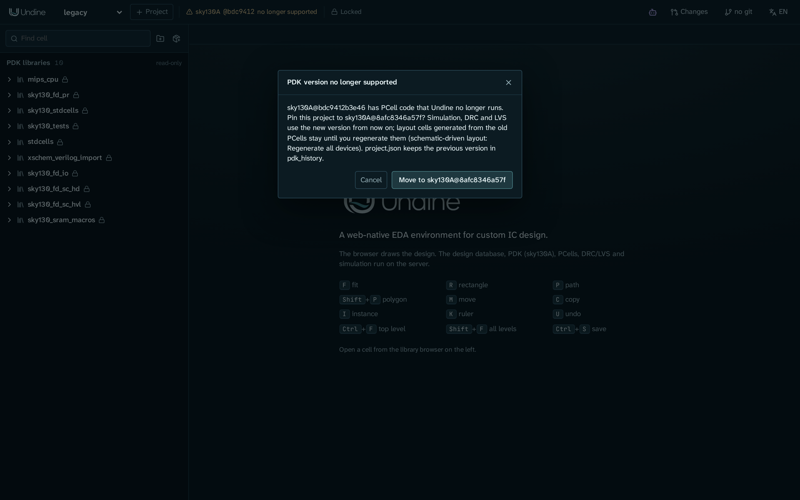

# PDKs

A PDK (process design kit) is what Undine knows about a fabrication process: its layers and design rules, the DRC and
LVS decks, the SPICE models, the device symbols and the PCell generators. PDKs live only on the server; the browser
gets the layer names and colours and the generated geometry, never the models or the rule decks.

Undine does not ship a PDK. You install PDKs with [ciel](https://github.com/fossi-foundation/ciel), the open-source PDK
version manager, and each project is pinned to one exact version of one PDK. This page explains which PDKs Undine
supports, how to install them, how a project records its PDK, and how to move a project to another version.

## Supported PDKs

| PDK | Variants | Version Undine is tested with | What works |
|---|---|---|---|
| SkyWater SKY130 | `sky130A`, `sky130B` | open_pdks `8afc8346a57fe1ab7934ba5a6056ea8b43078e71` (2025); installed by `./setup.sh` | KLayout DRC and LVS, Magic DRC, Magic + Netgen LVS, ngspice at the corners `tt`, `ss`, `ff`, `sf`, `fs`, the PDK's PCells, the Tiny Tapeout and Caravel [tapeout](tapeout.md) targets |
| GlobalFoundries GF180MCU | `gf180mcuA` (3 metals), `gf180mcuB` (4), `gf180mcuC`, `gf180mcuD` (5) | open_pdks `792ef67037d74c8c51811eab3ce23cf793491296`, the version wafer.space pins | KLayout DRC and LVS, Magic DRC, Magic + Netgen LVS, ngspice at `typical`, `ss`, `ff`, `sf`, `fs`, 29 PCells (nfet, pfet, resistors, MIM and MOS capacitors, diodes, BJTs, vias), the wafer.space [tapeout](tapeout.md) target |
| IHP SG13G2 | `ihp-sg13g2` | IHP-Open-PDK `89d42ee6d2fd9b50b86a1aada6fee6673c3e6008` | KLayout DRC and LVS, Magic DRC, Magic + Netgen LVS, ngspice at `mos_tt`, `mos_ss`, `mos_ff`, `mos_sf`, `mos_fs` once its [Verilog-A models are compiled](#ihp-sg13g2-verilog-a-models), 38 PCells (nmos, pmos, resistors, MIM capacitor, ...) |
| IHP SG13CMOS5L | `ihp-sg13cmos5l` | not tested (installed by ciel with the `ihp-sg13` family) | Unverified. KLayout DRC and Magic DRC. Magic + Netgen LVS and ngspice (`mos_*` corners, once the models are compiled) are set up as for SG13G2 but have not been run. No KLayout LVS (Undine sets none up for it yet), no PCells, and the PDK ships no standard-cell library |

The PCell panel of the [layout editor](layout.md) places each PDK's own PCells, and
[schematic-driven layout](layout.md#schematic-driven-layout) generates MOSFETs, resistors and MIM capacitors from a
schematic on SKY130, GF180MCU and SG13G2. Mind the width parameter: GF180MCU's `w_gate` is per finger, SG13G2's `w` is
the total over the `ng` gates.

Other versions of these PDKs usually work as well, but they have not been tested. SKY130 from open_pdks before 2025 is
the exception: Undine no longer runs its PCell code (see [Versions no longer supported](#versions-no-longer-supported)).

A PDK of another family is still found and listed, but Undine has no [profile](#pdk-profiles) for it: it knows none of
its layers, decks or models, and the features that need them are unavailable.

## Installing a PDK

### SKY130

`./setup.sh` installs SKY130 at the tested version as its `pdk` step. To run that step alone:

```sh
./setup.sh pdk
```

It runs `ciel enable --pdk-family sky130 8afc8346a57fe1ab7934ba5a6056ea8b43078e71`, which downloads the PDK into
`$PDK_ROOT` (by default `~/.ciel`) and enables it. The step is skipped when that version is already installed, and
`./setup.sh` runs its check afterwards.

For another version, give the open_pdks commit in `PDK_VERSION`:

```sh
pixi run ciel ls-remote --pdk-family sky130      # the versions ciel can install
PDK_VERSION=<open_pdks commit> ./setup.sh pdk
```

!!! note "`pixi run pdk`"

    `pixi run pdk` is a plain `ciel enable` of the tested SKY130 version. It does not read `PDK_VERSION` or
    `PDK_FAMILY`, does not skip an installed version, and runs no check afterwards. Use `./setup.sh pdk` for
    anything else.

### GF180MCU and IHP SG13G2

Install them at the tested versions with ciel:

=== "ciel"

    ```sh
    pixi run ciel enable --pdk-family gf180mcu 792ef67037d74c8c51811eab3ce23cf793491296
    pixi run ciel enable --pdk-family ihp-sg13 89d42ee6d2fd9b50b86a1aada6fee6673c3e6008
    ```

=== "setup.sh"

    ```sh
    PDK_FAMILY=gf180mcu PDK_VERSION=792ef67037d74c8c51811eab3ce23cf793491296 ./setup.sh pdk
    PDK_FAMILY=ihp-sg13 PDK_VERSION=89d42ee6d2fd9b50b86a1aada6fee6673c3e6008 ./setup.sh pdk
    ```

The `ihp-sg13` family installs both SG13G2 and SG13CMOS5L. Then:

- for IHP, compile the transistor models once: `./setup.sh osdi` ([below](#ihp-sg13g2-verilog-a-models));
- for GF180MCU, the PCells run in their own environment, `pcell-gf180` (gdsfactory 7.9), which the `install` step of
  `./setup.sh` creates (`pixi install -e pcell-gf180`).

!!! note "Rescan after installing a PDK"

    The server looks for PDKs when it starts. A PDK installed while it runs appears after a rescan, with no restart:
    **Rescan PDKs** in the PDK badge's menu, or `POST /api/pdks/rescan`. A PDK fetched from the browser
    ([Fetching a project's PDK](#fetching-a-projects-pdk)) is found at once. A restart (`./scripts/restart.sh`)
    finds it too, and loses no work ([Restarting the server](../reference/cli.md#restarting-the-server)).

Without pixi, install ciel with the server (`pip install -e "server[pdk,dev]"`) and run the same `ciel enable`
commands; see [Install without pixi](../getting-started/install.md#without-pixi).

## Where Undine looks for PDKs

At start, Undine searches these PDK roots, in this order:

1. `$PDK_ROOT`, when it is set (ciel also installs there);
2. `~/.ciel`;
3. `~/.volare` (PDKs installed with volare, ciel's predecessor).

`--pdk-root DIR` replaces that list. It is a global option, so it comes before the command, and you can repeat it:

```sh
pixi run python -m undine --pdk-root /opt/pdks --pdk-root ~/.ciel serve
```

!!! note "`--pdk-root` and the setup steps"

    Only the commands of `python -m undine` take `--pdk-root`. The `osdi` step and the already-installed check of the
    `pdk` step always search the default roots. For a PDK under another root, set `PDK_ROOT` to that root when you run
    them, for example `PDK_ROOT=/opt/pdks ./setup.sh osdi`.

In each root, Undine finds:

- every version in ciel's store, `<root>/ciel/<family>/versions/<commit>/<variant>/`, and in volare's,
  `<root>/volare/<family>/versions/<commit>/<variant>/`: all installed versions, not only the enabled one;
- a plain PDK directory, `<root>/<variant>/libs.tech/`. When it is a link into a `versions/<commit>/` directory (the
  version ciel or volare enabled), its version is that commit; otherwise it has no version.

A PDK is known by its **id**: the variant, `@`, and the first 12 characters of the commit, such as
`sky130A@8afc8346a57f`. A PDK without a version has its bare name as id. When two roots hold the same id, the first one
found is used. To list what Undine found:

```sh
pixi run python -m undine pdk list       # or: pdks
```

With the three families above installed, the output starts like this (shortened):

```
gf180mcuA@792ef67037d7           lyp=yes xschem=yes  792ef67037d74c8c51811eab3ce23cf793491296  ciel    /home/you/.ciel/ciel/gf180mcu/versions/792ef67.../gf180mcuA  libraries=gf180mcu_fd_pr,...
...
ihp-sg13g2@89d42ee6d2fd          lyp=yes xschem=yes  89d42ee6d2fd9b50b86a1aada6fee6673c3e6008  ciel    /home/you/.ciel/ciel/ihp-sg13/versions/89d42ee.../ihp-sg13g2  libraries=sg13g2_pr,sg13g2_stdcell,...
sky130A@8afc8346a57f             lyp=yes xschem=yes  8afc8346a57fe1ab7934ba5a6056ea8b43078e71  ciel    /home/you/.ciel/ciel/sky130/versions/8afc834.../sky130A  libraries=sky130_fd_pr,sky130_fd_sc_hd,...
```

`lyp` says whether the PDK has KLayout layer properties (the layer colours), `xschem` whether it has Xschem device
symbols. Then come the full commit, the installer (`ciel`, `volare`, or `-` for a plain directory), the directory and
the libraries installed (`libs.ref/`).

## How a project pins its PDK

A new project is pinned to one exact PDK version:

=== "Browser"

    **+ Project** in the top bar opens **New project**, which asks for a name and for **PDK, pinned to this exact
    version**: one of the ids the server found, or *none*.

=== "Command line"

    ```sh
    pixi run python -m undine new demo --pdk sky130A
    ```

<a id="bare-pdk-name"></a>
You can give a full id or a bare name. A bare name such as `sky130A` picks a version: a version whose PCells Undine
runs before one whose PCells it does not, the tested version before the others, then the first found. The project
records the exact id it picked.

`project.json` names the PDK by its id:

```json
{
  "name": "demo",
  "pdk": "sky130A@8afc8346a57f",
  "libraries": {"mylib": "libs/mylib"}
}
```

The project's [`undine.lock`](libraries.md#undinelock) records the same id, next to the tool versions, so that a
checkout on another machine can tell when it has another PDK version. A lock of format 2 pins more: the PDK's files
([Pinning the PDK by its files](#pinning-the-pdk-by-its-files)). A project made by hand with a bare name in
`project.json` (`"pdk": "sky130A"`) still opens, but the version is [picked from the name](#bare-pdk-name) each time
it opens; pin the id instead, so that every machine uses the same version.

The PDK badge at the top of the window shows the project's PDK:

| Badge | Meaning |
|---|---|
| **sky130A @8afc834** | the PDK the project is pinned to is installed here; hover for the full id. With a format 2 lock, the badge also says how the PDK stands against the pin, such as *unverified (trust on first use)* or *modified* ([PDK states](#pdk-states)) |
| **sky130A @bdc9412 no longer supported** | installed, but Undine no longer runs its PCell code: click it to [move the project](#moving-a-project-to-another-pdk-version) |
| **PDK sky130A@8afc8346a57f is not on this server** | the project names a PDK this server did not find: fetch it (**Fetch...** in the badge's menu, [below](#fetching-a-projects-pdk)), or [install](#installing-a-pdk) it and rescan, or move the project to one that is installed |
| **No PDK** | the project has no PDK |

Click the badge for its menu: the PDK's state against `undine.lock` with a line on what it means, **Fetch...** when
the PDK is missing or modified, **Rescan PDKs**, and, for a version no longer supported, the move.

A project whose PDK is missing still opens, without a PDK: the layout and schematic files are there, but the models,
decks, symbols and PCells of the PDK are not.

## Pinning the PDK by its files

A format 1 lock pins the PDK by its id, which names a commit but says nothing about the files on this machine: a PDK
edited after it was installed, or one installed from another source under the same commit, looks the same. Pin the
PDK by its files with:

```sh
pixi run python -m undine pdk verify demo --pin
```

```
undine.lock: the PDK pinned as installed here (format 2)
PDK unverified
```

This hashes the installed PDK and writes `undine.lock` as format 2 ([undine.lock](libraries.md#undinelock)): the full
commit, where it came from (`ciel` and its source), the libraries installed and one hash per part (`libs.tech`, each
`libs.ref/<lib>`, and IHP's other `libs.*` directories). So a PDK installed with more libraries still matches, and a
change is reported for the part it is in. What gets written into a PDK after install does not count:
`__pycache__/` and `*.pyc` (from importing the PCell code; Undine's own PCell runs write none) and
`libs.tech/ngspice/osdi/` (models an older setup compiled there). A 12-character id is expanded to the full commit
from the PDKs installed here; for one that is not installed, add `--network` to let ciel look it up (`ciel
ls-remote`).

Hashing a SKY130 variant (about 1 GB) takes seconds the first time. Undine keeps the hashes with the files' stamps in
its [store](../reference/data.md#the-store) (`pdk/`), and later only reads a file whose stamp changed. `lib status` and
the badge read only those kept hashes, never the PDK.

After that, `pdk verify demo` (without `--pin`) compares the PDK with the pin and never writes the lock:

```
  libs.tech: modified ngspice/sky130.lib.spice
~ the PDK files differ from the pin: reinstall it (`ciel rm --pdk-family sky130 8afc8346a57fe1ab7934ba5a6056ea8b43078e71`, then pdk fetch), or pin it as it is now with pdk verify --pin
PDK modified
```

`pdk verify --pin` on a lock that is format 2 already pins the PDK again as it is now, and says what the old pin was.
`lib lock --format 2` also writes format 2 (and pins the PDK as `--pin` does), also for a project with no PDK. Both
refuse a PDK that is not installed here: fetch it first. On a format 2 lock, `set-pdk` pins the new PDK the same way, and `lib lock` leaves the pin
alone.

A pin records what is installed, so `pdk verify --pin` and `lib lock --format 2` pin the PDK even when a locked
[package](libraries.md#pdk-compatibility) does not accept it. Both print a line for each such package (`! demo -> solo
(git 3f1a9c0b7e21): does not fit the PDK sky130A@8afc8346a57f: ...`), and `lib status` then reports each as an issue
until the package or the PDK moves.

### PDK states

`lib status`, the PDK badge and `pdk verify` name the PDK's state against `undine.lock`:

| State | Meaning | Counts as |
|---|---|---|
| `verified` | matches the hashes a PDK profile publishes for this commit. Not given yet: profiles do not publish hashes before a later phase ([Phases](../design/packages.md#phases)) | |
| `unverified` | matches the hashes pinned in `undine.lock`; no profile publishes hashes for this version yet, so it is **trust on first use**: the PDK is as it was on the machine that pinned it, not checked against the published release | a note |
| `unchecked` | files changed since the PDK was last hashed (or it never was here): run `pdk verify PROJECT`. `lib status` never hashes a PDK itself | a note |
| `not pinned` | the lock is format 1 and pins only the id: `pdk verify PROJECT --pin` pins the files | a note |
| `modified` | a part differs from the pin; the files are named when this machine hashed the pinned version before | an issue |
| `missing` | the pinned PDK is not installed here: fetch it | an issue |
| `mismatch` | `project.json` asks for another PDK than the lock pins (a hand edit, or a merge): `set-pdk PROJECT PDK` moves both | an issue |
| `other version` | (format 1) the lock's id is not the PDK found here | an issue |
| `not locked`, `none` | no undine.lock; the project has no PDK | |

A PDK with no version (a plain directory) is pinned by its hashes alone, with a warning. A locked library that is not
installed is an issue too; an installed library the lock does not name is only listed.

## Fetching a project's PDK

Undine installs a project's PDK with [ciel](https://github.com/fossi-foundation/ciel): **Fetch...** in the PDK badge's
menu (when the PDK is missing or modified), or from the command line:

```sh
pixi run python -m undine pdk fetch demo
```

```
fetch the PDK of demo with ciel:
  family     sky130
  variant    sky130A
  commit     8afc8346a57fe1ab7934ba5a6056ea8b43078e71
  libraries  ciel default
  source     static-web:https://fossi-foundation.github.io/ciel-releases
  root       /home/you/.ciel
fetch it? [y/N] y
  ...
installed /home/you/.ciel/ciel/sky130/versions/8afc8346a57fe1ab7934ba5a6056ea8b43078e71/sky130A
~ undine.lock pins the PDK by id only: `python -m undine pdk verify demo --pin` pins its tree
PDK not pinned
a running Undine server finds it after a rescan: Rescan PDKs in the PDK badge's menu, or POST /api/pdks/rescan
```

What it fetches:

- **Family.** ciel installs by family: `sky130` for `sky130A` and `sky130B`, `gf180mcu` for `gf180mcuA` to `D`,
  `ihp-sg13` for `ihp-sg13g2` and `ihp-sg13cmos5l`.
- **Commit.** From a format 2 pin, its full commit; from a format 1 id (or `project.json`'s id when there is no lock),
  the 12 characters expanded to the full commit from the PDKs installed here, else with `--network` (the dialog: *Allow
  the network ...*) by `ciel ls-remote`.
- **Libraries.** The pin's libraries; otherwise ciel's default set.
- **Source.** A format 2 pin names ciel's data source; a format 1 id is assumed to come from ciel's default source,
  `static-web:https://fossi-foundation.github.io/ciel-releases`. A PDK pinned from volare is refused (install it with
  volare). From the browser, only ciel's default source is fetched; another one is fetched from the command line.
- **Root.** The first PDK root Undine scans ([Where Undine looks for PDKs](#where-undine-looks-for-pdks)) that has a
  `ciel/` directory, does not exist yet, or is empty: `--pdk-root` when given, else `$PDK_ROOT`, else `~/.ciel`. When
  none qualifies (only `~/.volare`, say), the fetch is refused, since a PDK fetched elsewhere would not be found: pass
  `--pdk-root DIR` or set `PDK_ROOT`. ciel installs into its own store there and does not enable the version (the
  `<root>/<variant>` link stays as it was); Undine finds every version in ciel's store anyway.

Then Undine compares the PDK with the lock (as `pdk verify`) and, from the browser, rescans the PDKs, so the project
finds its PDK with no restart. A fetch never writes `undine.lock`: pin the PDK with `pdk verify --pin` if you want its
files pinned. The command line asks before it runs ciel (`--yes` does not ask) and cannot reach a running server: use
**Rescan PDKs** there.

In the browser, **Fetch PDK** shows the family, variant, commit, libraries, source and the directory it installs under.
Nothing is fetched until you click **Fetch**. The fetch then runs on the server: its output shows in the dialog, and
closing the dialog leaves it running (it is lost if the server restarts: fetch again, or rescan to find what it
installed). Agents cannot start a fetch: none of their tools asks for the confirmation it needs
([HTTP API](../reference/api.md#pdk-fetch)).

To install a `modified` PDK again, remove it first with `ciel rm --pdk-family FAMILY COMMIT` (the badge's menu and
`pdk verify` show the command), then fetch it.

## Moving a project to another PDK version

`set-pdk` pins a project to another installed PDK:

```sh
pixi run python -m undine set-pdk demo sky130A@8afc8346a57f
```

```
demo: sky130A@bdc9412b3e46 -> sky130A@8afc8346a57f
cells generated from PCells of the old PDK stay until regenerated (schematic-driven layout: Regenerate all devices)
```

It changes:

- `pdk` in `project.json`;
- `pdk_history` in `project.json`, which gains an entry with the old id, the new id and the time:

    ```json
    "pdk_history": [{"from": "sky130A@bdc9412b3e46", "to": "sky130A@8afc8346a57f", "time": "2026-11-10T09:30:00+0900"}]
    ```

- `pdk` in `undine.lock`. A project made before locks has none: `set-pdk` creates it, recording the tool versions
  in use now, as `lib lock` would, and prints `created undine.lock (format 1)`. A format 2 lock gets the new PDK's
  pin, its files hashed first (seconds for a PDK not hashed before); moving to the PDK the lock pins already keeps the
  pin as it is.

!!! warning "With the server running"

    The command line `set-pdk` only writes the project's files. A running server keeps the layouts it has loaded on the
    old PDK, for PCell placement and the editors, until it restarts. While the server runs, move the project through the
    server instead: with **Move to** in the PDK badge's dialog where it offers one, or with the HTTP call
    `POST /api/p/{project}/pdk` ([HTTP API](../reference/api.md)), which the badge uses. Otherwise restart the server
    after `set-pdk`.

After the move:

- simulation, DRC and LVS use the new version;
- earlier results become [outdated](verification.md#outdated-results), with the reason `PDK <old> → <new>`;
- layout cells generated from the old version's PCells stay as they are until you regenerate them (schematic-driven
  layout: **Regenerate all devices**).

To go back, run `set-pdk` with the old id; `pdk_history` keeps both moves. The PDK is changed in the project itself,
never in a [changeset](changesets.md): the HTTP call refuses a changeset preview.

**Packages that do not accept the PDK.** `set-pdk` checks the new PDK against the `[pdk]` of every locked
[package](libraries.md#pdk-compatibility), those a dependency brought in included, and refuses the move when one does
not accept it, listing each with its chain and changing nothing:

```
error: the PDK sky130A@0c4e2b7a1f30 is not accepted by 2 locked packages:
- demo -> analog_ip 1.2.0 (v1.2.0 @ 229914698b1f): sky130A@0c4e2b7a1f30 is not among commits 8afc8346a57f
- demo -> analog_ip 1.2.0 (v1.2.0 @ 229914698b1f) -> sar_common 1.3.1 (v1.3.1 @ 5b1c0e2a9d11): sky130A@0c4e2b7a1f30 is not among commits 8afc8346a57f
update or remove them (lib update, lib remove), or choose a PDK they accept; nothing was changed
```

Move the packages first (`lib update` to a version that lists the new commit), or remove them. Over HTTP the refusal
is a 409 with code `pdk_incompatible` and the list; **Move to** in the PDK badge's dialog shows it. A locked package
that is in neither the store nor installed here (a fresh clone) cannot be checked, and is refused with `run lib sync
first`. Moving to the PDK the project names already is never refused.

!!! warning

    A plain git dependency (no `undine-package.toml`) or a package with no `[pdk]` is not checked. A library drawn on
    another PDK version may need its layouts checked again (DRC and LVS) after the move.

### Versions no longer supported

SKY130 from open_pdks before 2025 (for example `bdc9412`) has an older generation of PCell code that Undine no longer
runs; the current code needs gdsfactory 8 with kfactory. A project pinned to such a version still opens, simulates and
runs DRC and LVS, but its PCells are unavailable, and the PDK badge says **no longer supported**.



Click the badge. When a version of the same PDK whose PCells Undine runs is installed (the tested one first), the
dialog **PDK version no longer supported** offers **Move to** that version; it does what `set-pdk` does. When none is
installed, the dialog names the supported version and the `set-pdk` command: run `./setup.sh pdk`, choose **Rescan PDKs**
in the badge's menu, and click the badge again.

`pixi run doctor` lists such PDKs too, with a `set-pdk` command for the projects pinned to them. The PDK that command
names is the first one found whose PCells Undine runs, which may be of another family (with GF180MCU installed, it is
`gf180mcuA@...`). Take the target from the badge's dialog instead, or use the same variant at the tested version,
such as `sky130A@8afc8346a57f`.

## IHP SG13G2 Verilog-A models

IHP's transistor models (PSP103 and others) are Verilog-A. ngspice loads them compiled, as OSDI files, which needs two
things:

1. **ngspice built with OSDI.** The `ngspice` step of `./setup.sh` builds ngspice 47 with OSDI into the pixi
   environment (conda-forge's ngspice has none).
2. **The compiled models.** Compile them once after installing the PDK:

    ```sh
    ./setup.sh osdi          # or: pixi run osdi
    ```

The `osdi` step downloads OpenVAF 23.5.0 into `.pixi/build` and runs the PDK's own compile script on a copy of its
Verilog-A sources, so the PDK stays as installed. The OSDI files go to Undine's
[store](../reference/data.md#the-store), `~/.undine/store/build/<commit>/<variant>/osdi/` (`$UNDINE_STORE` moves it;
a PDK with no version uses `build/local-<hash of its directory>/<variant>/osdi/`), shared by every project.

- Undine loads them in every IHP simulation, from the store first, then from the PDK
  (`libs.tech/ngspice/osdi/`, where an older setup compiled them), then from the cache an earlier Undine compiled
  them into (`~/.cache/undine/osdi/<PDK id>/`).
- **Moving from the old cache.** Models in the old cache are still used, and `pixi run doctor` notes them
  (`... from the old cache: run pixi run osdi to move them into the store`). `pixi run osdi` moves them into the store
  without compiling them again (`ihp-sg13g2: moved psp103.osdi from ... into ...`) and removes the old directory once
  it is empty; `pixi run osdi -n` says what it would move.
- Until they are compiled, an IHP simulation stops and tells you to run `./setup.sh osdi`.
- The step skips a PDK whose models are there. `FORCE=1 pixi run osdi` compiles them again; `pixi run osdi -n` only
  says what it would do.

The step is not part of a plain `./setup.sh`. It compiles the models of every PDK that needs them (SG13G2 and
SG13CMOS5L) in `$PDK_ROOT`, `~/.ciel` and `~/.volare`; for a PDK under another root, see
[`--pdk-root` and the setup steps](#where-undine-looks-for-pdks).

## Checking your PDKs

`./setup.sh check` (or `pixi run doctor`) reports what Undine found, and the command that fixes what is missing. For
example, with SKY130, GF180MCU and the `ihp-sg13` family installed at the tested versions, the IHP models not compiled
yet, and an old SKY130 left in `~/.volare`, the lines about PDKs read (shortened):

```
 ✓ a PDK                                                        ok  gf180mcuA@792ef67037d7, ..., ihp-sg13cmos5l@89d42ee6d2fd, ihp-sg13g2@89d42ee6d2fd, sky130A@8afc8346a57f, ...
 ✓ ngspice with OSDI (IHP's Verilog-A models)                   ok  ngspice-47 : Circuit level simulation program
 - compiled Verilog-A models of the PDKs that need them         missing  [recommended]  -> pixi run osdi (OpenVAF; missing for ihp-sg13cmos5l@89d42ee6d2fd, ihp-sg13g2@89d42ee6d2fd)
 ✓ PCell environment (gdsfactory 8 with kfactory; sky130, IHP)  ok  .../.pixi/envs/pcell/bin/python
 ✓ GF180MCU PCell environment (gdsfactory 7.9)                  ok  .../.pixi/envs/pcell-gf180/bin/python
 ✓ a PDK whose PCells Undine runs                               ok  gf180mcuA@792ef67037d7, ..., ihp-sg13g2@89d42ee6d2fd, sky130A@8afc8346a57f, sky130B@8afc8346a57f
 ! PDKs no longer supported (PCell code before 2025)            sky130A@bdc9412b3e46, sky130B@bdc9412b3e46  [note]  -> projects pinned to them: python -m undine set-pdk PROJECT gf180mcuA@792ef67037d7
 ✓ ciel (PDK manager)                                           ok  .../.pixi/envs/default/bin/ciel
```

*a PDK* is required: without one, `doctor` exits with code 1. The *GF180MCU PCell environment* line and the compiled-models
line appear only when such a PDK is installed. The `set-pdk` target on the *no longer supported* line is not the one
to use for a SKY130 project; see [Versions no longer supported](#versions-no-longer-supported).

`doctor` also shows each tool's version number and where it came from (`0.30.12 (pixi)`), Undine's version, and the
hash of its `pixi.lock`.

For one project, `lib status` compares the PDK (and the tools and dependencies) with `undine.lock`:

```sh
pixi run python -m undine lib status demo
```

```
  PDK                  pdk        other version  sky130A@bdc9412b3e46
  mylib                own        ok             libs/mylib
! PDK: locked sky130A@bdc9412b3e46, here sky130A@8afc8346a57f
  note: origins, Undine version and pixi.lock are not recorded (format 1)
```

In the window, the lock badge next to the PDK badge says **Locked** or **N lock issues**; click it for the same list.
When the difference is intended (you moved the PDK by hand, or on purpose use another version on this machine),
record what is in use with `lib lock` or the lock dialog's **lock** action (with a format 1 lock; a format 2 pin
moves with `set-pdk` or `pdk verify --pin`). See [undine.lock](libraries.md#undinelock) and
[PDK states](#pdk-states).

## PDK profiles

Each PDK family has a **profile**: what Undine needs to know about the process beyond the PDK's files. A profile
names the layers and the metal stack, the DRC and LVS decks and their options, the Magic and Netgen setup files, the
model library and its corners, the compiled models a simulation loads, the PCell library and the environment that
runs it, the standard cells, and what does not work yet. Undine picks the profile by the PDK's name, then by its
family.

Undine has profiles for SKY130, GF180MCU, IHP SG13G2 and IHP SG13CMOS5L. The first three have been run against the
tested PDK versions; SG13CMOS5L's has not. A PDK of a family without a profile gets the generic one, *Unknown
process*, which knows none of this: such a PDK is listed and a project can be pinned to it, but DRC, LVS, simulation
models and PCells are unavailable. Profiles are part of Undine, not of the PDK, so a new profile comes with a new
version of Undine. [Architecture and development](../development.md) shows where the profiles sit in the server.

!!! note "Planned"

    A package system for libraries and PDKs, with profiles published as data (and with them the hashes that make a
    PDK *verified*), is designed in [Packages and PDKs](../design/packages.md); [Phases](../design/packages.md#phases)
    says what exists today. Pinning a PDK by its files and fetching it through ciel are there now.

## See also

- [Install](../getting-started/install.md): `./setup.sh` and its steps
- [Libraries and dependencies](libraries.md): `undine.lock`, `lib status`, `lib lock`
- [Command line and configuration](../reference/cli.md): `new`, `set-pdk`, `pdk list`, `pdk verify`, `pdk fetch`, `doctor`, `PDK_ROOT`, `UNDINE_STORE`
- [Tapeout](tapeout.md): the shuttle targets per PDK
