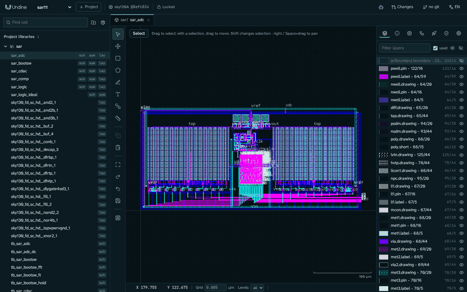

---
hide:
  - toc
---

# Undine ドキュメント { .u-hidden-title }

オープンソース · アルファ版

カスタム IC 設計のための AI ネイティブな Web ベースの EDA 環境

Undine(ウンディーネ)は設計データ、PDK、DRC / LVS、シミュレーションをサーバーに置き、ブラウザ、スクリプト、AI エージェントが同じ API で
作業します。エージェントの編集は提案として届き、あなたがレビューするまで設計は変わりません。

[はじめる](getting-started/install.md){ .md-button .md-button--primary }
[最初のセルを作る](tutorials/inverter.md){ .md-button }

<figure class="u-hero__figure" markdown>

<figcaption>AI エージェントと一緒に Undine で設計した SKY130 の 11 ビット SAR ADC(<a href="tutorials/sar-adc/">事例</a>)。</figcaption>
</figure>

## ドキュメントを探す { .u-section-title }

-   :material-rocket-launch-outline:{ .u-tile__icon }

    [はじめに](getting-started/install.md)

    `./setup.sh` でインストールし、sky130 の PDK で最初のプロジェクトを開きます。

-   :material-school-outline:{ .u-tile__icon }

    [チュートリアル](tutorials/inverter.md)

    インバータを回路図からレイアウトまで。次にエージェントと、そして Tiny Tapeout へ。

-   :material-target:{ .u-tile__icon }

    [セルと設計意図](guide/cells.md)

    ビューを並べて表示し、チェックの基準になる目標、制約、スペックを持たせます。

-   :material-vector-polyline:{ .u-tile__icon }

    [回路図](guide/schematic.md)

    Xschem 互換の `.sch` / `.sym` の編集、ネットリスト、シンボル。

-   :material-layers-outline:{ .u-tile__icon }

    [レイアウト](guide/layout.md)

    KLayout のタイル、PDK のレイヤーと PCell、回路図駆動レイアウト。

-   :material-sine-wave:{ .u-tile__icon }

    [シミュレーションと RTL](guide/rtl.md)

    コーナーごとのスペックを測る ngspice、Verilator、LibreLane で GDS まで。

-   :material-check-decagram-outline:{ .u-tile__icon }

    [検証](guide/verification.md)

    DRC、LVS、寄生抽出、ポストレイアウトシミュレーション。

-   :material-robot-outline:{ .u-tile__icon }

    [エージェントと MCP](getting-started/connect-ai.md)

    MCP で Claude Code や Claude Desktop から。`undine call`、Python からも。

-   :material-source-branch:{ .u-tile__icon }

    [変更セット (changeset)](guide/changesets.md)

    提案ごとに git のブランチ。変更前後のチェックを見て、採用か破棄か。

-   :material-package-variant-closed:{ .u-tile__icon }

    [PDK とライブラリ](guide/pdks.md)

    SKY130、GF180MCU、IHP SG13G2。パッケージは `undine.lock` に固定します。

-   :material-chip:{ .u-tile__icon }

    [テープアウト](guide/tapeout.md)

    Tiny Tapeout、wafer.space、ChipFoundry のチェックと提出用バンドル。

-   :material-book-open-variant:{ .u-tile__icon }

    [リファレンス](reference/cli.md)

    `undine` コマンド、ディスク上のデータ、HTTP API。

!!! tip "ヒント"

    `./setup.sh check`(または `pixi run doctor`)は、手元のマシンに足りないものと、それを直すコマンドを表示します。

## Undine の考え方 { .u-section-title }

**ブラウザは描画するだけ**

データベース、PDK、PCell のコード、チェック、シミュレーションはサーバーに置いたままです。PDK をファウンドリや会社が管理する
マシンの中に置いたまま使えます。[しくみ](overview.md#how-it-works)

**エージェントが提案し、人が決める**

UI でできることは、エージェントも MCP でできます。その編集は changeset に入り、変更前後のチェックと一緒にあなたがレビューします。
[設計エージェントと MCP](guide/assistant.md)

**再現できる設計**

プロジェクトは PDK を commit と木のハッシュで、ライブラリを内容で固定します。編集はすべて操作ログと git に残ります。
[ライブラリと依存関係](guide/libraries.md)

## 事例: 11 ビット SAR ADC { .u-section-title }

AI エージェントと一緒に Undine で作った、11 ビット 5.12 MS/s の SAR ADC です。「The Era of Vibe Tapeout」の設計に倣い、SKY130 で
0.067 mm²、DRC と LVS はクリーンです。各ブロックの抽出したレイアウトで tt コーナーをシミュレーションすると、SNDR 67.09 dB、
SFDR 81.62 dB、245 µW です。事例では、進め方、結果、残っている課題と限界を説明しています。

[事例を読む](tutorials/sar-adc.md){ .md-button }

## ヘルプとコミュニティ { .u-section-title }

- [:material-lifebuoy: トラブルシューティングと FAQ](troubleshooting.md)
- [:material-bug-outline: 問題を報告する](https://github.com/kadomoto-lab/undine-eda/issues)
- [:material-map-outline: ロードマップ](roadmap.md)
- [:material-hand-heart-outline: 開発に参加する](https://github.com/kadomoto-lab/undine-eda/blob/main/CONTRIBUTING.md)
- [:material-sitemap-outline: アーキテクチャ](development.md)
- [:material-scale-balance: ライセンス](licenses.md)

