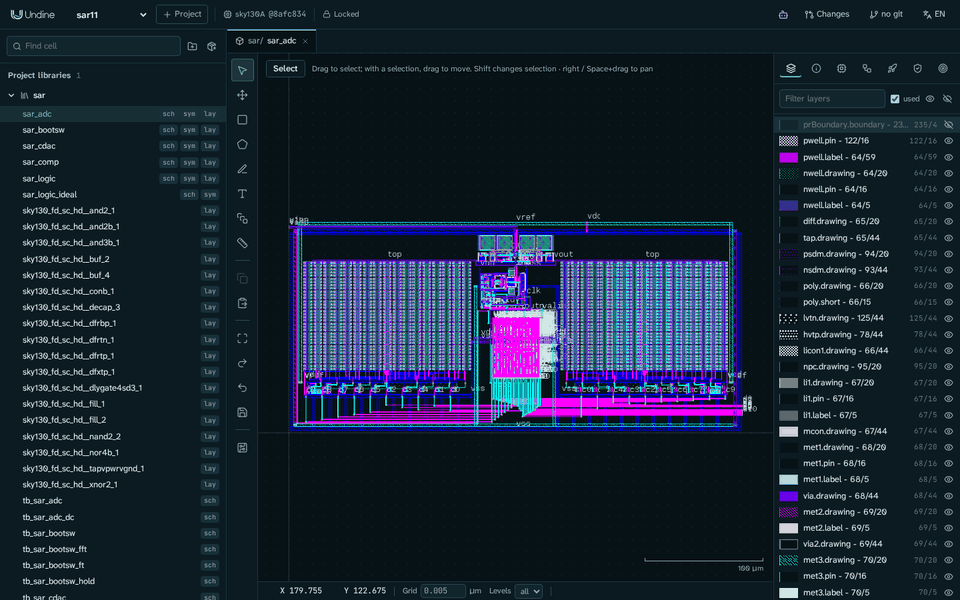

---
hide:
  - toc
---

# Undine documentation { .u-hidden-title }

Open source · alpha

An AI-native, web-based EDA environment for custom IC design.

Undine (pronounced *uhn-deen*) keeps the design, the PDK, DRC / LVS and simulation on a server, and lets the browser, scripts and AI agents
work through the same API. An agent's edits arrive as a proposal that you review before anything changes.

[Get started](getting-started/install.md){ .md-button .md-button--primary }
[Your first cell](tutorials/inverter.md){ .md-button }

<figure class="u-hero__figure" markdown>

<figcaption>An 11-bit SAR ADC on SKY130 designed in Undine with an AI agent (<a href="tutorials/sar-adc/">case study</a>).</figcaption>
</figure>

## Explore the documentation { .u-section-title }

-   :material-rocket-launch-outline:{ .u-tile__icon }

    [Getting started](getting-started/install.md)

    Install with `./setup.sh`, open a first project on the sky130 PDK.

-   :material-school-outline:{ .u-tile__icon }

    [Tutorials](tutorials/inverter.md)

    An inverter from schematic to layout, then with an agent, then to Tiny Tapeout.

-   :material-target:{ .u-tile__icon }

    [Cells and intent](guide/cells.md)

    Views side by side, and the goals, constraints and specs that checks work from.

-   :material-vector-polyline:{ .u-tile__icon }

    [Schematic](guide/schematic.md)

    Xschem-compatible `.sch` / `.sym` editing, netlists, symbols.

-   :material-layers-outline:{ .u-tile__icon }

    [Layout](guide/layout.md)

    KLayout tiles, PDK layers and PCells, schematic-driven layout.

-   :material-sine-wave:{ .u-tile__icon }

    [Simulation and RTL](guide/rtl.md)

    ngspice with specs at corners, Verilator, LibreLane to GDS.

-   :material-check-decagram-outline:{ .u-tile__icon }

    [Verification](guide/verification.md)

    DRC, LVS, parasitic extraction and post-layout simulation.

-   :material-robot-outline:{ .u-tile__icon }

    [Agents and MCP](getting-started/connect-ai.md)

    Claude Code and Claude Desktop over MCP, `undine call`, Python.

-   :material-source-branch:{ .u-tile__icon }

    [Changesets](guide/changesets.md)

    Every proposal on a git branch: checks before and after, adopt or discard.

-   :material-package-variant-closed:{ .u-tile__icon }

    [PDKs and libraries](guide/pdks.md)

    SKY130, GF180MCU, IHP SG13G2, and packages pinned in `undine.lock`.

-   :material-chip:{ .u-tile__icon }

    [Tapeout](guide/tapeout.md)

    Tiny Tapeout, wafer.space and ChipFoundry checks and bundles.

-   :material-book-open-variant:{ .u-tile__icon }

    [Reference](reference/cli.md)

    The `undine` command, the data on disk, the HTTP API.

!!! tip "Tip"

    `./setup.sh check` (or `pixi run doctor`) says what is missing on your machine, and the command that fixes it.

## Why Undine { .u-section-title }

**The browser only draws**

The database, PDK, PCell code, checks and simulation stay on the server. A PDK can stay inside a foundry- or
company-controlled machine. [How it works](overview.md#how-it-works)

**Agents propose, people decide**

Everything the UI does, an agent can do over MCP. Its edits land in a changeset you review, with checks before and
after. [Agent and MCP](guide/assistant.md)

**Reproducible by design**

A project pins its PDK by commit and tree hash and its libraries by content; every edit is in an operation log and in
git. [Libraries and dependencies](guide/libraries.md)

## Showcase: an 11-bit SAR ADC { .u-section-title }

An 11-bit, 5.12 MS/s SAR ADC built in Undine with an AI agent, after *The Era of Vibe Tapeout*: 0.067 mm² on SKY130,
DRC and LVS clean. Simulated on each block's extracted layout at the tt corner: SNDR 67.09 dB, SFDR 81.62 dB, 245 µW.
The case study shows how it was built, its results, and its open items and limits.

[Read the case study](tutorials/sar-adc.md){ .md-button }

## Help and community { .u-section-title }

- [:material-lifebuoy: Troubleshooting and FAQ](troubleshooting.md)
- [:material-bug-outline: Report a problem](https://github.com/kadomoto-lab/undine-eda/issues)
- [:material-map-outline: Roadmap](roadmap.md)
- [:material-hand-heart-outline: Contributing](https://github.com/kadomoto-lab/undine-eda/blob/main/CONTRIBUTING.md)
- [:material-sitemap-outline: Architecture](development.md)
- [:material-scale-balance: Licenses](licenses.md)

