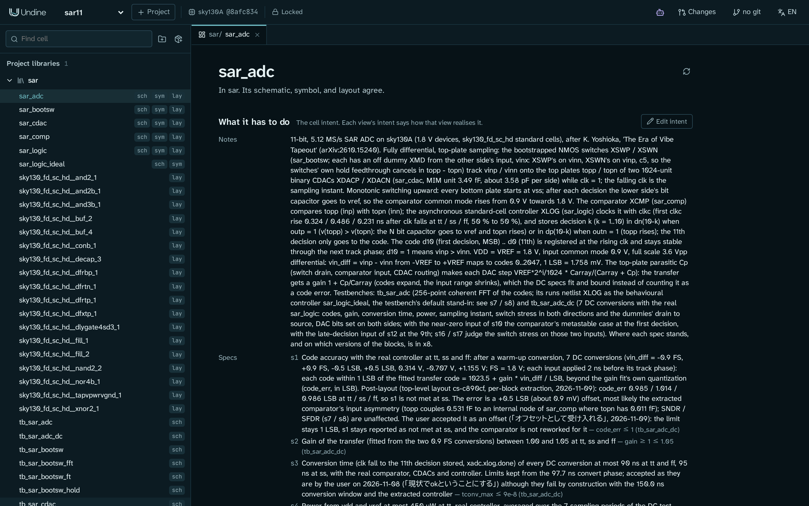
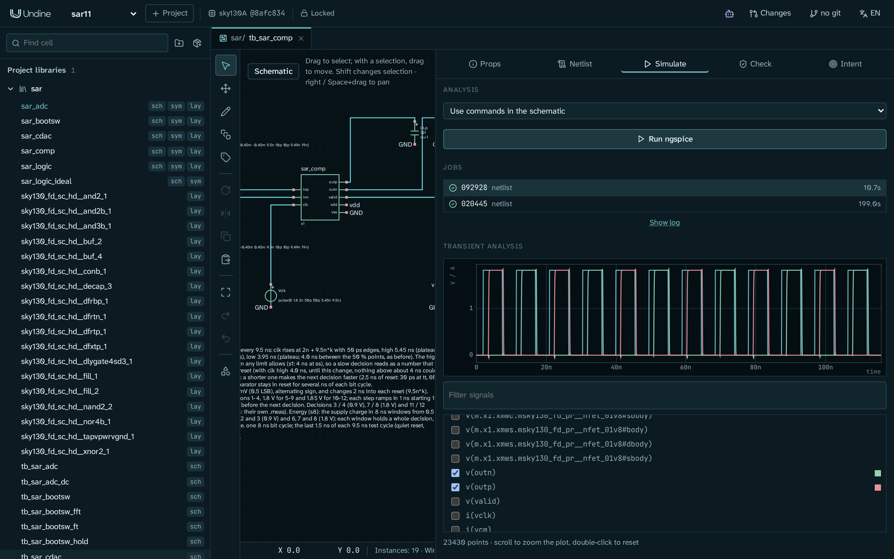
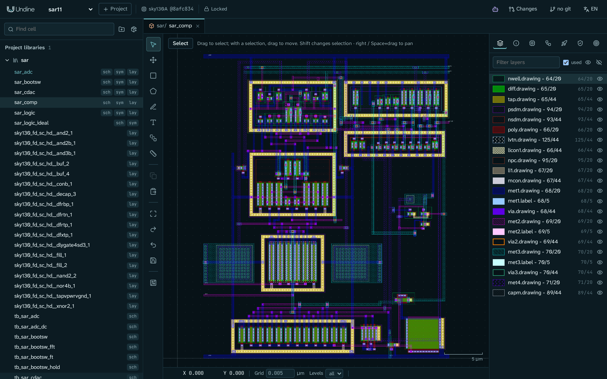
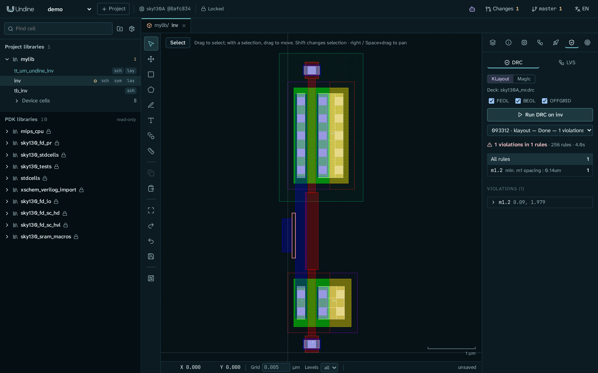
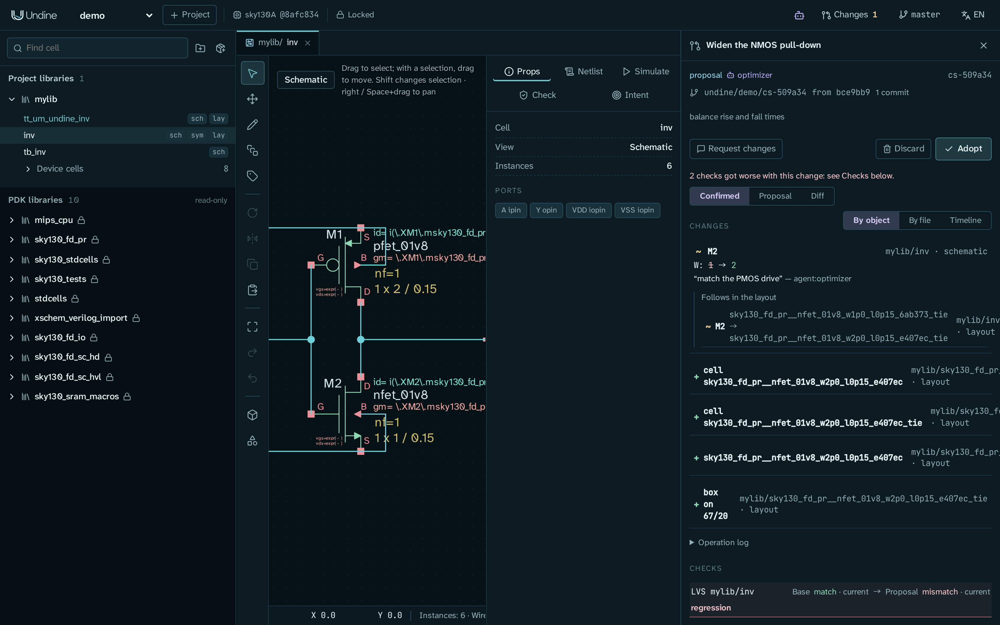
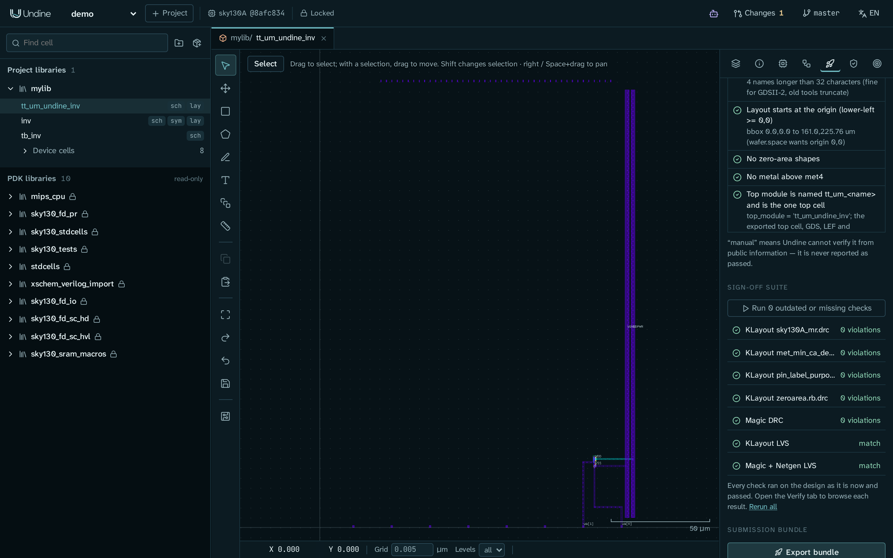

# 概要

**Undine(ウンディーネ)は、カスタム IC 設計のための AI ネイティブな Web ベースの EDA 環境です。** 回路図、レイアウト、RTL、シミュレーション、DRC/LVS、テープアウトを
ブラウザで行います。PDK はサーバーに置き、人、スクリプト、AI エージェントが同じ API を使います。

## しくみ { #how-it-works }

**ブラウザは描画するだけです。** 設計データベース、PDK、PCell の実装、DRC/LVS、シミュレーションはすべてサーバー上で動き、
Design API の向こう側にあります。Web UI はその API のクライアントの一つで、スクリプトや AI エージェントも同じ API を使う
クライアントです。

- **PDK をサービスとして提供。** クライアントが受け取るのはレイヤーの色、プリミティブのシンボル、PCell のパラメータ、
  描画結果だけで、モデル、ルールデッキ、PCell のコードは渡りません。PDK をファウンドリや会社が管理するサーバーの中に置いたまま使えます。
- **再現性。** プロジェクトは `project.json` に、PDK の正確なバージョン(`sky130A@8afc8346a57f`)とツールのバージョンを固定します。
- **エージェントを前提とした設計。** UI でできることはすべて、エージェントも同じ HTTP 呼び出しで行えます(MCP、`undine` コマンド、Python から)。
  変更はすべて記録され、レビューでき、取り消せます。
- **配置の自由。** 同じサーバーを手元のマシンでも、VPC の中でも、オンプレミスでも動かせる設計です。まだサインインがないので、
  信頼できるネットワークの中で使ってください([ロードマップ](roadmap.md)を参照)。

## 機能

| | |
|---|---|
| **PDK** | SkyWater SKY130、GlobalFoundries GF180MCU、IHP SG13G2 を [ciel](https://github.com/fossi-foundation/ciel) で導入。それぞれの KLayout と Magic / Netgen のデッキ、モデルとコーナー、PCell に対応。プロジェクトの PDK は `undine.lock` に commit と木のハッシュで固定し、ブラウザから ciel で取得できる |
| **レイアウト** | サーバーで描画するタイル(KLayout)、PDK の `.lyp` によるレイヤー、描画・移動・コピー・削除、再起動後も残る Undo、ルーラー、PCell の配置 |
| **回路図** | Xschem の `.sch` / `.sym` のビューアとエディタ(配線、配置、移動、回転、反転、複製、プロパティ)。ディスク上は Xschem と互換 |
| **セルと設計意図** | セルのビューを並べて表示し、設計意図(目標、制約、スペック)を持たせる。チェックやエージェントはそこから作業する |
| **シミュレーション** | ネットリスト生成(Undine、Xschem、vlsirtools)。ngspice 47 のジョブと波形ビューア。スペックをコーナー・温度・条件ごとに測り、スイープもできる |
| **検証** | KLayout の DRC/LVS デッキに加え、もう一つの判断材料として Magic の DRC と Magic + Netgen の LVS。結果は共通のブラウザで確認。Magic による寄生抽出と、抽出結果のビューでのシミュレーション |
| **回路図駆動レイアウト** | 回路図の MOSFET、抵抗、MIM 容量を PDK の PCell として生成(フィンガーは 1 つのデバイスにつなぐ)、ラッツネスト、回路図 ↔ レイアウトのクロスプローブ |
| **RTL** | セルごとの Verilog / SystemVerilog、Verilator によるリントとテストベンチ、LibreLane による RTL または標準セルの回路図から GDS まで、Caravel のユーザープロジェクト用ラッパーへのマクロのハードニング |
| **ライブラリとパッケージ** | パッケージの manifest(`undine-package.toml`)を持つ git の依存。パッケージ自身の依存も持ち込み、内容アドレスの共有ストアに一度だけ取得して、`undine.lock` に木のハッシュで固定する。セル名の重なりや、パッケージが受け付けない PDK は、何かを install する前に拒否する。依存のシミュレーター用コードブロックと RTL は、人が信頼するまで拒否する([ライブラリと依存関係](guide/libraries.ja.md)) |
| **変更セット (changeset) と git** | 提案ごとに git のブランチと専用の作業コピー、変更前後でのチェック、採用(オブジェクト単位でマージし、作業ツリーがきれいならコミット)・破棄・取り消し。操作ログはすべて残る。[履歴パネル](guide/history.ja.md)でコミットごとと作業ツリーの変更をオブジェクト単位で表示。git のブランチをオブジェクト単位でマージし(回路図、レイアウト、設計の意図)、確認し直すべきセルを一覧にする |
| **エージェント** | Claude Code や Claude Desktop などのための MCP サーバー、`undine` コマンドと Python クライアント、Agent Skill。ブラウザ向けにアプリ内エージェントも |
| **テープアウト** | Tiny Tapeout(SKY130 アナログ)、wafer.space(GF180MCU のダイ)、ChipFoundry(Caravel): 各シャトルの事前チェックに倣ったレイアウトのチェック、サインオフ一式、提出用バンドル |

## スクリーンショット

<table>
  <tr>
    <td width="50%"> <b>セルと設計意図</b>: セルがすべきこと。目標、制約、スペックと、それを測る条件</td>
    <td width="50%"> <b>回路図</b>: Xschem 互換の編集。ここでは SAR ADC の最上位</td>
  </tr>
  <tr>
    <td> <b>シミュレーション</b>: ngspice はサーバーで動き、波形はブラウザで表示(±0.45 mV の入力に対するコンパレータの判定)</td>
    <td> <b>レイアウト</b>: PDK のレイヤーでサーバーが描画するタイル。ここではコンパレータ</td>
  </tr>
  <tr>
    <td> <b>DRC / LVS</b>: KLayout または Magic のデッキ。ルールとマーカーをレイアウト上に表示</td>
    <td> <b>変更セット (changeset)</b>: エージェントの提案、その差分、変更前後のチェック。人の判断を待つ</td>
  </tr>
  <tr>
    <td colspan="2" align="center"> <b>テープアウト</b>: Tiny Tapeout のタイルのチェックとサインオフ一式</td>
  </tr>
</table>

## 謝辞

Undine は次のプロジェクトの上に成り立っています: [KLayout](https://www.klayout.de/)、[Xschem](https://xschem.sourceforge.io/)、
[ngspice](https://ngspice.sourceforge.io/)、[Magic](http://opencircuitdesign.com/magic/)、
[Netgen](http://opencircuitdesign.com/netgen/)、[Verilator](https://www.veripool.org/verilator/)、
[LibreLane](https://github.com/librelane/librelane)、[OpenVAF](https://openvaf.semimod.de/)、
[open_pdks](https://github.com/RTimothyEdwards/open_pdks)、[ciel](https://github.com/fossi-foundation/ciel)、
[SkyWater SKY130 PDK](https://github.com/google/skywater-pdk)、[GF180MCU PDK](https://github.com/google/gf180mcu-pdk)、
[IHP Open PDK](https://github.com/IHP-GmbH/IHP-Open-PDK)、[Tiny Tapeout](https://tinytapeout.com/)、
[wafer.space](https://wafer.space/)、[ChipFoundry](https://chipfoundry.io/) の Caravel。
