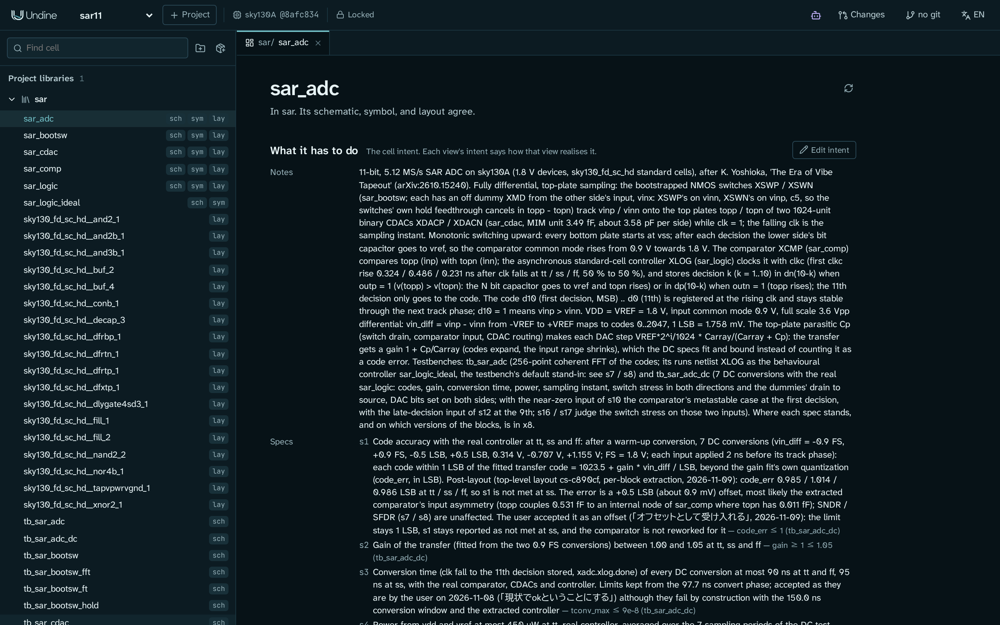
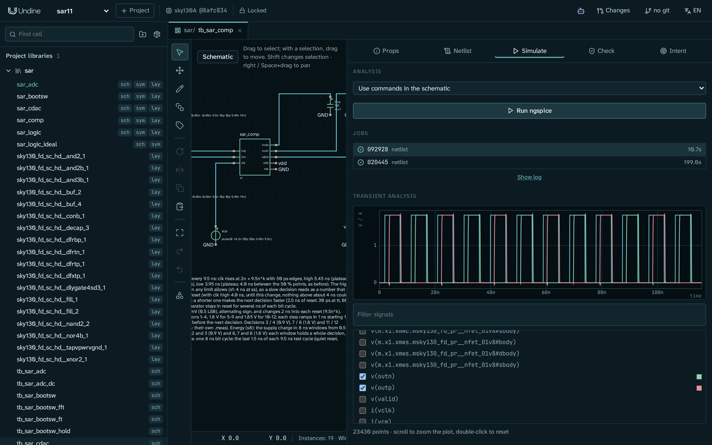
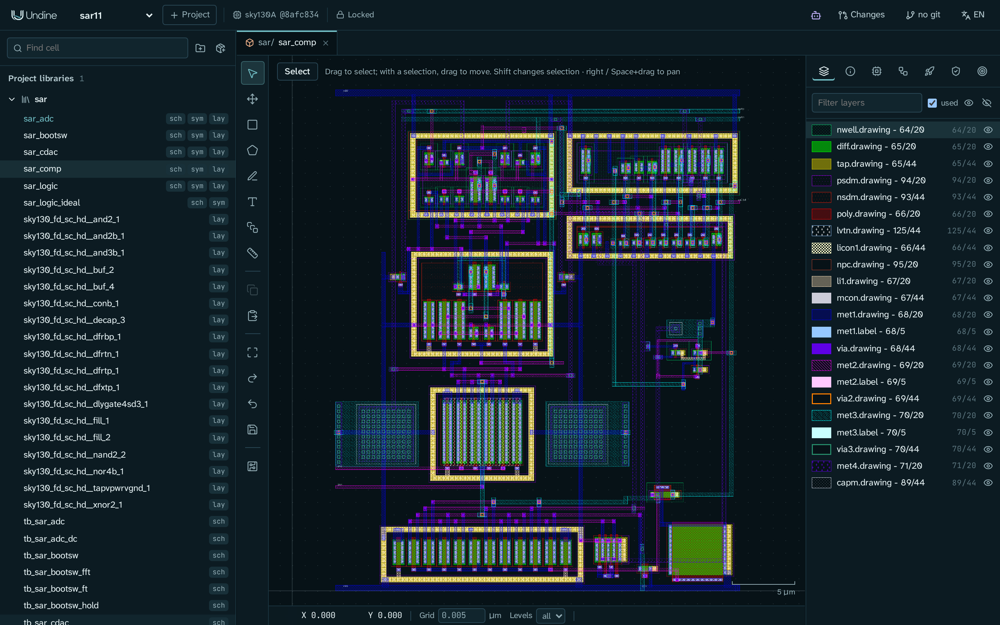
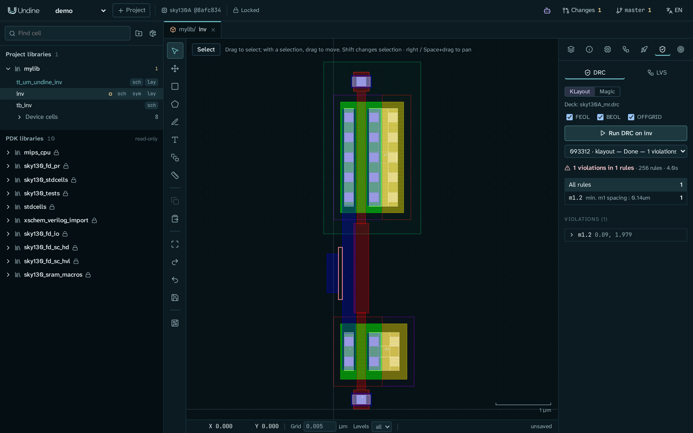
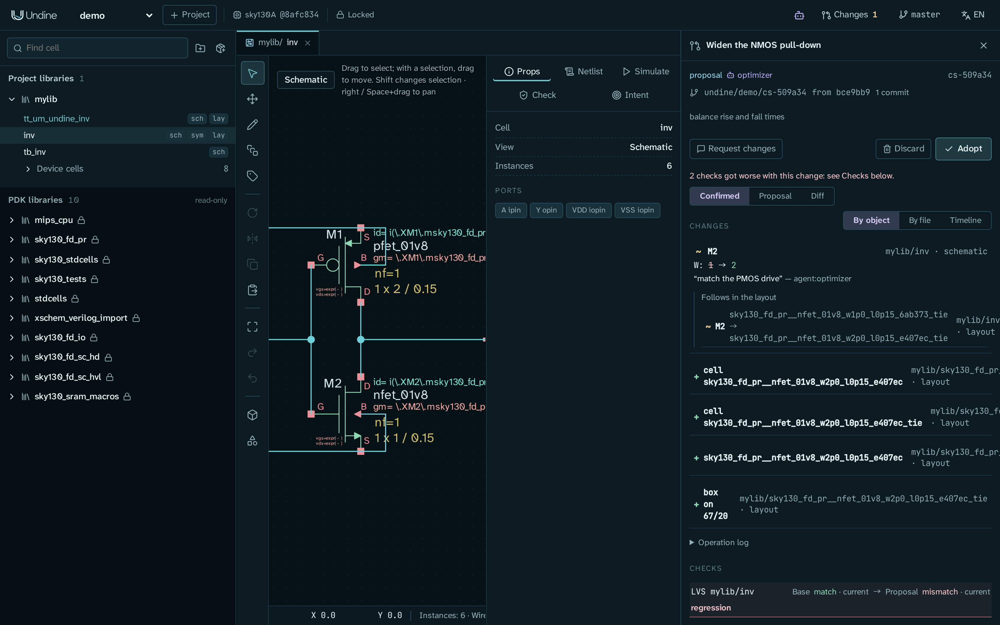
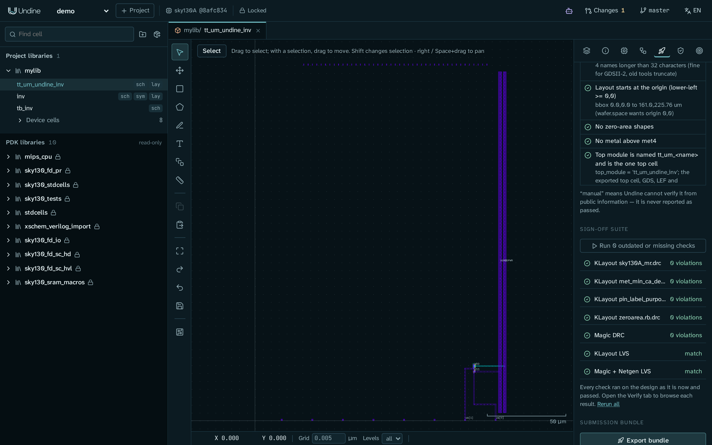

# Overview

**Undine** (pronounced *uhn-deen*) **is an AI-native, web-based EDA environment for custom IC design.** Schematic, layout, RTL, simulation, DRC/LVS and tapeout in the
browser, with the PDK on the server and an API that people, scripts and AI agents share.

## How it works

**The browser only draws.** The design database, the PDK, PCell implementations, DRC/LVS and simulation run on the
server, behind a Design API. The web UI is one client of that API; scripts and AI agents are others.

- **PDK-as-a-service.** The client sees layer colours, primitive symbols, PCell parameters and rendered results, never
  models, rule decks or PCell code. A PDK can stay inside a foundry- or company-controlled server.
- **Reproducibility.** A project pins the exact PDK version (`sky130A@8afc8346a57f`) and tool versions in `project.json`.
- **Agent-native.** Everything the UI does is an HTTP call an agent can make too (over MCP, the `undine` command or
  Python), and every change is logged, reviewable and revertible.
- **Deployment choice.** The same server is designed to run on your machine, inside a VPC or on-prem. It has no sign-in
  yet, so keep it on a network you trust (see the [roadmap](roadmap.md)).

## Features

| | |
|---|---|
| **PDKs** | SkyWater SKY130, GlobalFoundries GF180MCU and IHP SG13G2 through [ciel](https://github.com/fossi-foundation/ciel), each with its KLayout and Magic / Netgen decks, models and corners, and PCells; a project's PDK pinned by commit and tree hash in `undine.lock` and fetched through ciel from the browser |
| **Layout** | Server-rendered tiles (KLayout), PDK `.lyp` layers, draw / move / copy / delete, persistent undo, rulers, PCell placement |
| **Schematic** | Xschem `.sch` / `.sym` viewer and editor (wire, place, move, rotate, mirror, duplicate, properties), Xschem-compatible on disk |
| **Cells and intent** | Each cell's views side by side, and its design intent: goals, constraints and specs that checks and agents work from |
| **Simulation** | Netlisting (Undine, Xschem, vlsirtools); ngspice 47 jobs with a waveform viewer; specs measured at corners, temperatures and conditions, and sweeps |
| **Verification** | KLayout DRC/LVS decks, plus Magic DRC and Magic + Netgen LVS as a second opinion, with a shared result browser; parasitic extraction with Magic and simulation on the extracted view |
| **Schematic-driven layout** | The schematic's MOSFETs, resistors and MIM capacitors generated as PDK PCells (fingers strapped into one device), ratsnest, cross-probing schematic ↔ layout |
| **RTL** | Verilog / SystemVerilog per cell, Verilator lint and testbenches, LibreLane to GDS from RTL or from a schematic of standard cells, macros hardened into Caravel's user project wrapper |
| **Libraries and packages** | Git dependencies with a package manifest (`undine-package.toml`) that brings the package's own dependencies, installed once into a shared, content-addressed store and pinned by tree hash in `undine.lock`; cell-name clashes and PDKs a package does not accept refused before anything is installed; a dependency's simulator code blocks and RTL refused until a person trusts it ([Libraries and dependencies](guide/libraries.md)) |
| **Changesets and git** | Each proposal a git branch with its own working copy, checks before vs. now, adopt (merged object by object, committed when your tree is clean) / discard / revert, with a full operation log; a [History panel](guide/history.md) with each commit's and the working tree's changes object by object; git branches merged object by object (schematic, layout, intent), with the cells to re-check listed |
| **Agents** | An MCP server for Claude Code, Claude Desktop and other clients, the `undine` command and Python client, and an Agent Skill; an in-app agent for the browser |
| **Tapeout** | Tiny Tapeout (SKY130 analog), wafer.space (GF180MCU die) and ChipFoundry (Caravel): layout checks after each shuttle's precheck, sign-off suite, submission bundle |

## Screenshots

<table>
  <tr>
    <td width="50%"> <b>Cells and intent</b>: what a cell has to do: its goals, constraints and specs, with the conditions they are measured at</td>
    <td width="50%"> <b>Schematic</b>: Xschem-compatible editing, here the SAR ADC's top level</td>
  </tr>
  <tr>
    <td> <b>Simulation</b>: ngspice on the server, waveforms in the browser (the comparator's decisions on a ±0.45 mV input)</td>
    <td> <b>Layout</b>: server-rendered tiles from the PDK's layers, here the comparator</td>
  </tr>
  <tr>
    <td> <b>DRC / LVS</b>: KLayout or Magic decks, rules and markers in the layout</td>
    <td> <b>Changesets</b>: an agent's proposal, its diff and before/after checks, waiting for a human</td>
  </tr>
  <tr>
    <td colspan="2" align="center"> <b>Tapeout</b>: Tiny Tapeout tile checks and the sign-off suite</td>
  </tr>
</table>

## Acknowledgments

Undine builds on [KLayout](https://www.klayout.de/), [Xschem](https://xschem.sourceforge.io/),
[ngspice](https://ngspice.sourceforge.io/), [Magic](http://opencircuitdesign.com/magic/),
[Netgen](http://opencircuitdesign.com/netgen/), [Verilator](https://www.veripool.org/verilator/),
[LibreLane](https://github.com/librelane/librelane), [OpenVAF](https://openvaf.semimod.de/),
[open_pdks](https://github.com/RTimothyEdwards/open_pdks), [ciel](https://github.com/fossi-foundation/ciel),
the [SkyWater SKY130 PDK](https://github.com/google/skywater-pdk), the [GF180MCU PDK](https://github.com/google/gf180mcu-pdk),
the [IHP Open PDK](https://github.com/IHP-GmbH/IHP-Open-PDK), [Tiny Tapeout](https://tinytapeout.com/),
[wafer.space](https://wafer.space/) and [ChipFoundry](https://chipfoundry.io/)'s Caravel.
