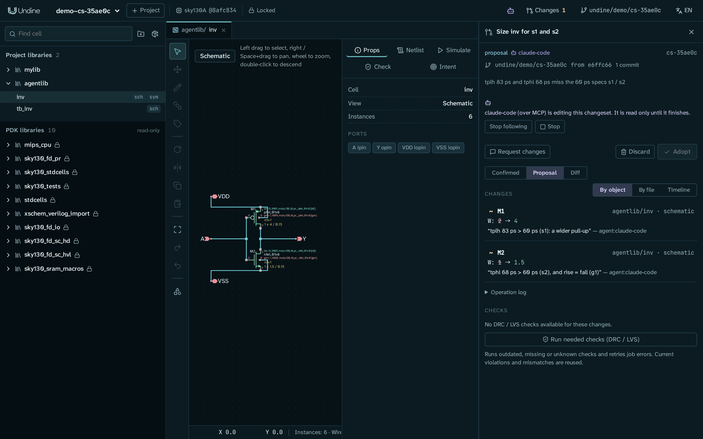
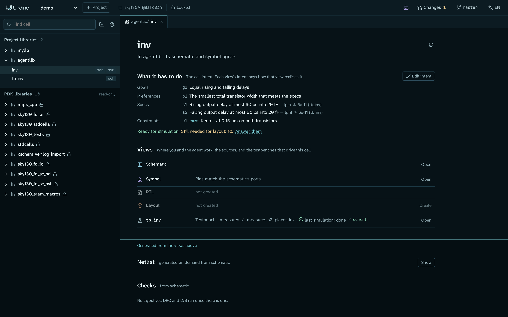
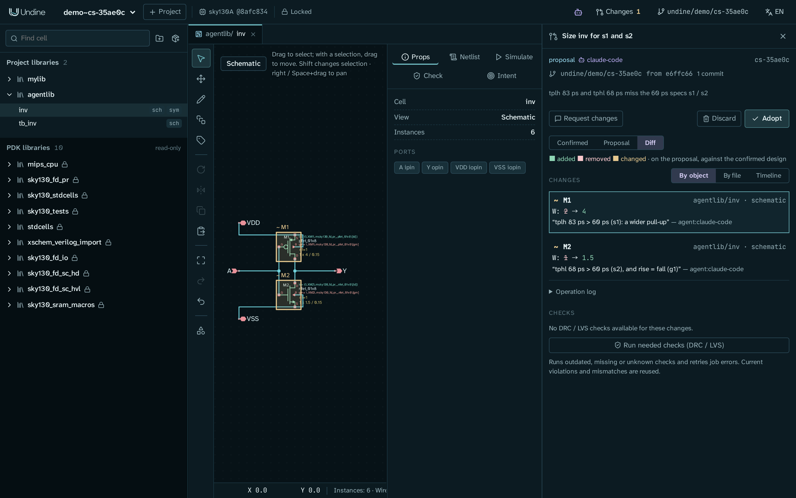

# AI エージェントと設計する

このチュートリアルでは、AI エージェントにセルの寸法を決めてもらい、結果を決めるのはあなたのままにします。セルが満たすべきことを
**設計意図** として書き、Claude(Claude Desktop または Claude Code で、MCP で Undine につないだもの)にそれを満たすよう頼み、
提案ができていく様子を Undine で見て、確かめ、採用するか取り消します。

題材は、[最初のプロジェクト](../getting-started/first-project.ja.md) と同じく `examples/make_inverter.py` が描く CMOS インバータ
`inv` です。`mylib` をそのまま残すため、専用のライブラリ `agentlib` に新しく作ります。描いたままのインバータは、これから与える
遅延の仕様には遅すぎます。終わったときには、次のものがそろっています:

- `agentlib/inv` の設計意図。目標、選好、*must*(厳守)の制約が 1 つずつと、テストベンチ `tb_inv` で測る遅延の仕様が 2 つです。
- エージェントが 2 つのトランジスタの寸法を変えた **changeset**。どの編集にも理由が付き、仕様を満たしています。
- その変更を git のマージコミットとして設計に採用し、そのあと再び取り消したこと。これで戻り方もわかります。

エージェントがあなたの設計を直接変えることはありません。エージェントがすることはすべて changeset に入ります。changeset は、
自分の作業コピーを持つ git のブランチです。あなたが **採用**(Adopt)を押すまで、設計には何も反映されません。



<a id="before-you-start"></a>
## 始める前に

次のものが必要です:

- sky130A の PDK と ngspice を含めてインストールした Undine。[インストール](../getting-started/install.ja.md) を参照してください。
  `./setup.sh check`(または `pixi run doctor`)で、足りないものがわかります。
- sky130A のプロジェクト。このチュートリアルでは、[最初のプロジェクト](../getting-started/first-project.ja.md) のプロジェクト `demo`
  を使います。このプロジェクトは、そのページの最後で git で管理するようにしてあります。sky130A のプロジェクトなら、どれでも構いません。
- サインイン済みの Claude Desktop または Claude Code。手順 3 で、[AI エージェントをつなぐ](../getting-started/connect-ai.ja.md)
  に従って Undine につなぎます。

API キーは要りません。MCP では、普段使っている AI アプリが考え、Undine はツールを用意するだけです。Undine の中でチャットしたい場合は、
最後の [代わりにアプリ内の Agent を使う](#the-in-app-agent-instead) を見てください。

!!! note "このチュートリアルの数値"
    以下の遅延は、`examples/make_inverter.py` が描いたままのインバータ(M1 が 2 µm、M2 が 1 µm、どちらも長さ 0.15 µm)が
    `tb_inv` の 20 fF の負荷を駆動するときに、typical コーナーで ngspice が出す値です。エージェントはスクリプトではありません。
    Claude は、ここに示すのと違う幅を選んだり、違う手順を踏んだり、違う言葉で答えたりすることがあります。変わらないのは流れと、
    決めるのはあなただということです。

<a id="1-start-undine-with-mcp-and-open-the-cell"></a>
## 1. MCP を有効にして Undine を起動し、セルを開く

AI アプリが Undine のツールを使えるように、MCP を有効にして Undine を起動します:

```sh
cd ~/undine-eda
UNDINE_MCP=1 pixi run serve
```

!!! note "MCP を有効にせずに起動していた場合"
    起動しているターミナルで Ctrl+C を押して止め、上のように起動し直します。`./scripts/restart.sh` を使っている場合は
    `UNDINE_MCP=1 ./scripts/restart.sh` です。

2 つ目のターミナルで(サーバーは動かしたままにします)、新しいライブラリ `agentlib` にインバータとそのテストベンチを作ります:

```sh
cd ~/undine-eda
pixi run python examples/make_inverter.py demo agentlib  # schematic inv, its symbol, and the testbench tb_inv
```

`wrote .../libs/agentlib/inv.sch`、`inv.sym`、`tb_inv.sch` の 3 行が表示されます。ライブラリがなければ、スクリプトが作ります。

!!! note "なぜ `mylib/inv` を使わないのか"
    最初のプロジェクトのインバータには配線済みのレイアウトもあり、Tiny Tapeout のタイル `tt_um_undine_inv` がそれを置いています。
    トランジスタの寸法を変えるとレイアウトが取り残され、LVS が失敗します。レイアウトのあるセルの寸法を変えるのは 2 つ目の練習に
    ちょうどよいのですが([セルにレイアウトがある場合](#if-the-cell-has-a-layout))、回路図だけのセルなら最初の実行を短くできます。

<http://127.0.0.1:8700> を開き、プロジェクト `demo` を選んで、ページを再読み込み(F5)します。ライブラリブラウザの
**プロジェクトのライブラリ**(Project libraries)の下に `agentlib` が表示されます。`agentlib` を展開して **inv** をクリックします
(名前です。小さな `sch` ボタンではありません)。これでセルの **セルのページ** が開きます。上部の **このセルがすべきこと**
(What it has to do)にセルの意図があり、その下の **ビュー**(Views)に、テストベンチとして `tb_inv` が並びます。今はまだ意図が空で、
*意図はまだありません。セルの目標・優先すること・仕様を書いてください。*(*No intent yet: state the cell's goals, preferences and
specs.*)と表示されています。

<a id="2-write-the-design-intent"></a>
## 2. 設計意図を書く

設計意図は、セルが何のためのものかをエージェントに伝えます。エージェントはセルを扱うたびにそれを読み、それに沿って作業し、
*must* の制約や仕様を自分の判断でゆるめることはありません。そうした変更は提案します。正確に書くほど、エージェントが推測する部分は
減ります。意図の 2 つの層は [セル、意図、ビュー](../guide/cells.ja.md) で説明しています。このチュートリアルで使うのはセルの意図だけです。

`inv` のセルのページで:

1. **意図を編集**(Edit intent)を押します。**設計意図**(Design intent)のエディタが開きます。
2. エディタのヘッダーにある **YAML** を押します。意図がテキストで表示されます。
3. テキストを次の内容に置き換え、**YAML を保存**(Save YAML)を押します。*意図を更新しました*(*Intent updated*)というトーストが出ます。

    ```yaml
    items:
      - {id: g1, kind: goal, text: Equal rising and falling delays}
      - {id: p1, kind: preference, text: The smallest total transistor width that meets the specs}
      - {id: c1, kind: constraint, strength: must, text: Keep L at 0.15 um on both transistors}
      - id: s1
        kind: spec
        text: Rising output delay at most 60 ps into 20 fF
        spec:
          measure: tplh
          max: 60.0e-12
          testbench: tb_inv
          meas: .meas tran tplh TRIG v(in) VAL=0.9 FALL=1 TARG v(out) VAL=0.9 RISE=1
      - id: s2
        kind: spec
        text: Falling output delay at most 60 ps into 20 fF
        spec:
          measure: tphl
          max: 60.0e-12
          testbench: tb_inv
          meas: .meas tran tphl TRIG v(in) VAL=0.9 RISE=1 TARG v(out) VAL=0.9 FALL=1
    ```

4. **編集を閉じる**(Close the editor)を押します。

`items` の下の各エントリが 1 つの項目です:

| 項目 | 種類 | エージェントに伝えること |
|---|---|---|
| `g1` | 目標(goal) | 最適化の方向: 立ち上がりと立ち下がりをできるだけ近づける |
| `p1` | 選好(preference) | トレードオフの判断: 仕様に必要な分より幅を増やさない |
| `c1` | 制約(constraint)、*must* | 守るべき規則: L には触れない |
| `s1`、`s2` | 仕様(spec) | 限界値のある測定と、それを確かめるテストベンチ |

各仕様は、`tb_inv`(20 ns の過渡解析)を、`.meas` 文を 1 つ足して実行します。足すのはその実行だけなので、テストベンチ自体は
そのままです。`tplh` は、入力が 0.9 V を下に横切ってから出力が 0.9 V を上に横切るまでの遅延で、`tphl` はその逆のエッジです。
限界値は SI 単位で書きます。`60.0e-12` は 60 ps です。

**このセルがすべきこと** の下に項目が並び、仕様には測定(`tplh ≤ 6e-11 (tb_inv)`)が、さらに
*シミュレーションの準備ができています。*(*Ready for simulation*)が表示され、`tb_inv` の行には *measures s1, measures s2, places inv*
と表示されます:



*レイアウトに必要な情報があと … 件あります。*(*Still needed for layout*)は、レイアウトの段階に必要なもの(たとえばポートの辺)を
数えています。このチュートリアルで変えるのは回路図だけなので、そのままで構いません。

!!! tip "YAML を使わない簡単な仕様"
    エディタのフォーム(*意図に追加*(*Add to the intent*)の **追加**(Add))では、目標、選好、制約と、**測定**(Measure)、
    **最小**(Min)、**最大**(Max)、**テストベンチ**(Testbench)を持つ仕様を追加できます。テストベンチにすでにある測定
    (テストベンチ自身の `.meas` や、動作点の `v(out)` など)なら、これで足ります。ここのように自分の `.meas` 文を持つ仕様は YAML で
    書きます。要求を言葉でエージェントに伝え、記録してもらうこともできます([プロンプトの例](#example-prompts) を参照)。その場合は
    エージェントの changeset の一部として届くので、あなたがレビューします。

最後に、新しいセルとその意図をコミットします。最初のプロジェクトで `demo` を git で管理するようにしましたが、そのあとに作ったものは
まだコミットされていません:

```sh
cd ~/undine-projects/demo
git add -A
git commit -m "agentlib: inv, tb_inv and the intent of inv"
```

そのあと `git status` が *nothing to commit, working tree clean* と表示すれば完了です。採用と取り消し(手順 8 と 9)は、プロジェクトに
ほかの未コミットの変更がないときだけマージをコミットします。きれいな状態から始めれば、それぞれが自分のコミットを作れます。
プロジェクトがまだ git で管理されていなければ、この手順は飛ばしてください。エージェントが changeset を開くとき、Undine がプロジェクトを
git で管理するよう設定し、ファイルを今のままコミットします。

<a id="3-connect-your-ai-agent"></a>
## 3. AI エージェントをつなぐ

[AI エージェントをつなぐ](../getting-started/connect-ai.ja.md) の **A** に従います。Claude Desktop なら
[A1](../getting-started/connect-ai.ja.md#a1-claude-desktop-recommended)、Claude Code なら
[A2](../getting-started/connect-ai.ja.md#claude-code) です。*「Undine のプロジェクト `demo` で、ライブラリ `agentlib` のセルの一覧を出して。」*
のような質問に Claude が `inv` と `tb_inv` で答えたら、ここに戻ってきます。

Claude Code なら、短くまとめると次のとおりです:

```sh
claude mcp add --scope user undine -- ~/undine-eda/.pixi/envs/default/bin/python -m undine mcp-stdio
claude mcp list                                   # undine: ... - ✔ Connected
pixi run python -m undine skills install          # optional: Undine's guide for agents, as a Claude Code skill
```

そのあと、Claude Code の **新しい** セッションを始めます(ターミナルで `claude`)。そうすると、そのセッションが Undine のサーバーを
読み込みます。

!!! tip "許可の確認を減らす"
    Claude Code は、Undine のツールをそれぞれ使う前に確認します。Undine のツールは設計を読むか changeset に書き込むだけなので、
    まとめて許可できます。[A2](../getting-started/connect-ai.ja.md#claude-code) の *任意: Undine のツールをまとめて許可する* を
    参照してください。

!!! tip "Claude に Undine のツールが見えない場合"
    AI エージェントをつなぐの [困ったときは](../getting-started/connect-ai.ja.md#troubleshooting) の表と、トラブルシューティングの
    [AI エージェントと MCP](../troubleshooting.ja.md#ai-agents-and-mcp) を見てください。よくある原因は、Undine を登録する前に始めた
    Claude Code のセッションと、`UNDINE_MCP=1` なしで起動した Undine です。

<a id="4-ask-the-agent-to-size-the-cell"></a>
## 4. エージェントにセルの寸法決めを頼む

Undine を開いたブラウザとチャットを並べておきます。Claude に次のプロンプトを送ります:

> Undine のプロジェクト `demo` で、インバータ `agentlib/inv` が遅延の仕様を満たしていない。設計意図を満たすように寸法を決めて。
> まず今のセルで仕様を測り、次に `sweep` でトランジスタの幅を探索し、選んだ幅を changeset で設定して、`check_specs` で確かめ、
> `run_checks` を実行して。意図が許さないことは何も変えないで。終わったら、変更前と変更後の遅延と、その幅を選んだ理由を教えて。

ツール名を書くのは任意です(Claude は Undine のガイドでツールを見つけます)が、書いておくと手順が予測しやすくなります。Claude は
ここから Undine のツールを使って作業します。典型的な流れは次のとおりです。名前は、チャットに表示されるツールの名前です:

1. `get_design_context` または `get_intent`: セルとその意図を読みます。`c1`(*must*)と 2 つの仕様も含みます。
2. `check_specs`: 今のセルで仕様を測ります。どちらも満たしていません。`tplh` は約 83 ps、`tphl` は約 68 ps です。
3. `sweep`: 何も編集せずに `M1.W` と `M2.W` の組み合わせをシミュレーションし、最も悪いマージンで順位を付けます。`M1.W` が 2、3、4、6、
   `M2.W` が 1、1.5、2、3 のとき、両方の仕様を満たす最小の組は M1 が 4 µm、M2 が 1.5 µm です(約 56 ps と 55 ps。`g1` のとおり
   遅延がそろっています)。
4. `open_changeset`: タイトルと理由を付けて changeset を開きます。プロジェクトがまだ git で管理されていなければ、このとき先に git で
   管理するよう設定し、ファイルを今のままコミットします(Claude がそう伝えます)。
5. `set_instance_params`: 新しい幅を設定します。それぞれに、どの仕様のための変更かを書いた理由が付きます。
6. もう一度 `check_specs`: 今度は作業コピーで測ります。両方の仕様を満たしています。
7. `run_checks`: 変更前と変更後の DRC と LVS です。`inv` にはまだレイアウトがないので、確かめるのは回路図(シンボルとポートの対応)
   だけです。

そのあと Claude がまとめを返します。たとえば次のようになります(言葉や数値は違うことがあります):

```text
Both delay specs are now met in changeset cs-35ae0c ("Size inv for s1 and s2"):

            before (M1 2 / M2 1 µm)   after (M1 4 / M2 1.5 µm)   spec
  tplh      82.6 ps                   56.2 ps                    ≤ 60 ps  (s1)
  tphl      67.8 ps                   55.1 ps                    ≤ 60 ps  (s2)

L stays 0.15 µm (c1). M1 = 3 µm gives a 65 ps rise, so 4 µm is the smallest pull-up on
this grid; with M2 = 1.5 µm the two delays are within 1 ps (g1). Total width 5.5 µm (p1).
Please review it in Undine; I cannot adopt it.
```

<a id="5-watch-the-changeset-fill"></a>
## 5. changeset ができていく様子を見る

Claude が最初の変更をすると、Undine はすぐにそれを表示します。手順 1 で開いた Undine のタブで、右側に changeset の **レビュー** が開き、
中央の図面が提案版に切り替わります。このページの最初の図のとおりです。レビューには書き手が表示されます:
*claude-code（MCP 経由）がこの変更セットを編集中です。完了まで読み取り専用です。*(英語の UI では *claude-code (over MCP) is editing this
changeset. It is read only until it finishes.*)

各編集は、届いたときにレビューに現れます。`M1  W: 2 → 4` と、Claude が書いた理由です。図面は、エージェントが編集しているセルに
追従します。レビューの **停止**(Stop)を押すと、エージェントを止められます。エージェントの次の書き込みは拒否され、それまでに変更した
内容は changeset に残ります。Claude が書き込みを終えると *編集中* の行が消え、レビューは通常のレビューになります。

エージェントが始めたときにタブが使用中だった場合(レビューを開いていた、未保存の編集があった)は、Undine は画面を切り替えず、
**作業を見る**(Watch)のあるバーを表示します。[外部エージェントの作業を Undine で見る](../guide/assistant.ja.md#watching-an-external-agent-in-undine)
で、その場合とほかの場合を説明しています。追従と一時停止、エージェントが終わったときの **レビューする**(Review)のバー、そして
プロジェクトを開いている Undine のタブがないときに Undine の起動役(AI アプリが起動する `mcp-stdio`)が開くブラウザのタブです。

<a id="6-check-the-result-yourself"></a>
## 6. 結果を自分で確かめる

エージェントの数値は主張にすぎません。採用する前に確かめます。仕様は、changeset を引き取らずに、その changeset の上で測り直せます:

=== "コマンドライン"

    ```sh
    cd ~/undine-eda
    pixi run python -m undine call check_specs lib=agentlib cell=inv changeset=cs-35ae0c fresh=true \
      --project demo --session me
    pixi run python -m undine session end --session me
    ```

    自分の changeset の id を使ってください(レビューのヘッダーと Claude の返事にあります)。`changeset=` は、その changeset の書き手に
    ならずに作業コピーを読んで確かめます。`fresh=true` は、エージェントの実行を使い回さずにシミュレーションをやり直します。
    `--session me` は、あなたの呼び出しをエージェントのものと分けます。`undine call` は呼び出しの間でそのセッションを保つので、
    そのセッションで開いた changeset はそのセッションのものであり続けます。`session end` はセッションを手放します。この確認では、
    何も保っておく必要がないからです。最初に `"changeset": "cs-…"`、次に各仕様が `"status": "met"` と測定した `worst` の値付きで
    表示され、仕様の一覧の後に `"met": "2/2"` が表示されます。

=== "ブラウザ"

    レビューで図面を **提案版**(Proposal)に切り替え、ライブラリブラウザから `tb_inv` を開いて(プレビューには提案版の作業コピーが
    表示されます)、その **シミュレーション**(Simulate)タブで **ngspice を実行**(Run ngspice)を押します。新しい幅での `in` と
    `out` の波形が表示されます。仕様の測定値そのものは `check_specs` から得ます(*コマンドライン* のタブ、または Claude に実行を
    頼みます)。

さらに、たとえばすべてのコーナーで確かめるよう、エージェントに頼むこともできます:

> あなたの changeset の `agentlib/inv` で、`corners: ['all']` と `temps: [-40, 27, 125]` で `check_specs` を実行して、各仕様の
> 最悪値と、それがどこで起きるかを教えて。

<a id="7-review-the-changeset"></a>
## 7. changeset をレビューする

次は提案そのものを読みます。右のレビューにすべてがあります。閉じていたら、上部バーの **変更**(Changes)から開きます。変更の一覧の
上にある **差分**(Diff)を押します。



次の部分を確かめます:

- **ヘッダー**: タイトル *Size inv for s1 and s2*、開いたのが `claude-code` であること、id と git のブランチ(`undine/demo/cs-…`)、
  理由。
- **差分**: 図面に、あなたの設計と違うところが示されます(追加は緑、削除は赤、変更は黄)。ここでは M1 と M2 が黄で、ほかには何も
  示されません。
- **対象ごと**(By object): 2 つの編集、`M1  W: 2 → 4` と `M2  W: 1 → 1.5` と、それぞれに Claude が書いた理由
  (*"tplh 83 ps > 60 ps (s1): a wider pull-up"*)。編集をクリックすると、そのビューを開いてハイライトします。
- **ファイルごと**(By file): ブランチの意味的な差分を、ファイルごとに表示します。回路図(`instance M1: W: 2 → 4`)と、それに
  追従するネットリストのビューです。採用でマージされるのはまさにこの内容で、どの操作にも記録されていない変更も含みます。
- **検証**(Checks): ここでは *この変更に利用できる DRC / LVS 検証はありません。*(*No DRC / LVS checks available for these
  changes.*)と表示されます。`inv` にレイアウトがないためです。レイアウトがあれば、各チェックの変更前と変更後の結果が表示されます。
  [セルにレイアウトがある場合](#if-the-cell-has-a-layout) を参照してください。

レビューのそのほかの部分は、**タイムライン**(Timeline)や
[チェックポイントの復元](../guide/changesets.ja.md#timeline-and-restoring-a-checkpoint) も含めて、
[変更セット (changeset)](../guide/changesets.ja.md#review-screen) で説明しています。

<a id="8-adopt-it"></a>
## 8. 採用する

ここで決めるのはあなたです。提案が望むものでなければ、採用せずに差し戻します([代わりに修正してほしいとき](#when-you-want-changes-instead))。
この提案は意図を満たしているので、採用します。

エージェントがまだ書き込んでいる間は採用できないので、*編集中* の行が消えるまで待ちます(チャットを閉じるとすぐに changeset が
解放されます。そうでなければ、エージェントのロックは最後の書き込みから 2 分で切れます)。

1. **採用**(Adopt)を押します。ダイアログ *この提案を採用しますか？*(*Adopt this proposal?*)が、ブランチをオブジェクト単位で、
   すべてか無しかで設計にマージすることを説明します。
2. ダイアログの **採用** を押します。

*提案を採用しました（マージコミット …）*(*Proposal adopted: merge commit …*)と表示されます。レビューには
*… に … が採用 · マージコミット …* と表示され、**採用** の代わりに **取り消す**(Revert)が表示されます。図面はあなたの設計に戻り、
設計は M1 が 4 µm、M2 が 1.5 µm になっています。

git には、あなたのブランチにマージコミット `Apply cs-…: Size inv for s1 and s2` ができています(プロジェクトで `git log`、または
[履歴パネル](../guide/history.ja.md))。changeset の中での実行(エージェントの `check_specs` や、手順 6 のあなたの実行)は、証拠として
それと一緒に保存され、**検証** の下に並びます。[採用・破棄の後の証拠](../guide/changesets.ja.md#evidence-after-apply-or-discard) を
参照してください。

!!! note "マージが未コミットのまま残る場合"
    マージがコミットされるのは、プロジェクトにほかの未コミットの変更や追跡されていないファイルがないときだけです。手順 2 の最後の
    コミットを飛ばした場合は、`agentlib` のファイルと意図がそうした変更にあたります。そのときは *提案を採用しました。プロジェクトに
    他の未コミットの変更があったため、マージは作業ツリーに未コミットのまま残しています*(英語の UI では *Proposal adopted. The project
    had other uncommitted changes, so the merge is left uncommitted in your working tree*)と表示されるので、git で自分でコミットします
    ([履歴パネル](../guide/history.ja.md) で未コミットの内容がわかります)。その場合は、手順 9 の取り消しも未コミットのまま残ります。

提案を開いてから、あなたの設計で同じオブジェクトが変わっていた場合は、何も書き込まれず、レビューに衝突が並びます。
[採用: マージ](../guide/changesets.ja.md#adopting-the-merge) を参照してください。ほかのメッセージについては、トラブルシューティングの
[changeset と採用](../troubleshooting.ja.md#changesets-and-adopting) を参照してください。

<a id="9-revert-it"></a>
## 9. 取り消す

採用した changeset は、いつでも取り消せます。そのあとにほかの変更をしていても、それが同じオブジェクトに触れていなければ構いません。

1. 上部バーの **変更** から changeset を開きます(*採用済み* と表示されています)。
2. **取り消す**(Revert)を押し、ダイアログ *変更セットを取り消しますか？*(*Revert the changeset?*)の **取り消す** を押します。

*提案を取り消しました（コミット …）*(*Proposal reverted: commit …*)と表示され、レビューには *… に … が取り消しました。* と表示されます。
設計は再び M1 が 2 µm、M2 が 1 µm になり、git には `Revert cs-…: Size inv for s1 and s2` というコミットが上に積まれます。
changeset、その証拠、2 つのコミットは履歴に残ります。Undo は採用をまたいで戻れません。戻る方法は **取り消す** です。

<a id="when-you-want-changes-instead"></a>
## 代わりに修正してほしいとき

自分のセルでは、提案がいつも望みどおりとは限りません。そのときは採用しません。次の 3 つの方法があります:

- **同じチャットで、変えてほしいことを Claude に伝えます。** Claude は同じ changeset の続きとして作業し、レビューに新しい手順が
  表示されます。たとえば:

    > M1 は 3 µm 以下にしておきたい。それでも s1 と s2 を満たせる? 満たせないなら仕様は変えずに、どの限界値が必要か、
    > その理由を教えて。

    この場合、M1 が 3 µm ではエージェントは `s1` を満たせません(約 65 ps)。仕様をゆるめられるのはあなただけなので、エージェントは
    そう伝え、黙って書き換えるのではなく、意図の変更(たとえば `s1` を 66 ps に)を提案するはずです。エージェントが意図の項目を
    変えた場合も、その変更はほかの変更と同じく changeset に入り、*対象ごと* に並ぶので、残すか退けるかをあなたが決めます。

    その間にチャットを閉じていた場合は、新しいチャットを始めて *「`demo` で開いている changeset `cs-…` の続きをして。」* と頼みます。
    Claude は `list_changesets` でそれを見つけ、`open_changeset` で続けます。

- **小さなことは自分で直します。** **提案版** に切り替えて、プレビューで編集します。あなたの編集は、エージェントのものと並んで、
  あなたの編集として changeset に記録されます。
- **提案全体を捨てます。** **破棄**(Discard)を押します。作業コピーは削除され、ブランチ、変更、チェックの証拠は残ります。

!!! note "修正を依頼(Request changes)"
    レビューの **修正を依頼**(Request changes)は、Undine のアプリ内の Agent を、入力欄を用意した状態で開きます。これには専用の
    接続(API キーまたはローカル LLM。[下記](#the-in-app-agent-instead) を参照)が必要です。MCP で Claude を使っている場合は、
    チャットでそのまま答えてください。

<a id="if-the-cell-has-a-layout"></a>
## セルにレイアウトがある場合

レイアウトのあるセルでは、エージェントの仕事がもう半分増えます。レイアウトを新しい幅に追従させる必要があり、`run_checks` にも
本当にすることができます。そのために、専用のライブラリ `layoutlib` に配線済みのインバータを作ります。最初のプロジェクトの
`mylib/inv` でも構いませんが、Tiny Tapeout のタイル `tt_um_undine_inv` がそれを決まったオフセットに置いているので、寸法を変えて
配線し直した `mylib/inv` では、タイルの接続が切れてしまいます。

```sh
cd ~/undine-eda
pixi run python examples/make_inverter.py demo layoutlib
pixi run python examples/route_inverter.py demo layoutlib    # layout of inv, routed, then LVS
```

`route_inverter.py` は最後に `done {"match": true, ...}` を出力します。ページを再読み込みし、`layoutlib/inv` に同じ意図を与え
(手順 2 を、そのセルのページで)、手順 2 の最後と同じようにコミットして、手順 4 の依頼を `layoutlib/inv` で送ります。

回路図だけを変える changeset では、LVS が失敗します。レビューでは **検証** の下に表示されます。*LVS layoutlib/inv* が
**変更前**(Base)の *一致*(*match*)から **提案版**(Proposal)の *不一致*(*mismatch*)になり、*悪化*(*regression*)と示されます。
**採用** の下の 1 行が、この変更で悪化したチェックの数を伝えます。エージェントに仕上げを頼みます:

> あなたの changeset の `layoutlib/inv` のレイアウトは、新しい幅に追従させる必要がある。`sync_layout` を実行し、残った未接続を
> 配線し直して、DRC(KLayout と Magic)と LVS が変更前と同じくらいクリーンになるまで `run_checks` を実行して。何か残ったら、
> 何がどこに残っているかを教えて。

`sync_layout` は、各トランジスタの PCell を、その場で新しい幅のものに置き換えます。大きくなったデバイスはもう古い配線やレールと
合わないので、その直後は LVS がまだ失敗し、Magic の DRC が違反を見つけます。そこでエージェントは `route` で配線し直し(未接続を
見るには `get_layout_info` と `get_drc_report`)、もう一度確かめます。1 回ごとに **検証** の下の行が更新され、チェッカーごとに
変更前と提案版が並びます。*悪化* と表示される行がなくなるまで続けます。何回かかるかはエージェント次第です。結果が十分かどうかは
あなたが決めます。チェックそのものについては [検証](../guide/verification.ja.md) を参照してください。

<a id="the-in-app-agent-instead"></a>
## 代わりにアプリ内の Agent を使う

Claude Code や Claude Desktop がない場合や、ローカル LLM ですべてを手元に置きたい場合は、Undine に組み込まれた **Agent** を使います。
意図、changeset、レビュー、採用は同じで、チャットの場所が Undine の中に移るだけです。

1. 上部バーの **変更** のすぐ左にある Agent のアイコン(ロボット)を押します。左の列の上部にチャットが開きます。
2. ヘッダーの設定アイコン(スライダー)を押し、**接続を追加**(Add a connection)、**この接続を使う**(Use this connection)と進みます。
   [AI エージェントをつなぐ の B](../getting-started/connect-ai.ja.md#b-api-chat-inside-undine) のとおりです。
3. `inv` を開き、手順 4 のプロンプトを送ります(プロジェクトは開いているものなので、省いて構いません)。

チャットには各ツールの呼び出しの開始と終了が表示され、**停止** を押すと次の手の前でターンを終えます。エージェントが何かを変更すると、
その changeset のレビューが開き、手順 5 と同じように図面が追従します。レビューの **修正を依頼** を押すと、このチャットが開き、
同じ提案の続きを頼めます。小さなローカルモデルは、スイープのような何手もかかる作業によく失敗します。快適に動く範囲で、いちばん大きい
モデルを使ってください。詳しくは [設計エージェントと MCP](../guide/assistant.ja.md#agent-in-app) を参照してください。

<a id="example-prompts"></a>
## プロンプトの例

これらは MCP で Claude と使うものです。1 つの Claude のセッションでどのプロジェクトでも扱えるので、どの例にもプロジェクトを
書いています。`demo`、`agentlib`、セル名は自分のものに置き換えてください。

**要求を意図として記録する**(あなたのメッセージを引用して、changeset に入ります):

> `demo` で、`agentlib/inv` の意図に次の内容を記録して: 「立ち上がりと立ち下がりの遅延は 20 fF の負荷で 60 ps 以下、tb_inv で測る。
> L は最小のまま。仕様を満たしたうえでは、速度より面積を重視する。」遅延の仕様は、それぞれ自分の `.meas` 文を持たせて追加して。
> `tb_inv` 自体はそのままにしておいて。

**決める前に探索する**(changeset は作らず、何も変わりません):

> `demo` で、`agentlib/inv` の `M1.W` を 2 から 6 µm、`M2.W` を 1 から 3 µm でスイープして仕様と照らし合わせ、いちばんよい 5 点を
> 遅延付きで見せて。まだ何も変えないで。

**意図から新しいセルを作る:**

> `demo` の `agentlib` に新しいセル `ota5t` を作って。5 トランジスタの OTA(NMOS の入力差動対、PMOS のカレントミラー負荷、
> NMOS のテール電流源)で、ポートは inp、inn、vbias、out、vdd、vss。シンボルと、1 pF の負荷と AC 解析を持つテストベンチ
> `tb_ota5t` も作って。`tb_ota5t` で測る仕様「DC ゲイン 30 dB 以上」を記録して、それを満たすように OTA の寸法を決めて。

**2 つ目のエージェントに、1 つ目のエージェントの作業を確かめさせる:**

> `demo` の changeset `cs-…` はほかの人のもの。開かずに、`changeset: cs-…` を付けてすべてのコーナーで `agentlib/inv` の
> `check_specs` を実行し、同じ `changeset` で `run_checks` を実行して、タイトルのとおりのことをしているか教えて。

**あなたの判断を待つ:**

> 終わったら教えて。そのあと、私が changeset を採用するか破棄するまで `wait_for` で待って、どうなったかを伝えて。

<a id="what-you-learned"></a>
## 学んだこと

- **設計意図**(目標、選好、制約、テストベンチ付きの仕様)は、セルが何のためのものかをエージェントに伝える手段です。エージェントは
  それに沿って作業し、意図への変更は提案としてあなたのところに戻ってきます。
- MCP のエージェントは Undine の型付きのツール(`check_specs`、`sweep`、`open_changeset`、`set_instance_params`、`run_checks` など)で
  作業し、書き込むのは常に **changeset** の中だけです。
- Undine はエージェントの作業にその場で追従し、**停止** はいつでもワンクリックで押せます。
- changeset は **対象ごと**、**ファイルごと**、**差分** でレビューし、変更前と提案版のチェックを並べて見ます。仕様は
  `check_specs changeset=…` で自分で確かめます。
- **採用** は(プロジェクトのほかの部分がコミット済みなら)マージコミットを作り、証拠を残します。**取り消す** は、自分のコミットで
  それを元に戻します。

<a id="next-steps"></a>
## 次のステップ

- [設計エージェントと MCP](../guide/assistant.ja.md): すべてのツール、1 つの接続での複数のエージェント、シェルと Python の
  クライアント、エージェント向けのガイド。
- [変更セット (changeset)](../guide/changesets.ja.md): レビュー、チェックポイントの復元、チェックの鮮度、マージと証拠。
- [セル、意図、ビュー](../guide/cells.ja.md) と [設計意図の設計ノート](../design/intent.ja.md): ビューの意図、規則付きの制約、
  YAML の形式。
- [検証](../guide/verification.ja.md): DRC、LVS、ERC、寄生抽出、ポストレイアウトシミュレーション。
- [git の履歴](../guide/history.ja.md): 採用と取り消しが作るコミットと、自分のブランチのマージ。
- [トラブルシューティング](../troubleshooting.ja.md): MCP の接続、採用、そのほかのメッセージ。
