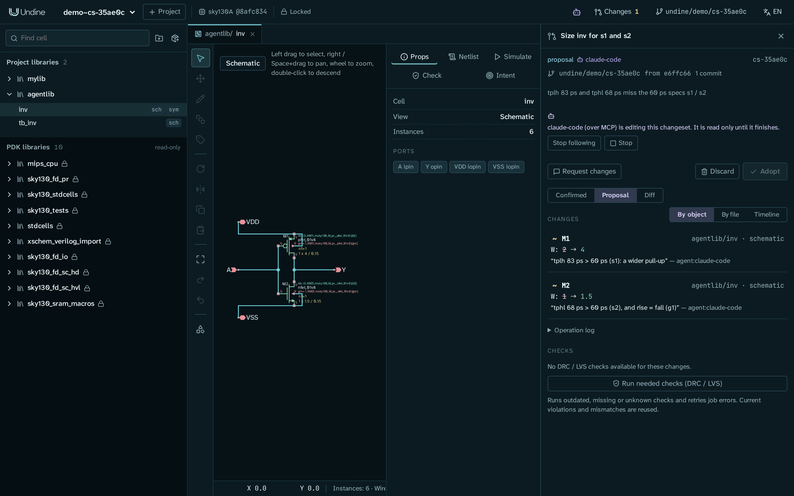
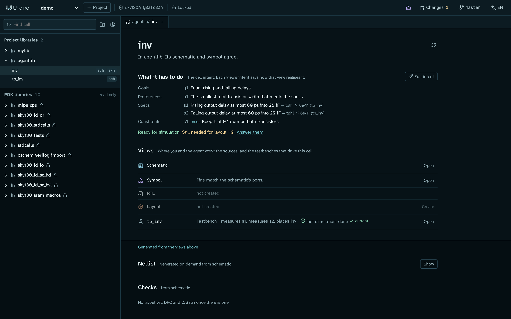
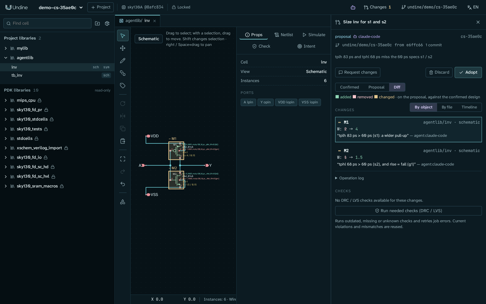

# Design with an AI agent

In this tutorial you have an AI agent size a cell for you, and you stay in charge of the result. You write down what
the cell has to achieve as its **design intent**, ask Claude (in Claude Desktop or Claude Code, connected to Undine over
MCP) to meet it, watch the proposal grow in Undine, check it, and then adopt it or revert it.

The cell is the CMOS inverter `inv` that `examples/make_inverter.py` draws, as in
[First project](../getting-started/first-project.md), made fresh in a library of its own, `agentlib`, so that your
`mylib` stays as it is. As drawn, the inverter is too slow for the delay specs you are about to give it. When you
finish, you have:

- a design intent on `agentlib/inv`: a goal, a preference, a *must* constraint and two delay specs measured on the testbench
  `tb_inv`;
- a **changeset** in which the agent resized the two transistors, with its reason on every edit and the specs met;
- that change adopted into your design as a git merge commit, and then reverted again, so you know the way back.

The agent never changes your design itself. Everything it does goes into a changeset, a git branch with its own working
copy, and nothing reaches your design until you click **Adopt**.



## Before you start

You need:

- Undine installed, with the sky130A PDK and ngspice. See [Install](../getting-started/install.md);
  `./setup.sh check` (or `pixi run doctor`) tells you what is missing.
- A project on sky130A. This tutorial uses the project `demo` from
  [First project](../getting-started/first-project.md), which ends by putting it in git; any project on sky130A works.
- Claude Desktop or Claude Code, signed in. You connect it to Undine in step 3, following
  [Connect an AI agent](../getting-started/connect-ai.md).

No API key is needed: with MCP the AI app you already use does the thinking, and Undine only offers it tools. If you would
rather chat inside Undine, see [The in-app Agent instead](#the-in-app-agent-instead) at the end.

!!! note "The numbers in this tutorial"
    The delays below are what ngspice gives for the inverter as `examples/make_inverter.py` draws it (M1 2 µm, M2 1 µm,
    both 0.15 µm long) into the 20 fF load of `tb_inv`, at the typical corner. An agent is not a script: Claude may pick
    other widths than the ones shown, take other steps, or word its replies differently. What stays the same is the
    flow, and that you decide.

## 1. Start Undine with MCP and open the cell

Start Undine with MCP turned on, so that an AI app can reach its tools:

```sh
cd ~/undine-eda
UNDINE_MCP=1 pixi run serve
```

!!! note "Already running without MCP?"
    Stop it (Ctrl+C in its terminal) and start it again as above. With `./scripts/restart.sh`, use
    `UNDINE_MCP=1 ./scripts/restart.sh`.

In a second terminal (the server keeps running), make the inverter and its testbench in a new library `agentlib`:

```sh
cd ~/undine-eda
pixi run python examples/make_inverter.py demo agentlib  # schematic inv, its symbol, and the testbench tb_inv
```

You should see three lines, `wrote .../libs/agentlib/inv.sch`, `inv.sym` and `tb_inv.sch`. The script creates the
library when it does not exist.

!!! note "Why not `mylib/inv`?"
    The inverter of First project also has a routed layout, and the Tiny Tapeout tile `tt_um_undine_inv` places it.
    Resizing its transistors would leave that layout behind, and its LVS would fail. Resizing a cell with a layout is a
    good second exercise ([If the cell has a layout](#if-the-cell-has-a-layout)), but a schematic-only cell keeps the
    first run short.

Open <http://127.0.0.1:8700>, choose the project `demo`, and reload the page (F5) so that the library browser shows
`agentlib` under **Project libraries**. Expand `agentlib` and click **inv** (its name, not the small `sch` button).
This opens its **cell page**: the cell's intent at the top under **What it has to do**, then its **Views**, with
`tb_inv` listed as its testbench. For now the intent is empty: *No intent yet: state the cell's goals, preferences and specs.*

## 2. Write the design intent

The design intent tells the agent what the cell is for. The agent reads it every time it works on the cell, works from
it, and never relaxes a *must* constraint or a spec on its own: it proposes such a change instead. The more precisely
you state it, the less the agent has to guess. [Cells, intent and views](../guide/cells.md) explains the two levels of
intent; this tutorial uses only the cell intent.

On the cell page of `inv`:

1. Click **Edit intent**. The **Design intent** editor opens.
2. Click **YAML** in the editor's header. The intent appears as text.
3. Replace the text with the following and click **Save YAML**. A toast says *Intent updated*.

    ```yaml
    items:
      - {id: g1, kind: goal, text: Equal rising and falling delays}
      - {id: p1, kind: preference, text: The smallest total transistor width that meets the specs}
      - {id: c1, kind: constraint, strength: must, text: Keep L at 0.15 um on both transistors}
      - id: s1
        kind: spec
        text: Rising output delay at most 60 ps into 20 fF
        spec:
          measure: tplh
          max: 60.0e-12
          testbench: tb_inv
          meas: .meas tran tplh TRIG v(in) VAL=0.9 FALL=1 TARG v(out) VAL=0.9 RISE=1
      - id: s2
        kind: spec
        text: Falling output delay at most 60 ps into 20 fF
        spec:
          measure: tphl
          max: 60.0e-12
          testbench: tb_inv
          meas: .meas tran tphl TRIG v(in) VAL=0.9 RISE=1 TARG v(out) VAL=0.9 FALL=1
    ```

4. Click **Close the editor**.

Each entry under `items` is one item:

| Item | Kind | What it tells the agent |
|---|---|---|
| `g1` | goal | a direction to optimise: rise and fall as close as possible |
| `p1` | preference | how to trade off: no more width than the specs need |
| `c1` | constraint, *must* | a rule it has to respect: do not touch L |
| `s1`, `s2` | spec | a measure with a limit and the testbench that checks it |

Each spec runs `tb_inv` (its 20 ns transient) with one extra `.meas` statement, added to that run only, so the testbench
itself stays as it is. `tplh` is the delay from the input falling through 0.9 V to the output rising through 0.9 V;
`tphl` is the other edge. Limits are in SI units: `60.0e-12` is 60 ps.

You should now see the items under **What it has to do**, the specs with their measures (`tplh ≤ 6e-11 (tb_inv)`),
*Ready for simulation*, and on the `tb_inv` row *measures s1, measures s2, places inv*:



*Still needed for layout* counts what the layout steps would need (port sides, for example). This tutorial changes only
the schematic, so you can leave those open.

!!! tip "Simple specs without YAML"
    The editor's form (**Add** under *Add to the intent*) adds goals, preferences, constraints and specs with a
    **Measure**, **Min**, **Max** and **Testbench**: enough for a measure the testbench already has, such as a `.meas`
    of its own or `v(out)` of an operating point. A spec that brings its own `.meas` statement, as here, is written in
    YAML. You can also tell the agent your requirements in words and let it record them (see
    [Example prompts](#example-prompts)); they then arrive as part of its changeset, for you to review.

Finally, commit the new cell and its intent. First project put `demo` in git, and what you made since is not committed
yet:

```sh
cd ~/undine-projects/demo
git add -A
git commit -m "agentlib: inv, tb_inv and the intent of inv"
```

`git status` should then say *nothing to commit, working tree clean*. Adopting and reverting (steps 8 and 9) commit their merge only when nothing else in the project is uncommitted, so a
clean start lets them make commits of their own. If your project is not in git yet, skip this: when the agent opens its
changeset, Undine puts the project in git and commits its files as they are.

## 3. Connect your AI agent

Follow [Connect an AI agent](../getting-started/connect-ai.md), part **A**:
[A1](../getting-started/connect-ai.md#a1-claude-desktop-recommended) for Claude Desktop,
[A2](../getting-started/connect-ai.md#claude-code) for Claude Code. Come back here once Claude answers a question such
as *"In the Undine project `demo`, list the cells of library `agentlib`."* with `inv` and `tb_inv`.

For Claude Code, the short version is:

```sh
claude mcp add --scope user undine -- ~/undine-eda/.pixi/envs/default/bin/python -m undine mcp-stdio
claude mcp list                                   # undine: ... - ✔ Connected
pixi run python -m undine skills install          # optional: Undine's guide for agents, as a Claude Code skill
```

Then start a **new** Claude Code session (`claude` in a terminal), so that it picks up the server.

!!! tip "Fewer permission prompts"
    Claude Code asks before it uses each Undine tool. Undine's tools only read the design or write into a changeset,
    so you can allow them all at once: see *Optional: allow all of Undine's tools at once* in
    [A2](../getting-started/connect-ai.md#claude-code).

!!! tip "If Claude does not see Undine's tools"
    See the [troubleshooting table](../getting-started/connect-ai.md#troubleshooting) of Connect an AI agent and
    [AI agents and MCP](../troubleshooting.md#ai-agents-and-mcp) in Troubleshooting. The most common causes are a
    Claude Code session started before you registered Undine, and an Undine started without `UNDINE_MCP=1`.

## 4. Ask the agent to size the cell

Keep the browser with Undine and the chat side by side. Send Claude this prompt:

> In the Undine project `demo`, the inverter `agentlib/inv` misses its delay specs. Size it to meet its design intent:
> first measure the specs as the cell is now, then explore the transistor widths with `sweep`, set the widths you choose
> in a changeset, confirm them with `check_specs` and run `run_checks`. Do not change anything the intent does not
> allow. When you are done, tell me the delays before and after, and why you chose those widths.

Naming the tools is optional (Claude finds them in Undine's guide), but it makes the steps predictable. Claude now works
through Undine's tools. A typical run looks like this; the names are the tools you see in the chat:

1. `get_design_context` or `get_intent`: it reads the cell and its intent, including `c1` (*must*) and the two specs.
2. `check_specs`: it measures the specs as the cell is. Both miss: about 83 ps for `tplh` and 68 ps for `tphl`.
3. `sweep`: it simulates combinations of `M1.W` and `M2.W` without editing anything, and ranks them by their worst
   margin. With `M1.W` 2, 3, 4, 6 and `M2.W` 1, 1.5, 2, 3, the smallest pair that meets both specs is M1 4 µm and
   M2 1.5 µm (about 56 ps and 55 ps: equal delays, as `g1` asks).
4. `open_changeset`: it opens a changeset with a title and a reason. If the project was not in git yet, this first puts
   it in git and commits its files as they are (Claude tells you so).
5. `set_instance_params`: it sets the new widths, each with a reason that names the spec it serves.
6. `check_specs` again, now on its working copy: both specs are met.
7. `run_checks`: DRC and LVS before and after the change. `inv` has no layout yet, so this checks only the schematic
   (its symbol against its ports).

Then Claude replies with a summary. For example (your wording and numbers may differ):

```text
Both delay specs are now met in changeset cs-35ae0c ("Size inv for s1 and s2"):

            before (M1 2 / M2 1 µm)   after (M1 4 / M2 1.5 µm)   spec
  tplh      82.6 ps                   56.2 ps                    ≤ 60 ps  (s1)
  tphl      67.8 ps                   55.1 ps                    ≤ 60 ps  (s2)

L stays 0.15 µm (c1). M1 = 3 µm gives a 65 ps rise, so 4 µm is the smallest pull-up on
this grid; with M2 = 1.5 µm the two delays are within 1 ps (g1). Total width 5.5 µm (p1).
Please review it in Undine; I cannot adopt it.
```

## 5. Watch the changeset fill

When Claude makes its first change, Undine shows it at once. In the Undine tab you opened in step 1, the changeset's
**review** opens on the right and the drawing in the middle switches to the proposal, as in the picture at the top of
this page. The review names the writer: *claude-code (over MCP) is editing this changeset. It is read only until it
finishes.*

Each edit appears in the review as it lands: `M1  W: 2 → 4`, with the reason Claude gave. The drawing follows the cell
the agent edits. **Stop** in the review stops the agent: its next write is refused, and what it already changed stays in
the changeset. When Claude stops writing, the *is editing* line goes and the review becomes an ordinary one.

If the tab was busy when the agent started (a review open, or edits not saved), Undine shows a bar with **Watch**
instead of taking the screen over. [Watching an external agent in Undine](../guide/assistant.md#watching-an-external-agent-in-undine)
describes that case and the others: following and pausing, the bar with **Review** when the agent has finished, and the
browser tab that Undine's launcher (`mcp-stdio`, which the AI app starts) opens when no Undine tab has the project open.

## 6. Check the result yourself

The agent's numbers are a claim. Check them before you adopt. The specs can be measured again on the changeset without
taking it over:

=== "Command line"

    ```sh
    cd ~/undine-eda
    pixi run python -m undine call check_specs lib=agentlib cell=inv changeset=cs-35ae0c fresh=true \
      --project demo --session me
    pixi run python -m undine session end --session me
    ```

    Use your changeset's id (it is in the review's header and in Claude's reply). `changeset=` reads and checks that
    changeset's working copy without becoming its writer, `fresh=true` runs the simulations again instead of reusing
    the agent's runs, and `--session me` keeps your calls apart from the agent's. `undine call` keeps that session
    between calls, so that a changeset it opens stays its own; `session end` lets it go, as this check needs nothing
    kept. You should see `"changeset": "cs-…"` first, then each spec with `"status": "met"` and its measured `worst`
    value, and after the list of specs `"met": "2/2"`.

=== "Browser"

    In the review, switch the drawing to **Proposal**, open `tb_inv` from the library browser (the preview shows
    the proposal's working copy), and click **Run ngspice** in its **Simulate** tab. You see the waveforms of `in`
    and `out` with the new widths. The spec measurements themselves come from `check_specs` (the *Command line* tab,
    or ask Claude to run it).

You can also ask the agent to go further, for example at every corner:

> Run `check_specs` on `agentlib/inv` in your changeset at `corners: ['all']` and `temps: [-40, 27, 125]`, and tell me the
> worst case of each spec and where it is.

## 7. Review the changeset

Now read the proposal itself. The review on the right has everything; open it from **Changes** in the top bar if it is
closed. Click **Diff** above the list of changes.



Check these parts:

- **The header**: the title *Size inv for s1 and s2*, `claude-code` as the one who opened it, its id and git branch
  (`undine/demo/cs-…`), and the reason.
- **Diff**: the drawing marks what differs from your design (added green, removed red, changed amber). Here M1 and M2
  are amber, and nothing else is marked.
- **By object**: the two edits, `M1  W: 2 → 4` and `M2  W: 1 → 1.5`, each with the reason Claude gave
  (*"tplh 83 ps > 60 ps (s1): a wider pull-up"*). Click one to open its view and highlight it.
- **By file**: the semantic diff of the branch, file by file: the schematic (`instance M1: W: 2 → 4`) and the netlist
  view that follows it. This is exactly what adopting merges, including anything no operation recorded.
- **Checks**: here *No DRC / LVS checks available for these changes.*, because `inv` has no layout. With a layout, each
  check shows its result before and after the change; see [If the cell has a layout](#if-the-cell-has-a-layout).

[Changesets](../guide/changesets.md#review-screen) describes the rest of the review, including the **Timeline** and
[restoring a checkpoint](../guide/changesets.md#timeline-and-restoring-a-checkpoint).

## 8. Adopt it

You now decide. If the proposal were not what you want, you would not adopt it but send it back
([When you want changes instead](#when-you-want-changes-instead)). This one meets the intent, so adopt it.

Adopting is refused while the agent is still writing, so wait until the *is editing* line is gone (closing the chat
releases the changeset at once; otherwise the agent's lock lapses two minutes after its last write).

1. Click **Adopt**. The dialog *Adopt this proposal?* explains that the branch is merged into your design object by
   object, all or nothing.
2. Click **Adopt** in the dialog.

You should see *Proposal adopted: merge commit …*. The review now says *Adopted … by … · merge commit …* and shows
**Revert** instead of **Adopt**. The drawing returns to your design, which now has M1 4 µm and M2 1.5 µm.

Git has a merge commit `Apply cs-…: Size inv for s1 and s2` on your branch (`git log` in the project, or the
[History panel](../guide/history.md)). The runs made in the changeset, such as the agent's `check_specs` and yours from
step 6, are kept with it as evidence, listed under **Checks**; see
[Evidence after apply or discard](../guide/changesets.md#evidence-after-apply-or-discard).

!!! note "If the merge is left uncommitted"
    The merge is committed only when nothing else in the project is uncommitted or untracked. If you skipped the commit
    at the end of step 2, the files of `agentlib` and the intent are such changes: you then see *Proposal adopted. The
    project had other uncommitted changes, so the merge is left uncommitted in your working tree*, and you commit it
    yourself with git (the [History panel](../guide/history.md) shows what is uncommitted). The revert in step 9 is
    then left uncommitted too.

If something in your design changed the same objects since the proposal was opened, nothing is written and the review
lists the conflicts; see [Adopting: the merge](../guide/changesets.md#adopting-the-merge). For other messages, see
[Changesets and adopting](../troubleshooting.md#changesets-and-adopting) in Troubleshooting.

## 9. Revert it

An adopted changeset can be taken back at any time, also after other changes, as long as they did not touch the same
objects.

1. Open the changeset from **Changes** in the top bar (it is listed as *adopted*).
2. Click **Revert**, then **Revert** in the dialog *Revert the changeset?*.

You should see *Proposal reverted: commit …*, and the review says *Reverted … by …*. The design has M1 2 µm and
M2 1 µm again, and git has a commit `Revert cs-…: Size inv for s1 and s2` on top. The changeset, its evidence and both
commits stay in the history. Undo does not cross an adopt: **Revert** is the way back.

## When you want changes instead

On your own cells, a proposal will not always be what you want. You then do not adopt it. You have three ways on:

- **Tell Claude what to change** in the same chat. It continues the same changeset, and the review shows the new steps.
  For example:

    > I would rather keep M1 at 3 µm or less. Can you still meet s1 and s2? If not, do not change the specs: tell me
    > which limit you would need and why.

    Here the agent cannot meet `s1` with M1 at 3 µm (about 65 ps). Since a spec is something only you relax, it should
    say so and propose an intent change (for example `s1` at 66 ps) rather than edit it silently. If it does change an
    intent item, that change is in the changeset like any other, listed under *By object*, for you to keep or reject.

    If you closed the chat in the meantime, start a new one and ask: *"Continue the open changeset `cs-…` in `demo`."*
    Claude finds it with `list_changesets` and continues it with `open_changeset`.

- **Fix small things yourself**: switch to **Proposal** and edit in the preview. Your edit is recorded in the changeset
  as yours, next to the agent's.
- **Drop the whole proposal** with **Discard**: its working copy is removed, and its branch, its changes and the check
  evidence are kept.

!!! note "Request changes"
    **Request changes** in the review opens Undine's own in-app Agent with the message box ready. It needs a connection
    of its own (an API key or a local LLM, see [below](#the-in-app-agent-instead)). With Claude over MCP, simply answer
    in the chat.

## If the cell has a layout

A cell with a layout gives the agent a second half to do: the layout has to follow the new widths, and `run_checks`
has real work to do. Build a routed inverter in a library of its own, `layoutlib`, for this. `mylib/inv` from First
project would do as well, but the Tiny Tapeout tile `tt_um_undine_inv` places it at fixed offsets, and a resized,
re-routed `mylib/inv` would break the tile's connections.

```sh
cd ~/undine-eda
pixi run python examples/make_inverter.py demo layoutlib
pixi run python examples/route_inverter.py demo layoutlib    # layout of inv, routed, then LVS
```

`route_inverter.py` ends with `done {"match": true, ...}`. Reload the page, give `layoutlib/inv` the same intent
(step 2, on its cell page), commit as at the end of step 2, and send the request of step 4 with `layoutlib/inv`.

A changeset that changes only the schematic makes LVS fail. The review shows it under **Checks**: *LVS layoutlib/inv*
with **Base** *match* → **Proposal** *mismatch*, marked *regression*, and a line under **Adopt** says how many checks got
worse with this change. Ask the agent to finish the job:

> The layout of `layoutlib/inv` in your changeset must follow the new widths. Run `sync_layout`, re-route what it
> leaves open, and run `run_checks` until DRC (KLayout and Magic) and LVS are as clean as before your change. If
> something is left, tell me what and where.

`sync_layout` swaps each transistor's PCell in place for one of the new width. The larger devices no longer meet the
old wires and rails, so right after it LVS still fails and Magic's DRC finds violations; the agent then re-routes with
`route` (and `get_layout_info`, `get_drc_report` to see what is open) and checks again. Each round updates the rows
under **Checks**, each checker's Base and Proposal side by side, until none says *regression*. How many rounds that
takes depends on the agent; you decide when the result is good enough. See [Verification](../guide/verification.md)
for the checks themselves.

## The in-app Agent instead

If you have no Claude Code or Claude Desktop, or want everything to stay on your machine with a local LLM, use the
**Agent** built into Undine. The intent, the changeset, the review and adopting are the same; only the chat moves into
Undine.

1. Click the Agent icon (the robot) just left of **Changes** in the top bar. The chat opens at the top of the left
   column.
2. Click the settings icon (sliders) in its header, **Add a connection**, and **Use this connection**, as in
   [Connect an AI agent, part B](../getting-started/connect-ai.md#b-api-chat-inside-undine).
3. Open `inv`, and send the prompt of step 4 (the project is the one you have open, so you can leave it out).

The chat shows each tool call as it starts and ends, and **Stop** ends the turn before its next step. When the agent
changes something, the review opens on its changeset and the drawing follows, as in step 5. In a review,
**Request changes** opens this chat ready to continue the same proposal. Small local models often fail at multi-step
work like a sweep; use the largest model that runs well. Details: [Agent and MCP](../guide/assistant.md#agent-in-app).

## Example prompts

These work with Claude over MCP; the project is named in each because one Claude session can work on any project.
Replace `demo`, `agentlib` and the cell names with yours.

**Record requirements as intent** (they arrive in a changeset, quoted from your message):

> In `demo`, record in the intent of `agentlib/inv`: "Rise and fall delay at most 60 ps into 20 fF, measured on tb_inv.
> Keep L at the minimum. Area matters more than speed beyond the spec." Add the delay specs with their own `.meas`
> statements, so that `tb_inv` itself stays as it is.

**Explore before you decide** (no changeset, nothing changes):

> In `demo`, sweep `M1.W` from 2 to 6 µm and `M2.W` from 1 to 3 µm in `agentlib/inv` against its specs and show me the
> five best points with their delays. Do not change anything yet.

**Build a new cell from its intent:**

> In `demo`, create a new cell `ota5t` in `agentlib`: a 5-transistor OTA (NMOS input pair, PMOS current mirror load, NMOS
> tail current source) with ports inp, inn, vbias, out, vdd, vss, its symbol, and a testbench `tb_ota5t` with a 1 pF
> load and an AC analysis. Record a spec "DC gain at least 30 dB" on `tb_ota5t` and size the OTA to meet it.

**Have a second agent verify the first one's work:**

> In `demo`, the changeset `cs-…` is someone else's. Without opening it, run `check_specs` on `agentlib/inv` with
> `changeset: cs-…` at every corner, and `run_checks` with the same `changeset`, and tell me whether it does what its
> title says.

**Wait for your decision:**

> When you are done, tell me, then wait with `wait_for` until I adopt or discard the changeset, and say what happened.

## What you learned

- The **design intent** (goals, preferences, constraints, specs with a testbench) is how you tell an agent what a cell
  is for. It works from it, and changes to it come back to you as proposals.
- An agent over MCP works through Undine's typed tools (`check_specs`, `sweep`, `open_changeset`,
  `set_instance_params`, `run_checks` ...) and only ever writes into a **changeset**.
- Undine follows the agent live, and **Stop** is always one click away.
- You review a changeset **by object**, **by file** and as a **Diff**, with the checks of the base and the proposal
  side by side, and verify the specs yourself with `check_specs changeset=…`.
- **Adopt** makes a merge commit (when the rest of the project is committed) and keeps the evidence; **Revert** takes it
  back with a commit of its own.

## Next steps

- [Agent and MCP](../guide/assistant.md): every tool, several agents on one connection, the shell and Python clients,
  and the agent guide.
- [Changesets](../guide/changesets.md): the review, restoring a checkpoint, check freshness, the merge and evidence.
- [Cells, intent and views](../guide/cells.md) and the [design intent design notes](../design/intent.md): view intent,
  constraints with rules, the YAML format.
- [Verification](../guide/verification.md): DRC, LVS, ERC, parasitic extraction and post-layout simulation.
- [Git history](../guide/history.md): the commits an adopt and a revert make, and merging branches of your own.
- [Troubleshooting](../troubleshooting.md): MCP connections, adopting, and the other messages you may meet.
