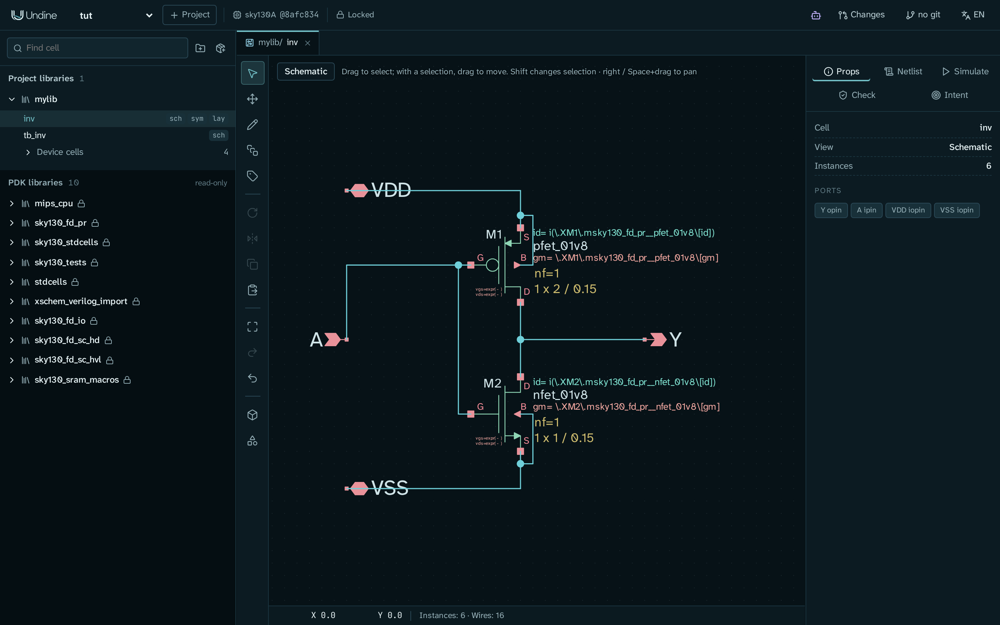
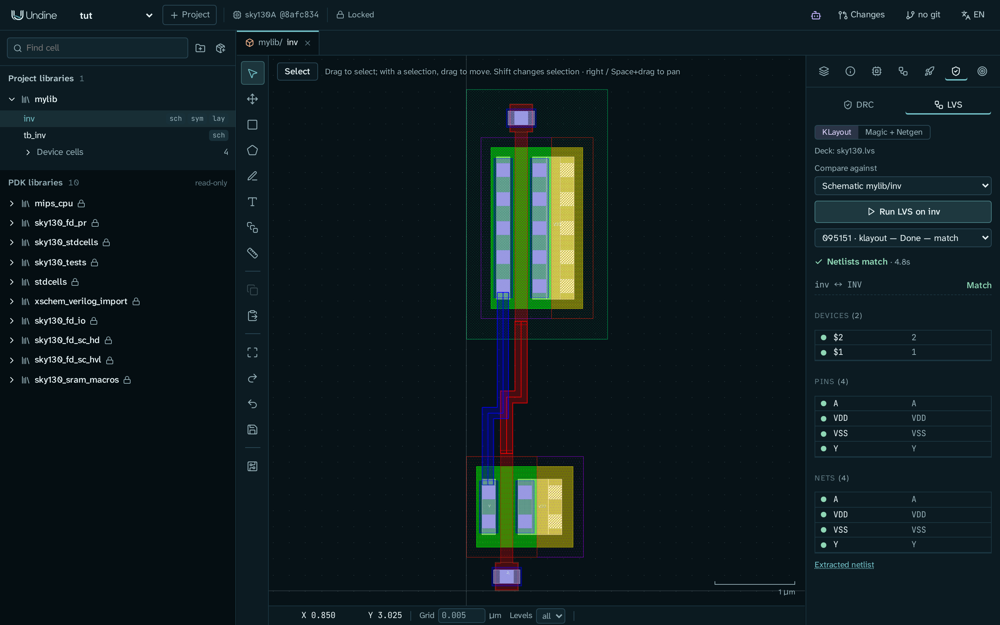
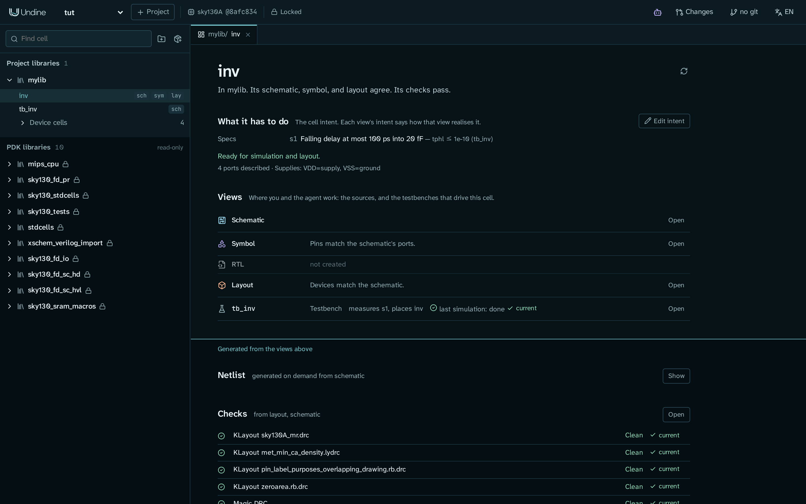

# 最初のセル: インバータを回路図から LVS まで

このチュートリアルでは、SKY130 の CMOS インバータを、空のライブラリから DRC と LVS に通るレイアウトまで設計します。
最初から最後までブラウザで作業します。スクリプトに任せられる手順には、そのスクリプトの名前を書いてあります。

終わったときには、ライブラリ `invlib` に次のものがそろっています:

- セル `inv`。回路図(pfet と nfet が 1 つずつ、ポートは `A`、`Y`、`VDD`、`VSS`)、シンボル、配線済みのレイアウトを持ちます。
- `inv` をパルスで駆動し、20 fF の負荷をつないだテストベンチ `tb_inv` と、その ngspice での過渡解析の実行。
- セルの意図にある仕様「立ち下がりの遅延は 100 ps 以下」。そのテストベンチで測ります。
- クリーンな DRC と一致する LVS。そして、回路図、シンボル、レイアウトが一致し、検証が合格していると述べるセルのページ。



<a id="before-you-start"></a>
## 始める前に

次のものが必要です:

- sky130A の PDK とそのツール(ngspice、KLayout、Magic、Netgen)を含めてインストールした Undine。
  [インストール](../getting-started/install.ja.md) を参照してください。`./setup.sh check`(または `pixi run doctor`)で、足りないものがわかります。
- sky130A のプロジェクト。このチュートリアルでは、[最初のプロジェクト](../getting-started/first-project.ja.md) のプロジェクト `demo`
  を使います。まだない場合は作ります:

    ```sh
    pixi run python -m undine new demo --pdk sky130A
    ```

- MCP を有効にして動いているサーバー。MCP が必要なのは `undine call` のコマンド(手順 7 と、手順 5 の任意のもの)だけです。
  ブラウザでの手順は、どれも MCP なしで動きます。

    ```sh
    UNDINE_MCP=1 pixi run serve     # http://127.0.0.1:8700
    ```

<http://127.0.0.1:8700> を開き、左上のプロジェクトのメニューで `demo` を選びます。

!!! note "なぜ新しいライブラリを使うのか"
    最初のプロジェクトを済ませていれば、`demo` にはすでにライブラリ `mylib` があり、完成した `inv`、そのテストベンチ `tb_inv`、
    その `inv` を置いた Tiny Tapeout のタイル `tt_um_undine_inv` が入っています。このチュートリアルではすべてを専用のライブラリ
    `invlib` に作るので、それらのセルとぶつかることも、タイルが使っている `inv` の上に描いてしまうこともありません。

!!! tip "時間がない場合"
    同じセルを作るスクリプトが 2 つあります。スクリプトで済む手順(手順 1 から 4、8 と 9)には、そのスクリプトの名前を書いた
    **コマンドライン** のタブがあります。それ以外の手順は、どちらの道でも同じです。描画を飛ばして、残りをブラウザで進めることもできます:

    ```sh
    pixi run python examples/make_inverter.py demo invlib     # schematic inv, symbol, testbench tb_inv
    pixi run python examples/route_inverter.py demo invlib    # layout of inv: generated, routed, then LVS
    ```

    これらは、サーバーが動いているマシンで、同じ `UNDINE_ROOT` で実行してください。`make_inverter.py` はファイルをプロジェクトの
    ディレクトリに直接書きます。`route_inverter.py` はサーバーの HTTP API を通して作業し、保存されたレイアウトのファイルも読みます。

<a id="1-create-a-library-and-a-cell"></a>
## 1. ライブラリとセルを作る

=== "ブラウザ"

    1. 左のライブラリブラウザで、フォルダのボタン(**新しいライブラリ**(New library))を押します。`invlib` と入力し、
       **作成**(Create)を押します。**プロジェクトのライブラリ**(Project libraries)の下にライブラリが表示されます。
    2. `invlib` の行にポインターを合わせ、**+** を押します(**新しいセル（回路図・シンボル・レイアウト）**、
       New cell (schematic, symbol, layout) のボタンです)。
    3. **セル名**(Cell name)に `inv` と入力します。**ビュー**(Views)の **回路図**(Schematic)にチェックを入れたまま、**作成** を押します。

    回路図エディタが空のシートで開き、`invlib/inv` のタブができます。ライブラリブラウザには、`sch` のバッジ付きで `inv` が表示されます。

=== "コマンドライン"

    `examples/make_inverter.py` は、ライブラリがなければ作り、そこに `inv.sch`、`inv.sym`、`tb_inv.sch` を書きます。
    手順 1 から 4 までをこれで済ませられます:

    ```sh
    pixi run python examples/make_inverter.py demo invlib
    ```

    ファイルごとに `wrote ...` の行が 1 行表示されます。ブラウザを再読み込みすると、セルが表示されます。

<a id="2-draw-the-schematic"></a>
## 2. 回路図を描く

インバータは、電源の間にある 2 つのトランジスタです。ゲートどうしをつなぎ(入力 `A`)、ドレインどうしをつなぎます(出力 `Y`)。

=== "ブラウザ"

    **トランジスタを置きます。**

    1. **I** を押します(またはツールバーの **シンボル配置 (I)**(Place symbol (I))を押します)。選択画面で `pfet_01v8` と入力し、
       `pfet_01v8`(ライブラリ `sky130_fd_pr`)を押します。
    2. シートをクリックして置き、**Esc** を押します。名前は `M1` になります。
    3. `nfet_01v8` も同じようにして、`M1` の下に置きます。名前は `M2` になります。
    4. `M1` をクリックします。右の **属性**(Props)タブで `W` を `2` にして **Enter** を押します。`L` は `0.15` のままにします。
       正孔は電子より動きにくいので、プルアップはプルダウンの 2 倍の幅にします。幅の広い pfet で、立ち上がりと立ち下がりのエッジが
       ほぼそろいます。

    **ポートを置きます。** ポートは `devices` ライブラリのシンボル `ipin`、`opin`、`iopin` です。選択画面で `pin` と入力すると
    表示されます。ポートを置いた順がセルのポートの順になるので、次の順に置きます:

    | ポート | シンボル | 置く場所 |
    |---|---|---|
    | `A` | `ipin` | ゲートの左 |
    | `Y` | `opin` | ドレインの右 |
    | `VDD` | `iopin` | 左上 |
    | `VSS` | `iopin` | 左下 |

    新しいポートの名前は `xxx` です。ポートをクリックし、**属性** でその `lab` 属性をポートの名前にします。すると、回路図の
    プロパティ(何もないところをクリック)の **ポート**(Ports)の一覧に、`A ipin`、`Y opin`、`VDD iopin`、`VSS iopin` と表示されます。

    **配線します。** **W** を押して配線ツールにします。端子をクリックして配線を始め、別の端子か既存の配線をクリックして終えます。
    曲がりはルーターが描き、デバイスの本体を避けて通ります。次の接続を描きます:

    - `A` から `M1` のゲート(`G`)へ。`M2` のゲートから `M1` のゲートへ。
    - `M1` のドレイン(`D`)から `M2` のドレインへ。`Y` からその配線へ。
    - `VDD` から `M1` のソース(`S`)へ。`M1` のボディ(`B`)からそのソースへ。
    - `VSS` から `M2` のソースへ。`M2` のボディからそのソースへ。

    終わったら **Esc** を押します。T 字の分岐にはドットが付きます。ステータスバーには `インスタンス 6個 · 配線 ...本`
    (`Instances: 6 · Wires: ...`)と表示されます。

    編集は、するそばから `inv.sch` に保存されます。保存の操作はありません。各ツールの詳細は
    [回路図エディタ](../guide/schematic.ja.md) のガイドにあります。

=== "コマンドライン"

    `make_inverter.py`(手順 1)が、同じデバイス、寸法、ポートでこの回路図をすでに書いています。

**ネットリストを確かめます。** 右の **ネットリスト**(Netlist)タブを開きます。4 つのポートと 2 つのトランジスタを持つ
サブサーキットが表示されます:

```text
.subckt inv A Y VDD VSS
XM1 Y A VDD VDD sky130_fd_pr__pfet_01v8 L=0.15 W=2
...
XM2 Y A VSS VSS sky130_fd_pr__nfet_01v8 L=0.15 W=1
...
.ends
```

ポートの順が違う場合は、ポートを違う順に置いています。それでもチュートリアルは続けられ、シンボルのピンも同じ順になります。
ポートの名前があるはずのところに `net1` のようなネットが出ているトランジスタは、配線がその端子に届いていません。描き直してください。

<a id="3-make-the-symbol"></a>
## 3. シンボルを作る

テストベンチは、シンボルを通してインバータを置きます。

=== "ブラウザ"

    1. 回路図のツールバーで、**スケマティックからシンボルを作成**(Create symbol from schematic)を押します(ツールバーの下のほうにある
       ボタンです)。
    2. シンボルエディタが、左に `A`、右に `Y`、`VDD`、`VSS` がある箱で開きます。横のパネルには *ネットリストの端子順序*
       (*Pins in netlist order*)として、`A`(入力)、`Y`(出力)、`VDD` と `VSS`(双方向)が並びます。
    3. `inv` の回路図に戻り、**整合性**(Check)タブを開いて **スケマティックとシンボルを検証**(Check schematic / symbol)を押します。
       *端子が一致*(*Interfaces match*)と表示されます。

    ピンを動かしたり、きれいな外形を描いたりできます(**P** でピン、**L** で線、**B** で箱)。
    [シンボル編集](../guide/schematic.ja.md#symbol-editing) を参照してください。

=== "コマンドライン"

    `make_inverter.py` が `inv.sym` を書いています。左に `A`、右に `Y`、上と下に電源がある正方形です。

<a id="4-build-a-testbench"></a>
## 4. テストベンチを作る

テストベンチは、セルを置いて駆動する回路図です。自分のポートは持ちません。

=== "ブラウザ"

    1. 手順 1 と同じようにして、`invlib` に回路図を持つセル `tb_inv` を作ります。
    2. **I** を押して、次のものを置きます:
        - `inv`(ライブラリ `invlib`): あなたのインバータで、名前は `x1` になります。
        - `vsource` のシンボルを 2 つ: 電源と入力です。
        - `capa` を 1 つ: 負荷です。
        - 各電源とキャパシタの下の端子に `gnd` を 1 つずつ、さらにインバータの `VSS` 用にもう 1 つ。
    3. 各部品をクリックし、**属性** で属性を設定します:

        | 部品 | `name` | `value` |
        |---|---|---|
        | 電源の電圧源 | `Vdd` | `1.8` |
        | 入力の電圧源 | `Vin` | `pulse(0 1.8 1n 100p 100p 5n 10n)` |
        | キャパシタ | `CL` | `20f` |

    4. ネットは、配線の代わりにラベルでつなぎます。**ラベル配置 (L)**(Place net label (L))を押し、**ネット名**(Net name)を入力して
       **配置**(Place)を押し、そのネットに属する端子を 1 つずつクリックします。次の名前に移る前に **Esc** を押します。
        - `in`: `Vin` の上の端子と、`x1` の端子 `A`。
        - `vdd`: `Vdd` の上の端子と、`x1` の端子 `VDD`。
        - `out`: `x1` の端子 `Y` と、`CL` の上の端子。

        同じ名前のラベルは 1 つのネットです。右側の端子に置くラベルは、置いている途中で **X** を押すと反転します。
    5. `x1` の端子 `VSS` から、その `gnd` へ配線を描きます。

=== "コマンドライン"

    `make_inverter.py` が、同じ電源と負荷で `tb_inv.sch` を書いています。モデルライブラリと自分の `.control` スクリプト
    (`tran 20p 20n`)を書いたコードブロックもあるので、次の手順では **回路図内のコマンドを使用**(Use commands in the schematic)で
    実行できます。

**ネットリストを確かめます。** `tb_inv` の **ネットリスト** タブを開きます。手順 2 の `.subckt inv` の上に、インバータと 3 つの部品が、
置いた順に、ネット `in`、`out`、`vdd`、`0`(グラウンド)の上に表示されます:

```text
x1 in out vdd 0 inv
Vdd vdd 0 1.8
Vin in 0 pulse(0 1.8 1n 100p 100p 5n 10n)
CL out 0 20f m=1
```

これらの行のどこかに `net1` のようなネットがあれば、ラベルか `gnd` がその端子に触れていません。それを削除し、端子の端に置き直してください。

<a id="5-run-a-transient-simulation"></a>
## 5. 過渡解析を実行する

1. `tb_inv` で、右の **シミュレーション**(Simulate)タブを開きます。
2. **解析**(Analysis)を **過渡解析 (.tran)**(Transient (.tran))にします。**刻み幅**(Step)を `20p` にし、**終了値**(Stop)は
   `20n` のままにします。
3. **ngspice を実行**(Run ngspice)を押します。

実行は **ジョブ**(Jobs)の下に表示され、1 秒もかかりません。終わると、グラフに `v(in)`、`v(out)`、`v(vdd)` が表示されます。
信号の一覧で `v(vdd)` のチェックを外し、グラフの上でスクロールして、1 ns にある入力の立ち上がりエッジを拡大します。
`v(in)` が 0.9 V を横切ってから数十ピコ秒後に、`v(out)` が立ち下がります。グラフをダブルクリックすると、元の表示に戻ります。

!!! note "トランジスタのモデルはどこから来るのか"
    このテストベンチにはモデルの文がないので、Undine は PDK の typical コーナー(`tt`)を読み込み、そのことをジョブに表示します。
    別のコーナーを選ぶには、PDK のコーナーシンボル `sky130_fd_pr/corner.sym` をテストベンチに置きます。
    [回路図エディタ](../guide/schematic.ja.md) のガイドを参照してください。モデルの読み込み方は
    [シミュレーションでの PDK のモデル](../guide/verification.ja.md#pdk-models-in-a-simulation) にあります。

このようにして描いたテストベンチには `.control` ブロックがないので、パネルで設定した解析が実行されます。自分の `.control` ブロックを
持つテストベンチ(`make_inverter.py` が書いたもの)は、**回路図内のコマンドを使用** で、書いてあるとおりに実行されます。

シェルからは、MCP を有効にしていれば、`run_simulation` で同じ実行ができます。解析は JSON で渡します(`key:=json`)。渡さないと
回路図自身の `.control` ブロックだけが実行されますが、このテストベンチにはそれがありません。

```sh
pixi run python -m undine call run_simulation lib=invlib cell=tb_inv 'analysis:={"type":"tran","step":"20p","stop":"20n"}' --project demo
```

結果には `"analysis": "Transient Analysis"` とあり、信号ごとの要約が付きます。

<a id="6-record-what-the-cell-has-to-do"></a>
## 6. セルがすべきことを記録する

どのセルにも **設計意図** があります。目標、選好、制約、仕様で、それぞれに理由が付きます。Undine のフローの各段階はそれを読み、
セルを扱う AI エージェントも読みます。ここでは、ポートを記述し、仕様を 1 つ追加します。

1. ライブラリブラウザで、名前の `inv` をクリックします(バッジではありません)。**セルのページ** が開きます。
   *invlib のセル。回路図、シンボルは一致しています。*(*In invlib. Its schematic and symbol agree.*)と表示され、ビューが並び、
   `tb_inv` が *places inv* の **テストベンチ**(Testbench)として表示されます。
2. **意図を編集**(Edit intent)を押します。
3. **ポート**(Ports)の下で、各ポートの **種類**(Kind)と **辺**(Side)を設定します:

    | ポート | 種類 | 辺 |
    |---|---|---|
    | `A` | 信号入力(signal in) | W |
    | `Y` | 信号出力(signal out) | E |
    | `VDD` | 電源(supply) | N |
    | `VSS` | グラウンド(ground) | S |

4. **電源**(Supplies)の下で、**推定した電源を使う**(Use suggested supplies)を押します。エディタに
   *シミュレーションの準備ができています*(*Ready for simulation*)と *レイアウトの準備ができています*(*Ready for layout*)が表示されます。
5. **意図に追加**(Add to the intent)で **仕様**(Spec)を選び、次のように入力します:
    - テキスト: `Falling delay at most 100 ps into 20 fF`
    - **測定**(Measure): `tphl`
    - **最大**(Max): `1e-10`(フォームには単位のない数値を秒で入れます)
    - **テストベンチ**(Testbench): `tb_inv`
    - **理由**(Why): `it drives the next stage at 100 MHz`

    **追加**(Add)を押します。**仕様**(Specs)の下に、仕様が `s1`、`tphl ≤ 1e-10 (tb_inv)` として表示されます。

6. この仕様には、`tphl` をどう測るかがまだ書かれていません。**YAML** を押し、`testbench: tb_inv` の下に、同じ字下げで `analysis` と
   `meas` の行を足して、仕様が次のようになるようにします:

    ```yaml
      spec:
        measure: tphl
        max: 1.0e-10
        testbench: tb_inv
        analysis: {type: tran, step: 20p, stop: 20n}
        meas: ".meas tran tphl trig v(in) val=0.9 rise=1 targ v(out) val=0.9 fall=1"
    ```

    このテストベンチには自分の `.control` ブロックがないので、`analysis` が仕様の実行に過渡解析を与えます(`make_inverter.py` の
    テストベンチに付けた仕様なら、省けます)。`meas` は `tphl` を定義する `.meas` 文です。`v(in)` が 0.9 V を上に横切ってから、
    `v(out)` が 0.9 V を下に横切るまでの時間です。

    **YAML を保存**(Save YAML)を押し、**フォーム**(Form)を押して戻ります。`.meas` 文が加わるのは、この仕様の実行だけです。
    テストベンチのファイルは変わりません。

**編集を閉じる**(Close the editor)を押します。セルのページの **このセルがすべきこと**(What it has to do)の下に仕様が並び、
*シミュレーション、レイアウトの準備ができています。*(*Ready for simulation and layout.*)と表示され、`tb_inv` は *measures s1* の
テストベンチとして表示されます。

意図はセルの隣、プロジェクトの `libs/invlib/inv.intent.yaml` に保存されます。項目の種類と意図のエディタは
[セル、意図、ビュー](../guide/cells.ja.md) と [設計ドキュメント](../design/intent.ja.md) にあります。仕様で何を測れるか、
仕様の `analysis` と `meas` については、[ツール](../guide/assistant.ja.md#the-tool-surface) の **仕様** の段落にあります。

<a id="7-measure-the-spec"></a>
## 7. 仕様を測る

ブラウザは仕様を記録します。測るのは `check_specs` ツールで、AI エージェントが呼びますし、あなたもシェルから呼べます。
MCP を有効にしてサーバーが動いている必要があります([始める前に](#before-you-start) を参照)。

```sh
pixi run python -m undine call check_specs lib=invlib cell=inv --project demo
```

結果には、仕様ごとに、状態、最悪値、限界値までの余裕が並びます:

```text
{
  "specs": [
    {
      "id": "s1",
      "text": "Falling delay at most 100 ps into 20 fF",
      "measure": "tphl",
      "min": null,
      "max": 1e-10,
      "testbench": "invlib/tb_inv",
      "status": "met",
      "worst": 6.78266e-11,
      "margin": 3.217e-11,
      ...
```

立ち下がりの遅延は約 68 ps で、限界値まで 32 ps の余裕があります。`check_specs` は、仕様をほかのコーナーや温度でも実行できます。
`undine call` については [スクリプトとシェル](../guide/assistant.ja.md#scripts-and-the-shell) で説明しています。

<a id="8-generate-the-layout-from-the-schematic"></a>
## 8. 回路図からレイアウトを生成する

=== "ブラウザ"

    1. `inv` のセルのページで、**レイアウト**(Layout)の行の **作成**(Create)を押します。レイアウトエディタが空のセルで開きます。
    2. 横のパネルで **回路図からレイアウトを生成**(Schematic-driven layout)を開きます(4 番目のアイコンです)。
       *回路図のデバイス*(*Schematic devices*)が `2`、*レイアウトに配置済み*(*Placed in layout*)が `0 / 2` と表示されます。
    3. **未配置の 2個を生成**(Generate 2 missing)を押します。*デバイス 2個を配置しました*(*Placed 2 devices*)という通知が出て、
       パネルに `M1`(pfet w=2 l=0.15)と `M2`(nfet w=1 l=0.15)がチェック付きで並びます。
    4. ツールバーの **保存 (Ctrl+S)**(Save (Ctrl+S))を押します。ステータスバーの `未保存`(`unsaved`)の表示が消えます。
    5. **F** を押して、表示を全体に合わせます。

=== "コマンドライン"

    `examples/route_inverter.py` は、デバイスを生成し、配線し、ピンのラベルを置き、保存して、KLayout の LVS を実行します。
    手順 8 と 9、手順 10 の LVS をこれで済ませられます。DRC はブラウザで実行します:

    ```sh
    pixi run python examples/route_inverter.py demo invlib    # third argument: the server's URL, if not :8700
    ```

    ジョブの状態が表示され、続いて LVS の比較のデバイス、ピン、ネットが表示されます。出力には、次のような、4 つのピンがすべて
    一致したピンの行があります:

    ```text
    pins [('A', 'A', 'Match'), ('VDD', 'VDD', 'Match'), ('VSS', 'VSS', 'Match'), ('Y', 'Y', 'Match')]
    ```

    !!! warning
        このスクリプトは空のレイアウトから始めます。セル `inv` にすでにあるものは削除します。手で配線したレイアウトに対しては
        実行しないでください。

各デバイスは PDK の PCell です。nfet の `M2` が下にあり、そのゲートコンタクトはさらに下にあります。pfet の `M1` はその上にあり、
ゲートコンタクトは上にあります。回路図でソースとボディが同じネットにあるので、それぞれのソースは li1 でボディタップにすでに
つながっています。そのため、`VDD` と `VSS` は配線する必要がありません。

**未配線の接続を表示（2本）**(Show unrouted connections (2))は、ラッツネストを描きます。2 つのデバイスをつなぐネットごとに破線を
1 本描き、ここでは `A`(ゲート)と `Y`(ドレイン)です。線はデバイスの中心どうしを結び、配線したあとも残ります。配線が完了したことを
教えてくれるのはラッツネストではなく LVS です。デバイスの生成のしかた(フィンガー、タップ、レイアウトのパラメータ)は
[回路図駆動レイアウト](../guide/layout.ja.md#schematic-driven-layout) にあります。

<a id="9-route-the-gates-and-the-output"></a>
## 9. ゲートと出力を配線する

配線を 2 本と、ラベルを 4 つ描きます。以下の座標は、**生成** で置かれたままのデバイスに対するものです。

=== "ブラウザ"

    ステータスバーにポインターの位置が µm で表示されるので、それで各点を探せます。クリックが中心線に乗るように、ステータスバーの
    **グリッド**(Grid)を既定の `0.005` から `0.01` にします。

    描くレイヤーを選ぶには、**レイヤー**(Layers。横のパネルの最初のアイコン)を開き、**レイヤーを絞り込み**(Filter layers)に
    レイヤーの番号を入力して、そのレイヤーの行をクリックします。**使用中**(used)にチェックが入っている間は、セルがすでに使っている
    レイヤーだけが一覧に表示されます。ラベルのレイヤーを探すときは、チェックを外します。

    **入力 `A`: 2 つのゲートの間の poly の配線。**

    1. `poly.drawing - 66/20` を選びます。
    2. ツールバーの **パス (P)**(Path (P))を押し、ステータスバーの **幅**(Width)を `0.15` にします。
    3. `M2` のゲートの上端 (0.50, 1.70) をクリックし、続けて (0.50, 2.40)、(0.68, 2.40)、`M1` のゲートの下端 (0.68, 3.34)
       をクリックします。**Enter** を押してパスを終えます。

    **出力 `Y`: 2 つのドレインの間の met1 の配線。** 各デバイスのドレインは、左側のソース / ドレインの帯です。

    1. `met1.drawing - 68/20` を選びます。
    2. **パス (P)** を押し、**幅** を `0.14` にします。
    3. `M2` の左の帯の (0.27, 1.30) をクリックし、続けて (0.27, 2.20)、(0.46, 2.20)、`M1` の左の帯の (0.46, 3.70) を
       クリックします。**Enter** を押します。

    **ピンのラベル。** LVS は、セルのピンをラベルで見つけます。**ラベル (L)**(Label (L))を押して点をクリックし、
    **新しいラベル**(New label)のダイアログにテキストを入力して **配置**(Place)を押します。

    | ラベル | レイヤー | 点 | 置く場所 |
    |---|---|---|---|
    | `A` | `met1.label - 68/5` | (0.50, 0.18) | `M2` のゲートコンタクト |
    | `Y` | `met1.label - 68/5` | (0.27, 1.00) | `M2` のドレインの帯 |
    | `VDD` | `li1.label - 67/5` | (1.08, 4.50) | `M1` のソースとタップ |
    | `VSS` | `li1.label - 67/5` | (0.90, 1.00) | `M2` のソースとタップ |

    **保存 (Ctrl+S)** を押します。

=== "コマンドライン"

    `route_inverter.py`(手順 8)は、独自の形状で同じことをします。2 つのゲートがそろうように pfet を動かし、まっすぐな poly の帯で
    ゲートどうしをつなぎ、ドレインどうしを met1 でつなぎ、4 つのラベルを置きます。



<a id="10-run-drc-and-lvs"></a>
## 10. DRC と LVS を実行する

`inv` のレイアウトが開いていない場合(たとえば `route_inverter.py` を実行した場合)は、開きます。`inv` のセルのページで、
**レイアウト** の行の **開く**(Open)を押します。

1. レイアウトの横のパネルで **DRC / LVS**(盾のアイコン)を開きます。**DRC** タブで **KLayout** を選んだまま、
   **inv の DRC を実行**(Run DRC on inv)を押します。数秒後に *違反なし*(*No violations*、256 ルール)と表示されます。
2. **LVS** タブを開きます。**比較対象**(Compare against)は **回路図 invlib/inv**(Schematic invlib/inv)です。
   **inv の LVS を実行**(Run LVS on inv)を押します。*ネットリストが一致*(*Netlists match*)、`inv ↔ INV` の *一致*(*Match*)と、
   一致した 2 つのデバイス、4 つのピン、4 つのネットが表示されます。
3. 必要なら、DRC タブで **Magic**、LVS タブで **Magic + Netgen** を選んで、それらも実行します。シャトルの事前チェックが使うのと
   同じツールです。どちらも同じ結果になるはずです(*違反なし*、*回路が一致*(*Circuits match*))。

!!! tip "DRC が poly.1a を報告した場合"
    poly のパスの端で `poly.1a`(poly の最小幅)が出るのは、パスがゲートの中心線から数ナノメートルずれていて、0.15 µm より細い部分が
    残っているからです。パスを選んで **Del** を押し、グリッドを `0.01` にして描き直してください。一覧の違反をクリックすると、
    レイアウトにそのマーカーが表示されます。

LVS が一致しない場合は、結果がどこが違うかを示します。対応する相手のないデバイスやピン、または接続の足りないネットです。
いちばん多い原因は、ラベルの付け忘れです。レポートの読み方は [検証](../guide/verification.ja.md) で説明しています。

<a id="11-check-the-whole-cell"></a>
## 11. セル全体を確かめる

セルのページは、セルのすべての検証を集めます。今の設計に対する結果をすべてそろえるには:

1. レイアウトの横のパネルで **テープアウト: シャトル検査と出力一式**(Tapeout: shuttle checks and bundle。ロケットのアイコン)を
   開きます。
2. **サインオフ検証**(Sign-off suite)の下で **全項目を検証（KLayout、Magic、Netgen）**(Run all checks (KLayout, Magic, Netgen))を
   押します。手順 10 の結果のいくつかがまだ最新なら、ボタンは代わりに **古い結果・未実行の N 項目を検証**
   (Run N outdated or missing checks)となり、残りだけを実行します。この一式は、KLayout の DRC のデッキ、Magic の DRC、
   KLayout の LVS、Magic + Netgen の LVS です。終わると、パネルに *すべての検証を現在の設計に対して実行し、合格しました。*
   (*Every check ran on the design as it is now and passed.*)と表示されます。

    一式の上にある **レイアウト検証**(Layout checks)は、シャトルのトップセル(Tiny Tapeout のタイル、ダイ)のためのものです。
    インバータ単体では不合格になります。ここでは無視してください。

3. `inv` のセルのページをもう一度開きます(ライブラリブラウザでその名前をクリックします)。今度は
   *invlib のセル。回路図、シンボル、レイアウトは一致しています。検証はすべて合格しています。*
   (*In invlib. Its schematic, symbol, and layout agree. Its checks pass.*)と表示されます。

    **レイアウト** の行には *デバイスは回路図と一致しています。*(*Devices match the schematic.*)とあり、テストベンチの行には
    最後のシミュレーションが *最新*(*current*)と表示され、水面線(*上のビューから生成されるもの*、*Generated from the views above*)
    の下では、どの検証も *違反なし*(*Clean*)か *一致*(*Matched*)で、*最新* です。



どの結果も、何に対して実行したかを覚えています。設計を変えると、もう一度実行するまで、その結果は何が変わったか(たとえば
*layout of invlib/inv changed*)を添えて *古い*(*outdated*)と示されます。変更を元に戻せば、再び最新になります。

試してみましょう。`inv` の回路図で、`M2` の `W` を `1.5` にします。セルのページは、レイアウトが古くなったと示します
(*devices out of date with the schematic: M2*)。次に回路図で **Ctrl+Z** を押す(または `W` を `1` に戻す)と、セルのページは再び
最新になります。ここでは、**回路図からレイアウトを生成** のパネルの **レイアウトを更新**(Update layout)は押さないでください。
新しい PCell に入れ替わりますが、あなたの配線はやり直されません。各結果が何に依存するかは
[古くなった結果](../guide/verification.ja.md#outdated-results) で説明しています。

<a id="what-you-learned"></a>
## 学んだこと

- セルはビュー(回路図、シンボル、レイアウト)と設計意図を持ちます。それらがそろっているかどうかは、セルのページに表示されます。
- 回路図は、ネットリスト、シンボル、レイアウトのデバイスの元になります。テストベンチは、そのセルを置く別の回路図です。
- 仕様は、何を、どのテストベンチで測るかと、その限界値を述べます。それを測るのは `check_specs` です。
- 回路図駆動レイアウトがデバイスを置きます。ネットを配線してピンにラベルを付けるのはあなたで、その結果を LVS が確かめます。
- どの検証とシミュレーションも入力を記録するので、古くなった結果は信用されずに、古いと示されます。

<a id="next-steps"></a>
## 次のステップ

- [AI エージェントと設計する](agent.ja.md): セルの寸法決めと検証を、その意図に沿ってエージェントに任せ、その変更をレビューします。
- [Tiny Tapeout でテープアウトする](tiny-tapeout.ja.md): このようなインバータを Tiny Tapeout のアナログタイルに入れ、バンドルを
  出力します。そのチュートリアルでは例のスクリプトでインバータを `mylib` に作り直すので、`invlib` の手で配線したレイアウトは
  そのまま残ります。
- [レイアウトエディタ](../guide/layout.ja.md)、[回路図エディタ](../guide/schematic.ja.md)、[検証](../guide/verification.ja.md):
  各手順の完全なリファレンスです。
- [変更セット (changeset)](../guide/changesets.ja.md): 編集を提案し、レビューして、採用するか破棄します。
