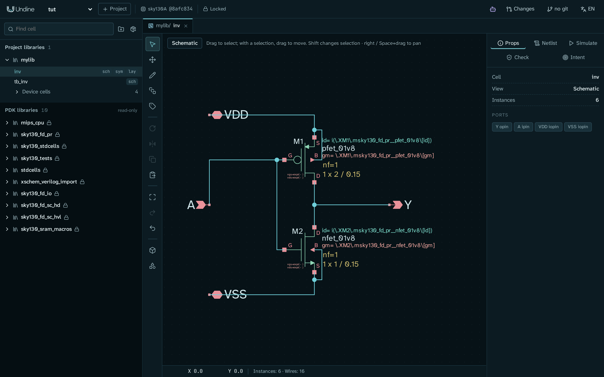
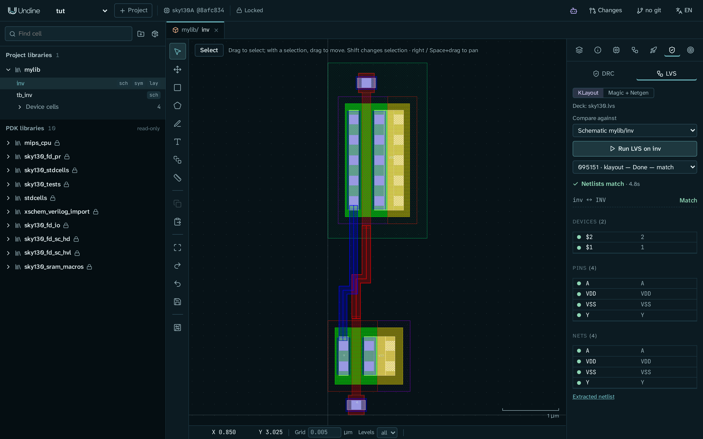
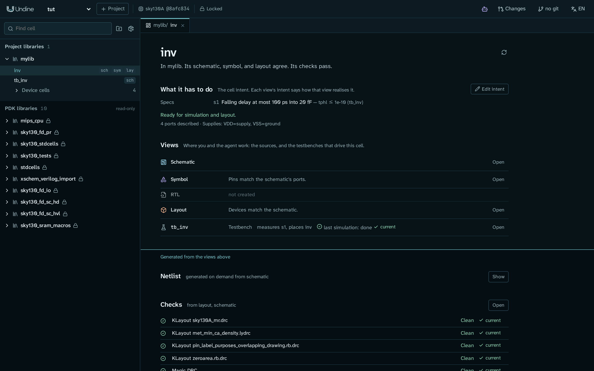

# Your first cell: an inverter from schematic to LVS

In this tutorial you design a CMOS inverter on SKY130 from an empty library to a layout that passes DRC and LVS. You
work in the browser the whole way, and the steps that a script can do for you name that script.

When you finish, the library `invlib` has:

- a cell `inv` with a schematic (one pfet, one nfet, ports `A`, `Y`, `VDD`, `VSS`), a symbol and a routed layout;
- a testbench `tb_inv` that drives `inv` with a pulse and loads it with 20 fF, and its transient run in ngspice;
- a spec in the cell's intent, "falling delay at most 100 ps", measured on that testbench;
- clean DRC and a matching LVS, and a cell page that says the schematic, symbol and layout agree and the checks pass.



## Before you start

You need:

- Undine installed with the sky130A PDK and its tools (ngspice, KLayout, Magic, Netgen). See
  [Install](../getting-started/install.md). `./setup.sh check` (or `pixi run doctor`) tells you what is missing.
- A project on sky130A. This tutorial uses the project `demo` from [First project](../getting-started/first-project.md).
  If you do not have it yet, create it:

    ```sh
    pixi run python -m undine new demo --pdk sky130A
    ```

- The server running, with MCP on. You need MCP only for the `undine call` commands (step 7, and the optional one in
  step 5); every browser step works without it.

    ```sh
    UNDINE_MCP=1 pixi run serve     # http://127.0.0.1:8700
    ```

Open <http://127.0.0.1:8700> and choose `demo` in the project menu at the top left.

!!! note "Why a new library?"
    If you did First project, `demo` already has the library `mylib` with a finished `inv`, its testbench `tb_inv` and
    the Tiny Tapeout tile `tt_um_undine_inv`, which places that `inv`. This tutorial builds everything in a library of
    its own, `invlib`, so it does not clash with those cells or draw over the one the tile uses.

!!! tip "Short on time?"
    Two scripts build the same cell. The steps that a script covers (steps 1 to 4, 8 and 9) have a **Command line**
    tab that names it; the other steps are the same on both paths. You can skip the drawing and still follow the rest
    in the browser:

    ```sh
    pixi run python examples/make_inverter.py demo invlib     # schematic inv, symbol, testbench tb_inv
    pixi run python examples/route_inverter.py demo invlib    # layout of inv: generated, routed, then LVS
    ```

    Run them on the machine where the server runs, with the same `UNDINE_ROOT`: `make_inverter.py` writes the files
    straight into the project directory; `route_inverter.py` works through the server's HTTP API and also reads the
    saved layout files.

## 1. Create a library and a cell

=== "Browser"

    1. In the library browser on the left, click the folder button (**New library**). Enter `invlib` and click
       **Create**. The library appears under **Project libraries**.
    2. Point at the `invlib` row and click **+** (**New cell (schematic, symbol, layout)**).
    3. Enter `inv` as the **Cell name**. Leave **Schematic** ticked under **Views** and click **Create**.

    The schematic editor opens on an empty sheet, with a tab `invlib/inv`. The library browser shows `inv` with a
    `sch` badge.

=== "Command line"

    `examples/make_inverter.py` creates the library if it does not exist, then writes `inv.sch`, `inv.sym` and
    `tb_inv.sch` into it. It covers steps 1 to 4:

    ```sh
    pixi run python examples/make_inverter.py demo invlib
    ```

    It prints one `wrote ...` line per file. Reload the browser to see the cells.

## 2. Draw the schematic

The inverter is two transistors between the supplies, with their gates joined (input `A`) and their drains joined
(output `Y`).

=== "Browser"

    **Place the transistors.**

    1. Press **I** (or click **Place symbol (I)** in the toolbar). In the picker, type `pfet_01v8` and click
       `pfet_01v8` (library `sky130_fd_pr`).
    2. Click on the sheet to place it, then press **Esc**. It is named `M1`.
    3. Do the same with `nfet_01v8` and place it below `M1`. It is named `M2`.
    4. Click `M1`. In the **Props** tab on the right, set `W` to `2` and press **Enter**. Leave `L` at `0.15`. The
       pull-up is twice as wide as the pull-down because holes are less mobile than electrons; the wider pfet roughly
       balances the rising and falling edges.

    **Place the ports.** Ports are the symbols `ipin`, `opin` and `iopin` of the `devices` library. Type `pin` in the
    picker to see them. Place them in this order, because the order you place the ports in is the cell's port order:

    | Port | Symbol | Where |
    |---|---|---|
    | `A` | `ipin` | left of the gates |
    | `Y` | `opin` | right of the drains |
    | `VDD` | `iopin` | top left |
    | `VSS` | `iopin` | bottom left |

    Each new port is called `xxx`. Click it and set its `lab` attribute in **Props** to the port name. The **Ports**
    list of the schematic's properties (click empty space) then shows `A ipin`, `Y opin`, `VDD iopin`, `VSS iopin`.

    **Wire it.** Press **W** for the wire tool. Click a pin to start a wire and another pin, or an existing wire, to
    finish it. The router draws the bends and goes round the device bodies. Draw these connections:

    - `A` to the gate (`G`) of `M1`, and the gate of `M2` to the gate of `M1`;
    - the drain (`D`) of `M1` to the drain of `M2`, and `Y` to that wire;
    - `VDD` to the source (`S`) of `M1`, and the body (`B`) of `M1` to its source;
    - `VSS` to the source of `M2`, and the body of `M2` to its source.

    Press **Esc** when you are done. A dot marks each T junction. The status bar shows `Instances: 6 · Wires: ...`.

    Edits are saved to `inv.sch` as you make them; there is no save step. Details of every tool are in the
    [Schematic editor](../guide/schematic.md) guide.

=== "Command line"

    `make_inverter.py` (step 1) already wrote this schematic, with the same devices, sizes and ports.

**Check the netlist.** Open the **Netlist** tab on the right. You should see a subcircuit with your four ports and the
two transistors:

```text
.subckt inv A Y VDD VSS
XM1 Y A VDD VDD sky130_fd_pr__pfet_01v8 L=0.15 W=2
...
XM2 Y A VSS VSS sky130_fd_pr__nfet_01v8 L=0.15 W=1
...
.ends
```

If the ports come in another order, you placed them in another order; you can still follow the tutorial, and the
symbol's pins follow the same order. If a transistor lists a net such as `net1` where you expected a port name, a wire
does not reach its pin: draw it again.

## 3. Make the symbol

A testbench places the inverter through its symbol.

=== "Browser"

    1. In the schematic's toolbar, click **Create symbol from schematic** (the button near the bottom of the toolbar).
    2. The symbol editor opens on a box with `A` on the left and `Y`, `VDD` and `VSS` on the right. The side panel
       lists *Pins in netlist order*: `A` (Input), `Y` (Output), `VDD` and `VSS` (Input / output).
    3. Go back to the `inv` schematic, open the **Check** tab and click **Check schematic / symbol**. You should see
       *Interfaces match*.

    You can move the pins and draw a nicer outline (**P** pins, **L** lines, **B** boxes); see
    [Symbol editing](../guide/schematic.md#symbol-editing).

=== "Command line"

    `make_inverter.py` wrote `inv.sym`, a square with `A` on the left, `Y` on the right and the supplies on top and
    bottom.

## 4. Build a testbench

A testbench is a schematic that places the cell and drives it. It has no ports of its own.

=== "Browser"

    1. Create a cell `tb_inv` in `invlib` with a schematic, as in step 1.
    2. Press **I** and place:
        - `inv` (library `invlib`): your inverter, named `x1`;
        - two `vsource` symbols: the supply and the input;
        - one `capa`: the load;
        - a `gnd` at the bottom pin of each source and of the capacitor, and one more for the inverter's `VSS`.
    3. Click each part and set its attributes in **Props**:

        | Part | `name` | `value` |
        |---|---|---|
        | supply source | `Vdd` | `1.8` |
        | input source | `Vin` | `pulse(0 1.8 1n 100p 100p 5n 10n)` |
        | capacitor | `CL` | `20f` |

    4. Connect the nets with labels instead of wires. Click **Place net label (L)**, enter the **Net name** and click
       **Place**, then click each pin that belongs to the net. Press **Esc** before the next name.
        - `in`: the top pin of `Vin` and pin `A` of `x1`;
        - `vdd`: the top pin of `Vdd` and pin `VDD` of `x1`;
        - `out`: pin `Y` of `x1` and the top pin of `CL`.

        Labels with the same name are one net. Press **X** while placing to mirror a label on a right-hand pin.
    5. Draw a wire from pin `VSS` of `x1` to its `gnd`.

=== "Command line"

    `make_inverter.py` wrote `tb_inv.sch` with the same sources and load. It also has a code block with the model
    library and its own `.control` script (`tran 20p 20n`), so you can run it with **Use commands in the schematic** in
    the next step.

**Check the netlist.** Open the **Netlist** tab of `tb_inv`. Above the `.subckt inv` of step 2 you should see the
inverter and the three parts on the nets `in`, `out`, `vdd` and `0` (ground), in the order you placed them:

```text
x1 in out vdd 0 inv
Vdd vdd 0 1.8
Vin in 0 pulse(0 1.8 1n 100p 100p 5n 10n)
CL out 0 20f m=1
```

A net such as `net1` in one of these lines means that a label or a `gnd` does not touch its pin: delete it and place
it again on the pin's end.

## 5. Run a transient simulation

1. In `tb_inv`, open the **Simulate** tab on the right.
2. Set **Analysis** to **Transient (.tran)**. Set **Step** to `20p` and leave **Stop** at `20n`.
3. Click **Run ngspice**.

The run appears under **Jobs** and takes well under a second. When it is done, the plot shows `v(in)`, `v(out)` and
`v(vdd)`. Untick `v(vdd)` in the signal list, then scroll on the plot to zoom in on the input's rising edge at 1 ns:
`v(out)` falls a few tens of picoseconds after `v(in)` crosses 0.9 V. Double-click the plot to zoom out again.

!!! note "Where the transistor models come from"
    Your testbench has no model statement, so Undine includes the PDK's typical corner (`tt`) and says so in the job.
    To choose another corner, place the PDK's corner symbol `sky130_fd_pr/corner.sym` in the testbench; see the
    [Schematic editor](../guide/schematic.md) guide. How the models are loaded is in
    [PDK models in a simulation](../guide/verification.md#pdk-models-in-a-simulation).

A testbench you drew this way has no `.control` block, so the analysis you set in the panel is what runs. A testbench
with its own `.control` block (the one from `make_inverter.py`) runs as written with **Use commands in the schematic**.

From the shell, with MCP on, `run_simulation` does the same run. Pass the analysis as JSON (`key:=json`): without it,
only the schematic's own `.control` block runs, and your testbench has none.

```sh
pixi run python -m undine call run_simulation lib=invlib cell=tb_inv 'analysis:={"type":"tran","step":"20p","stop":"20n"}' --project demo
```

The result says `"analysis": "Transient Analysis"` and summarises each signal.

## 6. Record what the cell has to do

Each cell has a **design intent**: its goals, preferences, constraints and specs, each with why. Undine's flow steps
read it, and so does an AI agent working on the cell. Here you describe the ports and add one spec.

1. In the library browser, click the name `inv` (not a badge). The **cell page** opens. It says
   *In invlib. Its schematic and symbol agree.* and lists the views, with `tb_inv` as a **Testbench** that
   *places inv*.
2. Click **Edit intent**.
3. Under **Ports**, set each port's **Kind** and **Side**:

    | Port | Kind | Side |
    |---|---|---|
    | `A` | signal in | W |
    | `Y` | signal out | E |
    | `VDD` | supply | N |
    | `VSS` | ground | S |

4. Under **Supplies**, click **Use suggested supplies**. The editor now shows *Ready for simulation* and
   *Ready for layout*.
5. Under **Add to the intent**, choose **Spec** and fill in:
    - the text: `Falling delay at most 100 ps into 20 fF`;
    - **Measure**: `tphl`;
    - **Max**: `1e-10` (the form takes a plain number, in seconds);
    - **Testbench**: `tb_inv`;
    - **Why**: `it drives the next stage at 100 MHz`.

    Click **Add**. The spec appears under **Specs** as `s1`, `tphl ≤ 1e-10 (tb_inv)`.

6. The spec still has to say how `tphl` is measured. Click **YAML** and add the lines `analysis` and `meas` under
   `testbench: tb_inv`, at the same indentation, so that the spec reads:

    ```yaml
      spec:
        measure: tphl
        max: 1.0e-10
        testbench: tb_inv
        analysis: {type: tran, step: 20p, stop: 20n}
        meas: ".meas tran tphl trig v(in) val=0.9 rise=1 targ v(out) val=0.9 fall=1"
    ```

    `analysis` gives the spec's runs their transient, since your testbench has no `.control` block of its own (a spec
    on the `make_inverter.py` testbench can leave it out). `meas` is the `.meas` statement that defines `tphl`: the
    time from `v(in)` rising through 0.9 V to `v(out)` falling through 0.9 V.

    Click **Save YAML**, then **Form** to go back. The `.meas` statement is added to the spec's own runs only; the
    testbench file does not change.

Click **Close the editor**. The cell page now lists the spec under **What it has to do**, says
*Ready for simulation and layout.*, and shows `tb_inv` as a testbench that *measures s1*.

The intent is stored next to the cell, in `libs/invlib/inv.intent.yaml` of the project. The kinds of item and the
intent editor are in [Cells, intent and views](../guide/cells.md) and the [design document](../design/intent.md); what
a spec can measure, and its `analysis` and `meas`, are in the **Specs** paragraph of
[The tool surface](../guide/assistant.md#the-tool-surface).

## 7. Measure the spec

The browser records specs; the measuring is done by the `check_specs` tool, which an AI agent calls and you can call
from the shell. It needs the server running with MCP on (see [Before you start](#before-you-start)).

```sh
pixi run python -m undine call check_specs lib=invlib cell=inv --project demo
```

The result lists each spec with its status, its worst value and the margin to the limit:

```text
{
  "specs": [
    {
      "id": "s1",
      "text": "Falling delay at most 100 ps into 20 fF",
      "measure": "tphl",
      "min": null,
      "max": 1e-10,
      "testbench": "invlib/tb_inv",
      "status": "met",
      "worst": 6.78266e-11,
      "margin": 3.217e-11,
      ...
```

The falling delay is about 68 ps, 32 ps inside the limit. `check_specs` can also run a spec at other corners and
temperatures; [Scripts and the shell](../guide/assistant.md#scripts-and-the-shell) explains `undine call`.

## 8. Generate the layout from the schematic

=== "Browser"

    1. On the cell page of `inv`, click **Create** in the **Layout** row. The layout editor opens on an empty cell.
    2. In the side panel, open **Schematic-driven layout** (the fourth icon). It lists *Schematic devices* `2` and
       *Placed in layout* `0 / 2`.
    3. Click **Generate 2 missing**. A notice says *Placed 2 devices*, and the panel lists `M1` (pfet w=2 l=0.15)
       and `M2` (nfet w=1 l=0.15) with a tick.
    4. Click **Save (Ctrl+S)** in the toolbar. The `unsaved` marker in the status bar goes away.
    5. Press **F** to fit the view.

=== "Command line"

    `examples/route_inverter.py` generates the devices, routes them, puts the pin labels, saves and runs KLayout LVS.
    It covers steps 8 and 9 and the LVS of step 10; run DRC in the browser:

    ```sh
    pixi run python examples/route_inverter.py demo invlib    # third argument: the server's URL, if not :8700
    ```

    It prints the job's state and then the devices, pins and nets of the LVS comparison. The output includes a pins
    line such as this one, with all four pins matched:

    ```text
    pins [('A', 'A', 'Match'), ('VDD', 'VDD', 'Match'), ('VSS', 'VSS', 'Match'), ('Y', 'Y', 'Match')]
    ```

    !!! warning
        The script starts from an empty layout: it deletes what the cell `inv` already has. Do not run it on a layout
        you routed by hand.

Each device is a PDK PCell: `M2`, the nfet, at the bottom with its gate contact below it, and `M1`, the pfet, above it
with its gate contact on top. Each one's source is already tied to its body tap in li1, because the schematic puts the
source and the body on the same net. So `VDD` and `VSS` need no wiring.

**Show unrouted connections (2)** draws the ratsnest: a dashed line for each net that joins two devices, here `A`
(the gates) and `Y` (the drains). The lines run between the device centres and stay after you route; LVS, not the
ratsnest, tells you that the routing is complete. How devices are generated (fingers, taps, layout parameters) is in
[Schematic-driven layout](../guide/layout.md#schematic-driven-layout).

## 9. Route the gates and the output

You draw two wires and four labels. The coordinates below are for the devices exactly as **Generate** placed them.

=== "Browser"

    The status bar shows the pointer's position in µm, so you can find each point. So that your clicks land on the
    centre lines, set **Grid** in the status bar from its default `0.005` to `0.01`.

    To choose the layer you draw on, open **Layers** (the first side-panel icon), type the layer number in
    **Filter layers** and click the layer's row. The list shows only the layers the cell already uses while **used**
    is ticked; untick it to find a label layer.

    **The input `A`: a poly wire between the two gates.**

    1. Choose `poly.drawing - 66/20`.
    2. Click **Path (P)** in the toolbar and set **Width** in the status bar to `0.15`.
    3. Click at (0.50, 1.70), the top of `M2`'s gate, then (0.50, 2.40), (0.68, 2.40), and (0.68, 3.34), the bottom
       of `M1`'s gate. Press **Enter** to finish the path.

    **The output `Y`: a met1 wire between the two drains.** The drain of each device is its left source / drain strip.

    1. Choose `met1.drawing - 68/20`.
    2. Click **Path (P)** and set **Width** to `0.14`.
    3. Click at (0.27, 1.30) on `M2`'s left strip, then (0.27, 2.20), (0.46, 2.20) and (0.46, 3.70) on `M1`'s left
       strip. Press **Enter**.

    **The pin labels.** LVS finds the cell's pins by their labels. Click **Label (L)**, click the point, type the
    text in the **New label** dialog and click **Place**.

    | Label | Layer | Point | On |
    |---|---|---|---|
    | `A` | `met1.label - 68/5` | (0.50, 0.18) | `M2`'s gate contact |
    | `Y` | `met1.label - 68/5` | (0.27, 1.00) | `M2`'s drain strip |
    | `VDD` | `li1.label - 67/5` | (1.08, 4.50) | `M1`'s source and tap |
    | `VSS` | `li1.label - 67/5` | (0.90, 1.00) | `M2`'s source and tap |

    Click **Save (Ctrl+S)**.

=== "Command line"

    `route_inverter.py` (step 8) does the same with its own geometry: it moves the pfet so that the two gates line up,
    joins them with a straight poly bar, joins the drains on met1 and puts the four labels.



## 10. Run DRC and LVS

If the layout of `inv` is not open (for example because you ran `route_inverter.py`), open it: on the cell page of
`inv`, click **Open** in the **Layout** row.

1. In the layout's side panel, open **DRC / LVS** (the shield icon). On the **DRC** tab, with **KLayout** chosen,
   click **Run DRC on inv**. After a few seconds you should see *No violations* (256 rules).
2. Open the **LVS** tab. **Compare against** is **Schematic invlib/inv**. Click **Run LVS on inv**. You should see
   *Netlists match*, `inv ↔ INV` *Match*, and the two devices, four pins and four nets matched.
3. Optionally, choose **Magic** on the DRC tab and **Magic + Netgen** on the LVS tab and run them too: the same tools
   that shuttle prechecks use. Both should agree (*No violations*; *Circuits match*).

!!! tip "If DRC reports poly.1a"
    `poly.1a` (minimum poly width) at the end of your poly path means the path is a few nanometres off the gate's
    centre line, which leaves a sliver narrower than 0.15 µm. Select the path, press **Del**, set the grid to `0.01`
    and draw it again. Click a violation in the list to see its marker in the layout.

If LVS does not match, the result says where: a device or pin without a counterpart, or a net with too few
connections. A missing label is the most common cause. [Verification](../guide/verification.md) explains the reports.

## 11. Check the whole cell

The cell page collects every check of the cell. To have them all on the design as it is now:

1. In the layout's side panel, open **Tapeout: shuttle checks and bundle** (the rocket icon).
2. Under **Sign-off suite**, click **Run all checks (KLayout, Magic, Netgen)**. If some results from step 10 are still
   current, the button reads **Run N outdated or missing checks** instead and runs only the others. The suite covers
   the KLayout DRC decks, Magic DRC, KLayout LVS and Magic + Netgen LVS. When they are done, the panel says
   *Every check ran on the design as it is now and passed.*

    The **Layout checks** above the suite are for a shuttle's top cell (a Tiny Tapeout tile, a die). A bare inverter
    fails them; ignore them here.

3. Open the cell page of `inv` again (click its name in the library browser). It now reads
   *In invlib. Its schematic, symbol, and layout agree. Its checks pass.*

    The **Layout** row says *Devices match the schematic.*, the testbench row shows its last simulation as
    *current*, and below the waterline (*Generated from the views above*) every check is *Clean* or *Matched* and
    *current*.



Every result remembers what it ran on. Change the design and the result is marked *outdated* with what changed, for
example *layout of invlib/inv changed*, until you run it again; undo the change and it is current again.

Try it: in the `inv` schematic, set `W` of `M2` to `1.5`. The cell page says the layout is out of date
(*devices out of date with the schematic: M2*). Then press **Ctrl+Z** in the schematic (or set `W` back to `1`), and
the cell page is current again. Do not click **Update layout** in the **Schematic-driven layout** panel here: it swaps
in the new PCell, but it does not redo your routing. [Outdated results](../guide/verification.md#outdated-results)
explains what each result depends on.

## What you learned

- A cell has views (schematic, symbol, layout) and a design intent; the cell page shows how they stand together.
- The schematic is the source of the netlist, the symbol and the layout's devices; a testbench is another schematic
  that places the cell.
- A spec says what to measure, on which testbench, and the limit; `check_specs` measures it.
- Schematic-driven layout places the devices; you route the nets and label the pins, and LVS confirms the result.
- Every check and simulation records its inputs, so an outdated result is flagged instead of trusted.

## Next steps

- [Design with an AI agent](agent.md): let an agent size and verify a cell from its intent, and review its changes.
- [Tape out on Tiny Tapeout](tiny-tapeout.md): put an inverter like this one in a Tiny Tapeout analog tile and export
  the bundle. That tutorial rebuilds the inverter with the example scripts in `mylib`, so your hand-routed layout in
  `invlib` stays as it is.
- [Layout editor](../guide/layout.md), [Schematic editor](../guide/schematic.md) and
  [Verification](../guide/verification.md): the full reference for each step.
- [Changesets](../guide/changesets.md): propose edits, review them and adopt or discard them.
