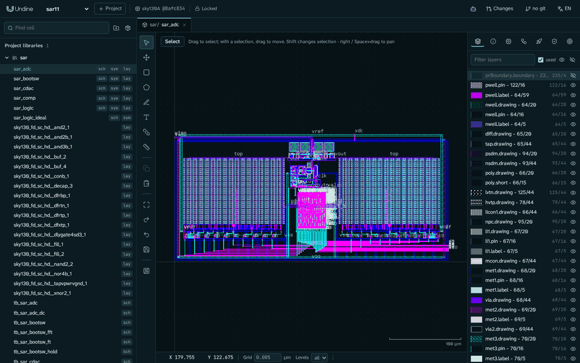
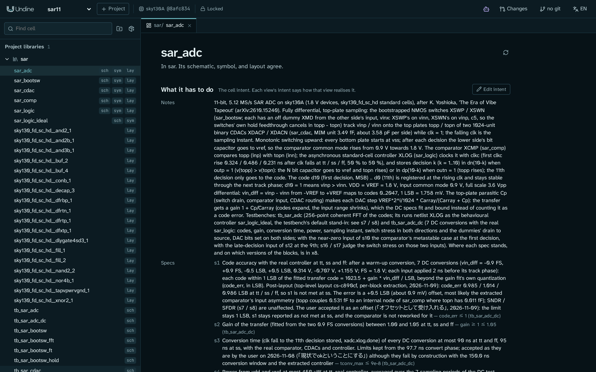
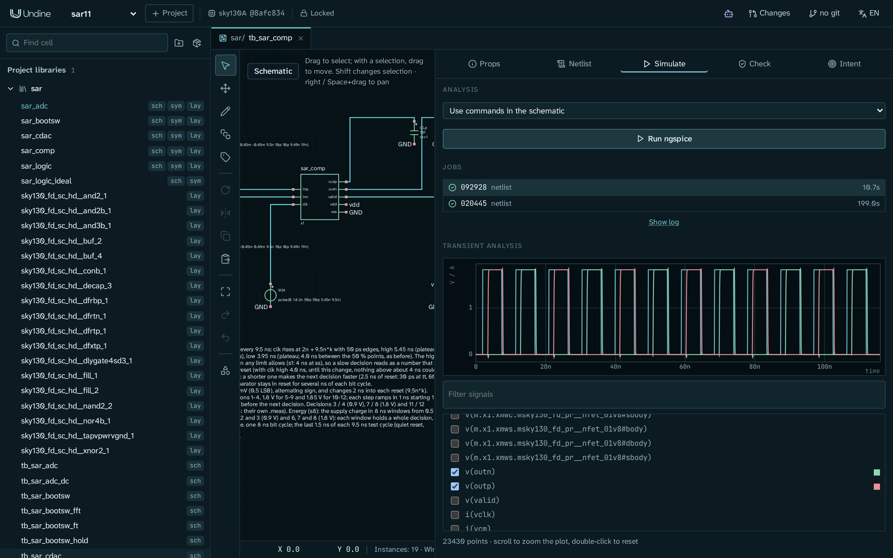
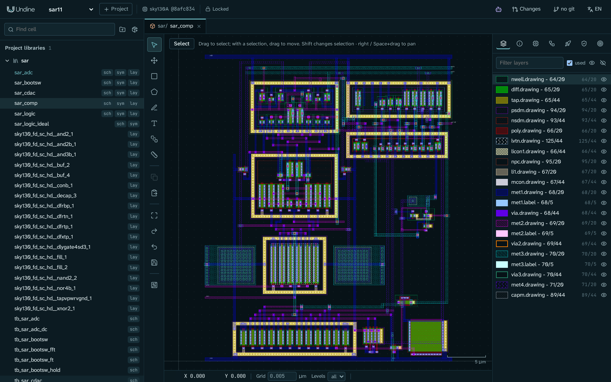
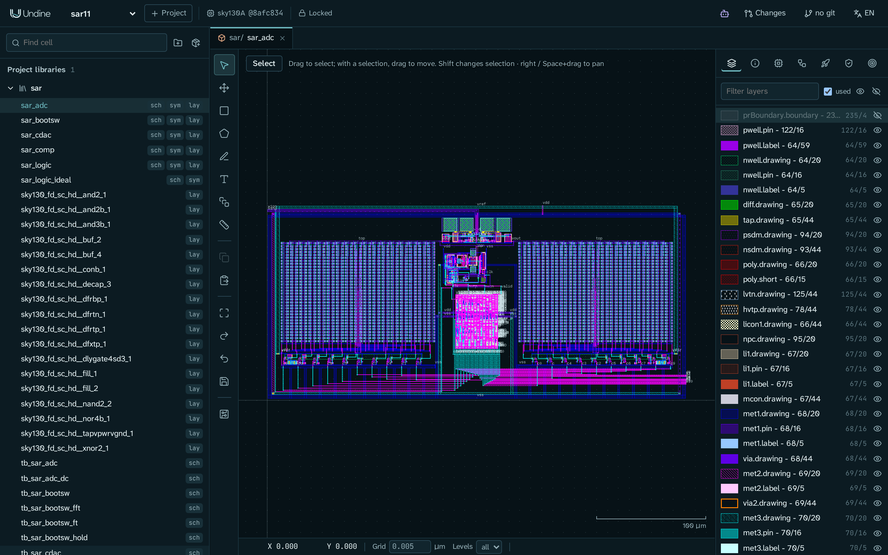

# 事例: 11 ビット SAR ADC



このページでは、ひとつの完成したミックスドシグナルのブロックを Undine で設計した過程を紹介します。最初の設計意図から、
ポストレイアウトの結果がそろったトップレベルのレイアウトまでです。ブロックは SkyWater SKY130 の 11 ビット、5.12 MS/s の
逐次比較型(SAR)ADC で、K. Yoshioka「The Era of Vibe Tapeout」([arXiv:2610.15240](https://arxiv.org/abs/2610.15240))の
リファレンス設計にならったものです。

設計作業は AI エージェント(Claude Code)が Undine の MCP ツールを通して行いました。変更はすべて **changeset** で、人間の設計者が
それぞれをレビューし、エージェントだけでは決められないことを決め、採用しました(または採用しませんでした)。

!!! note "このページについて"
    これはひとつの設計の報告で、手順を追うチュートリアルではありません。この設計(プロジェクト `sar11`、ライブラリ `sar`)は
    Undine で作りましたが、このリポジトリには含まれておらず、公開もしていません。チップはまだ作っていません。このページの数値は
    すべてシミュレーションによるものです。自分の設計で同じように作業するには、チュートリアル [AI エージェントと設計する](agent.md)
    から始めてください。

<a id="at-a-glance"></a>
## 概要

| | 目標 | Undine での結果 |
|---|---|---|
| SNDR(ポストレイアウト、tt、−1 dBFS での 256 点コヒーレント FFT) | ≥ 60 dB(論文)、レイアウト前に ≥ 64 dB(エージェントの目標) | **67.09 dB** |
| SFDR(同じ FFT) | ≥ 70 dB(論文) | **81.62 dB** |
| 5.12 MS/s での消費電力(tt) | ≤ 450 µW(論文) | **245 µW** |
| 面積 | ≤ 0.14 mm²(論文) | **0.067 mm²**(382 × 176 µm) |
| トップレベルの DRC(KLayout と Magic)、LVS、ERC | クリーン | **クリーン** |

すべての仕様を満たしているわけではありません。ss でのコードの精度と変換時間は目標に届いておらず、設計者はどちらも受け入れました。
ADC レベルのほかの数値とそれぞれの測り方は [結果](#results) に、数値に含まれていないことは
[未解決の項目と限界](#open-items-and-limits) にあります。

- **期間:** 11 日。最初のブロックの回路図(2026-10-30)から、採用したトップレベルのレイアウト(2026-11-10)まで。
- **changeset:** エージェントが 23 件を提案し、設計者が 21 件を採用、2 件を破棄。
- **仕様:** 6 つのセルで計 78 の仕様を測定。その多くは tt、ss、ff のコーナーで測りました。

<a id="the-design"></a>
## 設計


ADC は完全差動で、トッププレートサンプリングと単調(monotonic)スイッチングを使います。クロックが high の間、2 つのブートストラップ
スイッチが入力を 2 つの容量 DAC のトッププレートに追従させます。クロックの立ち下がりでサンプリングします。変換中は、自己タイミングの
コントローラがコンパレータを 11 回クロックします。最初の 10 回の判定では、判定のたびに低い側のビット容量を 1 つ `vss` から `vref` に
切り替えるので、コンパレータの同相電圧は 0.9 V から 1.8 V に向かって上がっていきます。11 回目の判定はコードにだけ入ります。
コードは次のクロックの立ち上がりでレジスタに取り込みます。

| セル | 内容 |
|---|---|
| `sar_bootsw` | ブートストラップ方式の NMOS サンプリングスイッチ。ブートストラップ回路のデバイスの 1 つは、電圧の上限に収めるために厚膜酸化膜のデバイス(`nfet_g5v0d10v5`)です。反対側の入力で駆動する、たすき掛けのオフのダミーが、ホールド時のフィードスルーを打ち消します。 |
| `sar_cdac` | 11 ビットのバイナリ容量 DAC の片側。約 3.49 fF(一辺 1.17 µm)の MIM ユニット 1024 個で、片側あたり約 3.58 pF です。ダミーユニットのリングと、ビットごとのビットドライバを持ちます。 |
| `sar_comp` | ダイナミックコンパレータ。自分のクロックから積分の窓を作る積分型プリアンプ、StrongARM ラッチ、2 つの出力が同時に立ち上がらないようにするメタスタビリティフィルタからなります。 |
| `sar_logic` | `sky130_fd_sc_hd` の標準セル 92 個(約 1700 トランジスタ)からなる非同期 SAR コントローラ。レイアウトは、回路図から作ったゲートレベルネットリストから LibreLane が配置配線します。 |
| `sar_logic_ideal` | `sar_logic` の動作モデル(XSPICE)。ピンは同じで、ADC レベルの長いシミュレーションで代わりに使います。 |
| `sar_adc` | トップレベル。2 つのスイッチ、2 つの CDAC、コンパレータ、コントローラ。 |

<a id="how-it-was-built"></a>
## 進め方

作業は段階を追って進み、各段階は設計者のレビューで終わりました。仕様つきのブロックの回路図、トップレベルの回路図、各ブロックの
レイアウト、そしてトップレベルのレイアウトとポストレイアウトシミュレーションです。以下の 6 つの節も同じ順に並んでいます。

### 1. まず意図

プロジェクトは設計者のひとことから始まりました。論文の ADC のようなものを、Undine で、SKY130 で作る、というものです。トランジスタを
1 つも描く前に、各セルに **設計意図** を与えました。目標、制約、仕様で、それぞれに理由がつきます。論文の目標値は背景(context)として
トップレベルの意図に入れました。エージェントは自分でより厳しい目標(寄生分のために約 4 dB を残すよう、レイアウト前に SNDR ≥ 64 dB)を
加え、そのことを明示しました。

仕様は Undine が測れるものです。テストベンチ、測定、上下限、確かめるコーナーからなります。たとえば、トップレベルの SNDR の仕様
(抜粋)です:

```yaml
- id: s7
  kind: spec
  text: 'SNDR at least 64 dB at tt: 256-point coherent FFT of d10..d0, ... -1.02 dBFS ... fin = 101/256 x fs'
  spec:
    measure: sndr_db
    min: 64
    testbench: tb_sar_adc
    spectrum: {bits: [d0, d1, ..., d10], fs: 5.12Meg, points: 256, start: 645.9375n, full_scale: 2048}
    corners: [tt]
```

意図は、設計者の判断を置く場所でもあります。エージェントは自分だけで決めるべきでないこと(緩める仕様、信頼性の免除(waiver)、
トレードオフ)に行き当たると、設計者に尋ねました。答えは設計者自身の言葉と日付とともに意図に入れたので、次のエージェント(または人)は
それをもとに作業します。こうした判断が 20 件以上記録されました。たとえば:

- ブートストラップ回路のデバイスの 1 つを厚膜酸化膜にし、すべてのデバイスのすべての端子対について過電圧を確かめ、短い過渡
  (最大 2.2 V、0.5 ns 未満)は記録した免除として受け入れる。
- 論文と同じく、MIM 容量のミスマッチは仕様の範囲から外す。
- コンパレータはレイアウトしたままとし、ポストレイアウトのタイミングは代わりに ADC レベルで判断する。



Undine の機能: [セル、意図、ビュー](../guide/cells.ja.md)、[設計意図](../guide/assistant.ja.md#design-intent)、
[設計: 設計の意図](../design/intent.ja.md)。

### 2. ブロックの回路図とコーナーごとの仕様

ブロックごとに、エージェントが回路図とそのテストベンチを描き、`check_specs` で仕様を測りました。その多くは tt、ss、ff で測っています。
仕様が扱う内容の例:

- **ブートストラップスイッチ:** オン抵抗と入力範囲にわたるその平坦さ、トラック時のセトリング、ホールド時のドループとフィードスルー、
  2 つのスイッチでのサンプリング FFT(SNDR ≥ 74 dB)、すべての端子対でのデバイスのストレス。
- **CDAC:** ユニットとアレイの容量、ビット 9 に対する各ビットの重み、各ビットのあとのセトリング、ドライバの遅延、変換 1 回あたりの
  エネルギー。
- **コンパレータ:** 同相電圧 0.9 V から 1.85 V での判定時間とリセット時間、入力容量、ノイズ、判定 1 回あたりのエネルギー、出力が
  同時に high にならないこと、デバイスのミスマッチを含めたオフセットの同相電圧に対するずれ。最後のものはモンテカルロ実行
  (`check_specs` の `mismatch`)で測ります。
- **トップレベル:** 7 つの DC 入力でのコードの精度、ゲイン、変換時間、消費電力、サンプリング誤差、スイッチのストレス、
  コンパレータのメタステーブルなケース、出力コードの 256 点 FFT による SNDR と SFDR。

256 サンプルの FFT には約 50 µs の過渡解析が必要です。コントローラがトランジスタレベルのままでは時間がかかりすぎるので、FFT の
テストベンチではコントローラを動作モデル `sar_logic_ideal` で動かします。これが **代役**(stand-in)です。回路図は本物の
コントローラのままで、テストベンチの意図にその置き換えが書かれ、すべての結果に代役を使ったことが記されます。DC のテストは本物の
コントローラで動かします。



Undine の機能: [仕様、コーナー、モンテカルロ、スペクトルの測定](../guide/assistant.ja.md#the-tool-surface)、
[代役](../guide/verification.ja.md#stand-ins)、[回路図エディタ](../guide/schematic.ja.md)。

### 3. エージェントが提案し、設計者が採用する

エージェントが設計を直接変えることはありませんでした。作業はひとつひとつが changeset でした。changeset はプロジェクトの git ブランチで、
自分の作業コピーを持ちます。エージェントが作業している間、設計者はそれを Undine で見ていました。エージェントの作業が終わると、
設計者はレビューを開きました:

- **対象ごと**(*By object*)は、変更をそれぞれエージェントの理由とともに一覧にしました。
- **差分**(*Diff*)は、提案版の上に確定版との違い(追加、削除、変更)を重ねて表示しました。
- チェックは、確定版と提案版のそれぞれについて DRC(KLayout と Magic)、LVS、ERC を表示しました。

仕様の結果はレビュー画面ではなく、エージェントの `check_specs` の報告から得ました。そのうえで設計者は **採用**(Adopt)、
**修正を依頼**(Request changes。エージェントは同じ changeset で作業を続けます)、**破棄**(Discard)のいずれかを押しました。

作業の一部は並行して進めました。各エージェント(Claude Code のサブエージェント)は `comp-layout`、`cdac-layout`、`top-layout` のような
自分の名前を使ったので、それぞれが自分の changeset を持ち、履歴とレビューは編集ごとにそれを行ったエージェントを示します。検証役の
エージェントは、ほかのエージェントの changeset を引き取らずに確かめられました。スイッチのレイアウトでは、2 つのエージェントが
2 通りの配置を並行して作りました。設計者はそれらを比べて一方を採用し、もう一方は破棄しました。

エージェントの呼び出しの多くは、Claude Code のシェルでの `undine call` を通りました。これは Claude Code 自身の MCP 接続と同じ
MCP エンドポイントにつながり、その編集も同じ規則に従います。

Undine の機能: [変更セット (changeset)](../guide/changesets.ja.md)、
[1 つの接続で複数のエージェントが動くとき](../guide/assistant.ja.md#several-agents-on-one-connection)、
[他のエージェントの changeset を確かめる](../guide/assistant.ja.md#checking-another-agents-changeset)、
[スクリプトとシェル](../guide/assistant.ja.md#scripts-and-the-shell)、
[AI エージェントをつなぐ](../getting-started/connect-ai.ja.md#claude-code)。

### 4. ブロックごとのレイアウト

アナログのブロックは、それぞれの回路図からレイアウトしました。エージェントはデバイスを PDK の PCell として生成し(MOSFET の
フィンガーを 1 つのデバイスにまとめ、MIM 容量の `MF` をユニットのアレイにする)、Undine の描画ツールで配置・配線し、各ブロックを
KLayout の DRC、Magic の DRC、LVS、ボディタップの ERC で確かめました。Magic と ERC は、KLayout の DRC が通したものに問題を
見つけました。厚膜酸化膜のデバイスのバッティングタップが Magic の `diff/tap.16` には狭すぎたことと、ボディタップが信号ネットの
ソースまたはドレインに突き合わされていたことです。



次に各ブロックを抽出し(Magic、モード `c` と `rc`)、抽出したビューで仕様を測り直しました。レイアウト後に仕様を満たさなくなった
ところでは、エージェントがその理由を報告し、設計者が判断しました。たとえば、スイッチのホールド時のフィードスルーはポストレイアウトで
不合格になりました(0.44 mV に対して 1.6 mV)。原因はスイッチ自身のソースとドレインの帯の間の 3.2 fF でした。設計者はたすき掛けの
ダミーで打ち消すことにし、そのために回路図、シンボル、トップレベルが変わりました。

Undine の機能: [回路図駆動レイアウト](../guide/layout.ja.md#schematic-driven-layout)、
[変更セットの検証](../guide/verification.ja.md#the-checks-of-a-changeset)、
[もう一つの判断材料: Magic の DRC と Magic + Netgen の LVS](../guide/verification.ja.md#second-opinion-magic-drc-and-magic-netgen-lvs)、
[寄生抽出とポストレイアウトシミュレーション](../guide/verification.ja.md#parasitic-extraction-and-post-layout-simulation)。

### 5. コントローラには LibreLane

コントローラは RTL を持たない、標準セルの回路図です。Undine がそのゲートレベルネットリストを書き出し、LibreLane が描かれたとおりに
配置配線します(`source: schematic`。論理合成も、サイズ変更も、クロックツリーもなし)。自己タイミングのコントローラには、それが
望ましい形です。エージェントはフローの設定(60 × 60 µm のダイ、met4 までの配線)を changeset で提案し、実行し、レイアウトを
取り込み、標準セルの回路図に対する LVS で確かめました。

レイアウト後、コントローラはレイアウト前より 1.4 倍から 1.5 倍遅くなりました。設計者は回路図と 5.12 MS/s のレートを保ち、代わりに
クロックのデューティを変えました。トラックが約 45 ns、変換が約 150 ns です。

Undine の機能: [標準セルの回路図から LibreLane](../guide/rtl.ja.md#from-a-schematic-of-standard-cells)、
[ゲートレベルネットリスト](../guide/rtl.ja.md#gate-level-netlists-of-standard-cell-schematics)。

### 6. トップレベルのレイアウトとポストレイアウトシミュレーション

トップレベルでは、2 つの CDAC を左右に置き、その間にスイッチ、コンパレータ、LibreLane のコントローラを置きます。KLayout と Magic の
DRC で違反はなく、LVS はすべてのセルで一致し、ERC は何も見つけませんでした。



続いて、ブロックをそれぞれの抽出結果でシミュレーションして、ADC レベルの仕様を測りました:

- **SNDR と SFDR:** FFT のテストベンチ。スイッチ、CDAC、コンパレータは `c` の抽出結果、コントローラは代役です。この実行には
  ngspice で約 6 時間かかりました。
- **消費電力とコードの精度:** DC のテストベンチ。アナログのブロックは `rc` の抽出結果、コントローラは LibreLane のレイアウトの
  抽出結果による本物です。

<a id="results"></a>
## 結果

SNDR、SFDR、消費電力、面積は [概要](#at-a-glance) にあります。SNDR と SFDR は FFT の実行から、消費電力は DC の実行
(`vdd` と `vref` の合計、tt)から得たもので、どちらも前の節で説明しました。DC の実行からは、ADC レベルのほかの仕様も得られます:

| 仕様 | 目標 | ポストレイアウトの結果 | 達成 |
|---|---|---|---|
| 伝達特性のゲイン | 1.00〜1.05 | tt で 1.0287 | はい |
| tt / ss / ff でのコードの精度 | ≤ 1 LSB | 0.985 / 1.014 / 0.986 LSB | ss で未達(受け入れ済み) |
| 変換時間 | ≤ 90 ns(ss では 95 ns) | 設計上、変換の窓は約 150 ns | 未達(受け入れ済み) |

ほかに 2 つの項目が目標に届いていません。遅い判定のテストでコンパレータがメタステーブル点に来なくなったことと、ブロックレベルの
仕様のいくつかがレイアウト後に満たされないことです。いずれも [未解決の項目と限界](#open-items-and-limits) で説明します。

<a id="open-items-and-limits"></a>
## 未解決の項目と限界

設計者は次の未解決の項目を受け入れ、それぞれを設計意図に記録しています:

- **ss でのオフセット。** ss でのコードの精度は 1 LSB に対して 1.014 LSB で、約 +0.5 LSB(0.9 mV)のオフセットによるものです。
  もっとも考えられる原因は、抽出したコンパレータの中での 2 つのトッププレートの非対称な結合です。SNDR と SFDR には影響しません。
  設計者はオフセットとして受け入れ、コンパレータは作り直していません。
- **変換時間の仕様。** トップレベルの変換時間の仕様(90 ns、ss では 95 ns)は、以前のクロック(変換 97.7 ns)に合わせて書いた
  ものです。変換の窓が 150 ns なので、設計上この仕様は満たせません。設計者は仕様をそのまま残し、未達として報告しています。
- **遅い判定のテスト。** 9 回目の判定でコンパレータをメタステーブル点に置くためのテスト入力が、レイアウト後はその点に届かなく
  なりました。設計者は入力を変えずに残しました。
- **ADC レベルで判断したブロックの仕様。** ブロックレベルの仕様のいくつかが、レイアウト後に満たされません。コンパレータのタイミングと
  エネルギーの仕様の一部、CDAC の変換エネルギー(10 pJ に対して 10.86 pJ)、コントローラの速度です。設計者はブロックを作り直す
  代わりに、上の ADC レベルの結果でこれらを判断することにしました。

結果の限界:

- **シミュレーションのみ。** 何も製造していません。
- **ブロックごとの抽出。** 各ブロックは、それぞれの抽出結果でシミュレーションしました。トップレベルでのブロック間の配線は、
  ポストレイアウトの実行に含まれていません。
- **FFT では動作モデルのコントローラ。** SNDR と SFDR は、コントローラの代わりに `sar_logic_ideal` を使って測りました。消費電力と
  コードの精度は、抽出した本物のコントローラで測りました。
- **過渡解析にノイズなし。** FFT はデバイスノイズを含まない過渡シミュレーションです。別に見積もったコンパレータのノイズと kT/C ノイズで、
  SNDR は約 1 dB 下がります。
- **容量のミスマッチなし。** 論文と同じく、MIM のミスマッチは仕様の範囲外です。コンパレータのオフセットには、モンテカルロの仕様を
  通してデバイスのミスマッチが含まれています。

<a id="lessons-from-this-design"></a>
## この設計から学んだこと

- 設計意図は、あなたとエージェントの間の契約です。エージェントが測れる仕様と、あなた自身の言葉で書いたあなたの判断です。
- エージェントは Undine でアナログ設計のフロー全体(回路図、コーナーごとの仕様、レイアウト、LibreLane、抽出、ポストレイアウト
  シミュレーション)をこなせます。それでも判断はあなたの手に残ります。あなたが採用するまで、何も設計に入らないからです。
- 結果は、それがどう得られたか(コーナー、代役、抽出)を示します。それを踏まえて読んでください。

<a id="next-steps"></a>
## 次のステップ

- [AI エージェントと設計する](agent.md): 同じ「提案、レビュー、採用」の流れを、小さなセルで一歩ずつ。
- [最初のセル: インバータ](inverter.md): Undine が初めての場合に。
- [AI エージェントをつなぐ](../getting-started/connect-ai.ja.md): 自分の Undine に AI エージェントをつなぐ。
- [セル、意図、ビュー](../guide/cells.ja.md): 最初のセルの意図を書く。
- [変更セット (changeset)](../guide/changesets.ja.md): 提案をレビューして採用する方法。
- [検証](../guide/verification.ja.md): チェック、抽出、ポストレイアウトシミュレーション。
- [設計エージェントと MCP](../guide/assistant.ja.md): ツールの全体。
