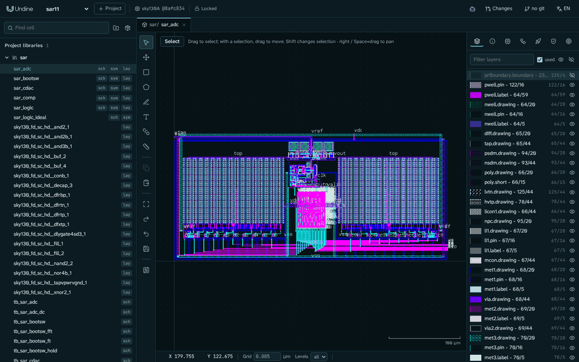
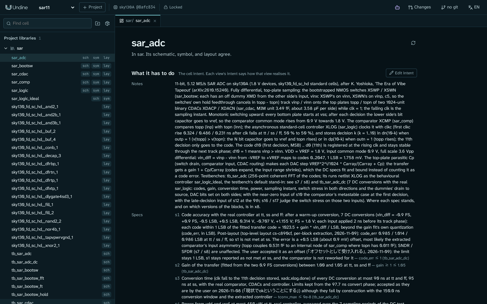
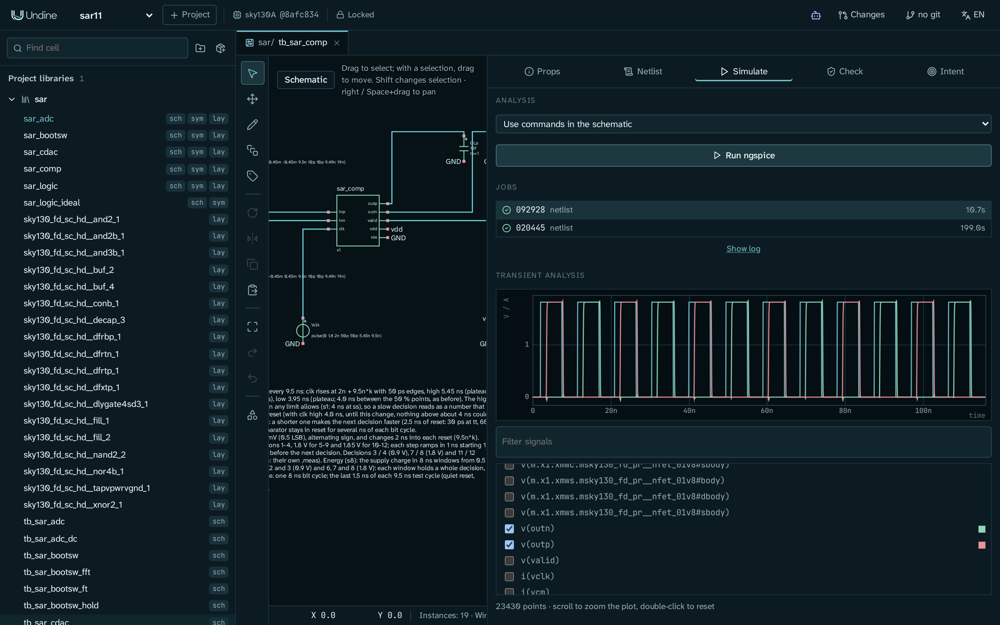
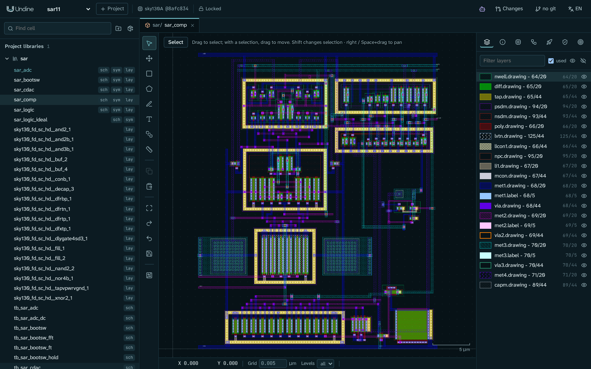
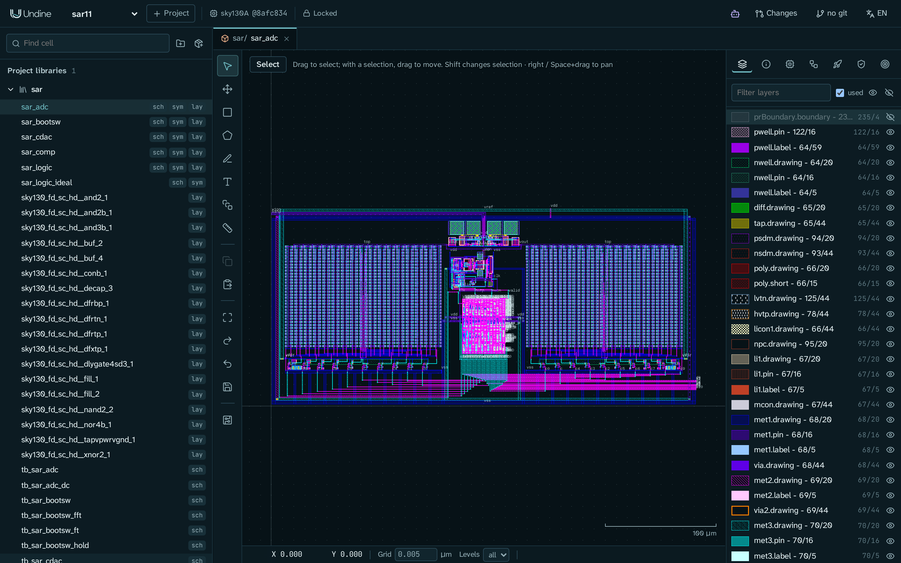

# Case study: an 11-bit SAR ADC



This page shows how a complete mixed-signal block was designed in Undine, from the first design intent to a
top-level layout with post-layout results. The block is an 11-bit, 5.12 MS/s successive-approximation ADC on SkyWater
SKY130, after the reference design of K. Yoshioka, "The Era of Vibe Tapeout"
([arXiv:2610.15240](https://arxiv.org/abs/2610.15240)).

An AI agent (Claude Code) did the design work through Undine's MCP tools. Every change was a **changeset**, and a
human designer reviewed each one, made the decisions the agent could not make alone, and adopted it (or did not).

!!! note "About this page"
    This is a report of one design, not a step-by-step tutorial. The design (project `sar11`, library `sar`) was built
    with Undine but is not part of this repository and is not published. No chip has been made: every figure on this
    page is from simulation. To work the same way on your own design, start with the tutorial
    [Design with an AI agent](agent.md).

## At a glance

| | Target | Result in Undine |
|---|---|---|
| SNDR, post-layout, tt, 256-point coherent FFT at −1 dBFS | ≥ 60 dB (paper); ≥ 64 dB before layout (the agent's target) | **67.09 dB** |
| SFDR, same FFT | ≥ 70 dB (paper) | **81.62 dB** |
| Power at 5.12 MS/s, tt | ≤ 450 µW (paper) | **245 µW** |
| Area | ≤ 0.14 mm² (paper) | **0.067 mm²** (382 × 176 µm) |
| Top-level DRC (KLayout and Magic), LVS, ERC | clean | **clean** |

Not every spec is met: code accuracy at ss and the conversion time miss their targets, and the designer accepted
both. [Results](#results) gives the other ADC-level figures and how each was measured, and
[Open items and limits](#open-items-and-limits) says what the figures leave out.

- **Time:** 11 days, from the first block schematic (2026-10-30) to the adopted top-level layout (2026-11-10).
- **Changesets:** 23 proposed by the agent, 21 adopted by the designer, 2 discarded.
- **Specs:** 78 measured specs over six cells, many of them at the tt, ss and ff corners.

## The design


The ADC is fully differential, with top-plate sampling and monotonic switching. While the clock is high, two
bootstrapped switches track the inputs onto the top plates of two capacitive DACs. The falling clock samples. During
conversion, a self-timed controller clocks the comparator 11 times. After each of the first ten decisions, it switches
one bit capacitor of the lower side from `vss` to `vref`, so the comparator's common mode rises from 0.9 V towards
1.8 V. The 11th decision goes only to the code. The code is registered at the next rising clock.

| Cell | What it is |
|---|---|
| `sar_bootsw` | Bootstrapped NMOS sampling switch. One device of the bootstrap circuit is a thick-oxide device (`nfet_g5v0d10v5`), to keep it within its voltage limits. A cross-coupled off dummy, driven from the other side's input, cancels the hold feedthrough. |
| `sar_cdac` | One side of the 11-bit binary capacitive DAC: 1024 MIM units of about 3.49 fF (1.17 µm sides), about 3.58 pF per side, with a ring of dummy units and a bit driver per bit. |
| `sar_comp` | Dynamic comparator: an integrating preamplifier whose window comes from its own clock, a StrongARM latch, and a metastability filter so that both outputs can never rise together. |
| `sar_logic` | Asynchronous SAR controller from 92 `sky130_fd_sc_hd` standard cells (about 1700 transistors). Its layout is placed and routed by LibreLane from a gate-level netlist made from the schematic. |
| `sar_logic_ideal` | Behavioural (XSPICE) model of `sar_logic` with the same pins, used as a stand-in for long ADC-level simulations. |
| `sar_adc` | The top level: two switches, two CDACs, the comparator and the controller. |

## How it was built

The work went in stages, and each ended in a review by the designer: block schematics with their specs, the top-level
schematic, the layout of each block, then the top-level layout and post-layout simulation. The six sections below
follow the same order.

### 1. Intent first

The project started from one sentence from the designer: build something like the paper's ADC, with Undine, on
SKY130. Before any transistor was drawn, each cell got a **design intent**: its goals, constraints and specs, each with its
reason. The paper's targets went into the top level's intent as context. The agent added a stricter target of its own
(SNDR ≥ 64 dB before layout, to leave about 4 dB for parasitics) and said so.

A spec is something Undine can measure: a testbench, a measure, limits and the corners to check it at. For example,
the top level's SNDR spec (abridged):

```yaml
- id: s7
  kind: spec
  text: 'SNDR at least 64 dB at tt: 256-point coherent FFT of d10..d0, ... -1.02 dBFS ... fin = 101/256 x fs'
  spec:
    measure: sndr_db
    min: 64
    testbench: tb_sar_adc
    spectrum: {bits: [d0, d1, ..., d10], fs: 5.12Meg, points: 256, start: 645.9375n, full_scale: 2048}
    corners: [tt]
```

The intent is also where the designer's decisions live. When the agent found something it should not decide alone
(a spec to relax, a reliability waiver, a trade-off), it asked. The answer went into the intent with the designer's own
words and the date, so the next agent (or person) works from it. More than 20 such decisions were recorded. For example:

- make one device of the bootstrap circuit thick-oxide, check every terminal pair of every device for over-voltage, and accept short
  transients (at most 2.2 V, under 0.5 ns) as a recorded waiver;
- leave MIM capacitor mismatch out of the spec scope, as the paper does;
- keep the comparator as laid out, and judge its post-layout timing at the ADC level instead.



Undine features: [Cells, intent and views](../guide/cells.md), [Design intent](../guide/assistant.md#design-intent),
[Design: design intent](../design/intent.md).

### 2. Block schematics and specs at corners

For each block, the agent drew the schematic and its testbenches and measured its specs with `check_specs`, most of
them at tt, ss and ff. Some examples of what the specs cover:

- **Bootstrapped switch:** on-resistance and its flatness over the input range, track settling, hold droop and
  feedthrough, a two-switch sampling FFT (SNDR ≥ 74 dB), and device stress on every terminal pair.
- **CDAC:** unit and array capacitance, the weight of each bit against bit 9, settling after each bit, driver delay,
  and the energy per conversion.
- **Comparator:** decision and reset time at common modes from 0.9 V to 1.85 V, input capacitance, noise, energy per
  decision, outputs never both high, and the offset's drift over common mode with device mismatch, measured as
  Monte Carlo runs (`mismatch` in `check_specs`).
- **Top level:** code accuracy at seven DC inputs, gain, conversion time, power, sampling error, switch stress, the
  comparator's metastable cases, and SNDR and SFDR from a 256-point FFT of the output code.

A 256-sample FFT needs about 50 µs of transient. With the controller at transistor level that takes far too long, so
the FFT testbench runs the controller as its behavioural model, `sar_logic_ideal`. This is a **stand-in**: the
schematic keeps the real controller, the testbench's intent names the substitution, and every result says it was
used. The DC tests run the real controller.



Undine features: [Specs, corners, Monte Carlo and spectral measures](../guide/assistant.md#the-tool-surface),
[Stand-ins](../guide/verification.md#stand-ins), [Schematic editor](../guide/schematic.md).

### 3. The agent proposes, the designer adopts

The agent never changed the design directly. Each piece of work was a changeset: a git branch of the project with its
own working copy, which the designer watched in Undine while the agent worked. When the agent finished, the designer
opened the review:

- **By object** listed each change with the agent's reason;
- **Diff** showed the proposal with what differs from the confirmed design drawn over it (added, removed, changed);
- the checks showed DRC (KLayout and Magic), LVS and the ERC in the confirmed design and in the proposal.

Spec results did not come from the review screen: they came from the agent's `check_specs` reports. The designer then
clicked **Adopt**, **Request changes** (the agent goes on in the same changeset) or **Discard**.

Some work ran in parallel. Each agent (a subagent of Claude Code) used a name of its own, such as `comp-layout`,
`cdac-layout` or `top-layout`, so each had its own changeset, and the history and the review name the agent behind
every edit. A verifier agent could check another agent's changeset without taking it over. For the switch layout, two
agents built two arrangements side by side. The designer compared them and adopted one; the other was discarded.

Most of the agent's calls went through `undine call` in Claude Code's shell. It speaks to the same MCP endpoint as
Claude Code's own MCP connection, and its edits follow the same rules.

Undine features: [Changesets](../guide/changesets.md),
[Several agents on one connection](../guide/assistant.md#several-agents-on-one-connection),
[Checking another agent's changeset](../guide/assistant.md#checking-another-agents-changeset),
[Scripts and the shell](../guide/assistant.md#scripts-and-the-shell),
[Connect an AI agent](../getting-started/connect-ai.md#claude-code).

### 4. Layout per block

The analog blocks were laid out from their schematics. The agent generated the devices as PDK PCells (a MOSFET's
fingers strapped into one device, a MIM capacitor's `MF` as an array of units), placed and routed them with Undine's
drawing tools, and checked each block with KLayout DRC, Magic DRC, LVS and an ERC on body taps. Magic and the ERC found
problems that KLayout's DRC passed: a thick-oxide device's butted tap too narrow for Magic's `diff/tap.16`, and body
taps butted against a signal net's source or drain.



Each block was then extracted (Magic, modes `c` and `rc`) and its specs measured again on the extracted view. Where a
spec failed after layout, the agent reported why, and the designer decided. For example, the switch's hold
feedthrough failed post-layout (1.6 mV against 0.44 mV) because of 3.2 fF between the switch's own source and drain
strips. The designer chose to cancel it with a cross-coupled dummy, which changed the schematic, the symbol and the top
level.

Undine features: [Schematic-driven layout](../guide/layout.md#schematic-driven-layout),
[The checks of a changeset](../guide/verification.md#the-checks-of-a-changeset),
[Second opinion: Magic DRC and Magic + Netgen LVS](../guide/verification.md#second-opinion-magic-drc-and-magic-netgen-lvs),
[Parasitic extraction and post-layout simulation](../guide/verification.md#parasitic-extraction-and-post-layout-simulation).

### 5. LibreLane for the controller

The controller is a schematic of standard cells with no RTL. Undine writes its gate-level netlist, and LibreLane
places and routes it as drawn (`source: schematic`: no synthesis, no resizing, no clock tree). For a self-timed
controller that is what you want. The
agent proposed the flow configuration (a 60 × 60 µm die, routing up to met4) in its changeset, ran it, imported the
layout and checked it with LVS against the standard-cell schematic.

After layout, the controller was 1.4 to 1.5 times slower than before. The designer kept the schematic and the
5.12 MS/s rate, and changed the clock duty instead: about 45 ns of track and 150 ns of conversion.

Undine features: [LibreLane from a schematic of standard cells](../guide/rtl.md#from-a-schematic-of-standard-cells),
[Gate-level netlists](../guide/rtl.md#gate-level-netlists-of-standard-cell-schematics).

### 6. Top-level layout and post-layout simulation

The top level places the two CDACs left and right, with the switches, the comparator and the LibreLane controller
between them. DRC with KLayout and with Magic found no violations, LVS matched every cell, and the ERC found nothing.



The ADC-level specs were then measured with the blocks simulated from their extractions:

- **SNDR and SFDR:** the FFT testbench, with the switches, CDACs and comparator from their `c` extractions and the
  controller as its stand-in. This run took about six hours of ngspice.
- **Power and code accuracy:** the DC testbench, with the analog blocks from their `rc` extractions and the real
  controller from the extraction of its LibreLane layout.

## Results

SNDR, SFDR, power and area are in [At a glance](#at-a-glance). SNDR and SFDR come from the FFT run, power from the
DC run (`vdd` and `vref` together, at tt), both described in the previous section. The DC run also gives the other
ADC-level specs:

| Spec | Target | Post-layout result | Met |
|---|---|---|---|
| Gain of the transfer | 1.00 to 1.05 | 1.0287 at tt | yes |
| Code accuracy at tt / ss / ff | ≤ 1 LSB | 0.985 / 1.014 / 0.986 LSB | no at ss (accepted) |
| Conversion time | ≤ 90 ns (95 ns at ss) | about 150 ns conversion window by design | no (accepted) |

Two more items do not reach their target: the late-decision test no longer puts the comparator at its metastable
point, and a few block-level specs miss after layout. All of them are explained in
[Open items and limits](#open-items-and-limits).

## Open items and limits

The designer accepted these open items, and each one is recorded in the design intent:

- **Offset at ss.** Code accuracy is 1.014 LSB at ss against 1 LSB, from an offset of about +0.5 LSB (0.9 mV). The
  most likely cause is an asymmetric coupling of the two top plates inside the extracted comparator. SNDR and SFDR are
  not affected. The designer accepted it as an offset, and the comparator was not reworked.
- **Conversion-time spec.** The top level's conversion-time spec (90 ns, 95 ns at ss) was written for the old clock
  (97.7 ns of conversion). With the 150 ns conversion window it fails by design. The designer kept the spec as it is,
  reported as not met.
- **Late-decision test.** A test input meant to put the comparator at its metastable point at the 9th decision no
  longer reaches that point after layout. The designer kept the input unchanged.
- **Block specs judged at the ADC level.** A few block-level specs miss after layout: some of the comparator's timing
  and energy specs, the CDAC's conversion energy (10.86 pJ against 10 pJ), and the controller's speed. The designer
  chose to judge them by the ADC-level results above instead of reworking the blocks.

Limits of the results:

- **Simulation only.** Nothing has been fabricated.
- **Per-block extraction.** Each block was simulated from its own extraction. The wiring between the blocks at the top
  level is not in the post-layout runs.
- **Behavioural controller in the FFT.** SNDR and SFDR were measured with `sar_logic_ideal` in place of the
  controller. Power and code accuracy were measured with the real, extracted controller.
- **No noise in the transient.** The FFT is a transient simulation without device noise. The comparator's noise and
  kT/C noise, estimated separately, cost about 1 dB of SNDR.
- **No capacitor mismatch.** MIM mismatch is out of the spec scope, as in the paper. The comparator's offset does
  include device mismatch, through its Monte Carlo spec.

## Lessons from this design

- The design intent is the contract between you and the agent: specs it can measure, and your decisions in your own
  words.
- An agent can do a full analog design flow in Undine (schematics, specs at corners, layout, LibreLane, extraction,
  post-layout simulation) while you keep the decisions, because nothing reaches the design until you adopt it.
- Results say how they were made: corners, stand-ins, extractions. Read them with that in mind.

## Next steps

- [Design with an AI agent](agent.md): the same propose, review and adopt loop on a small cell, step by step.
- [Your first cell: an inverter](inverter.md), if you are new to Undine.
- [Connect an AI agent](../getting-started/connect-ai.md) to your own Undine.
- [Cells, intent and views](../guide/cells.md): write the intent of your first cell.
- [Changesets](../guide/changesets.md): how to review and adopt a proposal.
- [Verification](../guide/verification.md): checks, extraction and post-layout simulation.
- [Agent and MCP](../guide/assistant.md): the full tool surface.
