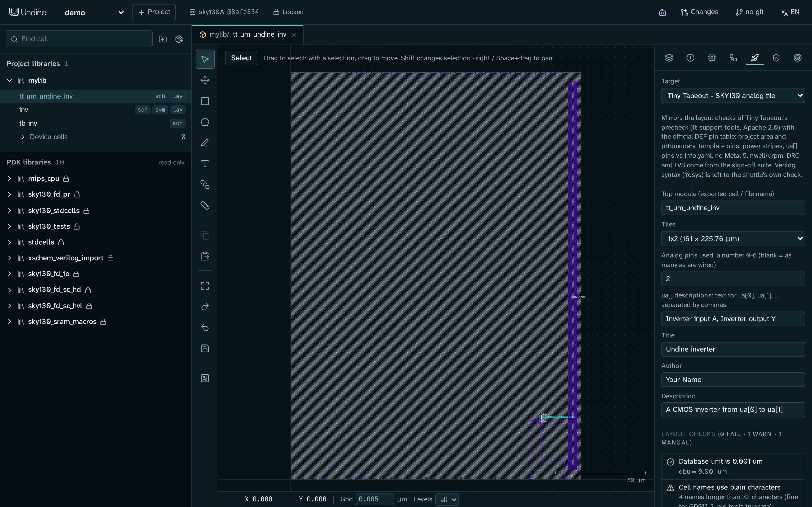
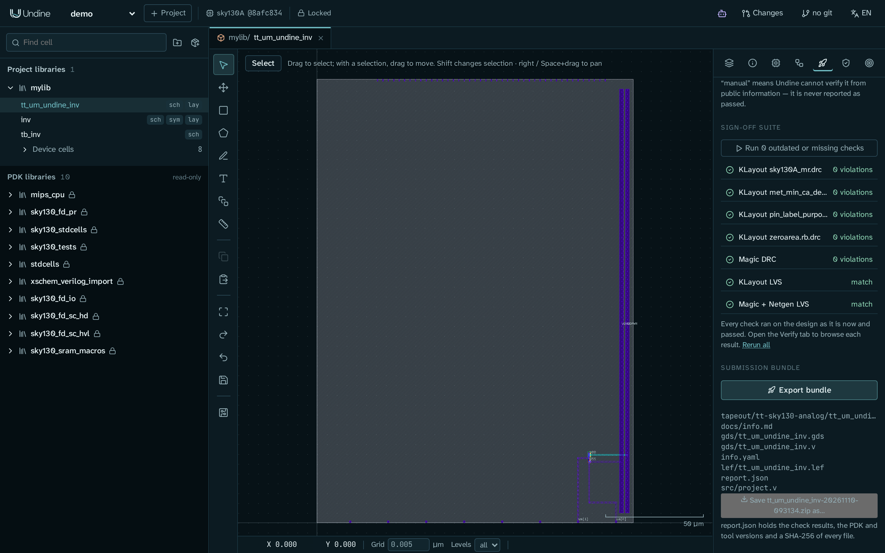

# Tiny Tapeout でアナログタイルをテープアウトする

このチュートリアルでは、完成したセルである CMOS インバータ `inv` を、[Tiny Tapeout](https://tinytapeout.com/) の SKY130
アナログタイルに仕上げます。Tiny Tapeout の事前チェックと同じようにタイルをチェックし、DRC と LVS のサインオフ一式を実行して、
Tiny Tapeout のリポジトリに入れるファイルのバンドルを出力します。

終わったときには、次のものがそろっています:

- 1x2 のタイル(161 × 225.76 µm)いっぱいの最上位セル `tt_um_undine_inv`。インバータはアナログピン `ua[0]` から `ua[1]` へ
  つながっています。
- クリーンなサインオフ。KLayout の DRC、Magic の DRC、KLayout の LVS、Magic + Netgen の LVS を、すべて今の設計に対して実行した結果です。
- `gds/`、`lef/`、`src/project.v`、`info.yaml`、`docs/info.md` と、何をチェックしたかを記録した `report.json` が入った zip。

タイルはスクリプトで作るので、このチュートリアルで扱うのは描画ではなく、テープアウトの手順です。最後の節では、バンドルを
Tiny Tapeout の側でどう使うかを説明します。

<a id="before-you-start"></a>
## 始める前に

次のものが必要です:

- sky130A の PDK と検証ツール(KLayout、Magic、Netgen)を含めてインストールした Undine。[インストール](../getting-started/install.ja.md)
  を参照してください。`./setup.sh check`(または `pixi run doctor`)で、足りないものがわかります。
- sky130A のプロジェクト。このチュートリアルでは、[最初のプロジェクト](../getting-started/first-project.ja.md) のプロジェクト `demo` と
  ライブラリ `mylib` を使います。

インバータはまだなくて構いません。手順 1 で作ります。[最初のセル: インバータ](inverter.md) で `inv` を自分で作った場合は、先に手順 1 の
警告を読んでください。

どの手順でも、Undine のサーバーが動いている必要があります:

```sh
pixi run serve                     # http://127.0.0.1:8700
```

ブラウザで <http://127.0.0.1:8700> を開き、左上のプロジェクトのメニューで `demo` を選びます。

!!! note "例のスクリプトはサーバーと同じマシンで実行します"
    `examples/` のスクリプトは、いくつかのファイルをプロジェクトのディレクトリ(`$UNDINE_ROOT`、既定は `~/undine-projects`)に
    直接書き込みます。そのため、サーバーが動いているマシンで、同じ `UNDINE_ROOT` で実行してください。`make_inverter.py` はファイルを
    書くだけです。`route_inverter.py` と `make_tt_inverter.py` はサーバーの HTTP API も呼びます。サーバーが `http://127.0.0.1:8700` に
    ない場合は、3 番目の引数にその URL を渡します。

<a id="1-build-the-inverter"></a>
## 1. インバータを作る

```sh
pixi run python examples/make_inverter.py demo mylib     # schematic inv and testbench tb_inv
pixi run python examples/route_inverter.py demo mylib    # layout of inv, routed, then LVS
```

`route_inverter.py` は最後に LVS の結果を出力します。`"match": true` と、4 つのピン `A`、`Y`、`VDD`、`VSS` が一致していることを
確認します:

```text
pins [('A', 'A', 'Match'), ('VDD', 'VDD', 'Match'), ('VSS', 'VSS', 'Match'), ('Y', 'Y', 'Match')]
```

!!! warning "`inv` がすでにあっても、両方のスクリプトを実行します"
    手順 2 のタイルのスクリプトは、インバータの原点から決まったオフセットにビアのスタックを置きます。それが合うのは、
    `route_inverter.py` が描くレイアウトそのものだけです。また `route_inverter.py` は、`make_inverter.py` が書く回路図
    (2 µm の pfet の `M1` が、1 µm の nfet の `M2` の上にある)を前提にしています。手で配線した `inv` では、タイルの `A`、`Y`、`VDD`、
    `VSS` の接続が外れ、タイルの LVS が失敗します。

    どちらのスクリプトも、既存の `inv` を **置き換えます**。`make_inverter.py` は回路図を上書きし、`route_inverter.py` はレイアウトの
    中身をすべて消します。自分のインバータを残したい場合は、`mylib` の代わりに別のライブラリ名(たとえば `ttlib`)を渡し、以下の
    すべてのコマンドと URL でその名前を使ってください。

!!! tip "LVS が一致しない場合"
    LVS が不一致を報告したり、ツールが見つからなかったりする場合は、[トラブルシューティング](../troubleshooting.md) を参照してください。
    特に *`pmap is missing`, or sky130 LVS fails at once* の項です。

<a id="2-build-the-tile"></a>
## 2. タイルを作る

```sh
pixi run python examples/make_tt_inverter.py demo mylib
```

成功したとき、スクリプトは何も出力しません。ブラウザでページを再読み込みすると、ライブラリ `mylib` にセル `tt_um_undine_inv` があり、
回路図(`sch`)とレイアウト(`lay`)を持っています。

スクリプトは、Tiny Tapeout のアナログタイルに必ず必要な 2 つのビューを作ります:

- **ラッパーの回路図。** `inv` を置き、タイルのピンにつなぎます。`ua[0]` を `A` に、`Y` を `ua[1]` に、`VDPWR` を `VDD` に、`VGND` を
  `VSS` にです。LVS は、タイルのレイアウトをこの回路図と比べます。
- **タイルのレイアウト。** 次のものを、この順に描きます:
    - ちょうど 1x2 のプロジェクト領域の `prBoundary`(235/4)の長方形
    - Tiny Tapeout のテンプレートのすべてのピン。met4(71/20)と met4 の pin 用途(71/16)に、それぞれ決まった位置で描きます。
      位置は、Undine に同梱している公式のピン表(`server/undine/data/tt_sky130A_analog.json`)によります
    - met4 の `VGND` と `VDPWR` の電源ストライプ。幅 2 µm で、下端の 5 µm 上から上端の 5 µm 下まで
    - アナログのパッドの近くに置いたインバータ
    - インバータからパッド `ua[0]`、`ua[1]` と `VGND` への met4 の配線とビアのスタック、および `VGND` の下を通って `VDPWR` の
      ビアのスタックへ向かう met3 の配線

スクリプトはブラウザと同じ HTTP API を使うので、自分のタイルを作るときの手本として読めます。テンプレートの値(ダイの寸法とピンの長方形)は
`undine.checks.tapeout.tt_template("1x2")` から取っています。

!!! tip "自分の設計の場合"
    自分のセルをテープアウトするには、同じ 2 つのビューを用意します。自分のセルを `ua[n]`、`VDPWR`、`VGND` につなぐ回路図を持つ最上位セルと、
    境界、テンプレートのピン、電源ストライプを持つレイアウトです。何が足りないかは、次の手順からのテープアウトのタブが教えてくれます。
    セルの名前は何でも構いません。パネルは `tt_um_<セル名>` を提案し、エクスポートで最上位セルの名前を変えます。自分で `tt_um_...` と
    名付けておけば、Undine の中とシャトルでの名前が同じになります。

<a id="3-open-the-tapeout-tab"></a>
## 3. テープアウトのタブを開く

1. 左のライブラリブラウザで、`mylib` の下の `tt_um_undine_inv` を見つけ、その横の `lay` をクリックします。レイアウトエディタが開き、
   タイル全体が表示されます。ハッチのかかったプロジェクト領域、上下の端に沿ったピンの列、右側の 2 本の電源ストライプです。
2. 右のサイドパネルで、ロケットのアイコンをクリックします。ツールチップは **テープアウト: シャトル検査と出力一式**
   (**Tapeout: shuttle checks and bundle**)です。このチュートリアルでは、これをテープアウトのタブと呼びます。

上部の **提出先**(**Target**)の一覧には、すでに **Tiny Tapeout - SKY130 アナログタイル**(**Tiny Tapeout - SKY130 analog tile**)が
表示されています。その下に、この対象が何をチェックするかの説明があり、続いてプロジェクト情報の欄、**レイアウト検証**(**Layout checks**)、
**サインオフ検証**(**Sign-off suite**)、**提出用ファイル一式**(**Submission bundle**)が並びます。



<a id="4-fill-in-the-project-information"></a>
## 4. プロジェクト情報を入力する

これらの欄は `info.yaml` になります。Tiny Tapeout がタイルを配置し、データシートを作るときに読むファイルです。パネルはこれらの値を
レイアウトとも照合するので、結果を見る前に入力しておきます。

| 欄 | 書き込み先 | このチュートリアルで入力する内容 |
|---|---|---|
| **トップモジュール**(**Top module**) | `top_module`、GDS の最上位セル名、ファイル名 | `tt_um_undine_inv`(入力済み) |
| **タイル数**(**Tiles**) | `tiles` | **1x2 (161 × 225.76 µm)** |
| **使用するアナログピン数**(**Analog pins used**) | `analog_pins` | `2` |
| **ua[] の説明**(**ua[] descriptions**) | `pinout: ua[0]`、`ua[1]`、... | `Inverter input A, Inverter output Y` |
| **タイトル**(**Title**) | `title` | `Undine inverter` |
| **作成者**(**Author**) | `author` | 自分の名前 |
| **説明**(**Description**) | `description`、および `docs/info.md` の *How it works* | `A CMOS inverter from ua[0] to ua[1]` |

パネルのラベルの中には、短いヒントが続くものがあります。たとえば **使用するアナログピン数: 0〜6(空欄なら配線済みの数)**
(**Analog pins used: a number 0-6 (blank = as many as are wired)**)です。ヒントは欄の入力のしかたを示しています。そのほかに、
次の点に注意します:

- **トップモジュール** は、`tt_um_` のあとに英字、数字、アンダースコアが続く形で、シャトルの中で一意である必要があります。
  たとえば GitHub のユーザー名を含めます。
- **使用するアナログピン数**: ピンは 1 本ごとに追加の費用がかかるので、必要な数だけにします。Tiny Tapeout は `ua[0]` から順に
  つなぐので、`ua[0]`、`ua[1]`、... の順に配線します。
- **ua[] の説明**: 使うピンにはすべて説明が必要です。説明にカンマは使えません。

欄から離れると(ほかの場所をクリックするか Tab キーを押すと)、レイアウトのチェックが再び実行されます。

!!! warning "欄の値は保存されません"
    パネルは、開いている間だけこれらの値を保持します。値は、バンドルをエクスポートするときに `info.yaml` に書き込まれます。
    ページを再読み込みしたり、別のセルを開いたりした場合は、もう一度入力してください。

<a id="5-read-the-layout-checks"></a>
## 5. レイアウトのチェックを読む

**レイアウト検証** の見出しには、`(不合格 0 · 警告 1 · 手動確認 1)` のような件数が表示されます(英語の UI では
`(0 fail · 1 warn · 1 manual)`)。各チェックにはアイコンがつきます:

- 緑のチェックマーク: **合格**(pass)
- 赤のバツ: **不合格**(fail)。不合格のチェックがひとつでもあると、エクスポートできません
- 黄色の三角: **警告**(warn)。内容を読んで判断します
- 灰色の疑問符: **手動確認**(manual)。公開されている情報だけでは Undine が検証できない項目で、合格とは報告しません

これらのチェックは、Tiny Tapeout の事前チェック(`tt-support-tools`)のレイアウトのチェックに倣っています。
[テープアウト](../guide/tapeout.ja.md#tiny-tapeout-sky130-analog) に一覧があります。

デモのタイルでは、次のように表示されるはずです:

- **セル名が使用可能な文字だけで構成される**(**Cell names use plain characters**): 警告。
  `4 names longer than 32 characters (fine for GDSII-2, old tools truncate)` と表示されます。これはトランジスタとビアの、自動生成された
  PCell の名前です。Undine が出力する GDSII ファイルでは名前が省略されずに残るので、そのままで構いません。
- **Verilog(src/project.v)の構文はシャトル側で Yosys により検証**(**Verilog syntax (src/project.v) is checked with Yosys by the
  shuttle**): 手動確認。Undine は Yosys を実行しません。バンドルにはポートのスタブが入っていて、Tiny Tapeout の事前チェックがそれを
  チェックします。
- そのほかのチェック: すべて合格。

アナログピンのチェックの働きを見るために、**ua[] の説明** の欄を空にして欄から離れてみます。チェック
**使用する ua[n] だけがメタルに接続され(analog_pins)、説明がある**(**ua[n] connect to metal exactly when used (analog_pins) and are
described**)が不合格になります。使っている 2 本のピンに、どちらも説明がなくなったからです:

```text
ua[0] has no description (pinout in info.yaml); ua[1] has no description (pinout in info.yaml)
```

次に **使用するアナログピン数** を `1` にします。`ua[1]` のメッセージが `ua[1] is connected to metal but analog_pins is 1` に変わります。
レイアウトは 2 つのパッドに配線しているので、`analog_pins` は 2 でなければなりません。先に進む前に、`2` と 2 つの説明を元に戻してください。

!!! tip "不合格のチェックを直す"
    各チェックの下の行に、何が問題なのかが書かれています。エディタでレイアウトを直すと、編集のたびにチェックが再び実行されます。
    描画と編集については [レイアウトエディタ](../guide/layout.ja.md) のガイドを参照してください。

<a id="6-run-the-sign-off-suite"></a>
## 6. サインオフ一式を実行する

レイアウトのチェックが見るのは、図形とピンです。デザインルールと接続は **サインオフ検証** でチェックします。PDK のすべての KLayout の
DRC デッキ、Magic の DRC、そして KLayout と Magic + Netgen による LVS です。この対象では、KLayout の LVS は、タイルがチップ上で
配線されるとおりに、フラットに、基板のネットを `VGND` として実行します。

=== "ブラウザ"

    パネルには 7 つのチェックが並び、一式が実行するまでは、どれも **未実行**(**not run**)と表示されます:

    - KLayout `sky130A_mr.drc`
    - KLayout `met_min_ca_density.lydrc`
    - KLayout `pin_label_purposes_overlapping_drawing.rb.drc`
    - KLayout `zeroarea.rb.drc`
    - Magic DRC
    - KLayout LVS
    - Magic + Netgen LVS

    **サインオフ検証** の下の **全項目を検証(KLayout、Magic、Netgen)**(**Run all checks (KLayout, Magic, Netgen)**)をクリックします。
    実行中は、各チェックに状態が表示されます。デモのタイルなら、一式は 1 分もかかりません。終わると、各 DRC のチェックに `違反 0 件`
    (`0 violations`)、各 LVS のチェックに `一致`(`match`)と表示され、パネルに
    **すべての検証を現在の設計に対して実行し、合格しました。**(**Every check ran on the design as it is now and passed.**)と表示されます。

=== "コマンドライン"

    パネルはサーバーの HTTP API を呼んでいます。同じ API を自分で呼ぶこともできます。一式を開始します:

    ```sh
    curl -s -X POST http://127.0.0.1:8700/api/p/demo/l/mylib/tapeout/tt_um_undine_inv/suite \
         -H 'content-type: application/json' -d '{"target": "tt-sky130-analog"}'
    ```

    応答には、チェックごとに開始したジョブが並びます。どれも `queued` でも `running` でもなくなるまで、状態を問い合わせます:

    ```sh
    curl -s 'http://127.0.0.1:8700/api/p/demo/l/mylib/signoff/tt_um_undine_inv?target=tt-sky130-analog'
    ```

    各項目には `state`、`passed`、`fresh`(今の設計に対して実行したかどうか)と、違反の数または LVS の判定が入った `summary` があります。
    `failed` や `cancelled` で終わったチェックは、終了していますが合格ではありません。すべての項目が `"passed": true` であることを確認します。
    サーバーのインターフェースは [HTTP API](../reference/api.ja.md) のリファレンスで説明しています。

結果を詳しく見るには(ルール、レイアウト上のマーカー、LVS の相互参照)、検証のタブを開きます。ロケットの隣にある盾のアイコンで、
ツールチップは **DRC / LVS** です。パネルの文中では「検証」タブ(Verify タブ)と呼んでいます。[検証](../guide/verification.ja.md) の
ガイドで説明しています。

あとで設計を変えると、影響を受けるチェックに **古い結果**(**outdated**)の印と、何が変わったかが表示され、ボタンは古いチェックと未実行の
チェックだけを実行するようになります。まだ有効な結果が残っている場合(回路図を変えると、古くなるのは 2 つの LVS のチェックだけです)、
ボタンは **古い結果・未実行の N 項目を検証**(**Run N outdated or missing checks**)になります。レイアウトを編集するとすべてのチェックが
古くなるので、ボタンは **全項目を検証(KLayout、Magic、Netgen)** になります。結果がまだ有効かどうかを Undine がどう判断するかは、
[テープアウト](../guide/tapeout.ja.md#tiny-tapeout-sky130-analog) と [古くなった結果](../guide/verification.ja.md#outdated-results) で
説明しています。

ツールが見つからないとチェックが報告した場合は、[トラブルシューティング](../troubleshooting.md) を参照してください。

<a id="7-export-the-submission-bundle"></a>
## 7. 提出用バンドルをエクスポートする

=== "ブラウザ"

    **提出用ファイル一式** の下の **ファイル一式を出力**(**Export bundle**)をクリックします。

    Undine はバンドルをプロジェクトに書き込み、zip としてダウンロードします。Chrome と Edge では、zip の保存先を尋ねるダイアログが
    出ます。ほかのブラウザでは、ダウンロードのフォルダに保存されます。そのあと、パネルにフォルダとそのファイルが一覧表示されます。
    zip をもう一度ダウンロードするには、ファイルの一覧の下にある
    **tt_um_undine_inv-<日付>-<時刻>.zip を名前を付けて保存…**(**Save tt_um_undine_inv-<date>-<time>.zip as…**)をクリックします。

    

=== "コマンドライン"

    対象とプロジェクト情報をファイル `export.json` に書きます:

    ```json
    {
      "target": "tt-sky130-analog",
      "params": {
        "top_module": "tt_um_undine_inv", "tiles": "1x2", "analog_pins": "2",
        "ua": "Inverter input A, Inverter output Y",
        "title": "Undine inverter", "author": "Your Name",
        "description": "A CMOS inverter from ua[0] to ua[1]"
      }
    }
    ```

    そしてエクスポートします:

    ```sh
    curl -s -X POST http://127.0.0.1:8700/api/p/demo/l/mylib/tapeout/tt_um_undine_inv/export \
         -H 'content-type: application/json' -d @export.json
    ```

    応答には、フォルダ(`dir`)、zip の名前(`zip`)、ファイルが入っています。不合格のレイアウトのチェックがあると、サーバーは
    `not exporting: failing checks: ...` と不合格のチェックを返して拒否します。[HTTP API](../reference/api.ja.md) のリファレンスを
    参照してください。

フォルダはプロジェクトのディレクトリの `<project>/tapeout/tt-sky130-analog/tt_um_undine_inv-<date>-<time>/` で、zip はその隣にあります。
中身は次のとおりです:

| ファイル | 内容 |
|---|---|
| `gds/tt_um_undine_inv.gds` | レイアウト。最上位セルの名前は **トップモジュール** の値になります |
| `gds/tt_um_undine_inv.v` | ポートのスタブのコピー。事前チェックが探す場所である GDS の隣に置きます |
| `lef/tt_um_undine_inv.lef` | ピンだけの抽象ビュー。テンプレートのすべてのピンと電源ストライプ |
| `src/project.v` | モジュールの Verilog のポートのスタブ(ポートだけで、回路はレイアウトです) |
| `info.yaml` | 手順 4 のプロジェクト情報。Tiny Tapeout の形式(`yaml_version: 6`)です |
| `docs/info.md` | 書き足して仕上げるデータシートのページ: *How it works*、*How to test*、*External hardware* |
| `report.json` | エクスポートの記録。PDK とツールのバージョン、チェックの結果、サインオフの状態、ファイルのハッシュ |

`report.json` の詳細は [テープアウト](../guide/tapeout.ja.md#tiny-tapeout-sky130-analog) にあります。

!!! warning "エクスポートはサインオフ一式を待ちません"
    **ファイル一式を出力** は、不合格のレイアウトのチェックがある間は無効になります(**先に不合格の項目を修正してください。**、
    **Fix the failing checks first.**)。しかし、サインオフ一式の実行は求めません。提出する前に、パネルに
    **すべての検証を現在の設計に対して実行し、合格しました。** と表示されていることを確認してください。`report.json` の `signoff` を
    読んで確かめることもできます。すべての項目が `"passed": true` かつ `"fresh": true` であるはずです。

<a id="8-submit-on-tiny-tapeout"></a>
## 8. Tiny Tapeout に提出する

Undine の役目はバンドルまでです。残りは GitHub と Tiny Tapeout のウェブサイトで行い、判定するのは Tiny Tapeout 自身の事前チェックです。
以下の手順は、Tiny Tapeout の [アナログの仕様のページ](https://tinytapeout.com/specs/analog/) に沿っています。シャトル、テンプレート、
価格は変わることがあるので、先にそのページを読んでください。

1. **リポジトリを作ります。** SKY130 のアナログ用テンプレート
   [TinyTapeout/ttsky-analog-template](https://github.com/TinyTapeout/ttsky-analog-template) を開き、*Use this template* を選びます。
   できた新しいリポジトリをクローンします。
2. **バンドルをリポジトリにコピーします。** バンドルを展開し、そのファイルでテンプレートのファイルを上書きします:

    ```bash
    # in the folder that holds your repository
    unzip tt_um_undine_inv-<date>-<time>.zip
    cd my-tt-project                               # your repository
    cp -r ../tt_um_undine_inv-<date>-<time>/{gds,lef,src,docs,info.yaml} .
    ```

    これで、テンプレートの `info.yaml`、`src/project.v`、`docs/info.md` が置き換わります。コミットする前に、`info.yaml` をテンプレートの
    版と見比べてください。テンプレートのコメントが各キーを説明しており、生成したファイルにも、最新のテンプレートと照らし合わせるよう
    書いてあります。`report.json` はリポジトリに入れないでおくか、自分の記録として取っておきます。
3. **データシートを仕上げます。** `docs/info.md` を編集し、回路の動作、テストのしかた(どのピンを、どのレベルで)、必要な外部の
   ハードウェアを書きます。
4. **リポジトリで GitHub Actions と Pages を有効にし**
   ([Tiny Tapeout の FAQ](https://tinytapeout.com/faq/#my-github-action-is-failing-on-the-pages-part) を参照)、push します。
   テンプレートのワークフローが、GDS と LEF をパッケージし(`gds`)、それに対して Tiny Tapeout の事前チェックを実行し(`precheck`)、
   GDS のビューアーを公開し(`viewer`)、データシートを作ります(`docs`)。事前チェックは、Undine が倣っているチェックに加えて、
   Undine が手動確認として報告するもの(`src/project.v` に対する Yosys など)も実行します。
5. **提出します。** Actions が通ったら、[app.tinytapeout.com](https://app.tinytapeout.com/) でリポジトリを提出します。
   アナログのプロジェクトは、タイルとアナログピン 1 本ごとに費用がかかります。現在の価格はアナログの仕様のページにあります。

!!! warning "実際の設計を提出する前に"
    Undine のチェックが扱うのは、事前チェックのレイアウトのルールです。Tiny Tapeout のアナログの仕様は、それ以上のことを求めており、
    それはどの事前チェックにも見えません:

    - **使わないデジタル出力は `VGND` につなぎます。** `uo_out`、`uio_out`、`uio_oe` を浮かせたままにしないでください。デモのタイルは
      流れを示すだけなので、これらをつないでいません。自分のタイルを提出する前に配線してください。
    - **アナログ経路の制限**(ピンごとの直列抵抗、容量、電流)をアナログの仕様のページのとおりに守ります。
    - **3.3 V のテンプレートは、`VAPWR` が必要な場合だけ使います。** Undine のタイルは 1.8 V のテンプレートを使い、
      `uses_vapwr: false` と書きます。

<a id="other-shuttles"></a>
## ほかのシャトル

テープアウトのタブには、**提出先** の一覧にあるほかの対象についても、同じレイアウトのチェック、サインオフ一式、提出用バンドルがあります:

- **wafer.space - GF180MCU ダイ**(**wafer.space - GF180MCU die**): gf180mcuD のダイ全体。
  [wafer.space - GF180MCU die](../guide/tapeout.ja.md#waferspace-gf180mcu-die) を参照してください。
- **ChipFoundry - Caravel ユーザープロジェクト(SKY130)**(**ChipFoundry - Caravel user project (SKY130)**): Caravel のデジタルまたは
  アナログのユーザープロジェクト用ラッパー。
  [ChipFoundry - Caravel user project](../guide/tapeout.ja.md#chipfoundry-caravel-user-project-sky130) を参照してください。
- **基本的なレイアウト検証(提出先共通)**(**Layout hygiene only (any shuttle)**): どのシャトルにも必要な基本のチェック。
  [Layout hygiene only](../guide/tapeout.ja.md#layout-hygiene-only-any-shuttle) を参照してください。

<a id="what-you-learned"></a>
## 学んだこと

- Tiny Tapeout のアナログタイルは、ラッパーの回路図と、プロジェクトの境界、met4 のテンプレートのピン、電源ストライプを持つレイアウトからなる、
  最上位セル `tt_um_...` です。`examples/make_tt_inverter.py` は HTTP API を通してそれを作ります。
- テープアウトのタブは、レイアウトを事前チェックのレイアウトのルールに照らしてチェックし、プロジェクト情報を配線に照らしてチェックします。
- **全項目を検証** は KLayout、Magic、Netgen で DRC と LVS を実行し、その後は古くなったものだけを実行します。
- **ファイル一式を出力** は、Tiny Tapeout のリポジトリに必要なファイルを、PDK、ツール、チェック、各ファイルのハッシュを記録した
  `report.json` とともに書き出します。

<a id="next-steps"></a>
## 次のステップ

- [テープアウト](../guide/tapeout.ja.md): すべての対象のすべてのチェックと、各バンドルの中身。
- [検証](../guide/verification.ja.md): DRC と LVS の結果、Magic と Netgen、古くなった結果。
- [レイアウトエディタ](../guide/layout.ja.md): 自分のタイルを描き、編集する。
- [変更セット (changeset)](../guide/changesets.ja.md): レイアウトの修正を AI エージェントに提案させ、テープアウトの前にレビューする。
- [HTTP API](../reference/api.ja.md): パネルと例のスクリプトが使う、サーバーのインターフェース。
- [データ配置と操作ログ](../reference/data.ja.md): バンドルとジョブの結果がプロジェクトのどこにあるか。
- [トラブルシューティング](../troubleshooting.md): ツールが見つからない場合、PDK の問題、LVS の失敗。
