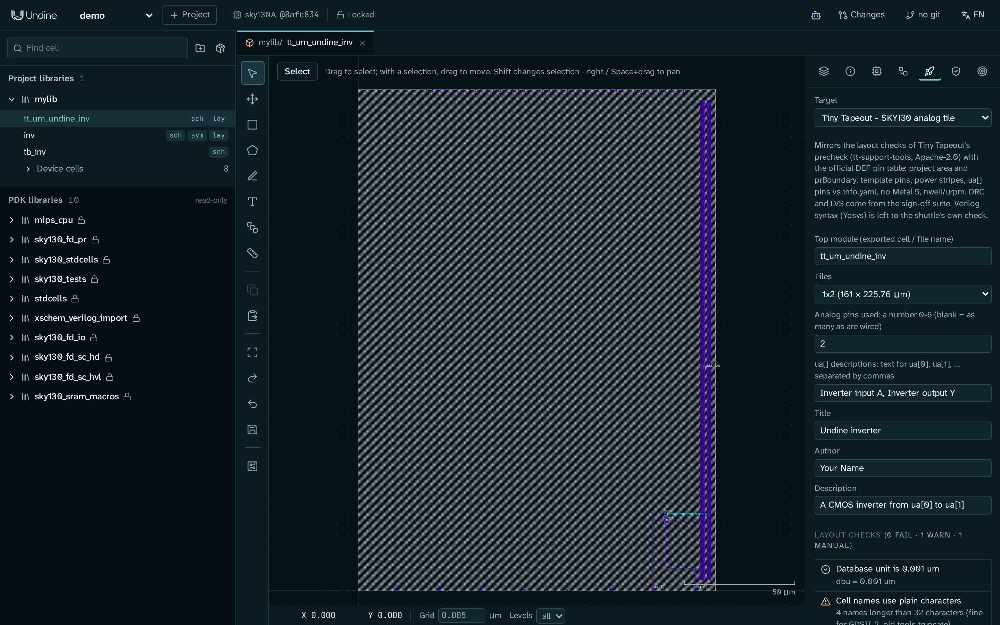
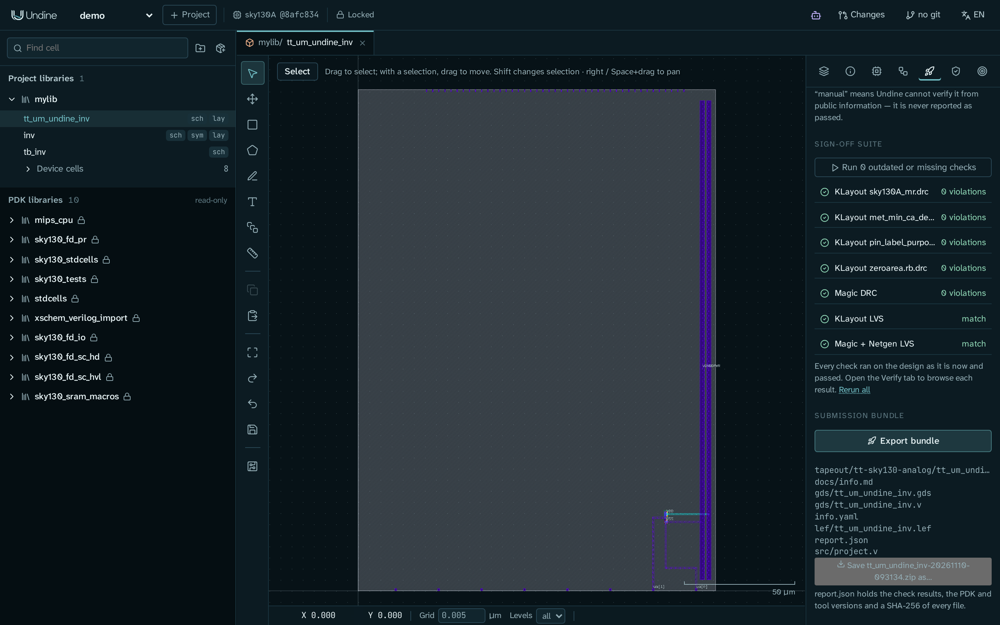

# Tape out an analog tile on Tiny Tapeout

In this tutorial you take a finished cell, the CMOS inverter `inv`, and turn it into a
[Tiny Tapeout](https://tinytapeout.com/) SKY130 analog tile. You check the tile the way Tiny Tapeout's precheck does,
run the full DRC and LVS sign-off suite, and export the bundle of files that goes into your Tiny Tapeout repository.

When you finish, you have:

- a top cell `tt_um_undine_inv` that fills a 1x2 tile (161 × 225.76 µm), with the inverter wired from the analog pin
  `ua[0]` to `ua[1]`;
- a clean sign-off: KLayout DRC, Magic DRC, KLayout LVS and Magic + Netgen LVS, all on the design as it is now;
- a zip with `gds/`, `lef/`, `src/project.v`, `info.yaml`, `docs/info.md` and a `report.json` that records what was
  checked.

The tile is built by a script, so this tutorial is about the tapeout steps, not about drawing. The last sections show
what to do with the bundle on the Tiny Tapeout side.

## Before you start

You need:

- Undine installed, with the sky130A PDK and the verification tools (KLayout, Magic, Netgen). See
  [Install](../getting-started/install.md); `./setup.sh check` (or `pixi run doctor`) tells you what is missing.
- A project on sky130A. This tutorial uses the project `demo` and the library `mylib` from
  [First project](../getting-started/first-project.md).

You do not need the inverter yet: step 1 builds it. If you made `inv` yourself in
[Your first cell: an inverter](inverter.md), read the warning in step 1 first.

The Undine server must be running for every step:

```sh
pixi run serve                     # http://127.0.0.1:8700
```

Open <http://127.0.0.1:8700> in your browser and choose `demo` in the project menu at the top left.

!!! note "Run the example scripts next to the server"
    The scripts in `examples/` write some files straight into the project directory (`$UNDINE_ROOT`, default
    `~/undine-projects`), so run them on the machine where the server runs, with the same `UNDINE_ROOT`.
    `make_inverter.py` only writes files. `route_inverter.py` and `make_tt_inverter.py` also call the server's HTTP
    API: if the server is not on `http://127.0.0.1:8700`, pass its URL as their third argument.

## 1. Build the inverter

```sh
pixi run python examples/make_inverter.py demo mylib     # schematic inv and testbench tb_inv
pixi run python examples/route_inverter.py demo mylib    # layout of inv, routed, then LVS
```

`route_inverter.py` ends with the LVS result. You should see `"match": true` and the four pins `A`, `Y`, `VDD` and
`VSS` matched:

```text
pins [('A', 'A', 'Match'), ('VDD', 'VDD', 'Match'), ('VSS', 'VSS', 'Match'), ('Y', 'Y', 'Match')]
```

!!! warning "Run both scripts, even if you already have an `inv`"
    The tile script in step 2 places its via stacks at fixed offsets from the inverter's origin. They land only on the
    exact layout that `route_inverter.py` draws, and `route_inverter.py` expects the schematic that `make_inverter.py`
    writes (`M1`, a 2 µm pfet, above `M2`, a 1 µm nfet). On an `inv` you routed by hand, the tile's `A`, `Y`, `VDD`
    and `VSS` connections miss, and LVS of the tile fails.

    Both scripts **replace** an existing `inv`: `make_inverter.py` overwrites its schematic and `route_inverter.py`
    deletes everything in its layout. To keep your own inverter, pass another library name instead of `mylib`, for
    example `ttlib`, and use that name in every command and URL below.

!!! tip "If LVS does not match"
    If LVS reports a mismatch or a tool is missing, see [Troubleshooting](../troubleshooting.md), in particular
    *`pmap is missing`, or sky130 LVS fails at once*.

## 2. Build the tile

```sh
pixi run python examples/make_tt_inverter.py demo mylib
```

The script prints nothing when it succeeds. Reload the page in your browser: the library `mylib` now has a cell
`tt_um_undine_inv` with a schematic (`sch`) and a layout (`lay`).

The script makes the two views that every Tiny Tapeout analog tile needs:

- **The wrapper schematic.** It places `inv` and connects it to the tile's pins: `ua[0]` to `A`, `Y` to `ua[1]`,
  `VDPWR` to `VDD` and `VGND` to `VSS`. LVS compares the tile's layout with this schematic.
- **The tile layout.** It draws, in this order:
    - a `prBoundary` (235/4) rectangle of exactly the 1x2 project area;
    - every pin of Tiny Tapeout's template on met4 (71/20) and on the met4 pin purpose (71/16), at its fixed position.
      The positions come from the official pin table that Undine ships
      (`server/undine/data/tt_sky130A_analog.json`);
    - the `VGND` and `VDPWR` power stripes on met4, 2 µm wide, from 5 µm above the bottom edge to 5 µm below the top;
    - the inverter, placed near the analog pads;
    - met4 routes and via stacks from the inverter to the pads `ua[0]` and `ua[1]` and to `VGND`, and a met3 route
      under `VGND` to a via stack on `VDPWR`.

The script uses the same HTTP API as the browser, so you can read it as a recipe for your own tile. Its template
values (die size and pin rectangles) come from `undine.checks.tapeout.tt_template("1x2")`.

!!! tip "Your own design"
    To tape out your own cell, give it the same two views: a top cell whose schematic connects your cell to `ua[n]`,
    `VDPWR` and `VGND`, and a layout with the boundary, the template pins and the power stripes. The Tapeout tab in the
    next steps tells you what is still missing. The cell can have any name: the panel proposes `tt_um_<cell name>`
    and the export renames the top cell. Naming it `tt_um_...` yourself keeps the names in Undine and on the shuttle
    the same.

## 3. Open the Tapeout tab

1. In the library browser on the left, find `tt_um_undine_inv` under `mylib` and click `lay` next to it. The layout
   editor opens with the whole tile: the hatched project area, the pin row along the top and bottom edges, and the two
   power stripes on the right.
2. In the side panel on the right, click the rocket icon. Its tooltip is **Tapeout: shuttle checks and bundle**. This
   tutorial calls it the Tapeout tab.

The **Target** list at the top already shows **Tiny Tapeout - SKY130 analog tile**. Under it, a note says what the
target checks, then come the project information fields, the **Layout checks**, the **Sign-off suite** and the
**Submission bundle**.



## 4. Fill in the project information

The fields become your `info.yaml`, the file Tiny Tapeout reads to place your tile and to write the datasheet.
The panel also checks them against the layout, so fill them in before you look at the results.

| Field | Goes to | Enter for this tutorial |
|---|---|---|
| **Top module** | `top_module`, the top cell name in the GDS, and the file names | `tt_um_undine_inv` (filled in for you) |
| **Tiles** | `tiles` | **1x2 (161 × 225.76 µm)** |
| **Analog pins used** | `analog_pins` | `2` |
| **ua[] descriptions** | `pinout: ua[0]`, `ua[1]`, ... | `Inverter input A, Inverter output Y` |
| **Title** | `title` | `Undine inverter` |
| **Author** | `author` | your name |
| **Description** | `description`, and *How it works* in `docs/info.md` | `A CMOS inverter from ua[0] to ua[1]` |

Some labels in the panel go on with a short hint, for example **Analog pins used: a number 0-6 (blank = as many as
are wired)**. The hints say how to fill a field in. In addition:

- **Top module** must match `tt_um_` followed by letters, digits or underscores, and must be unique on the shuttle.
  Include your GitHub user name, for example.
- **Analog pins used**: use as few as you need, because each one costs extra. Tiny Tapeout connects them in order
  from `ua[0]`, so wire `ua[0]`, `ua[1]`, ... in that order.
- **ua[] descriptions**: every used pin needs one, and a description cannot contain a comma.

The layout checks run again when you leave a field (click elsewhere or press Tab).

!!! warning "The fields are not saved"
    The panel keeps these values only while it is open. They are written into `info.yaml` when you export the bundle.
    If you reload the page or open another cell, enter them again.

## 5. Read the layout checks

The **Layout checks** heading shows a count, for example `(0 fail · 1 warn · 1 manual)`. Each check has an icon:

- a green tick: **pass**;
- a red cross: **fail**. You cannot export while any check fails;
- an amber triangle: **warn**. Read it, then decide;
- a grey question mark: **manual**. Undine cannot verify it from public information, and never reports it as passed.

These checks mirror the layout checks of Tiny Tapeout's precheck (`tt-support-tools`).
[Tapeout](../guide/tapeout.md#tiny-tapeout-sky130-analog) lists them all.

For the demo tile you should see:

- **Cell names use plain characters**: warn, `4 names longer than 32 characters (fine for GDSII-2, old tools truncate)`.
  These are the generated PCell names of the transistors and vias. GDSII files from Undine keep them in full, so you
  can leave them.
- **Verilog syntax (src/project.v) is checked with Yosys by the shuttle**: manual. Undine does not run Yosys; the bundle
  holds a port stub that Tiny Tapeout's precheck checks.
- Every other check: pass.

To see how the analog pin check works, clear the **ua[] descriptions** field and leave it. The check
**ua[n] connect to metal exactly when used (analog_pins) and are described** fails, because both used pins now lack a
description:

```text
ua[0] has no description (pinout in info.yaml); ua[1] has no description (pinout in info.yaml)
```

Now set **Analog pins used** to `1`. The `ua[1]` message changes to `ua[1] is connected to metal but analog_pins is 1`:
the layout wires two pads, so `analog_pins` must be 2. Put back `2` and the two descriptions before you go on.

!!! tip "Fix a failing check"
    The line under each check says what is wrong. Fix the layout in the editor; the checks run again after each edit.
    The [Layout editor](../guide/layout.md) guide covers drawing and editing.

## 6. Run the sign-off suite

The layout checks look at geometry and pins. Design rules and connectivity come from the **Sign-off suite**: every
KLayout DRC deck of the PDK, Magic DRC, and LVS with KLayout and with Magic + Netgen. For this target, KLayout LVS
runs flat with `VGND` as the substrate net, as the tile is wired on the chip.

=== "Browser"

    The panel lists seven checks, each marked **not run** until the suite has run it:

    - KLayout `sky130A_mr.drc`
    - KLayout `met_min_ca_density.lydrc`
    - KLayout `pin_label_purposes_overlapping_drawing.rb.drc`
    - KLayout `zeroarea.rb.drc`
    - Magic DRC
    - KLayout LVS
    - Magic + Netgen LVS

    Under **Sign-off suite**, click **Run all checks (KLayout, Magic, Netgen)**. Each check shows its state while it
    runs. For the demo tile the suite takes well under a minute. When it is done, each DRC check shows
    `0 violations`, each LVS check shows `match`, and the panel says **Every check ran on the design as it is now and
    passed.**

=== "Command line"

    The panel calls the server's HTTP API, and so can you. Start the suite:

    ```sh
    curl -s -X POST http://127.0.0.1:8700/api/p/demo/l/mylib/tapeout/tt_um_undine_inv/suite \
         -H 'content-type: application/json' -d '{"target": "tt-sky130-analog"}'
    ```

    The answer lists the job started for each check. Ask for their state until none is `queued` or `running`:

    ```sh
    curl -s 'http://127.0.0.1:8700/api/p/demo/l/mylib/signoff/tt_um_undine_inv?target=tt-sky130-analog'
    ```

    Each entry has `state`, `passed`, `fresh` (it ran on the design as it is now) and a `summary` with the violation
    count or the LVS verdict. A check that ended `failed` or `cancelled` is finished but did not pass. Check that every
    entry has `"passed": true`. The [HTTP API](../reference/api.md) reference describes the server's interface.

To look at a result in detail (rules, markers in the layout, LVS cross-references), open the Verify tab: the shield
icon next to the rocket, with the tooltip **DRC / LVS**. The panel's own text calls it the Verify tab. The
[Verification](../guide/verification.md) guide explains it.

When you change the design later, the checks it affects are marked **outdated**, with what changed, and the button
runs only the outdated or missing checks. It reads **Run N outdated or missing checks** when some results are still
current (a schematic change outdates only the two LVS checks), and **Run all checks (KLayout, Magic, Netgen)** after a
layout edit, which outdates every check. [Tapeout](../guide/tapeout.md#tiny-tapeout-sky130-analog) and
[Outdated results](../guide/verification.md#outdated-results) explain how Undine decides that a result is current.

If a check reports a missing tool, see [Troubleshooting](../troubleshooting.md).

## 7. Export the submission bundle

=== "Browser"

    Under **Submission bundle**, click **Export bundle**.

    Undine writes the bundle into the project and downloads it as a zip. In Chrome and Edge a dialog asks where to
    save the zip; other browsers save it to your downloads folder. The panel then lists the folder and its files. To
    download the zip again, click **Save tt_um_undine_inv-<date>-<time>.zip as…** under the file list.

    

=== "Command line"

    Put the target and the project information in a file, `export.json`:

    ```json
    {
      "target": "tt-sky130-analog",
      "params": {
        "top_module": "tt_um_undine_inv", "tiles": "1x2", "analog_pins": "2",
        "ua": "Inverter input A, Inverter output Y",
        "title": "Undine inverter", "author": "Your Name",
        "description": "A CMOS inverter from ua[0] to ua[1]"
      }
    }
    ```

    Then export:

    ```sh
    curl -s -X POST http://127.0.0.1:8700/api/p/demo/l/mylib/tapeout/tt_um_undine_inv/export \
         -H 'content-type: application/json' -d @export.json
    ```

    The answer gives the folder (`dir`), the zip name (`zip`) and the files. If a layout check fails, the server
    refuses with `not exporting: failing checks: ...` and the checks that fail. See the
    [HTTP API](../reference/api.md) reference.

The folder is `<project>/tapeout/tt-sky130-analog/tt_um_undine_inv-<date>-<time>/` in the project directory, and the
zip is next to it. It holds:

| File | What it is |
|---|---|
| `gds/tt_um_undine_inv.gds` | The layout, with the top cell named after **Top module** |
| `gds/tt_um_undine_inv.v` | A copy of the port stub, next to the GDS, where the precheck looks for it |
| `lef/tt_um_undine_inv.lef` | A pin-only abstract: all template pins and the power stripes |
| `src/project.v` | The Verilog port stub of the module (ports only; the circuit is the layout) |
| `info.yaml` | The project information from step 4, in Tiny Tapeout's format (`yaml_version: 6`) |
| `docs/info.md` | A datasheet page to complete: *How it works*, *How to test*, *External hardware* |
| `report.json` | The record of the export: PDK and tool versions, check results, sign-off status, file hashes |

[Tapeout](../guide/tapeout.md#tiny-tapeout-sky130-analog) describes `report.json` in full.

!!! warning "Export does not wait for the sign-off suite"
    **Export bundle** is disabled while a layout check fails (**Fix the failing checks first.**), but it does not
    require the sign-off suite. Before you submit, check that the panel says **Every check ran on the design as it is
    now and passed.** You can also read `signoff` in `report.json`: every entry should have `"passed": true` and
    `"fresh": true`.

## 8. Submit on Tiny Tapeout

Undine stops at the bundle. The rest happens on GitHub and on the Tiny Tapeout website, and Tiny Tapeout's own
precheck is the judge. The steps below follow Tiny Tapeout's
[analog specs page](https://tinytapeout.com/specs/analog/); read it first, because shuttles, templates and prices change.

1. **Create your repository.** Open the analog template for SKY130,
   [TinyTapeout/ttsky-analog-template](https://github.com/TinyTapeout/ttsky-analog-template), and choose
   *Use this template*. Clone your new repository.
2. **Copy the bundle into it.** Unzip the bundle and copy its files over the template's:

    ```bash
    # in the folder that holds your repository
    unzip tt_um_undine_inv-<date>-<time>.zip
    cd my-tt-project                               # your repository
    cp -r ../tt_um_undine_inv-<date>-<time>/{gds,lef,src,docs,info.yaml} .
    ```

    This replaces the template's `info.yaml`, `src/project.v` and `docs/info.md`. Compare `info.yaml` with the
    template's version before you commit: the template's comments explain each key, and the generated file asks you to
    check it against the current template. Leave `report.json` out of the repository, or keep it for your own records.
3. **Complete the datasheet.** Edit `docs/info.md`: say how the circuit works, how to test it (which pins, which
   levels) and what external hardware it needs.
4. **Turn on GitHub Actions and Pages** for the repository (see
   [Tiny Tapeout's FAQ](https://tinytapeout.com/faq/#my-github-action-is-failing-on-the-pages-part)), then push. The
   template's workflows package the GDS and LEF (`gds`), run Tiny Tapeout's precheck on them (`precheck`), publish a
   GDS viewer (`viewer`) and build the datasheet (`docs`). The precheck runs the checks that Undine mirrors, plus the
   ones it reports as manual, such as Yosys on `src/project.v`.
5. **Submit.** When the actions pass, submit the repository at [app.tinytapeout.com](https://app.tinytapeout.com/).
   Analog projects pay for their tiles and for each analog pin; the analog specs page gives the current prices.

!!! warning "Before you submit a real design"
    Undine's checks cover the layout rules of the precheck. Tiny Tapeout's analog specs ask for more, which no
    precheck can see:

    - **Tie the unused digital outputs to `VGND`.** Do not leave `uo_out`, `uio_out` or `uio_oe` floating. The demo
      tile leaves them unconnected, because it only shows the flow: wire them before you submit your own tile.
    - **Respect the analog path limits** (series resistance, capacitance and current per pin) given on the analog
      specs page.
    - **Use the 3.3 V template only if you need `VAPWR`.** Undine's tile uses the 1.8 V template and writes
      `uses_vapwr: false`.

## Other shuttles

The Tapeout tab has the same layout checks, sign-off suite and submission bundle for the other targets in the
**Target** list:

- **wafer.space - GF180MCU die**: a whole die on gf180mcuD. See
  [wafer.space - GF180MCU die](../guide/tapeout.md#waferspace-gf180mcu-die).
- **ChipFoundry - Caravel user project (SKY130)**: Caravel's digital or analog user project wrapper. See
  [ChipFoundry - Caravel user project](../guide/tapeout.md#chipfoundry-caravel-user-project-sky130).
- **Layout hygiene only (any shuttle)**: the basic checks every shuttle needs. See
  [Layout hygiene only](../guide/tapeout.md#layout-hygiene-only-any-shuttle).

## What you learned

- A Tiny Tapeout analog tile is a top cell `tt_um_...` with a wrapper schematic and a layout that has the project
  boundary, the template pins on met4 and the power stripes. `examples/make_tt_inverter.py` builds one through the
  HTTP API.
- The Tapeout tab checks the layout against the precheck's layout rules and checks the project information against
  the wiring.
- **Run all checks** runs DRC and LVS with KLayout, Magic and Netgen, and later runs only what is outdated.
- **Export bundle** writes the files your Tiny Tapeout repository needs, with a `report.json` that records the PDK,
  the tools, the checks and a hash of every file.

## Next steps

- [Tapeout](../guide/tapeout.md): every check of every target, and what each bundle holds.
- [Verification](../guide/verification.md): DRC and LVS results, Magic and Netgen, and outdated results.
- [Layout editor](../guide/layout.md): draw and edit your own tile.
- [Changesets](../guide/changesets.md): let an AI agent propose the layout fixes, and review them before you tape out.
- [HTTP API](../reference/api.md): the server's interface that the panel and the example scripts use.
- [Data layout and operation log](../reference/data.md): where the bundles and job results live in the project.
- [Troubleshooting](../troubleshooting.md): missing tools, PDK problems and LVS failures.
